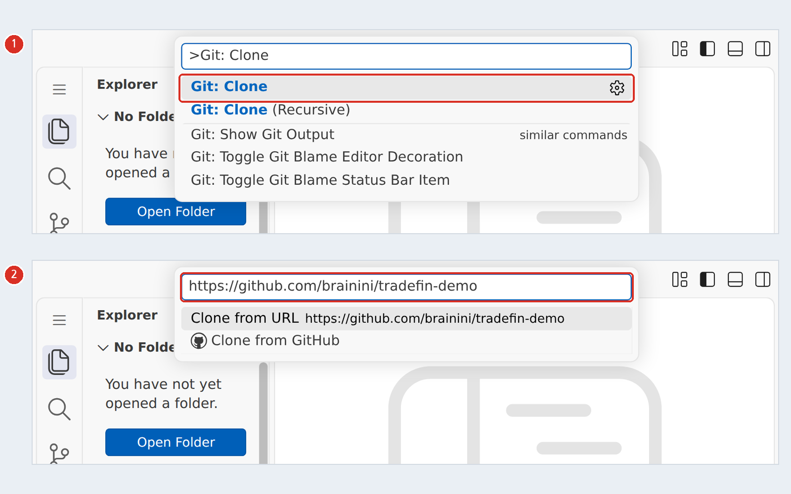
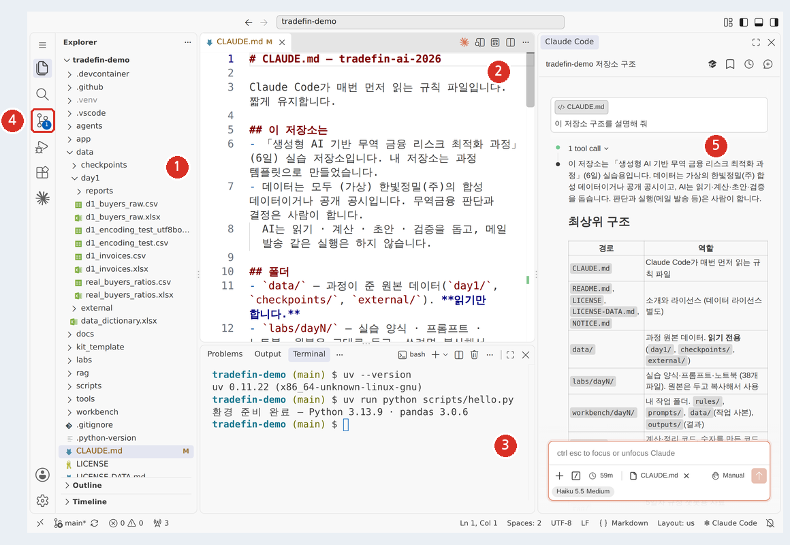
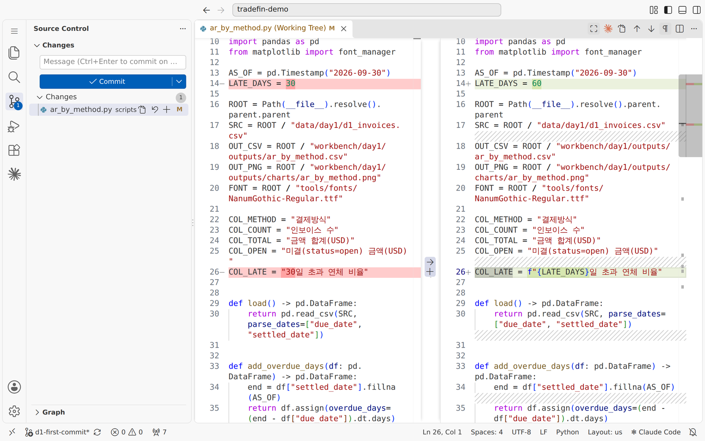
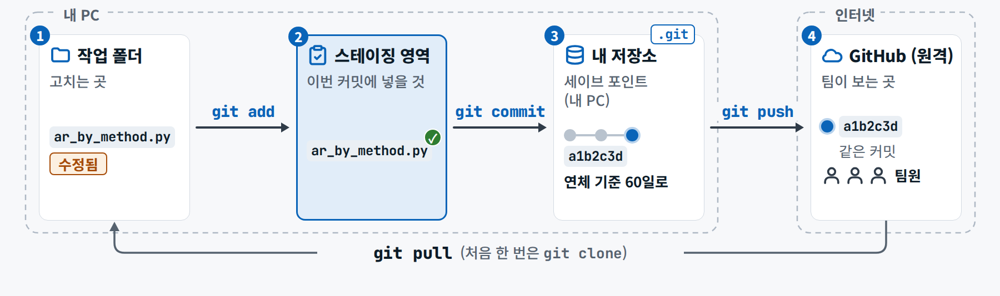
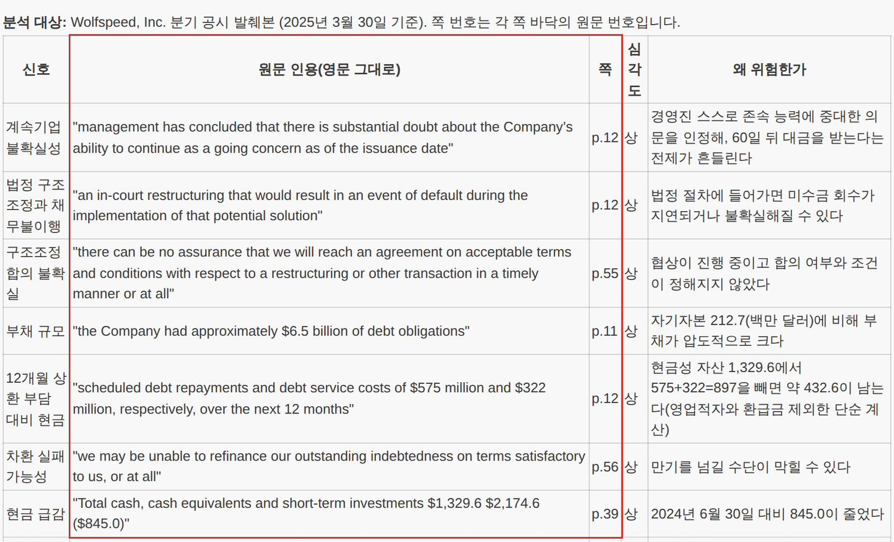
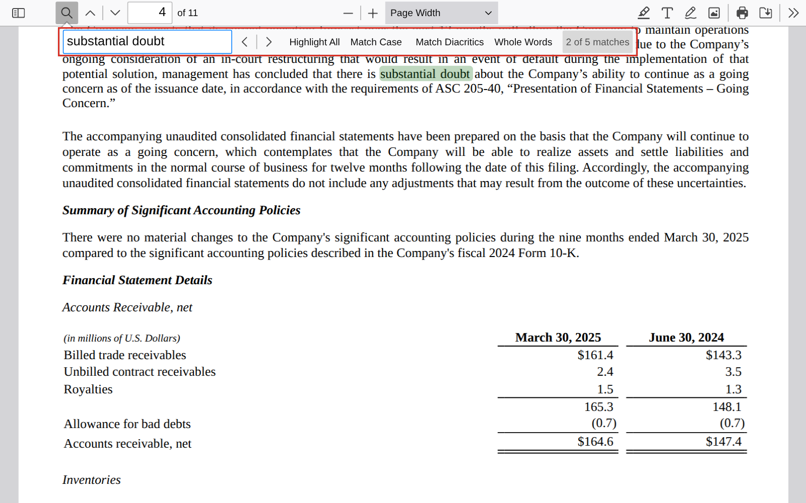
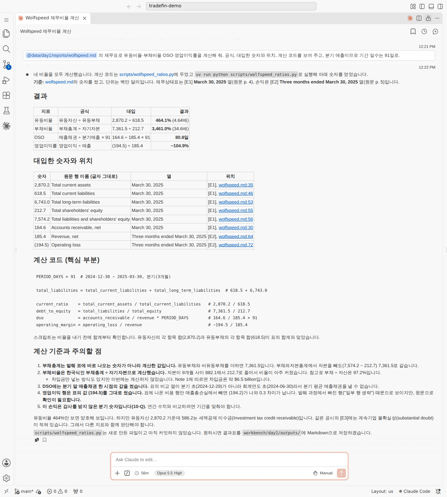
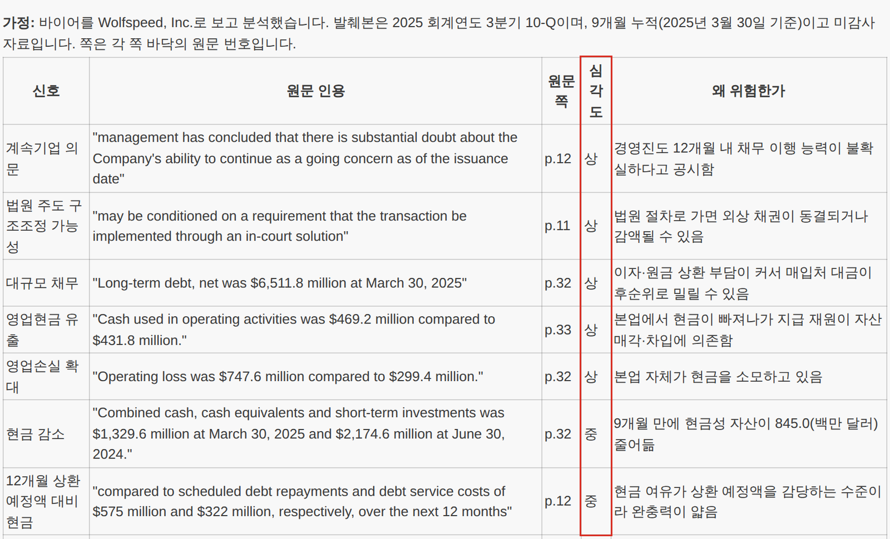
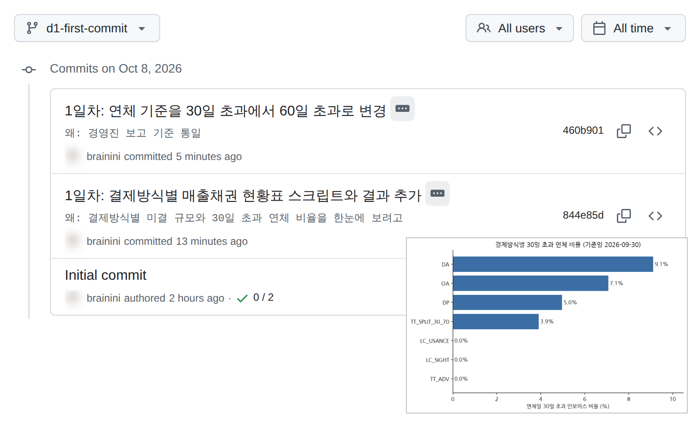

<div class="tf-lab" markdown>
<span class="tf-eyebrow">1일차 · 실습 A · 4–5교시 · 13:00–14:50 <span class="tf-daystate" data-tf-daystate="1"></span></span>

# 실습 A — 내 작업 환경 · 첫 커밋 · AI로 보고서 읽고 검증하기

<div class="tf-meta" markdown>
<span class="tf-chip tf-chip--time">A-1 13:00–13:50</span>
<span class="tf-chip tf-chip--time">A-2 14:00–14:50</span>
<span class="tf-chip tf-chip--tool">VS Code · GitHub</span>
<span class="tf-chip tf-chip--tool">Claude Code · Manual</span>
<span class="tf-chip tf-chip--tool">ChatGPT 또는 Claude 웹</span>
</div>

<div class="tf-flow" markdown>
<div markdown><b>상황</b> (가상) 한빛정밀(주) 수출팀. 영국 부품 유통사 Halden에 60일 외상(O/A)으로 납품하고 있습니다. 팀장 — "이 바이어에게 외상 선적을 계속해도 되나?" 결정은 사람이 하고, 판단 재료는 AI로 빨리 뽑아 **우리가 검증**합니다. 그 전에 6일 동안 쓸 작업장을 만듭니다.</div>
<span>→</span>
<div markdown><b>넣는 것</b> 과정 템플릿 · `CLAUDE.md` · Halden 연차보고서(가상, 재무표 £'000) + 프롬프트 A0 · A1 · A2 · A3 + 보조 S0 · S1 · S2 · S7</div>
<span>→</span>
<div markdown><b>얻는 것</b> 내 공개 저장소 · `CLAUDE.md`(내 규칙 2줄) · 위험 신호 표 `d1_signals_halden.md` · 비율 계산표 `d1_ratios_halden.md` + 계산 코드 · 두 AI 대조 · 커밋 2개 이상</div>
</div>

<div class="tf-lab__grid" markdown>
<div class="tf-lab__cell" markdown><span class="tf-lab__label">목표</span> 모두 같은 작업 환경에서 첫 커밋을 올리고, 보고서의 위험 신호와 비율을 **근거와 함께** 뽑아 직접 검증합니다 — 문장은 원문에서, 숫자는 코드로</div>
<div class="tf-lab__cell" markdown><span class="tf-lab__label">오전 시연과의 관계</span> 시연 3(템플릿 → clone → CLAUDE.md → 커밋)을 **작게**, 시연 2(공시 위험 신호)를 **다른 회사 · Claude Code · 파일 저장 · 비율 · 교차 확인**으로</div>
</div>

<small>macOS에서는 이 쪽 단축키의 ++ctrl++을 ++cmd++로 누릅니다. 터미널 열기(++ctrl+grave++)만 macOS도 ++ctrl++ 그대로입니다.</small>

<div data-tf-map></div>
</div>

!!! late "늦었다면 — 최소 경로"

    13:35에 아직 A-1 · 03이어도 괜찮습니다. `uv sync`가 길면 터미널을 그대로 두고 **04 · 05를 먼저** 합니다(둘 다 `.venv`가 필요 없습니다). 설치가 막혔으면 [Codespaces · 채팅 경로](#chat-path)로 바로 바꾸고 손을 드세요. A-2는 모두 같은 파일로 시작합니다 — 시간이 모자라면 **A-2 · 01 → 02 → 05(커밋)** 만 해도 오늘 결과가 남습니다.

## 입력 파일 받기 {#files}

내 저장소를 만들면(A-1 · 02 · 03) `data/day1/`에 **이미 들어 있습니다** — 따로 받을 것이 없습니다. 깨진 CSV 연습 파일(A-1 · 01)과, 저장소 없이 채팅 경로로 하는 분만 아래에서 받습니다.

--8<-- "docs/_snippets/day1/files_lab-a_cards.md"

!!! warning "내 저장소는 공개입니다"

    `CLAUDE.md` 규칙 · 커밋 메시지 · 결과 파일에 **회사 이름 · 실명 · 실제 숫자 · 키 · 비밀번호**를 쓰지 않습니다. 오늘 AI에 올리는 파일은 가상 보고서와 공개 공시뿐입니다 — 회사 실데이터는 익명화본도 올리지 않습니다.

## A-1 · 내 작업 환경과 첫 커밋 {#a1}

<div class="tf-phase tf-lz" markdown>

<span class="tf-eyebrow">슬라이드 실습 A-1 · 13:00–13:50 · VS Code · Claude Code · GitHub</span>

**목표** 모두가 같은 환경에서 첫 커밋을 GitHub에 올린다

1. 설치 점검 — VS Code · Git · uv · 확장 3종 · 로그인 · 학습 설정 끄기
2. 과정 템플릿 → Use this template → 내 공개 저장소
3. Clone → 폴더 신뢰 → 터미널에서 uv sync
4. Claude Code: 모드 Manual 확인 → CLAUDE.md 읽고 내 규칙 더하기
5. 첫 커밋 · push → GitHub에서 확인 → 주소 제출

**산출물** 내 저장소 주소 · CLAUDE.md · 커밋 1개

</div>

### A-1 · 01 설치 점검 — VS Code · Git · uv · 확장 3종 · 로그인 · 학습 설정 끄기 (13:00–13:20) { #a1-check .step data-tool="VS Code, 브라우저" }

**왜** 오후 내내 이 환경 위에서 일합니다. 지금 한 칸씩 확인해 두면 뒤에서 막히지 않습니다. 사전 준비 점검표 → 터미널 · 확장 · 로그인 · 학습 설정 · 깨진 CSV → 13:20 손 점검

!!! me "내가 할 일"

    1. VS Code를 열고 ++ctrl+grave++ (키보드 왼쪽 위 백틱 `` ` `` 키)로 터미널을 엽니다. 세 줄을 하나씩 칩니다 — 모두 버전 숫자가 나오면 됩니다.

        ```text
        code --version
        git --version
        uv --version
        ```

    2. **커밋 작성자 이름**을 정합니다. 로그인이 아니라 커밋마다 찍히는 이름입니다. 저장소가 공개라 실명 · 회사 메일 대신 별명과 GitHub의 noreply 주소를 권합니다. 주소는 GitHub **Settings → Emails**에서 "Keep my email addresses private"를 켜면 `숫자ID+아이디@users.noreply.github.com` 모양으로 보입니다 — 화면의 주소를 **그대로 복사**해 둘째 줄 따옴표 안에 넣습니다.

        ```text
        git config --global user.name "내 별명"
        git config --global user.email "숫자ID+아이디@users.noreply.github.com"
        ```

    3. ++ctrl+shift+x++ 로 확장 화면을 열어 **Claude Code for VS Code**(게시자 **Anthropic**) · **Python** · **Jupyter** 세 개가 설치돼 있는지 봅니다. 이름이 비슷한 다른 확장이 많으니 게시자를 꼭 봅니다.
    4. 파일을 하나 열고 편집기 오른쪽 위의 **Claude 아이콘**을 눌러 로그인합니다 — 구독 계정(Pro · Team · Enterprise)은 **Claude.ai Subscription**, API 계정은 **Anthropic Console**을 고르고 브라우저에서 승인합니다.
    5. 쓰는 AI 서비스의 **'모델 개선(학습)'을 끕니다** — ChatGPT는 설정 › 데이터 제어 › '모델 개선을 위한 데이터 학습 허용', Claude는 설정 › 개인정보 › '모델 개선'. 끈 뒤에도 좋아요 · 싫어요 단추는 누르지 않습니다.
    6. **깨진 CSV 비교(1분)** — 위 '입력 파일 받기'의 `d1_encoding_test.csv`와 `d1_encoding_test_utf8bom.csv`를 받아 각각 **더블클릭**해 엑셀로 엽니다. 한쪽만 한글이 깨집니다. 왜 그런지 아래 그림으로 한 줄 설명해 봅니다.

!!! ai "AI가 하는 일"

    이 단계에서는 AI에게 시킬 일이 없습니다(로그인 확인만). 설정 메뉴를 못 찾겠으면 그 AI에게 "학습 설정을 끄는 곳이 어디야?"라고 물어봐도 됩니다 — 메뉴 이름은 계정마다 조금 다를 수 있습니다.

<figure class="result" markdown="span">
  { loading=lazy }
  <figcaption>① 확장 설치(게시자 Anthropic) → ② 작성자 신뢰 → ③ 로그인 방법(구독은 Claude.ai Subscription) → ④ 첫 질문과 답, 입력창 아래 모드 <strong>Manual</strong>. ②의 문구가 <code>code-server provides…</code>인 것은 브라우저판 VS Code로 찍어서입니다(시연 화면 예시)</figcaption>
</figure>

<figure markdown="span">
  { width="560" loading=lazy }
  <figcaption>ChatGPT — 설정 › 데이터 제어: ① 켜짐(파란색) → ② 끈 뒤(회색). Claude는 설정 › 개인정보에서 같은 스위치를 끕니다</figcaption>
</figure>

<figure markdown="span">
  { width="560" loading=lazy }
  <figcaption>파일이 망가진 것이 아니라 <strong>저장할 때와 읽을 때의 규칙(인코딩)</strong>이 다른 것입니다. 앞머리 표식(BOM)이 있는 파일은 엑셀이 UTF-8로 알아봅니다</figcaption>
</figure>

!!! ok "확인"

    - [ ] 터미널의 세 줄이 모두 버전을 보여 준다
    - [ ] 확장 3종이 있고(게시자 Anthropic 확인), Claude Code 패널에 입력창이 보인다(로그인됨)
    - [ ] ChatGPT · Claude의 '모델 개선(학습)'이 꺼져 있다
    - [ ] 두 CSV 중 한쪽만 깨지는 이유를 한 줄로 말할 수 있다 — 읽는 규칙(인코딩)이 다르다

??? fix "'찾을 수 없다' · '인식되지 않는다'가 나와요"

    터미널과 VS Code를 **완전히 닫았다가** 새로 엽니다(설치 직후에는 새 창에서만 보입니다). 그래도 같으면 [사전 준비 — Git](../setup.md#git) · [uv](../setup.md#uv)를 보고 다시 설치합니다.

??? fix "Claude 아이콘(Spark)이 안 보여요"

    파일을 하나 엽니다 → VS Code를 업데이트합니다 → ++ctrl+shift+p++ → `Developer: Reload Window` → 폴더가 제한 모드(Restricted Mode)가 아닌지 봅니다.

??? fix "로그인 창이 안 뜨거나, 승인 뒤 VS Code로 돌아오지 않아요"

    브라우저 팝업을 허용하고 다시 누릅니다. 돌아오지 못하면 브라우저에 표시된 코드를 복사해 Claude Code 패널에 붙여 넣습니다.

??? fix "무료(Free) 플랜이라 Claude Code 로그인이 안 돼요"

    Claude Code는 Pro 이상 구독이나 API(Console) 계정이 필요합니다. 오늘은 [채팅 경로](#chat-path)로 같은 실습을 합니다 — 강사에게 손을 들어 알려 주세요.

??? fix "회사 PC라 설치가 막혔어요"

    내 저장소(A-1 · 02)를 만든 뒤 **Code → Codespaces → Create codespace on main**으로 브라우저 속 VS Code를 엽니다. Codespaces는 Plan 모드로 시작하니, 계획을 승인할 때 편집마다 승인하는 `manually approve edits`를 고릅니다 → [사전 준비 — Codespaces](../setup.md#codespaces).

??? fix "엑셀에서 깨진 CSV를 제대로 열고 싶어요(선택)"

    엑셀 새 통합 문서 → **데이터 › 텍스트/CSV에서** → 파일 고르기 → **파일 원본: 65001: 유니코드(UTF-8)** → **로드**. 저장할 때는 'CSV UTF-8' 형식을 고릅니다.

<p class="tf-check"><time>13:20</time> 손 점검 — 터미널 세 줄 · 확장 3종 · 로그인 · 학습 설정 꺼짐 · 깨진 CSV 설명 한 줄.</p>

### A-1 · 02 과정 템플릿 → Use this template → 내 공개 저장소 (13:20–13:30) { #a1-repo .step data-tool="GitHub" }

**왜** 오늘부터 6일 동안 쓸 작업장입니다. 과정 템플릿 → Use this template → 내 공개 저장소 `tradefin-my-T{조}-{번호}`

!!! me "내가 할 일"

    1. 브라우저에서 GitHub에 **로그인**한 뒤 [github.com/brainini/tradefin-ai-2026](https://github.com/brainini/tradefin-ai-2026)을 엽니다. 이름 옆에 **Public template** 표시가 있는 저장소입니다.
    2. 초록색 **Use this template → Create a new repository**를 누릅니다.
    3. **Owner** = 내 계정, **Repository name** = `tradefin-my-T{조}-{번호}`(예: 1조 1번 → `tradefin-my-T1-01`), 공개 범위 = **Public** → **Create repository**.
    4. 열린 내 저장소의 주소(`https://github.com/내아이디/tradefin-my-T1-01`)를 복사해 둡니다 — 03과 05에서 씁니다.

!!! ai "AI가 하는 일"

    없습니다. 저장소를 만드는 일은 GitHub 화면에서 사람이 합니다.

<figure markdown="span">
  { loading=lazy }
  <figcaption>이름 옆 'Public template'. 그림은 로그아웃 화면이라 단추가 없지만, <strong>로그인하면</strong> 위쪽(Code 단추 근처)에 초록색 <strong>Use this template</strong>이 나타납니다</figcaption>
</figure>

!!! ok "확인"

    - [ ] 내 저장소 쪽이 열렸고 커밋이 1개(Initial commit)다
    - [ ] 파일 목록에 `CLAUDE.md` · `data/` · `labs/` · `workbench/`가 보인다

??? fix "Use this template 단추가 없어요"

    GitHub에 **로그인**했는지 봅니다. 로그아웃 화면에는 단추가 없습니다.

??? fix "비공개(Private)로 만들어졌어요"

    내 저장소 **Settings → General** 맨 아래 **Change visibility → Public**. 비공개로 두려면 **Settings → Collaborators**에서 짝과 강사를 초대합니다.

??? fix "이름에 회사 이름 · 실명을 넣었어요"

    **Settings → General → Repository name**에서 바꿉니다(공개 저장소라 이름도 보입니다).

??? fix "수업 전에 미리 만든 저장소라 파일이 조금 달라요"

    VS Code에서 연 뒤(A-1 · 03) 터미널에 `uv run python tools/get_day_files.py 1`을 치면 빠진 1일차 파일을 받습니다. 그래도 다르면 강사에게 — 새 이름으로 다시 만드는 편이 빠를 수 있습니다.

### A-1 · 03 Clone → 폴더 신뢰 → 터미널에서 uv sync (13:30–13:35) { #a1-clone .step data-tool="VS Code, 터미널" }

**왜** 내 저장소를 내 PC로 내려받고, 모두 똑같은 파이썬 환경(`uv.lock` 그대로)을 만듭니다. 내 저장소 주소 → `Git: Clone` → `uv sync` → `.venv`

!!! me "내가 할 일"

    1. VS Code에서 ++ctrl+shift+p++ → **`Git: Clone`** → 02에서 복사한 내 저장소 주소를 붙여 넣고 Enter → 저장할 폴더는 **OneDrive 밖**(예: `C:\work`) → **Open**.
    2. "이 폴더의 작성자를 신뢰합니까?" 창에서 **Yes, I trust the authors**를 누릅니다. 신뢰하지 않으면(제한 모드) Claude Code가 동작하지 않습니다.
    3. 터미널에서 환경을 만들고 확인합니다. 처음에는 몇 분 걸립니다.

        ```text
        uv sync
        uv run python scripts/hello.py
        ```

    4. 오른쪽 아래에 '권장 확장 설치' 알림이 뜨면 **Install**을 누릅니다.

!!! ai "AI가 하는 일"

    아직 없습니다. 다만 오류가 나면 **오류 메시지 전문을 복사해 Claude Code에 붙여 넣고** "원인이 뭐야?"라고 묻는 습관을 여기서 처음 써 봅니다(로그인이 끝났다면).

<figure markdown="span">
  { loading=lazy }
  <figcaption>① 명령 팔레트에서 <code>Git: Clone</code> → ② <strong>내 저장소 주소</strong>를 붙여 넣기(그림의 주소는 강사 시연 저장소)</figcaption>
</figure>

!!! ok "확인"

    - [ ] 터미널에 `환경 준비 완료 — Python 3.13.x · pandas 3.0.x` 한 줄이 나온다
    - [ ] 탐색기에 `.venv` 폴더가 생겼다(커밋하지 않습니다 — 자동으로 제외돼 있습니다)

??? fix "`uv sync`가 5분이 지나도 안 끝나요"

    처음에는 1GB 안팎을 받습니다. 터미널을 그대로 두고 **04 · 05를 먼저** 하세요 — 둘 다 `.venv`가 필요 없습니다. A-2 · 03(14:20) 전까지만 끝나면 됩니다.

??? fix "회사 망에서 받기가 막혀요"

    pypi.org · github.com이 막힌 망입니다. 휴대폰 핫스팟으로 바꾸거나 [Codespaces](#chat-path)로 갑니다.

??? fix "제한 모드(Restricted Mode)로 열렸어요"

    위쪽 배너의 **Manage** → **Trust**를 누릅니다. 제한 모드에서는 Claude Code가 움직이지 않습니다.

??? fix "폴더가 OneDrive 안에 있어요"

    `.venv`가 동기화되며 느려지거나 오류가 납니다. OneDrive 밖 폴더(예: `C:\work`)로 다시 clone합니다.

<p class="tf-check"><time>13:35</time> 손 점검 — 내 저장소가 VS Code에 열렸고 `hello.py`가 '환경 준비 완료' 한 줄을 찍었는지 봅니다.</p>

### A-1 · 04 Claude Code: 모드 Manual 확인 → CLAUDE.md 읽고 내 규칙 더하기 (13:35–13:45) { #a1-claude .step data-tool="Claude Code" }

**왜** Manual은 파일 편집 · 명령 실행을 **매번 내가 승인**하는 모드입니다. `CLAUDE.md`는 Claude Code가 대화마다 먼저 읽는 업무 매뉴얼입니다. 모드 확인 → S0(연결 확인) → `CLAUDE.md` 읽기 → A0 → diff 승인

!!! me "내가 할 일"

    1. 편집기 오른쪽 위 **Claude 아이콘**으로 패널을 엽니다. 패널이 좁으면 ++ctrl+shift+p++ → `Claude Code: Open in New Tab`으로 넓게 엽니다.
    2. **입력창 아래의 모드 표시부터** 봅니다. 시작 모드는 PC마다 다릅니다 — **Manual**이 아니면 모드 단추를 눌러 Manual로 바꿉니다(필수).
    3. 연결 확인 질문 **S0**을 보냅니다.
    4. 탐색기에서 `CLAUDE.md`를 열어 한 번 읽습니다(원본 `data/`는 읽기만 · 결과는 `workbench/` · 숫자는 코드와 함께 · 모르면 '확인 필요' …).
    5. 프롬프트 **A0**의 `{내 규칙 ①}` · `{내 규칙 ②}`를 내 규칙으로 바꿔 보냅니다.
    6. Claude가 바뀔 내용(diff)을 **대화에 먼저 보여 주고** "적용할까요?"라고 묻습니다. 내가 더한 두 줄만 바뀌는지 보고 "응, 적용해 줘"라고 답합니다.
    7. 이어서 뜨는 편집 허락 창 오른쪽의 diff에서도 **내가 더한 두 줄만** 초록색인지 한 번 더 보고 `1 Yes`를 누릅니다.

!!! prompt "보조 프롬프트 S0 — 연결 확인 질문"

    --8<-- "labs/day1/prompts.md:s0"

!!! prompt "프롬프트 A0 — CLAUDE.md에 내 규칙 더하기"

    --8<-- "labs/day1/prompts.md:a0"

규칙 예(그대로 써도 됩니다) — "숫자에는 기준일과 통화(또는 단위)를 함께 쓴다" · "외국어 문서의 인용은 원문 그대로 두고 번역은 따로 쓴다" · "메일은 초안 파일로만 만들고 보내지 않는다" · "추정한 값에는 '추정'이라고 표시한다".

!!! ai "AI가 하는 일"

    S0에는 저장소 구조와 `CLAUDE.md`의 규칙을 한국어로 설명합니다(파일 읽기는 허락 창 없이 합니다). A0에는 `CLAUDE.md`를 읽고, 프롬프트대로 **바뀔 내용(diff)부터 대화에 보여 준 뒤 멈춥니다** — 이때 파일은 아직 그대로입니다. "적용해 줘"라고 하면 **편집 허락 창을 한 번** 띄웁니다. 바뀔 줄이 오른쪽에 초록색으로 보이고, 승인해야 파일이 바뀝니다(diff를 건너뛰고 바로 허락 창을 띄울 때도 있습니다).

<figure markdown="span">
  { width="680" loading=lazy }
  <figcaption>① 탐색기 ② 편집기 ③ 터미널 ④ 소스 제어(파란 배지 = 바뀐 파일 수) ⑤ Claude Code 패널 — 입력창 아래에 모드(<strong>Manual</strong>)와 모델 이름이 보입니다</figcaption>
</figure>

<figure class="result" markdown="span">
  { width="680" loading=lazy }
  <figcaption>허락 창 읽는 법 — <strong>무엇을</strong>(파일 · 명령) · <strong>어디에</strong>(폴더) · <strong>지우는가</strong>. 끝까지 읽고 <code>1 Yes</code>. 범위를 넓히는 <code>2</code>는 오늘 쓰지 않습니다(시연 3 화면 예시)</figcaption>
</figure>

!!! ok "확인"

    - [ ] 입력창 아래 모드가 **Manual**이다
    - [ ] S0에 한국어 답이 왔다(`CLAUDE.md`를 읽었다)
    - [ ] `CLAUDE.md`에서 바뀐 줄은 내가 더한 두 줄뿐이다

??? fix "모드가 Auto · Plan으로 시작해요"

    입력창 아래 모드 단추를 눌러 **Manual**로 바꿉니다. 시작 모드는 저장소 설정으로 정할 수 없어 PC마다 다릅니다 → [FAQ](../faq.md#q-mode).

??? fix "diff만 보여 주고 파일이 안 바뀌어요"

    정상입니다. A0가 "diff를 먼저 보여 줘"라고 했기 때문입니다. 두 줄만 바뀌는지 보고 "응, 적용해 줘"라고 답하면 편집 허락 창이 뜹니다.

??? fix "다른 줄까지 바뀌려고 해요"

    허락 창에서 **No**를 누르고 "다른 줄은 고치지 마. '일하는 방식' 맨 아래에 두 줄만 더해"라고 다시 보냅니다.

??? fix "`2 Yes, allow all edits …`를 눌러 버렸어요"

    이 대화에서는 편집을 묻지 않고 하게 됩니다. 입력창 아래 모드가 바뀌었으면 **Manual**로 되돌리고, 새 대화(`+`)로 다시 시작합니다.

??? fix "`CLAUDE.md`가 없다며 `/init`을 하라고 해요"

    내 저장소를 Clone한 폴더를 열었는지 봅니다(탐색기 맨 위 이름이 `tradefin-my-…`). 템플릿으로 만든 저장소에는 `CLAUDE.md`가 이미 있습니다 — `/init`은 빈 프로젝트에서만 씁니다.

### A-1 · 05 첫 커밋 · push → GitHub에서 확인 → 주소 제출 (13:45–13:50) { #a1-commit .step data-tool="VS Code, GitHub" }

**왜** 첫 커밋은 소스 제어 화면으로 **직접** 해서 Git의 네 자리(작업 폴더 → 스테이징 → 내 저장소 → GitHub)를 손으로 한 번 겪습니다. 두 번째 커밋부터는 Claude Code(S7)에 맡깁니다.

!!! me "내가 할 일"

    1. 왼쪽 막대의 **소스 제어**(가지 모양 · 파란 숫자 배지)를 누르면 `CLAUDE.md`가 **M**(수정)으로 보입니다. 파일을 눌러 바뀐 줄(diff)을 한 번 더 봅니다.
    2. 위쪽 메시지 칸에 세 줄을 씁니다 — 첫 줄은 **무엇을**, 한 줄 비우고, 셋째 줄은 **왜**(`CLAUDE.md`의 규칙입니다).

        ```text
        1일차: CLAUDE.md에 내 업무 규칙 추가

        왜: 매번 같은 말을 반복하지 않으려고
        ```

    3. **Commit**을 누르고(스테이징 안내가 뜨면 **Yes**), 이어서 **Sync Changes**를 눌러 GitHub에 올립니다(push). 처음에는 GitHub 로그인 창이 뜹니다.
    4. 브라우저에서 내 저장소를 새로고침해 방금 커밋이 맨 위에 보이는지 봅니다.
    5. 내 저장소 주소를 <span data-tf-link="submit_form" data-tf-empty="제출 폼(수업 중 화면 · 오픈채팅 공지로 받은 주소)">제출 폼</span>에 붙여 넣어 제출합니다. 오늘 '제출'은 이것 한 번이고, 그 뒤로는 push가 곧 제출입니다.

!!! ai "AI가 하는 일"

    이번에는 없습니다 — 일부러 손으로 합니다. A-2 · 05부터는 보조 프롬프트 **S7**로 Claude Code가 바뀐 파일 요약 · 메시지 제안 · 커밋 · push를 하고, 나는 허락 창에서 파일 목록 · 메시지 · 브랜치를 읽고 승인만 합니다.

<figure markdown="span">
  { loading=lazy }
  <figcaption>소스 제어 — 메시지 칸 · <strong>Commit</strong> 단추 · <strong>M</strong>(수정) 파일 · 오른쪽 diff(빨강 = 지운 줄, 초록 = 더한 줄). 그림은 시연 3에서 기준을 30 → 60으로 바꾼 장면입니다</figcaption>
</figure>

<figure markdown="span">
  { loading=lazy }
  <figcaption>Commit = 스테이징 영역의 것을 내 저장소에 기록, Sync Changes = GitHub로 push. push 전까지 커밋은 내 PC에만 있습니다</figcaption>
</figure>

!!! ok "확인"

    - [ ] GitHub 커밋 목록 맨 위에 내 커밋이 있고, 메시지 둘째 단락이 `왜:`로 시작한다
    - [ ] 내 저장소 주소를 제출했다

??? fix "push가 거부되거나 로그인을 물어요"

    VS Code 왼쪽 아래 **계정 아이콘**에서 GitHub에 로그인하고 다시 **Sync Changes**를 누릅니다.

??? fix "`GH007 … private email` 오류가 나요"

    GitHub이 개인 메일이 찍힌 커밋을 막은 것입니다. 터미널에서 `git config --global user.email "숫자ID+아이디@users.noreply.github.com"`(GitHub **Settings → Emails**에 보이는 주소를 그대로 복사) → 소스 제어 **···** → **Commit → Undo Last Commit** → 같은 메시지로 다시 Commit → Sync Changes.

??? fix "메시지를 한 줄로 써 버렸어요"

    되돌리지 않습니다. 다음 커밋부터 무엇 · 빈 줄 · 왜를 지키면 됩니다.

??? fix "제출 폼 링크가 안 보여요"

    제출 폼 주소는 수업 중 화면과 오픈채팅 공지로도 알려 드립니다. 그래도 못 찾으면 내 저장소 주소를 복사해 두고 강사에게 손을 듭니다.

<p class="tf-check"><time>13:50</time> 첫 push — 내 저장소에 내 커밋이 보이고 주소를 제출했으면 A-1 완료입니다.</p>

## A-2 · AI로 보고서 읽고 검증하기 {#a2}

<div class="tf-phase tf-lz" markdown>

<span class="tf-eyebrow">슬라이드 실습 A-2 · 14:00–14:50 · Claude Code · ChatGPT · Claude</span>

**목표** 보고서의 위험 신호와 비율을 근거와 함께 뽑는다

1. 위험 신호 표 — 프롬프트 A1로 Halden 보고서 읽고 파일 저장
2. 인용 2개를 Ctrl+F로 찾아 일치 · 불일치 표시
3. 비율 4개를 파이썬으로 계산 — 공식 · 대입값 · 코드
4. ChatGPT 또는 Claude 웹에 같은 보고서 → 두 결과 대조, 차이의 원인
5. 14:40 강사 기준값과 비교 → 커밋 · push

**산출물** 위험 신호 표 · 비율 계산표 · 커밋

</div>

오전 시연 2를 **다른 회사로** 해 봅니다. 가상 영국 유통 바이어 Halden의 연차보고서(FY2026 · 재무표 단위 £'000)이고, 이번에는 채팅이 아니라 **Claude Code로 읽고 결과를 파일로 저장**합니다. 이 실습의 목표는 AI가 요약을 잘하는지가 아니라 **AI가 가져온 근거와 숫자가 진짜인지 우리가 확인하는 것**입니다.

### A-2 · 01 위험 신호 표 — 프롬프트 A1로 Halden 보고서 읽고 파일 저장 (14:00–14:15) { #a2-signals .step data-tool="Claude Code" }

**왜** 판단 재료를 AI로 빨리 뽑되, 검증할 수 있게 **원문 인용과 위치**를 함께 받습니다. Halden 보고서 → A1 → `d1_signals_halden.md`

!!! me "내가 할 일"

    1. Claude Code 패널의 `+`로 **새 대화**를 엽니다. 모드가 **Manual**인지 다시 봅니다. 한 대화에서는 문서 하나만 다룹니다.
    2. 아래 프롬프트(Halden판 — 빈칸을 채워 둔 A1)를 복사해 보냅니다.
    3. 허락 창이 뜨면 무엇을 · 어디에 쓰는지 읽고 `1 Yes`를 누릅니다.
    4. 탐색기에서 `workbench/day1/outputs/d1_signals_halden.md`를 열고 ++ctrl+shift+v++ 로 미리보기를 켜면 표가 보입니다.

!!! prompt "프롬프트 A1 — 위험 신호 표 · Halden판"

    --8<-- "labs/day1/prompts.md:a1-halden"

빈칸 판(슬라이드와 같은 글) · 다른 회사의 빈칸 값 — [프롬프트 A1](../prompts/day1.md#a1) · [빈칸 값 표](../prompts/day1.md#values)

!!! ai "AI가 하는 일"

    보고서를 읽고(읽기는 허락 창 없이) 체크리스트 8개 유형을 하나씩 점검한 뒤, 결과 파일을 쓰겠다고 **허락 창을 한 번** 띄웁니다. 인용을 명령으로 다시 확인하려 하면 창이 더 뜹니다. 보통 몇 분 안에 끝나고, 위험 신호 표 · 안심 요소 표 · 세 줄 요약이 한 파일에 들어갑니다.

<figure class="result" markdown="span">
  { loading=lazy }
  <figcaption>이런 모양이면 방향이 맞습니다 — 원문 인용 열과 위치 열이 있어 <strong>직접 찾아 검증</strong>할 수 있습니다(시연 2 결과 예시 — 다른 회사의 공시)</figcaption>
</figure>

!!! ok "확인"

    - [ ] 표 세 가지(위험 신호 · 안심 요소 · 세 줄 요약)가 있다
    - [ ] 체크리스트 8개 유형이 모두 표에 있다(못 찾은 유형은 '명시되지 않음')
    - [ ] 위치 열에 `[H숫자]`나 쪽이 있다
    - [ ] 안심 요소(위험을 줄이는 사실)가 위험 신호 표에 섞여 있지 않다

??? fix "결과가 저장소 맨 위 `outputs/`에 생겼어요"

    "그 파일을 `workbench/day1/outputs/`로 옮겨 줘"라고 보냅니다. 이 저장소의 'outputs 폴더'는 `CLAUDE.md`에 `workbench/day1/outputs/`로 적혀 있습니다.

??? fix "파일이 안 만들어졌어요"

    허락 창에서 `No`를 눌렀는지 봅니다. "결과를 outputs 폴더에 d1_signals_halden.md 로 저장해 줘"라고 다시 보냅니다.

??? fix "증자 · 신용보험 같은 안심 요소가 위험 신호 표에 들어갔어요"

    "위험을 줄이는 사실은 안심 요소 표로 옮기고 위험 신호 표에서 빼 줘"라고 되묻습니다.

??? fix "영어 인용을 한국어로 번역해 버렸어요"

    "인용은 원문 영어 그대로 다시 적어 줘. 번역은 옆 열에 따로"라고 되묻습니다.

### A-2 · 02 인용 2개를 Ctrl+F로 찾아 일치 · 불일치 표시 (14:15–14:20) { #a2-quotes .step data-tool="VS Code, Claude Code" }

**왜** AI가 준 **문장**은 원문에서 직접 찾아봅니다. '일치' · '불일치'는 내가 확인한 사실이라 AI에게 맡기지 않고 내가 적습니다. 표의 인용 2개 → ++ctrl+f++ → 표에 '확인' 열

!!! me "내가 할 일"

    1. 표에서 **서로 다른 신호의 원문 인용 2개**를 고릅니다.
    2. 탐색기에서 `data/day1/reports/halden_fictional_annual_report.md`를 **편집기로** 엽니다(미리보기 창에서는 찾기가 안 됩니다).
    3. ++ctrl+f++ 를 누르고 인용 문장을 붙여 넣습니다. `1 of 1`처럼 찾으면 **일치**, `No results`면 문장 가운데의 낱말 4–5개로 다시 찾아 봅니다. 그래도 없으면 **불일치**입니다.
    4. 결과 파일의 표 맨 오른쪽에 **확인** 열을 더하고, 고른 두 행에 `일치` 또는 `불일치`를 **직접** 적고 저장합니다. 손댈 줄은 넷뿐입니다 — 머리 줄 끝에 ` 확인 |`, 그 아래 구분 줄 끝에 `---|`, 고른 두 행 끝에 ` 일치 |`(또는 ` 불일치 |`). 나머지 행은 그대로 둬도 표가 깨지지 않습니다.

        ```text
        | 신호 | 원문 인용 | 위치 | 심각도 | 확인 |
        |---|---|---|---|---|
        | … | "…" | [H4] | 상 | 일치 |
        ```

    5. 불일치가 있으면 같은 대화에서 A1 재질문으로 **그 행만** 다시 시킵니다.

!!! prompt "프롬프트 A1 재질문 — 인용이 원문에 없을 때"

    --8<-- "labs/day1/prompts.md:a1-retry"

!!! ai "AI가 하는 일"

    재질문을 받으면 그 행의 인용을 원문 문장 그대로 다시 적거나, 원문에 없으면 '명시되지 않음'으로 바꾸겠다고 편집 허락 창을 띄웁니다. 다른 행이 바뀌지 않는지 diff로 봅니다.

<figure markdown="span">
  { loading=lazy }
  <figcaption>찾기 칸에 인용을 붙이면 원문에서 강조되고 몇 번째 일치인지 보입니다. 그림은 시연 2의 PDF 뷰어 — 오늘은 VS Code 편집기에서 같은 방법으로 찾습니다</figcaption>
</figure>

!!! ok "확인"

    - [ ] 표의 '확인' 열에 내가 적은 표시가 2개 있다
    - [ ] 불일치였다면 재질문 뒤 그 행이 원문 문장(또는 '명시되지 않음')으로 바뀌었다

??? fix "분명히 있는 문장인데 안 찾아져요"

    따옴표 모양(곧은 `"` · 굽은 `“`)이나 줄바꿈 차이일 수 있습니다. 따옴표를 빼고 가운데 낱말 4–5개로 찾습니다. 재무표 줄을 인용한 칸의 `\|`는 표 칸을 나누는 기호라 원문에는 `|`로 있습니다 — 빼고 찾습니다.

??? fix "++ctrl+f++ 가 안 먹어요"

    미리보기 창이 아니라 **편집기 탭**에서 찾습니다. 탐색기에서 파일을 한 번 눌러 편집기로 엽니다.

??? fix "끝내 못 찾았어요"

    그것이 답입니다 — **불일치**(AI가 문장을 바꿨거나 지어냈습니다). 표에 적고 재질문으로 넘어갑니다.

<p class="tf-check"><time>14:20</time> 손 점검 — 표에 일치 · 불일치 표시 2개가 있는지, 불일치면 재질문 중인지 봅니다.</p>

### A-2 · 03 비율 4개를 파이썬으로 계산 — 공식 · 대입값 · 코드 (14:20–14:30) { #a2-ratios .step data-tool="Claude Code" }

**왜** AI가 준 **숫자**는 암산이 아니라 다시 돌릴 수 있는 **코드**가 내게 합니다. 같은 대화에서 A2 → `scripts/ratios_halden.py` + `d1_ratios_halden.md`

!!! me "내가 할 일"

    1. **같은 대화**에서 아래 프롬프트(Halden판 A2)를 보냅니다.
    2. 허락 창(코드 파일 쓰기 · `uv run` 실행 · 결과 파일 쓰기)을 하나씩 읽고 승인합니다.
    3. `d1_ratios_halden.md`와 `scripts/ratios_halden.py`를 열어 봅니다.
    4. 대입한 숫자가 **재무표의 어느 줄 · 어느 열**인지, 그 열이 **당기(2026)**인지, 단위(£'000)와 기간(연간 = 365일)을 밝혔는지 확인합니다.

!!! prompt "프롬프트 A2 — 재무비율 계산 · Halden판"

    --8<-- "labs/day1/prompts.md:a2-halden"

!!! ai "AI가 하는 일"

    재무표에서 숫자를 찾아 계산 스크립트를 만들고, `uv run`으로 실행해 결과 표를 파일에 씁니다. 허락 창은 보통 **2–3번** 뜹니다. 답에는 비율마다 공식 · 대입한 숫자와 위치 · 결과 · 해석 한 줄이 들어갑니다.

<figure class="result" markdown="span">
  { width="560" loading=lazy }
  <figcaption>좋은 답의 모양 — 공식 · 대입한 숫자와 위치 · 계산 코드가 한 답에 있고 계산 기준(이 예는 분기 매출이라 91일)을 밝힙니다(짧은 라이브 2 결과 예시 — 다른 회사)</figcaption>
</figure>

!!! ok "확인"

    - [ ] 비율 4개마다 공식 · 대입한 숫자 · 원문 위치(손익계산서 `[H6]` · 재무상태표 `[H7]`)가 있다
    - [ ] 쓴 열이 2026(당기)이고, 단위 £'000 · 기간 365일을 밝혔다
    - [ ] 표의 결과가 `scripts/ratios_halden.py`를 실행한 값이다

??? fix "`uv run`이 오래 걸리거나 멈춰요"

    A-1 · 03의 `uv sync`가 아직 끝나지 않았을 수 있습니다. 끝날 때까지 기다리거나 짝의 화면을 같이 봅니다.

??? fix "2025 열(전년)을 쓴 것 같아요"

    "재무표 열 머리(날짜)를 확인하고 2026 열로 다시 계산해 줘"라고 되묻습니다.

??? fix "매출채권 · 총부채 · 일수가 이상해요"

    표의 그 칸을 짚어 묻습니다 — 예: "매출채권에 Other receivables를 더했어? 무역 매출채권만으로 다시", "총부채 = 유동부채 + 비유동부채로 다시", "연간 보고서라 일수는 365".

??? fix "자본이 0 이하로 나와요"

    자본잠식이면 부채비율은 계산해도 해석할 수 없습니다. 표에 '해석 불가'로 적게 합니다.

### A-2 · 04 ChatGPT 또는 Claude 웹에 같은 보고서 → 두 결과 대조, 차이의 원인 (14:30–14:40) { #a2-cross .step data-tool="ChatGPT 또는 Claude 웹, Claude Code" }

**왜** 같은 자료 · 같은 질문도 AI마다 답이 갈릴 수 있습니다. 겹치는 곳은 믿을 만한 출발점, **갈리는 곳이 사람이 볼 곳**입니다. 보고서 첨부 → A3(웹) → 답 전체 → S1(Claude Code) → '두 AI 대조' 표 + 내 원인 한 줄

!!! me "내가 할 일"

    1. 탐색기에서 보고서 파일을 오른쪽 클릭 → **Reveal in File Explorer**(Mac: Reveal in Finder) → 그 파일을 브라우저의 **ChatGPT 또는 Claude 웹 새 대화**에 끌어다 놓습니다(사이트에서 다시 받을 필요가 없습니다). 둘 다 있으면 다른 회사의 AI인 ChatGPT를 권합니다.
    2. **A3**를 붙여 넣어 보냅니다. 코드 실행(ChatGPT는 데이터 분석, Claude는 코드 실행)이 켜져 있어야 계산을 코드로 합니다.
    3. 답 **전체**를 복사합니다(손으로 표를 옮기지 않습니다).
    4. Claude Code로 돌아와(A2와 같은 대화) **S1**의 빈칸에 붙여 넣어 보냅니다.
    5. 만들어진 '두 AI 대조' 표에서 '다름' 줄을 보고, **원인 한 줄을 내가** 표 아래에 씁니다(같으면 "같다 — 같은 열 · 같은 일수").

!!! prompt "프롬프트 A3 — 다른 AI로 교차 확인 · ChatGPT 또는 Claude 웹"

    --8<-- "labs/day1/prompts.md:a3"

!!! prompt "보조 프롬프트 S1 — 두 AI 대조 정리 · Claude Code"

    --8<-- "labs/day1/prompts.md:s1"

!!! ai "AI가 하는 일"

    웹 AI는 첨부한 보고서로 파이썬을 돌려 비율을 계산하고 공식 · 대입값 · 코드를 보여 줍니다. Claude Code는 두 결과를 비율마다 나란히 놓은 표를 `d1_ratios_halden.md` 맨 아래에 더하고(편집 허락 창 1번), 다른 줄에는 **원인 후보만** 적습니다 — 어느 쪽이 맞는지는 쓰지 않습니다.

<figure class="result" markdown="span">
  { loading=lazy }
  <figcaption>같은 자료 · 같은 프롬프트도 AI마다 심각도 · 신호 수가 갈립니다 — 갈린 칸이 사람이 확인할 곳입니다(시연 2의 두 번째 AI 결과 예시)</figcaption>
</figure>

!!! ok "확인"

    - [ ] `d1_ratios_halden.md` 맨 아래에 '두 AI 대조' 표가 있다
    - [ ] 그 아래에 내가 쓴 원인 한 줄이 있다(같으면 "같다 — 같은 열 · 같은 일수")

??? fix "ChatGPT에 파일이 안 올라가요(무료 업로드 한도)"

    Claude 웹(claude.ai)으로 바꿉니다. A3는 둘 중 하나면 됩니다.

??? fix "웹 AI가 코드 없이 암산으로 답했어요"

    "파이썬으로 계산하고 코드를 보여 줘"라고 다시 보냅니다. 설정에서 코드 실행(데이터 분석) 기능을 켭니다.

??? fix "회사 보고서로 해 봐도 되나요?"

    안 됩니다. 오늘 올리는 파일은 가상 보고서와 공개 공시뿐입니다(익명화본도 올리지 않습니다).

<p class="tf-check"><time>14:40</time> 기준값 공개 — 강사 화면의 값 4개를 보고 다음 단계(S2)로 갑니다. 대조 표가 덜 됐어도 넘어갑니다.</p>

### A-2 · 05 14:40 강사 기준값과 비교 → 커밋 · push (14:40–14:50) { #a2-commit .step data-tool="Claude Code" }

**왜** 기준값과 다르면 틀린 것이 아니라 **원인을 찾을 차례**입니다 — 열 · 단위 · 합산 · 일수. 강사 화면의 값 → S2 → '기준값 대조' 표 → S7 → 두 번째 push

!!! me "내가 할 일"

    1. **14:40**에 강사가 기준값을 화면으로 보여 줍니다(파일로 나눠 주지 않습니다). 그 전까지는 내 숫자를 믿고 갑니다.
    2. 화면의 값 4개를 **S2**의 `{값}` 자리에 적어 보냅니다.
    3. 만들어진 '기준값 대조' 표에서 다른 줄의 원인 후보 **하나를 원문에서 직접** 확인합니다(그 숫자가 재무표 어디에 있나).
    4. **S7**로 커밋 · push를 맡깁니다. Claude가 바뀐 파일 목록과 커밋 메시지(무엇 · 빈 줄 · 왜:)를 **제안하고 멈추면**, 읽어 보고 "좋아, 커밋하고 push 해 줘"라고 답합니다.
    5. 이어서 뜨는 명령 허락 창에서 **파일 목록 · 메시지 · 브랜치(main)**를 읽고 승인합니다.

!!! prompt "보조 프롬프트 S2 — 기준값 대조"

    --8<-- "labs/day1/prompts.md:s2"

!!! prompt "보조 프롬프트 S7 — 커밋 · push 맡기기"

    --8<-- "labs/day1/prompts.md:s7"

!!! ai "AI가 하는 일"

    S2에는 기준값 · 내 결과 · 다른 AI 결과를 한 표로 놓고, 차이가 나는 줄은 원문에서 대입한 숫자의 위치를 다시 찾아 원인 후보를 씁니다(편집 허락 창 1번). S7은 두 번 주고받습니다 — ① 바뀐 파일을 살피는 명령 허락 창 1번 뒤 요약과 메시지를 제안하고 기다립니다. ② 내가 "좋아"라고 하면 `git add` · `git commit` · `git push`를 실행합니다 — 보통 한 줄로 묶어 허락 창 1번(나눠 실행하면 2–3번)입니다. 메시지 끝에 `Co-Authored-By: Claude …` 한 줄이 붙을 수 있습니다(AI가 함께 썼다는 표시 — 그대로 둬도 됩니다). `data/` · `labs/` 원본이 바뀌었거나 `~$` 잠금 파일이 있으면 커밋하지 않고 알려 줍니다.

<figure class="result" markdown="span">
  { loading=lazy }
  <figcaption>커밋 이력 — 첫 줄은 무엇을, 둘째 줄은 <code>왜:</code>. 다음 달에 "왜 이렇게 했죠?"라고 물으면 이 이력을 보여 줍니다(시연 3 결과 예시)</figcaption>
</figure>

!!! ok "확인"

    - [ ] `d1_ratios_halden.md`에 '기준값 대조' 표가 있고, 다른 줄의 원인을 하나 이상 원문에서 확인했다
    - [ ] 내 저장소 커밋이 2개 이상이고 메시지마다 `왜:` 줄이 있다
    - [ ] `workbench/day1/outputs/`의 두 파일과 `scripts/ratios_halden.py`가 GitHub에 보인다

??? fix "14:40 화면을 놓쳤어요 · 집에서 복습해요"

    기준값은 파일로 나눠 주지 않습니다. 수업 중이면 짝에게 화면의 값 4개를 묻거나 손을 듭니다. 값이 없어도 이 단계의 핵심인 원인 찾기는 할 수 있습니다 — A-2 · 04의 '두 AI 대조' 표에서 줄 하나(다른 줄이 있으면 그 줄)를 골라, 대입한 숫자를 원문 재무표에서 직접 찾아 확인하고 표 아래 한 줄로 적은 뒤 S7로 커밋합니다. 기준값은 다음 수업 날 아침 강사에게 물어 S2로 더합니다.

??? fix "기준값과 숫자가 달라요"

    실패가 아닙니다. 다른 줄마다 원인(쓴 열 · 단위 · 총부채 합산 방식 · 기간 일수)을 표 아래에 한 줄 적는 것이 이 단계의 과제입니다.

??? fix "push가 거부돼요"

    [A-1 · 05의 막히면](#a1-commit)과 같습니다 — 왼쪽 아래 계정에서 GitHub 로그인, `GH007`이면 noreply 주소로 바꾸기.

??? fix "커밋할 파일에 `data/` 변경이 섞여 있어요"

    원본이 바뀐 것입니다. 커밋하지 말고 터미널에서 `git restore data/`로 되돌린 뒤 강사에게 알립니다.

<p class="tf-check"><time>14:50</time> 두 번째 push — 커밋 2개 이상 · 결과 파일 두 개 · 계산 코드가 내 저장소에 있으면 실습 A 완료입니다.</p>

## 다 했으면 — 내 손으로 넓혀 보기 {#more}

여기까지가 함께 하는 부분입니다. 남은 시간과 저녁에는 오늘 배운 **근거 요구 · 코드로 숫자 · 두 AI 대조**를 내 방식으로 넓혀 봅니다. 하나만 골라도 좋습니다. 결과 파일은 `workbench/day1/outputs/`에 두고 S7로 커밋합니다.

<div class="grid cards tf-ext" markdown>

-   <span class="tf-level">기본 · 15분 · Claude Code</span>

    **실제 공시로 같은 흐름 — iRobot**

    새 대화에서 A1 → A2를 `irobot.md`로 돌리고(`{회사}` = `irobot`), SEC에서 뽑은 비율표 `real_buyers_ratios.csv`의 iRobot 행과 견줍니다. 1% 넘게 다르면 원인을 적습니다. 분기 보고서 `wolfspeed.md`로 하면 AI가 **91일 함정**을 피하는지도 볼 수 있습니다.

    ??? prompt "대조 프롬프트 XA1"

        --8<-- "labs/day1/prompts.md:xa1"

-   <span class="tf-level">응용 · 10분 · Claude Code</span>

    **인용 전수 검사를 코드로**

    내가 ++ctrl+f++ 로 본 인용 2개를 넘어 표의 인용 **전부**를 코드로 찾게 합니다. 내 손 확인 2개와 결과가 같은지 봅니다 — AI의 결과를 다른 방법(코드)으로 검증하는 감각입니다.

    ??? prompt "프롬프트 XA2"

        --8<-- "labs/day1/prompts.md:xa2"

-   <span class="tf-level">응용 · 15분 · Claude Code</span>

    **오탐 반례 — 경고 문구 = 부도인가?**

    `plug_power.md`의 PART A → B → C를 새 대화에서 하나씩 정리해 위험 신호가 어떻게 바뀌는지 봅니다. 셋 다 한 뒤에 파일 맨 끝 '이후 경과'를 읽고 "경고 문구가 곧 부도인가?"를 한 줄로 씁니다.

    ??? prompt "프롬프트 XA3"

        --8<-- "labs/day1/prompts.md:xa3"

-   <span class="tf-level">기본 · 5분 · Claude Code</span>

    **표를 JSON으로**

    같은 결과를 JSON 배열로 받아 봅니다. 표는 사람이 읽고, JSON은 프로그램이 읽습니다 — 내일부터 쓰는 자동화의 입력 모양입니다.

    ??? prompt "프롬프트 XA4"

        --8<-- "labs/day1/prompts.md:xa4"

-   <span class="tf-level">도전 · 15분 · Claude Code</span>

    **내 업무용 체크리스트로 A1 v2**

    A1의 8개 유형을 내 업무(예: 신규 바이어 심사)에 맞게 고쳐 `workbench/day1/prompts/A1_위험신호_v2.md`로 저장 · 커밋하고, Halden으로 다시 돌려 무엇이 달라지는지 봅니다. 회사 자료는 쓰지 않습니다.

    ??? prompt "프롬프트 XA5"

        --8<-- "labs/day1/prompts.md:xa5"

</div>

## 채팅 경로 — Claude Code를 못 쓸 때 {#chat-path}

**Codespaces(설치가 막힌 PC)** — 내 저장소 → **Code → Codespaces → Create codespace on main**. 몇 분 뒤 브라우저에 VS Code가 열리고 Python 3.13 · uv · 확장 3종이 준비됩니다. Claude Code 패널에서 로그인하고, Codespaces는 **Plan 모드로 시작**하니 계획을 승인할 때 `manually approve edits`(편집마다 승인)를 고릅니다. 개인 계정은 월 사용 시간이 정해져 있어 비상용입니다 → [사전 준비 — Codespaces](../setup.md#codespaces).

**채팅 경로(Claude Code 계정이 없을 때)** — 같은 실습을 claude.ai 또는 ChatGPT와 GitHub 웹 화면으로 합니다.

1. 위 '입력 파일 받기'에서 `halden_fictional_annual_report.md`를 받습니다.
2. 새 대화에 보고서를 **첨부**하고 A1 · A2를 붙여 넣습니다. `@파일` 줄은 지우고, "결과는 outputs 폴더에 … 저장해" 줄은 **"결과를 d1_signals_halden.md 파일로 만들어 내려받게 해 줘"**로 바꿉니다(A2는 `d1_ratios_halden.md`, "계산 코드를 답에 보여 주고 실행해 줘"를 더합니다). ChatGPT 무료는 업로드 수가 적으니 Claude를 먼저 권합니다.
3. 인용 확인(A-2 · 02)은 받은 보고서를 메모장이나 브라우저에서 열어 ++ctrl+f++ 로 같은 방법으로 합니다. A-2 · 04는 다른 쪽 AI에 같은 보고서로 A3를 보냅니다.
4. 받은 파일을 내 저장소(A-1 · 02)의 `workbench/day1/outputs/` 폴더에서 **Add file → Upload files**로 올립니다. 커밋 메시지는 '무엇' · 빈 줄 · '왜'로 씁니다.
5. GitHub 로그인도 안 되면 결과 파일을 강사에게 전달하고, 다음 날 아침 시작 파일로 합류합니다.

## 막힐 때 {#troubleshooting}

단계마다 있는 '막히면'에 없는 일, 여러 단계에 걸친 일입니다. 더 많은 경우는 [사전 준비 — 자주 막히는 곳](../setup.md#stuck)과 [FAQ](../faq.md)에 있습니다.

??? fix "사용 한도에 걸렸어요"

    안내 메시지의 풀리는 시각을 확인하고, 그동안은 짝의 화면이나 다른 AI(채팅 경로)로 진행합니다 → [FAQ](../faq.md#q-usage-limit).

??? fix "허락 창이 너무 자주 떠요"

    정상입니다. 읽고 `1 Yes`를 누릅니다. 모르는 명령이면 `No`를 누르고 "이 명령이 뭐 하는 거야?"라고 묻습니다. 파일 삭제 · 강제 push · `git reset --hard`는 거절합니다.

??? fix "대화가 길어지며 엉뚱한 답이 나와요"

    새 일은 새 대화(`+`)로 시작합니다. 같은 보고서로 이어 가는 A1 → A2 → S1 → S2만 한 대화에서 합니다.

??? fix "`git status`에 `data/` 변경이 보여요"

    원본이 바뀐 것입니다. `git restore data/`로 되돌리고 강사에게 알립니다. AI에게도 "원본은 수정하지 마"를 다시 말합니다.

## 다음 — 실습 B {#next}

15:00에 [실습 B](lab-b.md)를 시작합니다. 같은 저장소에서 **바이어 150곳 파일**을 진단하고 노트북으로 탐색합니다. 쉬는 시간에 A-2 결과가 GitHub에 올라갔는지 한 번만 확인해 두세요.
