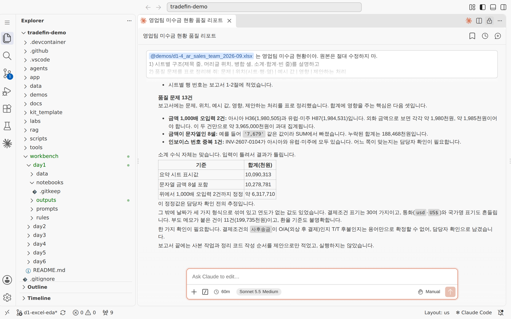
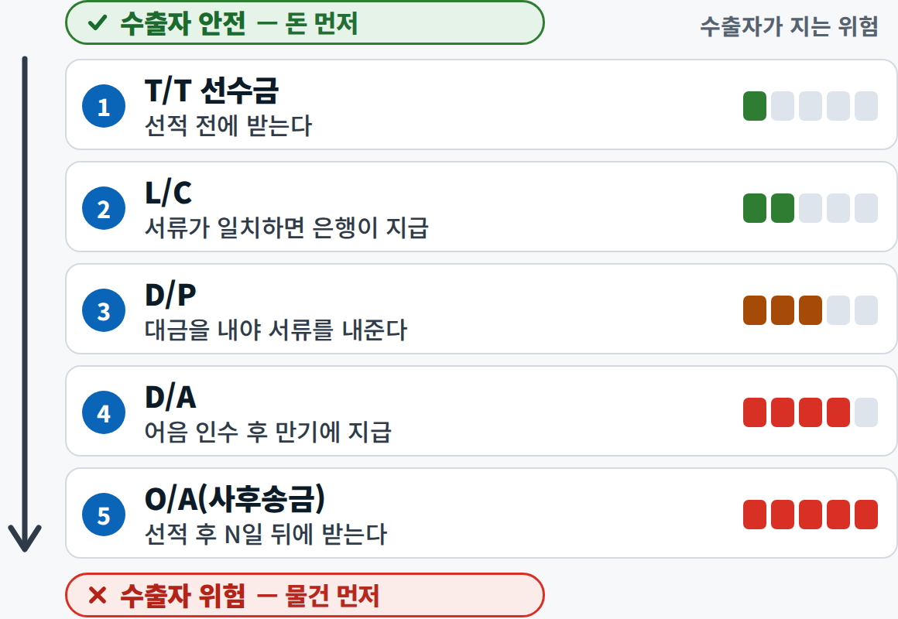
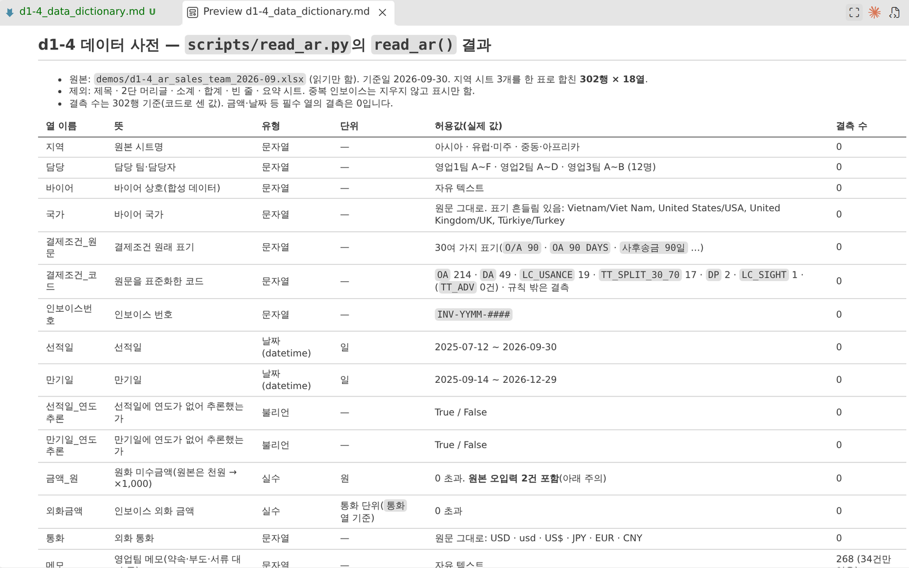
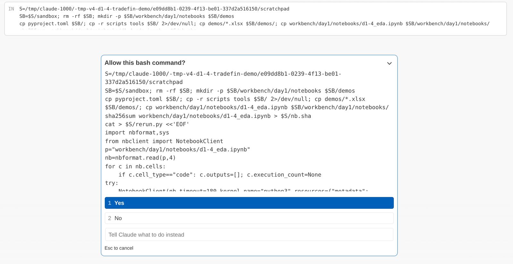
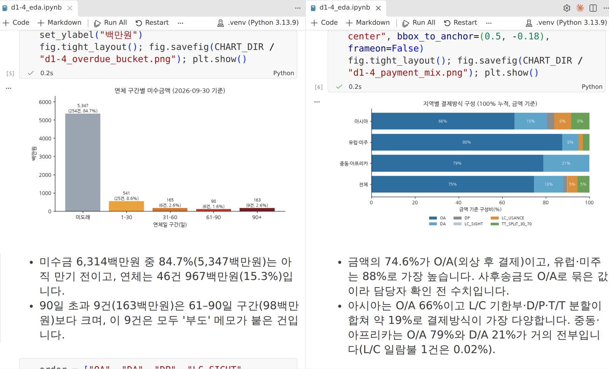
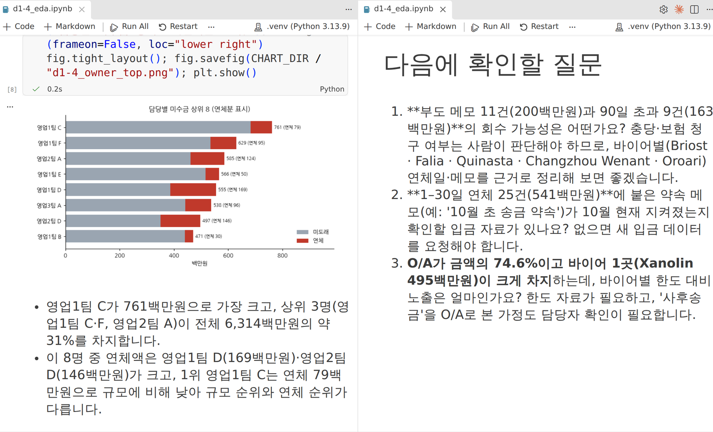
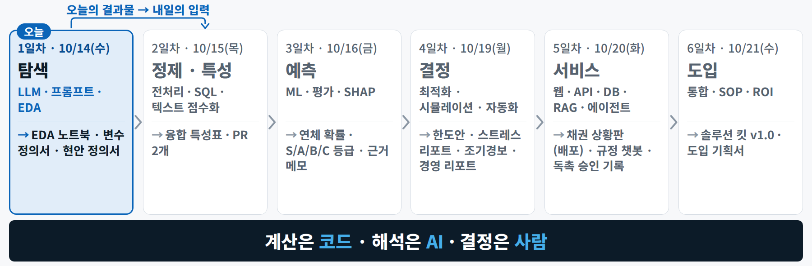

1일차 · 실습 B · 6–7교시 · 15:00–16:50 

# 실습 B — 바이어 데이터 EDA와 결제방식별 현안 정의

B-1 15:00–15:50
B-2 16:00–16:50
Claude Code · Manual
Jupyter
엑셀 · 완성본 열기

<b>상황</b> 같은 회사의 영업 · 재무 대장에서 모은 해외 바이어 150곳 현황 엑셀(기준일 2026-09-30). 담당자들이 손으로 입력해 표기가 흔들리고 이상한 값이 섞여 있습니다 — 무엇인지는 알려 드리지 않습니다. 팀장 — "결제방식별로 위험이 어디에 몰려 있나? 먼저 풀 금융 현안은?"

→

<b>넣는 것</b> `d1_buyers_raw.xlsx`(153행 × 23열) + 프롬프트 B1–B5 + 보조 S3–S7 + 완성본 `d1_pivot_check.xlsx` + 현안 정의서 양식

→

<b>얻는 것</b> 품질 보고서 · 코드표 · 변수 정의서 · EDA 노트북(차트 3) · EDA 메모(손 검산 포함) · 현안 정의서 1쪽 · 커밋

목표 원본은 그대로 두고 진단 → 기준표 → 탐색 → 검산 → 정의 순서로 **결제방식별 위험을 숫자로 보이고 현안 1쪽**을 씁니다. 고치는 일(정제)은 2일차입니다

오전 시연과의 관계 시연 4(엉망인 엑셀 → 진단 → 노트북)를 **다른 파일로** — 오류는 직접 찾습니다. 시연 3의 '결제방식별 연체'를 **바이어 단위**로 다시 봅니다

<small>macOS에서는 이 쪽 단축키의 ++ctrl++을 ++cmd++로, ++alt++를 ++option++으로 누릅니다.</small>

!!! late "늦었다면 — 최소 경로"

    **B-1 · 01(진단) → B-2 · 01(차트 1개라도) → 커밋**만 해도 오늘 결과가 남습니다. 16:35에 아직 B-2 · 01이어도 괜찮습니다 — **01 → 03 → 05**로 가고 02 · 04는 건너뜁니다. 다 못 끝냈으면 그대로 push하고 내일 아침 `uv run python tools/get_day_files.py 2`로 모두 같은 출발점에서 시작합니다.

## 입력 파일 받기 {#files}

내 저장소에는 `data/day1/`과 `labs/day1/`에 **이미 들어 있습니다**. 저장소 없이 채팅 경로로 하는 분, 엑셀로 완성본만 열어 볼 분은 아래에서 받습니다.

--8<-- "docs/_snippets/day1/files_lab-b_cards.md"

!!! warning "원본은 한 칸도 고치지 않습니다"

    `data/day1/`의 원본은 읽기만 합니다. 바꿔 볼 것은 `workbench/day1/data/`로 직접 복사한 사본이나 새 파일로 합니다. 터미널의 `git status`에 `data/` 변경이 보이면 바로 `git restore data/` 하고 손을 드세요. **한 번에 하나씩** 시키고 결과를 확인한 뒤 다음으로 넘어갑니다.

## B-1 · 바이어 데이터 진단과 사전 {#b1}

슬라이드 실습 B-1 · 15:00–15:50 · Claude Code · Excel(선택)

**목표** 바이어 150곳 파일의 품질 문제와 변수 정의서

1. 진단 — 프롬프트 B1, 원본 수정 금지 → 품질 보고서
2. AI가 놓친 문제를 1개 이상 직접 찾아 짝과 비교
3. 결제조건 표기 → 표준 코드 7개 매핑표, 애매한 행은 내가 판단
4. 변수 정의서(데이터 사전) — 재무 지표 4개는 공식 · 위험 방향까지 → 커밋

**산출물** 품질 보고서 · 코드표 · 변수 정의서

### B-1 · 01 진단 — 프롬프트 B1, 원본 수정 금지 → 품질 보고서 (15:00–15:12) { #b1-diagnose .step data-tool="Claude Code" }

**왜** 고치기 전에 무엇이 이상한지부터 봅니다. 진단과 수정을 한 번에 시키면 무엇을 왜 고쳤는지 검토할 기회가 사라집니다. `d1_buyers_raw.xlsx` → B1 → `d1_quality_report.md`

!!! me "내가 할 일"

    1. Claude Code `+`로 **새 대화**를 열고 입력창 아래 모드가 **Manual**인지 봅니다.
    2. 프롬프트 **B1**을 복사해 붙여 넣고 보냅니다. 첫 줄이 "원본은 수정하지 마", 마지막 줄이 "진단만 하고, 고치는 코드는 아직 만들지 마"입니다.
    3. 허락 창이 뜰 때마다 명령이 **읽기만 하는지**(파일을 바꾸거나 지우지 않는지) 읽고 `1 Yes`를 누릅니다.
    4. 끝나면 `workbench/day1/outputs/d1_quality_report.md`를 열어 읽습니다. 표가 좁으면 편집기에서 ++alt+z++ 로 줄 바꿈을 켭니다.
    5. 터미널에서 `git status`를 쳐 `data/` 아래가 바뀌지 않았는지 봅니다.

!!! prompt "프롬프트 B1 — 데이터 진단(원본 수정 금지)"

    --8<-- "labs/day1/prompts.md:b1"

!!! ai "AI가 하는 일"

    엑셀을 읽는 점검 명령을 **열 번 안팎** 실행하겠다고 허락을 구합니다(2–5분). 끝나면 23열마다 **유형 · 결측 수 · 이상한 표기 예 3개 · 문제 · 처리 제안**을 한 줄씩, 따로 **중복 행 · 숫자처럼 보이는 글자 · 날짜 형식 종류** 표를 보고서에 씁니다. 고치는 코드는 만들지 않습니다.

<figure class="result" markdown="span">
  { loading=lazy }
  <figcaption>진단 답의 모양 — 문제마다 위치 · 예시 값 · 영향, 그리고 "고치지 않고 제안만"(시연 4 결과 예시 — 다른 엑셀이라 문제의 종류와 수가 다릅니다)</figcaption>
</figure>

!!! ok "확인"

    - [ ] 보고서에 23열이 모두 한 줄씩 있고, 따로 표 3개(중복 행 · 숫자처럼 보이는 글자 · 날짜 형식)가 있다
    - [ ] 터미널 `git status`에 `data/` 변경이 없다(원본 153행 × 23열 그대로)

??? fix "허락 창이 너무 자주 떠요"

    정상입니다. 읽기 명령이 열 번 안팎 뜹니다. `2 Yes, allow … for this project`처럼 허락 범위를 넓히는 선택은 오늘 쓰지 않습니다.

??? fix "Claude가 고치는 코드를 만들려고 해요"

    허락 창에서 **No**를 누르고 "진단만 해 줘. 고치는 코드는 아직 만들지 마"라고 다시 보냅니다(B1 마지막 줄과 같습니다).

??? fix "`git status`에 `data/` 변경이 보여요"

    원본이 바뀐 것입니다. `git restore data/`로 되돌리고 강사에게 알립니다.

??? fix "보고서 표가 좁아 읽기 어려워요"

    미리보기 대신 편집기 탭에서 원문으로 보거나, ++alt+z++ 로 줄 바꿈을 켭니다. "열별 표를 열 6개 이하로 나눠 다시 써 줘"라고 해도 됩니다.

### B-1 · 02 AI가 놓친 문제를 1개 이상 직접 찾아 짝과 비교 (15:12–15:20) { #b1-missed .step data-tool="Claude Code" }

**왜** AI 진단도 빠뜨립니다. 사람이 목록을 읽고 판단하는 연습입니다 — 목록을 뽑는 손일은 AI가, '문제인가'의 판단은 내가. 보고서 + 원본 → S3(열 값 목록) → 보고서 끝 '내가 찾은 문제'

!!! me "내가 할 일"

    1. 보고서를 열 하나씩 훑으며 묻습니다 — 유형이 맞나 · 같은 값이 다르게 적혔나 · 빈칸 · 범위 밖 값 · 같은 행이 두 번?
    2. 의심 가는 열 1–3개를 골라 **S3**로 **값 목록**만 받습니다(판단은 시키지 않습니다). 숫자 열은 가장 큰 · 작은 값 5개도 함께 받습니다 — 자릿수가 튀는 값은 여기서 보입니다.
    3. 목록에서 보고서에 **없는** 문제를 하나 이상 고르고, **S3 더하기**로 보고서 끝 '내가 찾은 문제'에 적게 합니다(위치 · 예시 값 · 영향).
    4. 짝과 서로 찾은 것을 비교합니다 — 같은 문제의 다른 위치도 '찾은 것'입니다.

!!! prompt "보조 프롬프트 S3 — 열 값 목록(읽기 전용)"

    --8<-- "labs/day1/prompts.md:s3"

??? prompt "보조 프롬프트 S3 더하기 — 내가 찾은 문제를 보고서에"

    --8<-- "labs/day1/prompts.md:s3-add"

!!! ai "AI가 하는 일"

    S3에는 원본을 읽기만 하는 명령 허락 창을 한두 번 띄우고, 열마다 값 종류 수 · 흔한 값 · 드문 값 · 빈칸 수 · 숫자로 읽히지 않는 값 · (숫자 열이면) 가장 큰 · 작은 값을 대화에 보여 줍니다(30초 안팎). S3 더하기에는 보고서 맨 끝에 표를 붙이는 편집 허락 창을 한 번 띄웁니다.

!!! ok "확인"

    - [ ] 보고서 끝 '내가 찾은 문제'에 1개 이상(위치 · 예시 값 · 영향)
    - [ ] 짝과 찾은 것을 비교했다

??? fix "보고서가 다 찾은 것 같아요"

    같은 문제의 **다른 위치**(다른 열 · 다른 표기)도 '놓친 것'입니다. 글자 열은 **가장 드문 값 5개**, 숫자 열은 **가장 큰 · 작은 값 5개**만 봐도 이상한 것이 잘 보입니다 — 금액은 통화가 같은 바이어끼리 견줍니다(엔화 금액은 원래 자릿수가 큽니다).

??? fix "엑셀로 직접 보고 싶어요(선택)"

    원본은 열지 않고 `workbench/day1/data/`의 사본을 엽니다. 사본이 없으면(1일차에는 이 폴더가 보통 비어 있습니다) 탐색기에서 `data/day1/d1_buyers_raw.xlsx`를 오른쪽 클릭 → **Copy** → `workbench/day1/data/` 폴더를 오른쪽 클릭 → **Paste**로 만듭니다. 사본을 오른쪽 클릭 → **Reveal in File Explorer**(Mac: Reveal in Finder) → 더블클릭해 엑셀로 열고, 열마다 필터 단추(▼)로 값을 훑습니다. **저장하지 않고** 닫습니다(열어 둔 동안 생기는 `~$…` 파일은 커밋하지 않습니다).

<time>15:20</time> 손 점검 — 보고서가 있고 '내가 찾은 문제'가 1개 이상 있는지, `data/`가 그대로인지 봅니다.

### B-1 · 03 결제조건 표기 → 표준 코드 7개 매핑표, 애매한 행은 내가 판단 (15:20–15:35) { #b1-codes .step data-tool="Claude Code" }

**왜** 장부에는 같은 결제방식이 `T/T 30 days after B/L` · `O/A 60` · `L/C at sight` …처럼 자유롭게 적혀 있어 이대로는 결제방식별로 셀 수 없습니다. 애매한 표기는 **사람이** 정합니다. `payment_terms_raw` 열 → B2 → 내 판단 → S4 → `d1_code_table.csv`

!!! me "내가 할 일"

    1. 프롬프트 **B2**를 보내고 허락 창을 읽어 승인합니다.
    2. `workbench/day1/outputs/d1_code_table.csv`를 VS Code에서 열어 **'확신: 낮음'** · **'검토 필요'** 행을 찾습니다.
    3. 아래 그림과 표(돈이 언제 오나)를 근거로 그 행의 코드를 **내가** 정합니다.
    4. **S4**에 내 판단을 적어 보내 반영합니다. '검토 필요' · '확신: 낮음' 행이 많아도 한 행씩 쓰지 않습니다 — 같은 판단은 **계열로 묶어 한 줄**로 씁니다. 예: `- 'T/T … after B/L' 계열(대소문자 · 일수 모두) → OA · 근거: 선적 뒤 N일에 송금 = 사후송금`. 몇 줄이면 됩니다.
    5. (선택 2분) **S5**로 공개 데이터 사전과 다른 표기만 받아 한 번 더 생각합니다.

!!! prompt "프롬프트 B2 — 결제조건 코드표"

    --8<-- "labs/day1/prompts.md:b2"

!!! prompt "보조 프롬프트 S4 — 내 판단 반영"

    --8<-- "labs/day1/prompts.md:s4"

??? prompt "보조 프롬프트 S5 — 공개 사전과 대조(선택)"

    --8<-- "labs/day1/prompts.md:s5"

!!! ai "AI가 하는 일"

    B2에는 표기를 모두 모아 표준 코드 7개(`TT_ADV` · `TT_SPLIT_30_70` · `LC_SIGHT` · `LC_USANCE` · `DP` · `DA` · `OA`)로 짝지은 CSV를 만들고(읽기 · 쓰기 허락 창 1–3번, 1분 안팎), 확신이 낮거나 판단할 수 없는 행은 **'검토 필요'**로 남깁니다. 앞뒤 공백 · 대소문자만 다른 표기도 따로 한 줄씩 적힐 수 있습니다(그대로 둡니다). S4에는 내가 적은 행만 고치고 근거 끝에 '(사람 판단)'을 붙입니다(허락 창 1번).

<figure markdown="span">
  { width="560" loading=lazy }
  <figcaption>판단의 기준 — <strong>돈이 언제 오나</strong>. "T/T"만 적힌 표기는 선적 전인지 후인지 알 수 없습니다(근거 칸에 "표기만으로는 불명 — 원장 확인"을 남깁니다)</figcaption>
</figure>

| 표준 코드 | 뜻 | 표기에서 찾을 단서 |
|---|---|---|
| `TT_ADV` | 전신송금 **선수금**(선적 전 전액) | in advance · before shipment · 선수금 · 선입금 |
| `TT_SPLIT_30_70` | **선수금 + 잔금** 분할 | 선수금 비율과 잔금 시점이 **함께** 적힘 |
| `LC_SIGHT` | L/C **일람불** | L/C · at sight · sight L/C · 일람불 |
| `LC_USANCE` | L/C **기한부** | L/C · usance · N days(기한부) |
| `DP` | D/P 지급인도 추심 | D/P · documents against payment |
| `DA` | D/A 인수인도 추심 | D/A · acceptance |
| `OA` | **사후송금**(외상) | O/A · open account · T/T라도 **선적 후 N일** 뒤 송금 |

!!! ok "확인"

    - [ ] `d1_code_table.csv`에 '검토 필요'가 0행이다
    - [ ] 내가 고친 행의 판단 근거 끝에 '(사람 판단)'이 있다
    - [ ] 엑셀로 열어도 한글이 깨지지 않는다(utf-8-sig)

??? fix "AI가 '검토 필요' 없이 다 채웠어요"

    '판단 근거' · '확신' 열을 봅니다. 비정형이거나 시점이 빠진 표기는 '검토 필요'가 맞습니다 — 그런 행을 골라 내가 판단해 S4로 고칩니다.

??? fix "'T/T'만 적힌 표기는 어디로 넣나요?"

    표기만으로는 선적 전(선수금)인지 후(사후송금)인지 모릅니다. 공개 데이터 사전은 `TT_ADV`로 두었지만, 판단 근거에 "표기만으로는 불명 — 원장 확인"을 적어 둡니다. 원장으로 확인하는 법은 아래 '다 했으면'에 있습니다.

??? fix "CSV를 엑셀로 연 채로 S4를 보냈더니 고쳐지지 않아요"

    Windows는 엑셀이 연 파일을 잠급니다. 엑셀을 닫고 같은 프롬프트를 다시 보냅니다.

??? fix "엑셀에서 CSV 한글이 깨져요"

    엑셀 **데이터 › 텍스트/CSV에서**로 열고 **파일 원본 65001: UTF-8**을 고릅니다 → [FAQ](../faq.md#q-csv).

### B-1 · 04 변수 정의서(데이터 사전) — 재무 지표 4개는 공식 · 위험 방향까지 → 커밋 (15:35–15:50) { #b1-dictionary .step data-tool="Claude Code" }

**왜** 열 이름 · 뜻 · 단위 · 위험 방향을 적어 두면 내일 정제와 모레 예측이 같은 뜻으로 일합니다. 원천 23열 → B3 → `d1_data_dictionary.md` → S7 커밋

!!! me "내가 할 일"

    1. 프롬프트 **B3**를 보내고 `workbench/day1/outputs/d1_data_dictionary.md`를 엽니다.
    2. 재무 지표 4개(`current_ratio_fy2025` · `debt_to_equity_fy2025` · `dso_fy2025` · `op_margin_fy2025`)의 **공식**이 오전 정의와 같은지 봅니다 — 유동비율 = 유동자산 ÷ 유동부채 · 부채비율 = 총부채 ÷ 자기자본 · DSO = 매출채권 ÷ 매출 × 기간 일수 · 영업이익률 = 영업이익 ÷ 매출.
    3. **위험 방향**을 봅니다 — 낮은 유동비율 · 높은 부채비율 · 긴 DSO · 낮은 영업이익률이 위험 쪽. 단위(소수인가 %인가)와 결측 수가 B1 보고서와 맞는지도 봅니다.
    4. (선택) **S5 정의서판**으로 공개 데이터 사전과 뜻 · 단위가 다른 줄만 받아 봅니다.
    5. **S7**로 보고서 · 코드표 · 정의서 세 파일을 커밋 · push합니다. 제안된 파일 목록 · 메시지를 읽고 "좋아, 커밋하고 push 해 줘" → 명령 허락 창에서 파일 목록 · 메시지 · 브랜치를 읽고 승인합니다.

!!! prompt "프롬프트 B3 — 변수 정의서"

    --8<-- "labs/day1/prompts.md:b3"

??? prompt "보조 프롬프트 S5 정의서판 — 공개 사전과 대조(선택)"

    --8<-- "labs/day1/prompts.md:s5-dict"

!!! prompt "보조 프롬프트 S7 — 커밋 · push 맡기기"

    --8<-- "labs/day1/prompts.md:s7"

!!! ai "AI가 하는 일"

    B3에는 원본을 읽어 23열의 뜻 · 유형 · 단위 · 허용값 · 결측 수를 표로 쓰고, 재무 지표 4개에는 공식과 위험 방향을 붙입니다(파일 쓰기 허락 창 1번 + 읽기 명령 몇 번, 1–2분). S7에는 바뀐 파일을 요약해 메시지를 제안하고 기다렸다가, 내가 "좋아"라고 하면 커밋 · push 명령 허락 창을 띄웁니다(보통 한 줄로 묶어 1번).

<figure class="result" markdown="span">
  { loading=lazy }
  <figcaption>변수 정의서의 모양 — 열 이름 · 뜻 · 유형 · 단위 · 허용값 · 결측 수(시연 4 결과 예시 — 다른 파일이라 열이 다릅니다)</figcaption>
</figure>

!!! ok "확인"

    - [ ] 23열 정의가 있고, 재무 지표 4개에 공식과 위험 방향이 있다
    - [ ] 부채비율 메모에 "자기자본이 0 이하(자본잠식)면 해석 불가"가 있다(오전 재무비율 장의 규칙)
    - [ ] 보고서 · 코드표 · 정의서 세 파일이 커밋 · push됐다

??? fix "위험 방향이 거꾸로 적혔어요"

    "유동비율은 낮을수록, 부채비율은 높을수록, DSO는 길수록, 영업이익률은 낮을수록 위험이다. 위험 방향 열을 고쳐 줘"라고 되묻습니다(오전 재무비율 장).

??? fix "DSO 공식에 365 대신 91이 들어갔어요"

    바이어 파일의 재무 숫자는 **연간**입니다. "DSO는 연간 매출 기준이라 365일로 다시 적어 줘"라고 고치게 합니다.

<time>15:50</time> 커밋 — 세 파일이 내 저장소에 올라갔는지 봅니다.

## B-2 · EDA 노트북 · 검산 · 현안 정의 {#b2}

슬라이드 실습 B-2 · 16:00–16:50 · Claude Code · Jupyter · Excel

**목표** 결제방식별 위험을 숫자로 보이고 현안 1쪽을 쓴다

1. EDA 노트북 — 차트 3개 + 해석 3줄씩, 허락 창 읽고 승인
2. 엑셀 피벗 · 피벗 차트로 숫자 하나 재현 → 일치 여부와 원인을 EDA 메모에
3. 현안 정의서 1쪽 — 숫자는 파일에 있는 것만
4. 조별 3분: 우리 회사라면 1순위 현안은?
5. 커널 재시작 후 전체 실행 → 커밋 · push

**산출물** EDA 노트북 · 차트 3개 · EDA 메모 · 현안 정의서

### B-2 · 01 EDA 노트북 — 차트 3개 + 해석 3줄씩, 허락 창 읽고 승인 (16:00–16:15) { #b2-notebook .step data-tool="Claude Code, Jupyter" }

**왜** 숫자를 그림으로 보고, AI의 해석이 그림과 맞는지 내가 대조합니다. 원천 + 내 코드표 → B4 → `d1_eda.ipynb` · 차트 PNG 3개 · `d1_eda_notes.md`(해석 + 결제방식별 표)

!!! me "내가 할 일"

    1. 새 대화(Manual)에서 프롬프트 **B4**를 보냅니다.
    2. 허락 창의 명령을 **끝까지** 읽습니다 — 무엇을(노트북 실행) · 어디에(임시 폴더) · 지우는 것이 그 임시 폴더뿐인지. 확인되면 `1 Yes`. 셀마다 Execute 창이 뜨는 판이면 셀 코드를 읽고 **Execute**.
    3. 끝나면 `workbench/day1/notebooks/d1_eda.ipynb`를 열고 오른쪽 위 커널이 **`.venv`(Python 3.13)**인지 봅니다. 아니면 **Select Kernel → Python Environments → `.venv`**.
    4. 차트 3개와 해석 3줄을 읽고, **해석이 차트와 맞는지** 대조합니다. AI 해석도 틀립니다 — 틀린 줄은 "차트 2의 해석 둘째 줄이 그림과 다르다, 고쳐 줘"로 고치게 합니다.

!!! prompt "프롬프트 B4 — EDA 노트북"

    --8<-- "labs/day1/prompts.md:b4"

!!! ai "AI가 하는 일"

    정리 규칙을 `scripts/`에 코드로 남기고, 노트북을 파일로 만든 뒤 **명령으로 실행**합니다(임시 폴더의 사본에서 돌리기도 합니다). 허락 창이 **10–20번** 뜨고(데이터 살피기 · 정리 코드 · 노트북 만들기 · 셀 실행 · 차트 확인 · 해석 고치기 — 셀을 하나씩 실행하므로 셀 수만큼 늘어납니다) 3–5분 걸립니다. 많아 보여도 정상이니 하나씩 읽고 승인합니다. 임시 폴더를 쓰면 실행 명령 안에 그 폴더를 지우는 줄이 들어 있을 수 있습니다. 차트는 `workbench/day1/outputs/charts/`에 PNG로, 해석과 결제방식별 표는 `d1_eda_notes.md`에도 씁니다.

<figure class="result" markdown="span">
  { width="680" loading=lazy }
  <figcaption>무엇을 · 어디에 · 지우는 것이 임시 폴더뿐인지 끝까지 읽고 <code>1 Yes</code>. 모르는 명령이면 <code>No</code>로 거절하고 무슨 명령인지 묻습니다(시연 4 화면 예시)</figcaption>
</figure>

<figure class="result" markdown="span">
  { loading=lazy }
  <figcaption>셀 아래에 차트, 바로 밑에 해석 — 오늘은 같은 모양으로 바이어 파일의 차트 3개를 만듭니다(시연 4 결과 예시 — 다른 엑셀 · 다른 차트)</figcaption>
</figure>

!!! ok "확인"

    - [ ] 차트 3개 — ① 연체일수(`max_dpd_days`) 분포(0일을 뺀 그림 포함) ② 국가별 연체 바이어 비율 상위 10(5곳 미만 표시) ③ 결제방식별 연체 바이어 비율
    - [ ] 차트마다 해석 3줄이 노트북과 `d1_eda_notes.md`에 있고, `d1_eda_notes.md`에 결제방식별 표(바이어 수 · 연체 바이어 수 · 비율)가 있다
    - [ ] `workbench/day1/outputs/charts/`에 PNG 3개, 노트북 커널이 `.venv (Python 3.13)`

??? fix "`FileNotFoundError: data/day1/…`가 나와요"

    노트북을 실행하는 위치가 달라서입니다(VS Code는 저장소 맨 위, 명령줄 실행은 노트북 폴더 기준). "첫 셀에서 저장소 맨 위 폴더(pyproject.toml 있는 곳)로 이동하게 고쳐 줘"라고 보냅니다.

??? fix "커널 목록에 `.venv`가 없어요"

    터미널에서 `uv sync` → ++ctrl+shift+p++ → `Developer: Reload Window`. 그래도 안 되면 "노트북 대신 `scripts/d1_eda.py`로 만들고 `uv run`으로 실행해 차트 PNG와 해석 md를 저장해 줘" — 점검 기준은 같습니다 → [FAQ](../faq.md#q-kernel).

??? fix "'IDE에서 셀을 실행할 수 없다'고 해요"

    "명령줄로 실행해 줘"라고 답합니다. 노트북을 파일로 만든 뒤 명령으로 실행하는 방식이면 됩니다.

??? fix "차트의 한글이 네모로 나와요"

    "차트 한글 글꼴을 tools/fonts/NanumGothic-Regular.ttf 로 고쳐 줘"라고 보냅니다.

??? fix "Plan 모드로 계획부터 받고 싶어요(선택)"

    큰 작업이라 계획을 먼저 읽어도 좋습니다. 다만 계획 승인 화면 맨 위의 `use auto mode`가 미리 선택돼 있어 Enter를 치면 그것이 눌립니다 — **마우스로 `manually approve edits`**를 누릅니다 → [FAQ](../faq.md#q-mode).

??? fix "오류로 멈췄어요"

    오류 메시지 **전문**을 복사해 그대로 Claude Code에 붙여 넣습니다 — AI와 코딩하는 기본 순환입니다.

<time>16:15</time> 손 점검 — 노트북이 열리고 차트 3개와 해석이 있는지, `charts/`에 PNG 3개가 있는지 봅니다.

### B-2 · 02 엑셀 피벗 · 피벗 차트로 숫자 하나 재현 → 일치 여부와 원인을 EDA 메모에 (16:15–16:25) { #b2-check .step data-tool="엑셀, Claude Code" }

슬라이드의 '엑셀 피벗 · 피벗 차트로 숫자 하나 재현'은 **완성본 엑셀로 대신합니다** — 10분을 엑셀 조작이 아니라 **AI 숫자와 대조하고 원인을 찾는 데** 씁니다.

**왜** AI(노트북)가 코드로 낸 숫자를 **코드가 아닌 다른 길**로 센 숫자와 맞춰 봅니다. 다르면 원인을 적는 것이 정답입니다. 완성본 `d1_pivot_check.xlsx` + `d1_eda_notes.md` → S6 → 엑셀에서 원인 하나 확인 → '손 검산' 절

!!! file "완성본 제공 — d1_pivot_check.xlsx"

    <dl markdown>
    <dt>무엇</dt><dd markdown>원천 `d1_buyers_raw.xlsx`를 **한 칸도 고치지 않고** 결제방식별로 센 표(행 수 · 연체 판정 불가 · 판정 가능 행 · 연체 바이어 · 비율)와 막대 차트입니다. 셀을 누르면 수식이 보입니다. 내 저장소에는 `labs/day1/d1_pivot_check.xlsx`로 들어 있습니다.</dd>
    <dt>왜</dt><dd markdown>엑셀 피벗을 손으로 만드는 10분을 줄이고, 그 시간을 AI 결과와의 대조에 쓰려고 미리 만들었습니다. **정답이 아니라 기준선**입니다 — 노트북은 코드표 · 정리 규칙을 적용했으니 다른 것이 정상이고, 어디서 갈렸는지 찾는 것이 오늘의 과제입니다.</dd>
    <dt>어떻게 만들었나</dt><dd markdown>공개 파일 두 개(원천과 `data_dictionary.xlsx`의 결제조건 표기 → 코드 42개)만 썼습니다. **buyers 시트** = 원천 그대로 + '표준코드' 열(결제조건의 앞뒤 공백을 지우고 '코드표' 시트에서 찾기, 없으면 '미분류') + '연체' 열(연체일수가 0보다 크면 1, 숫자가 아니면 빈칸). **결제방식_피벗 시트** = 피벗 테이블과 같은 계산을 COUNTIF · COUNTIFS · SUMIF 수식으로.</dd>
    </dl>

    [:material-microsoft-excel: 완성본 받기](../downloads/day1/d1_pivot_check.xlsx){ .md-button .md-button--primary download="d1_pivot_check.xlsx" }

| 시트 | 무엇 | 어떻게 만들었나 |
|---|---|---|
| `안내` | 왜 · 무엇으로 · 어떻게 · 쓰는 법 · 주의 | 1분 읽기 |
| `결제방식_피벗` | 표준 코드 7종 + 미분류 + 합계의 행 수 · 판정 불가 · 판정 가능 · 연체 바이어 · 비율, 막대 차트 | 피벗(행 = 표준코드, 값 = 개수 · 합계)과 같은 계산을 수식으로 |
| `buyers` | 원천 153행 × 23열 그대로 + `표준코드`(X열) · `연체`(Y열) | X = 결제조건(I열)을 `코드표`에서 찾기 · Y = 연체일수(L열)가 0보다 크면 1 |
| `코드표` | 결제조건 표기 → 표준 코드 42개 | 공개 데이터 사전 그대로 — 내 코드표를 붙이면 다시 계산(다 했으면) |

!!! me "내가 할 일"

    1. VS Code 탐색기에서 `labs/day1/d1_pivot_check.xlsx`를 오른쪽 클릭 → **Reveal in File Explorer**(Mac: Reveal in Finder) → 더블클릭해 엑셀로 **읽기만** 엽니다(엑셀이 없으면 위 단추로 받아 웹용 Excel). '안내' 시트를 1분 읽습니다. 엑셀은 열 때 수식을 다시 계산하므로 닫을 때 "변경 내용을 저장할까요?"가 뜨면 **저장 안 함**을 누릅니다.
    2. `결제방식_피벗`의 막대와 노트북 차트 3의 **모양**을 견줍니다 — 어느 결제방식이 높고 낮은가.
    3. 결제방식 하나(예: 비율이 눈에 띄는 것)를 골라 두 숫자를 봅니다.
    4. **S6**으로 결제방식마다 나란히 놓은 표와 원인 후보를 받습니다.
    5. 원인 후보 **하나를 엑셀에서 직접** 확인합니다 — `buyers` 시트에서 `표준코드` · `연체` 열 필터(▼)를 걸고, 셀을 눌러 수식을 봅니다.
    6. **S6 더하기**로 `d1_eda_notes.md` 끝에 '손 검산' 절을 남깁니다. 프롬프트 끝 줄은 B-2 · 05에서 노트북을 다시 실행해도 이 절이 지워지지 않게 하는 줄이라 빼지 않습니다.

!!! prompt "보조 프롬프트 S6 — 완성본과 대조"

    --8<-- "labs/day1/prompts.md:s6"

!!! prompt "보조 프롬프트 S6 더하기 — 손 검산 절"

    --8<-- "labs/day1/prompts.md:s6-add"

!!! ai "AI가 하는 일"

    S6에는 완성본에 저장된 값과 노트북 메모의 표를 읽어(읽기 명령 허락 창 1–2번, 1분 안팎) 결제방식마다 같음/다름 표를 대화에 보여 주고, 다른 줄에 원인 후보를 `buyer_id` 예시와 함께 적습니다 — 어느 쪽이 맞는지는 쓰지 않습니다. 보통 원인이 둘 이상 겹쳐 나옵니다(코드표 · 같은 바이어 반복 · 숫자가 아닌 연체일). S6 더하기에는 '손 검산' 절을 붙이는 편집 허락 창을 한 번 띄우고, 노트북에 메모 파일을 처음부터 다시 쓰는 셀이 있으면 그 셀도 고치겠다고 허락 창을 1–2번 더 띄웁니다.

!!! ok "확인"

    - [ ] `d1_eda_notes.md` 끝에 '손 검산' 절 — 대상 · 노트북 값 · 완성본 값 · 일치/불일치 · 내가 확인한 원인
    - [ ] 다르면 원인 한 줄이, 같으면 "맞았다 + 노트북이 한 처리"가 있다

??? fix "숫자가 달라요"

    틀린 것이 아니라 원인을 찾을 차례입니다. 분모(몇 행을 셌나) · 같은 바이어 반복 · 숫자가 아닌 연체일 · 코드표 차이('미분류' · '검토 필요') · 정의(연체일 > 0) 순서로 봅니다 → [FAQ](../faq.md#q-pivot-vs-ai).

??? fix "노트북이 아직 안 끝났어요"

    B-2 · 01을 먼저 끝냅니다. 시간이 모자라면 이 단계는 건너뛰어도 됩니다(최소 경로).

??? fix "엑셀이 없어요 · Codespaces에서 하고 있어요"

    위 **완성본 받기**로 내려받아 웹용 Excel(office.com)로 엽니다. 엑셀 없이 S6만으로도 됩니다 — Claude Code는 파일에 저장된 값을 읽습니다.

??? fix "`labs/day1/d1_pivot_check.xlsx`가 내 저장소에 없어요"

    수업 전에 만든 저장소일 수 있습니다. 터미널에서 `uv run python tools/get_day_files.py 1`을 치면 받습니다(또는 위 단추로 받아 `labs/day1/`에 넣습니다).

??? fix "완성본을 고치고 저장해 버렸어요"

    터미널에서 `git restore labs/day1/d1_pivot_check.xlsx`로 되돌립니다. 바꿔 보고 싶으면 `workbench/day1/data/`로 직접 복사한 사본에서 합니다.

### B-2 · 03 현안 정의서 1쪽 — 숫자는 파일에 있는 것만 (16:25–16:35) { #b2-issue .step data-tool="Claude Code" }

**왜** 분석의 첫 칸은 "무엇을 결정하려는 분석인가"입니다. 오늘의 숫자를 업무의 언어로 바꿉니다 — 숫자는 파일에 있는 것만. `d1_eda_notes.md` + `d1_code_table.csv` + 양식 → B5 → `d1_issue_definition.md`

!!! me "내가 할 일"

    1. 프롬프트 **B5**를 보냅니다. 양식 `labs/day1/issue_definition_template.md`를 읽어 정의서 초안을 만듭니다.
    2. 정의서의 숫자가 `d1_eda_notes.md`의 숫자와 같은지 봅니다 — 새 숫자가 있으면 "이 숫자는 `d1_eda_notes.md`의 어디에 있어? 없으면 지워 줘".
    3. 규정 · 통계는 '확인 필요', 바이어 5곳 미만 그룹은 '표본 작음 — 결론 보류'로 남았는지 봅니다.
    4. ⑤ **'내 업무라면'을 직접** 씁니다 — 내 업무에서 이 현안에 해당하는 결제방식 · 바이어의 **상황만**(회사 이름 · 실명 · 실제 숫자 없이).

!!! prompt "프롬프트 B5 — 결제방식별 현안 정의서"

    --8<-- "labs/day1/prompts.md:b5"

!!! ai "AI가 하는 일"

    메모 · 코드표 · 양식을 읽고 ①–④(한 줄 문제 · 근거 숫자 표 · 먼저 풀 현안 · 다음에 필요한 데이터)를 채운 파일을 쓰겠다고 허락 창을 한 번 띄웁니다. ⑤는 비워 두고, 일반 구조를 설명하는 문장 끝에는 '(일반 설명)'을 붙입니다.

!!! ok "확인"

    - [ ] 양식 ①–④가 채워졌고, 숫자는 모두 `d1_eda_notes.md`에 있는 것이다
    - [ ] ⑤ '내 업무라면'은 내 글이다(회사 이름 · 실명 · 실제 숫자 없음)

??? fix "정의서에 모르는 숫자가 있어요"

    "이 숫자는 `d1_eda_notes.md`의 어디에 있어? 없으면 지워 줘"라고 되묻습니다. 메모에 결제방식별 표가 없으면 B-2 · 01로 돌아가 표를 더하게 합니다.

??? fix "회사 이야기를 써 버렸어요"

    바로 지웁니다. 이미 push했다면 지우는 것으로 끝나지 않으니(커밋 이력에 남습니다) 강사에게 바로 알립니다.

<time>16:35</time> 현안 초안 — 정의서 ①–④가 있고 ⑤가 내 글인지 봅니다.

### B-2 · 04 조별 3분: 우리 회사라면 1순위 현안은? (16:35–16:38) { #b2-talk .step data-tool="조 토론" }

**왜** 숫자가 말해 주지 않는 우선순위는 업무를 아는 사람이 정합니다. 내 정의서 ③ → 조 토론 3분 → 정의서 ⑥

!!! me "내가 할 일"

    1. 조원에게 내 정의서 ③(먼저 풀 현안)을 한 문장으로 말합니다.
    2. 3분 동안 "우리 회사라면 1순위 현안은 무엇이고 왜인가"를 정합니다.
    3. 정의서 **⑥ 조별 우선순위**에 1순위 한 줄과 이유 한 줄을 **직접** 씁니다.

!!! ai "AI가 하는 일"

    없습니다 — 사람의 판단과 대화입니다. 말할 때 나온 회사 이름 · 실명 · 숫자는 파일에 쓰지 않습니다.

!!! ok "확인"

    - [ ] 정의서 ⑥에 2줄(1순위 · 이유)이 있다

### B-2 · 05 커널 재시작 후 전체 실행 → 커밋 · push (16:38–16:50) { #b2-commit .step data-tool="Jupyter, Claude Code" }

**왜** 셀을 오가며 실행하다 생긴 **숨은 상태**가 없는지, 노트북이 처음부터 끝까지 다시 도는지 확인하고 오늘 결과를 올립니다. Restart → Run All → 저장 → S7 → push

!!! me "내가 할 일"

    1. 노트북 위쪽 도구 막대에서 **Restart** → **Run All**(또는 ++ctrl+shift+p++ → `Jupyter: Restart Kernel and Run All Cells`). 셀 번호가 `[1]`부터 이어지고 오류가 없는지 봅니다.
    2. ++ctrl+s++ 로 저장합니다(저장하지 않으면 옛 출력이 커밋됩니다).
    3. `d1_eda_notes.md`를 열어 끝에 '손 검산' 절이 **그대로 남아 있는지** 봅니다(노트북이 메모를 다시 썼을 수 있습니다).
    4. **S7**을 보냅니다. 제안된 파일 목록 · 메시지를 읽고 "좋아, 커밋하고 push 해 줘" → 명령 허락 창에서 파일 목록 · 메시지 · 브랜치를 읽고 승인합니다.
    5. 브라우저에서 내 저장소의 `workbench/day1/`에 오늘 결과가 보이는지 봅니다.

!!! prompt "보조 프롬프트 S7 — 커밋 · push 맡기기"

    --8<-- "labs/day1/prompts.md:s7"

!!! ai "AI가 하는 일"

    바뀐 파일(정리 코드 · 노트북 · 차트 · 메모 · 정의서)을 요약해 커밋 메시지를 제안하고 기다렸다가, 내가 "좋아"라고 하면 커밋 · push 명령 허락 창을 띄웁니다(허락 창 1–2번씩). `data/` · `labs/` 원본이 바뀌었거나 `~$`로 시작하는 엑셀 잠금 파일이 있으면 커밋하지 않고 알려 줍니다.

<figure class="result" markdown="span">
  { loading=lazy }
  <figcaption>도구 막대 <strong>Restart</strong> · <strong>Run All</strong>, 오른쪽 위 커널 <code>.venv</code>, 셀 번호가 끊기지 않고 이어집니다(시연 4 결과 예시 — 끝의 '다음에 확인할 질문'은 '다 했으면'에서 해 봅니다)</figcaption>
</figure>

!!! ok "확인"

    - [ ] 재시작 후 전체 실행이 오류 없이 끝났고 저장했다
    - [ ] 다시 실행한 뒤에도 `d1_eda_notes.md` 끝에 '손 검산' 절이 있다
    - [ ] 오늘 결과 파일이 내 저장소에 올라갔다(보고서 · 코드표 · 정의서 · 노트북 · 차트 3 · 메모 · 현안 정의서)

??? fix "재실행에서 경로 오류가 나요"

    B-2 · 01의 '`FileNotFoundError`' 처방과 같습니다 — "첫 셀에서 저장소 맨 위 폴더로 이동하게 고쳐 줘".

??? fix "다시 실행했더니 '손 검산' 절이 사라졌어요"

    노트북에 메모 파일(`d1_eda_notes.md`)을 처음부터 다시 쓰는 셀이 있어서입니다. 같은 대화에서 "방금 지워진 '손 검산' 절을 다시 붙이고, 다시 실행해도 지워지지 않게 그 셀을 고쳐 줘"라고 보냅니다 — 절의 내용은 대화에 남아 있습니다. 고친 뒤 Restart → Run All을 한 번 더 하고 절이 남는지 봅니다.

??? fix "커밋 목록에 `~$`로 시작하는 파일이 있어요"

    엑셀이 연 파일의 잠금 파일입니다. 엑셀을 닫고 그 파일은 빼고 커밋합니다(S7이 알려 줍니다).

??? fix "저장하지 않고 커밋했어요"

    출력이 옛것입니다. ++ctrl+s++ 로 저장한 뒤 S7로 한 번 더 커밋합니다.

<time>16:50</time> push — 내 저장소에서 오늘 커밋과 결과 파일이 보이는지 봅니다.

## 다 했으면 — 내 손으로 넓혀 보기 {#more}

배운 순서(진단 → 기준표 → 탐색 → 검산 → 정의)를 조금 바꿔 **AI가 어디까지 하는지** 직접 재 봅니다. 하나만 골라도 좋습니다. 이 순서는 내 업무 엑셀에도 그대로 씁니다 — 6일차 도입 기획의 재료가 됩니다 → [내 업무를 AI 과업으로](../ax-project.md).

-   기본 · 10분 · Claude Code + Jupyter

    **인보이스 단위로 다시 보기**

    시연 3의 원장 `d1_invoices.csv`(5,033건)로 월별 30일 초과 연체 비율 선 차트를 그리고, 같은 정의로 결제방식별 비율을 구해 **바이어 단위 결론과 같은지** 봅니다. 추이는 선, 비교는 막대.

    ??? prompt "프롬프트 XB1"

        --8<-- "labs/day1/prompts.md:xb1"

-   응용 · 10분 · Claude Code

    **내 코드표로 완성본 다시 계산**

    완성본 사본의 `코드표` 시트를 내 코드표로 바꿔 결제방식별 숫자가 얼마나 움직이는지 봅니다 — 코드표 하나가 결론을 바꾸는 크기. `결제방식_피벗` B14가 0인지도 봅니다.

    ??? prompt "프롬프트 XB2"

        --8<-- "labs/day1/prompts.md:xb2"

-   응용 · 15분 · Claude Code

    **애매한 표기를 원장으로 확인**

    내가 판단한 표기를 쓰는 바이어를 `buyer_id`로 인보이스 원장과 이어, 원장의 결제방식과 내 판단이 같은지 봅니다 — 사람이 하던 '원장 확인'을 AI에게.

    ??? prompt "프롬프트 XB3"

        --8<-- "labs/day1/prompts.md:xb3"

-   응용 · 10분 · Claude Code + Jupyter

    **관계 보기 — 상관은 원인이 아니다**

    유동비율과 연체일수의 산점도를 그려 봅니다. 숫자가 아닌 값을 몇 개 뺐는지, 그림이 말해 주는 것과 말해 주지 않는 것을 해석 2줄로.

    ??? prompt "프롬프트 XB4"

        --8<-- "labs/day1/prompts.md:xb4"

-   도전 · 10분 · Claude Code + Jupyter

    **AI에게 다음 질문 맡기기**

    "이 노트북을 보고 다음에 확인할 질문 3개"를 받고, 그중 하나를 셀 하나로 확인해 해석 2줄을 씁니다. 질문을 고르는 것은 내 몫입니다.

    ??? prompt "프롬프트 XB5"

        --8<-- "labs/day1/prompts.md:xb5"

## 채팅 경로 — Claude Code를 못 쓸 때 {#chat-path}

claude.ai 또는 ChatGPT에 파일을 올려 같은 일을 합니다([실습 A의 채팅 경로](lab-a.md#chat-path)와 같은 방식).

1. 위 '입력 파일 받기'에서 `d1_buyers_raw.xlsx`(안 올라가면 `d1_buyers_raw.csv`)를 받아 새 대화에 첨부합니다.
2. B1–B3 · B5의 `@파일` 줄은 지우고, "결과는 outputs 폴더의 … " 줄은 **"결과를 `{파일 이름}` 파일로 만들어 내려받게 해 줘"**로 바꿉니다 — 표를 손으로 옮겨 적지 않습니다.
3. B4는 노트북 대신 **"코드를 실행해 차트 PNG 3개와 해석 · 결제방식별 표가 든 d1_eda_notes.md를 만들어 내려받게 해 줘"**로 바꿉니다.
4. B-2 · 02는 완성본(위 카드)을 웹용 Excel로 열어 같은 방법으로 대조하고, S6은 완성본과 메모 파일을 함께 첨부해 보냅니다.
5. B5는 양식 `issue_definition_template.md`도 함께 첨부합니다.
6. 받은 파일을 내 저장소의 `workbench/day1/outputs/`(노트북은 `notebooks/`)에 **Add file → Upload files**로 올립니다. 커밋 메시지는 '무엇' · 빈 줄 · '왜'로 씁니다.

## 막힐 때 {#troubleshooting}

여러 단계에 걸친 일입니다. 단계 안의 '막히면'도 함께 보세요.

??? fix "사용 한도에 걸렸어요"

    안내 메시지의 풀리는 시각을 확인하고, 그동안은 짝의 화면이나 채팅 경로로 진행합니다 → [FAQ](../faq.md#q-usage-limit).

??? fix "엑셀에서 CSV 한글이 깨져요"

    **데이터 › 텍스트/CSV에서**로 열고 **파일 원본 65001: UTF-8**을 고릅니다 → [FAQ](../faq.md#q-csv).

??? fix "push · GitHub 로그인이 안 돼요"

    [실습 A-1 · 05](lab-a.md#a1-commit)의 '막히면'과 같습니다. 끝내 안 되면 결과 파일을 강사에게 전달하고, 다음 날 아침 시작 파일로 합류합니다.

??? fix "AI가 시키지 않은 파일까지 고치려 해요"

    허락 창에서 **No**를 누르고 "이번에는 {파일}만 만들어. 다른 파일은 고치지 마"라고 다시 보냅니다. 한 번에 하나씩 시키는 것이 오늘의 습관입니다.

## 오늘의 마무리 {#wrapup}

17:00에 오늘 결과물 표를 다시 띄우고 **흔한 실수**를 함께 짚습니다. 정답 파일은 그때 강사 화면으로만 보여 드립니다. 그다음은 Cowork로 오늘 결과를 보고서로 만드는 시연 5, 결과 공유 · 정리 · 내일 예고입니다 → [1일차 개요 — 오늘의 결과물](index.md#submit).

<figure markdown="span">
  { loading=lazy }
  <figcaption>오늘의 결과물 → 내일의 입력 — 오늘 찾은 품질 문제가 내일의 정제 규칙이 되고, 변수 정의서가 특성의 설계도가 됩니다</figcaption>
</figure>
