# 1일차 이론 요약 — AI로 일하는 법

오전 세 교시(09:00–11:50)와 마지막 교시(17:00 이후)에 배운 내용을 덱의 장 순서대로 요약합니다. 이 과정에서 이론의 대부분은 **AI로 일하는 방법**(원리 · 도구 · 개발 방법 · 데이터)이고, 무역금융 업무 지식은 필요한 만큼만 곁들입니다. 숫자와 모델 이름은 **2026년 10월 14일 기준**입니다. 그림은 강의 슬라이드와 같은 것이고, 슬라이드 PDF는 아래 카드에서 받습니다(인쇄본과 같은 판).

--8<-- "docs/_snippets/day1/files_pdf_cards.md"

| 장 | 다루는 것 | 시연 · 라이브 | 오후에 쓰는 곳 |
|---|---|---|---|
| [00 시작하며](#ch00) | 오늘의 목표 · 6일 지도 · 데이터 위생 5가지 | – | 실습 A-1 · 01 학습 설정 끄기 |
| [01 AI 지형 2026](#ch01) | AI · 머신러닝 · 딥러닝 · LLM · 모델 지도 · 도구 네 층 · 에이전틱/버티컬 AI | 시연 1 딥 리서치 | – |
| [02 LLM 원리](#ch02) | 만들어지는 과정 · 토큰 · 다음 토큰 예측 · 컨텍스트 창 · 할루시네이션 · 에이전트 · 비용 | 짧은 라이브 1 그라운딩 | 실습 A-2 근거 확인 |
| [03 Claude 도구 3종](#ch03) | 채팅 · Cowork · Claude Code · 요금제와 데이터 설정 | – | 실습 A-1 |
| [04 AI에게 일 시키는 법](#ch04) | 컨텍스트 설계 · 6요소 프롬프트 · 근거 요구와 반복 | 시연 2 PDF 공시 | 실습 A-2 · 01 프롬프트 A1 |
| [05 개발 환경 세팅](#ch05) | VS Code · 터미널 · uv · 노트북 vs 스크립트 · 권한 모드 · CLAUDE.md | – | 실습 A-1 |
| [06 Git · GitHub 입문](#ch06) | 이력 · Git vs GitHub · 네 자리 · 명령 · 되돌리기 | 시연 3 첫 프로젝트 | 실습 A-1 · 05 · 모든 커밋 |
| [07 데이터 탐색(EDA)](#ch07) | CRISP-DM · 데이터 유형 · 인코딩 · 기술통계 · 차트 · EDA 다섯 단계 | 시연 4 엑셀 → 노트북 | 실습 B |
| [08 무역금융 기초](#ch08) | 결제방식 · L/C와 T/T · 신용정보 · 재무비율 4종 | 짧은 라이브 2 비율 계산 | 실습 A-2 · 03 · B-1 · 03 |
| [정리](#wrap) | 시연 5 Cowork · 오늘의 다섯 줄 | 시연 5 | – |

용어는 [용어 17개 표](#terms)와 [용어집 → 1일차](../glossary.md#day1)에 있습니다.

---

## 00 시작하며 {#ch00}

**오늘의 목표 세 가지** — ① AI를 고르고, 근거를 요구하며 시킨다 ② 내 작업 환경을 만든다 ③ 데이터를 의심하며 탐색한다. 오늘이 끝나면 내 GitHub 저장소 · `CLAUDE.md` · 결과 파일 9종 · 커밋 2개 이상이 남습니다.

**6일 파이프라인** — 같은 가상 회사 한빛정밀의 데이터가 매일 한 칸씩 앞으로 갑니다. 탐색 → 정제 · 특성 → 예측 → 결정 → 서비스 → 도입.

<figure markdown="span">
  { loading=lazy }
  <figcaption>날마다 방법과 결과물이 한 칸씩 — 오늘(1일차 · 탐색)의 결과물이 내일의 입력이 됩니다</figcaption>
</figure>

어제의 결과물이 오늘의 입력입니다(오늘의 변수 정의서는 내일 특성을 만드는 설계도). 6일 내내 지킬 원칙은 하나입니다 — **계산은 코드가, 해석은 AI가, 결정은 사람이** 합니다.

**데이터 위생 다섯 가지**

1. AI 서비스에 파일을 올리는 순간 그 내용은 **AI 회사 서버에서 처리**됩니다(채팅에 올린 파일도, Cowork에 연결한 폴더도).
2. 실습은 **가상 회사 데이터와 공개 공시**만 씁니다. 회사 실데이터 · 개인정보는 익명화본도 올리지 않습니다.
3. AI 서비스의 **'모델 개선(학습)' 설정은 끄고** 시작합니다.
4. 내 저장소는 **공개**입니다 — 키 · 비밀번호 · 회사 자료는 커밋하지 않습니다(`.gitignore`).
5. AI 결과는 **검증 전까지 초안**입니다 — 인용은 원문에서, 숫자는 코드로 다시 확인합니다.

<figure markdown="span">
  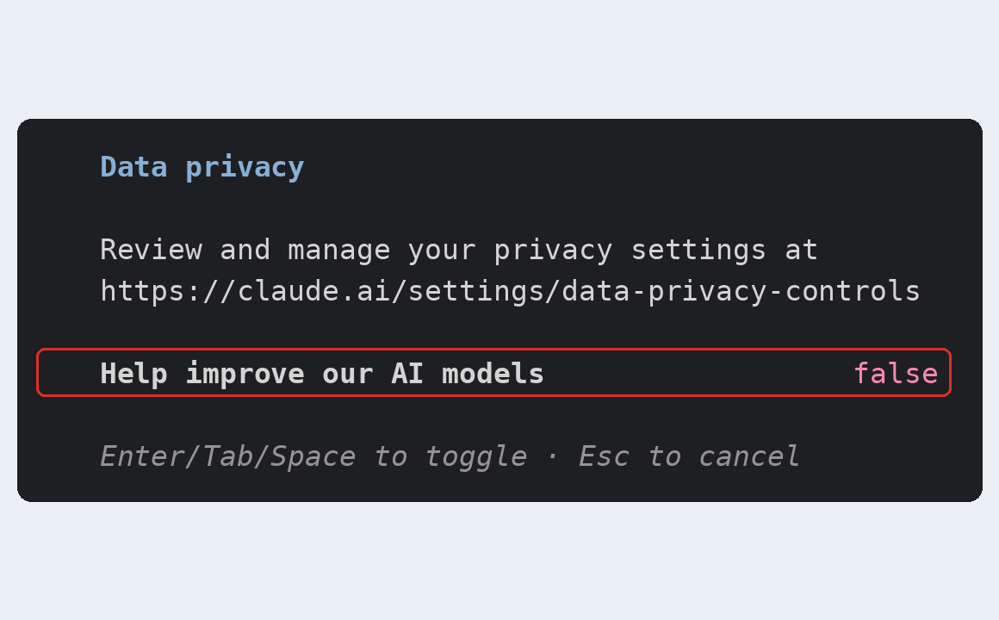{ width="480" loading=lazy }
  <figcaption>학습 설정은 쓰는 서비스마다 따로 끕니다 — Claude Code에서도 같은 계정 설정('모델 개선' 꺼짐)이 보입니다(시연 준비 화면)</figcaption>
</figure>

---

## 01 AI 지형 2026 {#ch01}

### AI · 머신러닝 · 딥러닝 · LLM — 큰 원 안의 작은 원

| 말 | 한 줄 |
|---|---|
| **인공지능(AI)** | 사람의 판단 · 언어 · 인식을 기계가 하게 하는 기술 전체(사람이 쓴 규칙도 포함) |
| **머신러닝** | 사람이 규칙을 쓰는 대신 **데이터와 정답에서 규칙을 배운다** — 3일차 연체 예측 모델 |
| **딥러닝** | 여러 층의 신경망으로 이미지 · 소리 · 긴 글처럼 규칙으로 쓰기 어려운 것을 배운다 |
| **생성형 AI · LLM** | 엄청난 양의 글로 학습해 새 글 · 코드 · 표를 만든다 |

쓰임도 두 가지입니다 — **판별**("이 바이어가 연체할까?")과 **생성**("독촉 메일 초안을 써 줘"). 이 과정은 둘 다 씁니다.

<figure markdown="span">
  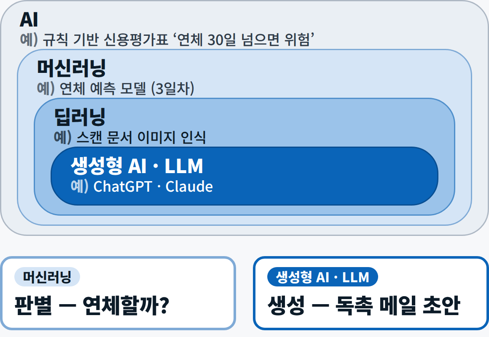{ width="560" loading=lazy }
  <figcaption>큰 원 안의 작은 원 — 규칙 기반 신용평가표도 AI, 3일차 연체 예측은 머신러닝, ChatGPT · Claude는 LLM</figcaption>
</figure>

### 2026년 10월의 주요 모델 — 회사보다 계층으로 기억한다

| 회사 | 최상위 | 주력 | 경량 | 쓰는 앱 |
|---|---|---|---|---|
| Anthropic | Claude Fable 5.1 | Claude Opus 5.5 · Sonnet 5.5 | Claude Haiku 5.5 | Claude · Claude Code |
| OpenAI | GPT-6 Astra | GPT-6.1 Sol | GPT-6 Luna | ChatGPT · Codex |
| Google | Gemini 3.1 Pro | Gemini 3.8 Flash | Gemini Flash-Lite | Gemini · Gemini Notebook |
| 오픈 모델 | – | DeepSeek V4.1 · Qwen3.8 · K-EXAONE 2.0 | Gemma 4 | 사내 서버 · 내 PC |

- **모델은 반년이면 바뀝니다.** 이름이 아니라 **계층(최상위 · 주력 · 경량)과 일의 종류**로 고릅니다. 10/14에 ChatGPT에서 GPT-5.5가 은퇴하는 것처럼 반년 전의 최신 모델이 화면에서 사라집니다.
- 잘 모르겠으면 주력부터(Anthropic의 권고는 "잘 모르면 Opus 5.5부터"). 아주 까다로운 추론이나 긴 에이전트 작업만 최상위, 같은 일을 수천 번 반복하는 분류 · 정보 뽑기는 경량이 맞습니다.
- 주력 모델은 모두 약 100만 토큰 창을 갖고, 답하기 전에 **생각(추론)** 하는 것이 기본입니다.
- 오픈 모델은 데이터를 밖으로 내보낼 수 없는 회사의 선택지입니다.

### AI 도구는 네 층 — 회사가 달라도 구조는 같다

<figure markdown="span">
  { loading=lazy }
  <figcaption><strong>만들기</strong>(코드 · 데이터 · Git까지 — 시연 3 · 4) · <strong>맡기기</strong>(목표를 주면 완성 파일을 돌려줌 — 시연 5) · <strong>조사</strong>(근거 달린 보고서 — 시연 1) · <strong>대화</strong>(묻고 답하기 — 시연 2)</figcaption>
</figure>

위층일수록 **AI가 혼자 하는 일이 늘고, 사람이 확인할 곳도 늘어납니다.** 제품 이름은 자주 바뀌니 "무엇을 맡기는 층인가"로 기억하세요.

### 에이전틱 AI와 버티컬 AI — 서로 다른 축

<div class="tf-stack" markdown>

| | 에이전틱 AI (Agentic AI) | 버티컬 AI (Vertical AI) |
|---|---|---|
| 묻는 것 | **어떻게 일하나** | **어느 분야를 아나** |
| 뜻 | 목표를 주면 계획 → 도구로 행동 → 결과 확인 → 반복을 스스로 잇는다 | 범용 모델에 한 산업의 데이터 · 규정 · 도구를 붙인다 |
| 예 | 바이어 공시 검색 → 재무 요약 → 심사 메모 초안 | 신용장 규칙을 붙인 수출서류 심사 AI |
| 흔한 오해 | 사람 확인이 필요 없다 → **발송 · 한도 변경은 사람이 승인** | 새 모델을 학습시켜야 한다 → 대부분 **문서 · 규칙 · 도구 연결** |

</div>

이 과정 6일 동안 만드는 것이 작은 '무역금융 버티컬 에이전트'입니다.

### 시연 1 — 딥 리서치로 사례 조사

<div class="tf-flow" markdown>
<div markdown><b>상황</b> 팀장 — "다른 회사는 무역금융에 AI를 어떻게 쓰나? 사례 몇 개 정리해 줘." 검색으로 하면 1–2시간이고 기사마다 수치가 다릅니다.</div>
<span>→</span>
<div markdown><b>입력</b> 조사 질문 + 범위(기간 · 기관 · 분야) + 결과 표의 열 8개</div>
<span>→</span>
<div markdown><b>결과</b> 근거 링크가 달린 사례 표 8–10건 + '덜 확실한 부분' 3줄 + 진행 기록(검색어 · 읽은 페이지)</div>
</div>

**배운 점**

1. **맡기는 일이 클수록 범위와 표의 모양을 먼저 정한다.** "수치가 없으면 '공개 안 됨'이라고 쓰고 추정하지 마"라는 한 줄이 그럴듯한 숫자를 지어내지 못하게 막습니다.
2. **진행 기록은 에이전트의 작업 흔적**입니다. 결과를 믿기 전에 흔적부터 봅니다.
3. **근거 링크는 열어서 대조**합니다 — 링크가 열린다고 끝이 아니라 발표일 · 수치를 본문과 맞춰야 어긋남이 잡힙니다. 일치 · 불일치 판정은 AI가 아니라 **사람이** 합니다.
4. 숫자를 볼 때는 **누가 말한 숫자인가**(기관 발표 · 언론 보도 · 벤더 주장)를 함께 봅니다. 리허설 결과에서 국내 사례는 모두 수치가 '공개 안 됨'이었고, 숫자가 있는 행은 모두 벤더가 한 말이었습니다.

??? prompt "시연 1 프롬프트 — 펼쳐서 보기"

    ```text
    <목표> 무역금융·수출채권 관리 분야에서 AI를 실제로 도입한 사례를 조사해 표로 정리해 줘. </목표>
    <범위>
    - 기간: 2025-01 이후 발표되거나 보도된 사례
    - 기관: 은행, 무역보험·신용보험사, 신용평가·신용조사 회사, 수출기업 (국내 사례 3건 이상 포함)
    - 분야: 신용한도 심사, 수출서류 심사, 매출채권 회수·독촉, 신용분석 보고서, 무역 사기 탐지 </범위>
    <출력> 1) 표 — 열: 기관 | 나라 | 무엇을 자동화했나 | AI 방식(ML·생성형·에이전트)
    | 공개된 성과 수치 | 수치의 성격(기관 발표·언론 보도·벤더 주장) | 근거 링크 | 발표일
    8–10건. 수치가 없으면 '공개 안 됨'이라고 쓰고 추정하지 마.
    2) 표 아래에 '덜 확실한 부분' 3줄 </출력>
    ```

---

## 02 LLM 원리 {#ch02}

> 수식은 쓰지 않습니다. "답이 어떻게 만들어지고 왜 틀리는가"를 알면 프롬프트 쓰는 법과 검증하는 법이 따라옵니다.

### LLM이 만들어지는 과정 — 네 단계

| 단계 | 하는 일 |
|---|---|
| ① **사전학습** | 책 · 웹 · 코드 수조 토큰을 읽으며 **'다음 토큰 맞히기'**만 반복 — 스마트폰 자판의 다음 단어 추천을 인터넷 규모로 키운 것 |
| ② **사후학습** | 질문 · 모범 답 예시로 **지시 따르기**를 배우고, 사람이 더 낫다고 고른 답 쪽으로 다듬어진다(신입사원 교육) |
| ③ **추론 · 도구 훈련** | 답하기 전에 **생각**하는 단계를 거치고, 검색 · 코드 실행 같은 **도구**를 쓰는 연습을 한다 |
| ④ **서비스** | 채팅 앱 · API · 에이전트 형태로 우리에게 제공된다 |

**지식 기준일 이후의 일은 모릅니다**(최신 Claude 모델은 2026년 6월). 오늘 아침 환율이나 어제 나온 공시는 검색이나 파일로 직접 넣어 줍니다.

### 토큰 {#term-token}

**토큰(Token)** — 모델이 글을 다루려고 잘게 자른 조각. **요금과 한도의 단위**입니다.

- 같은 뜻이라도 언어 · 모델마다 토큰 수가 다릅니다(예: "수출 대금을 안전하게 받으려면 신용장이 필요하다"는 한 토크나이저에서 15조각, 같은 뜻의 영어 문장은 13조각). 영어 기준 대략 3.5글자가 1토큰이고 한국어는 더 많이 나오는 편입니다.
- **요금 = 토큰 수 × 단가**(입력 · 출력 따로). 한 번에 넣을 수 있는 양(컨텍스트 창)과 구독 사용 한도도 토큰으로 셉니다.
- 감을 잡자면 영문 분기 공시 한 편은 수만 토큰입니다. 최신 Claude 모델은 새 토크나이저를 써서 같은 글에서 토큰이 이전 세대보다 약 30% 더 나옵니다.

<figure markdown="span">
  { width="560" loading=lazy }
  <figcaption>모델은 글을 토큰 조각으로 읽습니다 — 조각 수가 곧 요금과 한도의 단위입니다</figcaption>
</figure>

### 다음 토큰 예측과 샘플링

모델은 지금까지의 글을 보고 **다음에 올 토큰 후보마다 확률을 계산**한 뒤, 하나를 골라 붙이고 다시 계산하기를 반복합니다. 고르는 방식(**샘플링**)에 무작위성이 있어서 **같은 질문에도 답이 달라집니다.**

- **온도**: 무작위성을 정하는 값 — 낮으면 보수적, 높으면 다양. 0이어도 같은 답은 보장되지 않고, 최신 Claude는 온도를 바꿀 수 없습니다.

<figure markdown="span">
  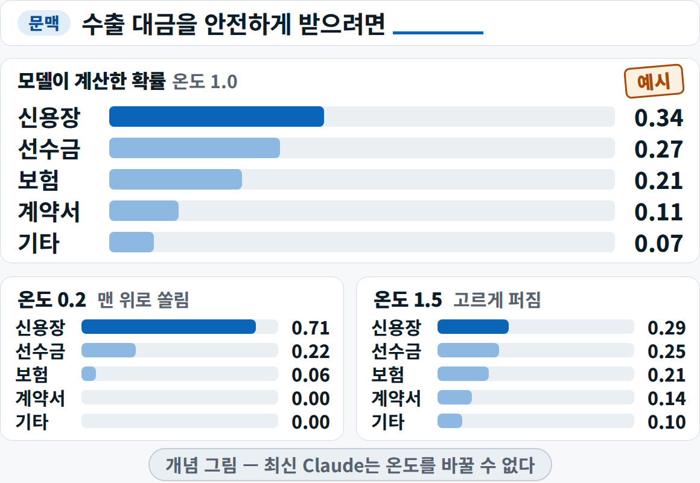{ width="560" loading=lazy }
  <figcaption>후보마다 확률을 계산해 하나를 고릅니다 — 온도가 낮으면 맨 위로 쏠리고 높으면 고르게 퍼집니다(설명용 예시 값)</figcaption>
</figure>
- 그래서 2026년에 품질을 잡는 법은 **① 형식을 정하고 ② 생각의 깊이를 고르고 ③ 결과를 검증**하는 것입니다. 같은 질문을 두세 번 돌려 답이 엇갈리는 곳을 의심하는 것도 좋은 방법입니다.

### 컨텍스트 창 {#term-context}

**컨텍스트 창(Context window)** — 모델이 답을 만들 때 **한 번에 참고하는 텍스트의 최대량**(토큰).

- 비유하면 **책상**입니다. 지시문 + 올린 파일 + 대화 기록 + 도구 결과 + 지금 쓰는 답이 책상 위에 올라갑니다. 최신 Claude는 100만 토큰, 답은 한 번에 최대 12.8만 토큰입니다.
- 넓다고 다 쏟아 놓으면 필요한 것을 못 찾습니다 — 많이 넣을수록 정확도와 회상이 떨어지는 현상을 **context rot**이라 부릅니다.
- 습관: **새 일은 새 대화**로, 긴 작업은 중간에 요약해서 이어 갑니다.

<figure markdown="span">
  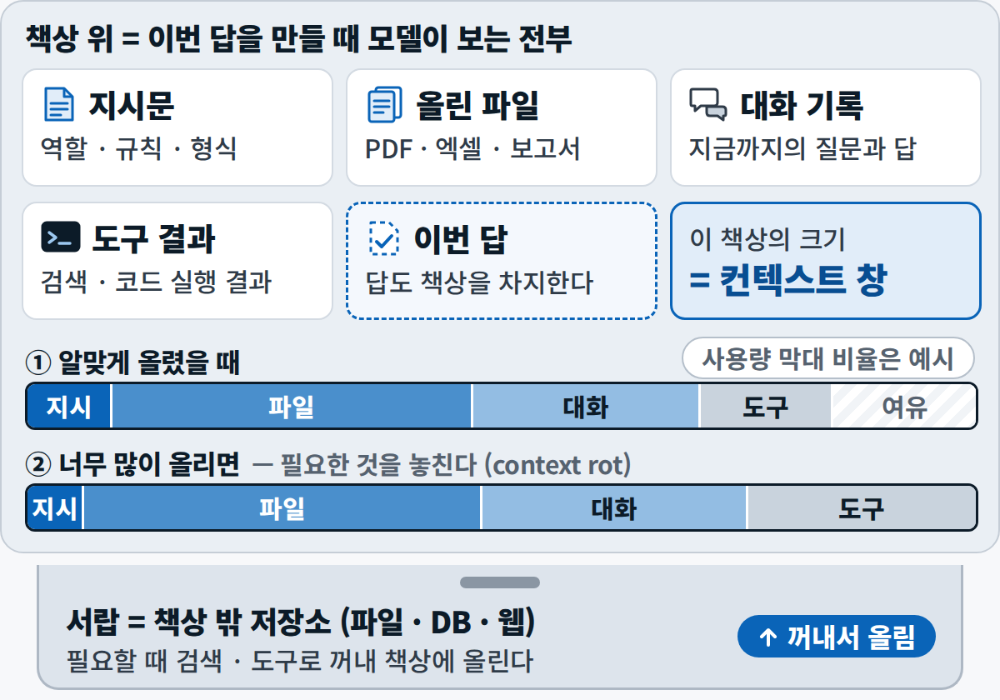{ width="560" loading=lazy }
  <figcaption>책상 위가 이번 답을 만들 때 모델이 보는 전부입니다 — 너무 많이 올리면 필요한 것을 놓칩니다(context rot)</figcaption>
</figure>

### 할루시네이션과 그라운딩 {#term-hallucination}

<div class="tf-stack" markdown>

| | 할루시네이션 (Hallucination) | 그라운딩 (Grounding) |
|---|---|---|
| 뜻 | 그럴듯하지만 **틀린 내용을 사실처럼** 만드는 현상 | 답을 **준 근거**(문서 · 검색 결과)에 묶는 방법 |
| 왜 / 어떻게 | 확률로 빈칸을 채운다 · 기준일 이후를 모른다 · 잘못된 전제를 따라가기도 한다 | 준 근거만 쓰게 · 인용을 먼저 · 모르면 비우게 · 문장마다 근거 위치(쪽 · 조항 · 링크) · 여러 번 돌려 비교 · 숫자는 코드로 |
| 예 | 없는 조항 번호 · 그럴듯한 수치 · 가짜 링크 | "이 조항만 근거로 답하고 해당 문장을 인용해. 조항에 없으면 없다고 해" |

</div>

**줄일 수는 있어도 0으로 만들 수는 없습니다. 맞은 답도 근거가 없으면 확인할 수 없습니다.**

#### 짧은 라이브 1 — 근거 없이 vs 근거 붙여 {#live1}

잘못된 전제("서류 제시기간을 선적 후 30일로 정한 조항은 몇 조?")를 일부러 넣어 물었습니다. 근거 없이 물으면 최신 모델은 전제를 바로잡고 맞게 답하는 경우가 많지만, **그 답이 맞는지 우리가 확인할 길이 없습니다.** 신용장 통일규칙의 해당 조항 한 단락을 붙이고 "이 조항만 근거로, 해당 문장을 인용하라"고 하면 답이 조항 문장에 묶이고, 인용 문장을 원문과 글자 그대로 대조할 수 있습니다.

### 대화에서 에이전트로 — 네 단계

| 단계 | 하는 일 |
|---|---|
| ① **대화** | 묻고 답한다 — 초안 · 요약 · 번역. 학습한 지식으로만 |
| ② **추론** | 답하기 전에 생각한다. Opus · Fable은 이 생각을 끌 수 없고 깊이(effort)만 고른다 |
| ③ **도구 사용** | 검색 · 코드 실행 · 파일 읽기를 부른다 — 최신 정보와 정확한 계산은 도구가 맡는다 |
| ④ **에이전트** | 도구를 루프에서 스스로 쓴다 — 모으기 → 행동 → 확인 → 반복 |

위로 갈수록 맡기는 일이 늘어나니, **되돌릴 수 없는 일에는 반드시 사람 승인**을 둡니다. 오늘 시연 3 · 4의 Claude Code가 4단계입니다.

### 비용과 한도는 토큰으로 계산한다

- Claude Opus 5.5는 100만 토큰당 **입력 $4 / 출력 $20**(출력이 5배 비쌉니다). 경량 Haiku 5.5는 $0.10 / $0.50, 최상위 Fable 5.1은 $10 / $50입니다. → "짧게, 정해진 형식으로" 답하게 하는 것이 곧 비용 절감.
- 에이전트는 채팅보다 토큰을 약 **4배**, 여러 에이전트가 함께 일하면 약 **15배**까지 씁니다 — 값어치가 있는 일에만.
- 개인 구독(Pro · Max)은 쓴 만큼 내는 대신 5시간 단위 · 주간 **사용 한도**가 있고, 채팅 · Cowork · Claude Code가 같은 한도를 나눠 씁니다.
- **라우팅**: 숫자 추출은 경량, 판단이 들어가는 메모는 주력처럼 섞어 씁니다. 회사 도입 비용은 '사용자 수 × 호출 수 × 토큰 × 단가'로 어림하고, 6일차 도입 기획에서 직접 계산합니다.

---

## 03 Claude 도구 3종 {#ch03}

같은 모델이 세 작업대에서 일합니다. 차이는 모델이 아니라 **권한**(무엇을 볼 수 있고, 무엇을 할 수 있나)입니다.

| 구분 | Claude 채팅 | Claude Cowork | Claude Code |
|---|---|---|---|
| 한 줄 | 물어보고 받는다 | 맡기고 나중에 받는다 | 내 PC에서 만든다 |
| 일하는 곳 | 브라우저 · 앱 | 데스크톱 앱 · 통합 대화 | VS Code · 터미널 · 데스크톱 · 웹 |
| 다루는 파일 | 올린 파일 | 연결한 폴더 | 프로젝트 저장소 전체 |
| 실행 위치 | Anthropic 샌드박스 | Anthropic 클라우드 | 내 PC(승인 후) · 웹판은 클라우드 |
| 남는 것 | 대화 기록 | 결과 파일(Word · Excel · PPT) | **스크립트 + Git 커밋** |
| 비슷한 도구 | ChatGPT | ChatGPT Work | Codex |
| 이럴 때 | 질문 · 초안 · 파일 1–3개 | 여러 파일 → 문서 하나 | 반복 · 재현 · 코드 · 데이터 |

- **'남는 것'이 가장 중요한 줄입니다.** 채팅의 답은 다시 물으면 달라지지만 Claude Code가 남긴 스크립트는 다음 달에 돌려도 같은 숫자를 냅니다(**재현**). 매달 반복하는 집계처럼 같은 결과가 다시 나와야 하는 일은 Claude Code와 Git으로 합니다.
- Pro · Max에서는 채팅과 Cowork가 **하나의 Claude**로 합쳐지는 중이라 계정에 따라 화면이 다를 수 있습니다.
- 어느 도구든 **모델은 AI 회사 서버에서 돕니다.** Claude Code가 내 PC에서 명령을 실행해도 읽은 파일 내용은 모델에게 보내집니다.

### 요금제와 데이터 설정

<div class="tf-stack" markdown>

| 구분 | Claude | ChatGPT |
|---|---|---|
| 무료 | 채팅 · 파일 분석 · 코드 실행 — **Cowork · Claude Code는 없다** | 대화 · Codex(경량 모델) · 파일 업로드는 하루 몇 개 수준 |
| 개인 유료(월) | Pro $20 · Max $100 / $200 — Claude Code · Cowork · Research | Plus $20 — Work · Codex · 딥 리서치 · 데이터 분석 |
| 회사용 | Team · Enterprise — 기본으로 학습하지 않는다 | Business · Enterprise — 기본으로 학습하지 않는다 |
| 학습 끄기 | 설정 › 개인정보 › 모델 개선 끄기 | 설정 › 데이터 제어 › '모델 개선을 위한 데이터 학습 허용' 끄기 |
| 주의 | 좋아요 · 싫어요를 누르면 그 대화가 학습될 수 있다 | 임시 채팅은 학습하지 않는다 |

</div>

개인 계정은 무료든 유료든 설정을 끄지 않으면 대화가 모델 개선에 쓰일 수 있습니다(Claude는 학습을 허용하면 대화를 최대 5년, 끄면 30일 보관). 학습을 꺼 두어도 **좋아요 · 싫어요 버튼을 누르면** 그 대화가 개선용으로 저장될 수 있으니 누르지 않습니다. → 오후 [실습 A-1 · 01](lab-a.md#a1-check)에서 모두 이 설정부터 끕니다.

---

## 04 AI에게 일 시키는 법 {#ch04}

### 프롬프트에서 컨텍스트로

좋은 답은 AI가 **보는 모든 것**을 설계할 때 나옵니다. AI가 답을 만들 때 실제로 보는 재료는 여섯 가지입니다 — **규칙 파일 · 지시 · 자료 · 예시 · 도구 결과 · 대화 기록**.

- 프롬프트 엔지니어링이 문장 한 줄을 다듬는 일이라면, **컨텍스트 엔지니어링**은 이 여섯 가지 가운데 **무엇을 책상에 올릴지 고르는 일**입니다. 목표는 "원하는 답이 나올 가능성을 가장 높이는, 가장 작은 고신호 묶음"입니다.
- 출장 가방을 싸듯, 다 넣지 말고 '어디에 있는지'만 알려 두었다가 필요할 때 꺼내 오게 합니다(Claude Code가 `CLAUDE.md`는 처음부터 읽고 나머지 파일은 필요할 때 찾아 읽는 방식).
- 신용조사 보고서 열 건을 통째로 붙이는 것보다 **'이번 판단에 필요한 세 쪽'**을 골라 주는 쪽이 낫습니다.

<figure markdown="span">
  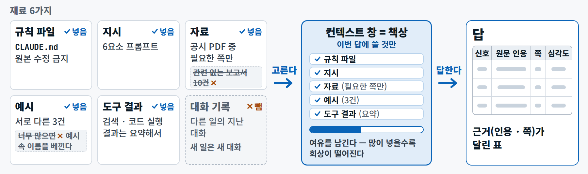{ loading=lazy }
  <figcaption>고른다 → 답한다 — 관련 없는 보고서 · 지난 대화는 빼고, 이번 판단에 필요한 것만 책상에 올립니다</figcaption>
</figure>

### 좋은 프롬프트의 6요소 — 역할 · 맥락 · 과제 · 형식 · 예시 · 제약

프롬프트는 똑똑하지만 **우리 회사 사정을 모르는 신입**에게 주는 업무지시서입니다. 태그로 칸을 나누면 AI도 사람도 어디까지가 지시이고 어디부터가 자료인지 헷갈리지 않습니다.

```text
<역할> 수출기업 신용관리팀 분석가 </역할>
<맥락> 이 바이어에게 60일 외상(O/A)으로 수출을 검토 중. 결정은 사람이 한다 </맥락>
<과제> 첨부 공시에서 대금 지급 위험 신호를 모두 찾아라 </과제>
<형식> 표: 신호 | 원문 인용 | 원문 쪽 | 심각도(상/중/하) | 왜 위험한가 </형식>
<예시> 매출 급감 | "Revenue … decreased" | p.32 | 중 | 현금을 버는 힘이 줄어든다 </예시>
<제약> 원문에 없으면 '명시되지 않음'. 쪽은 각 쪽 바닥의 원문 번호 </제약>
```

- **이유를 붙이면** 더 잘 따릅니다 — "우리가 60일 외상을 준다"를 알면 AI가 무엇을 위험으로 볼지 스스로 고릅니다.
- **예시**는 실제와 닮고 서로 다른 것 두세 개면 됩니다(많아도 세 개 — 너무 많으면 예시 속 이름을 베낍니다).
- **'하지 마'보다 '이렇게 하라'**가 잘 통합니다 — 그래서 제약이 "모르면 '명시되지 않음'이라고 써라"입니다.
- 긴 문서는 **위에**, 질문은 **맨 아래**에 둡니다. 형식을 **표나 JSON**으로 정하면 엑셀 · 코드로 바로 옮기고 한 칸씩 대조해 검증하기 쉽습니다.

### 근거를 요구하고, 고쳐서 저장한다 — 다섯 단계

| 단계 | 하는 일 |
|---|---|
| ① 요청 | **형식과 근거** — 인용 · 위치를 함께 지정한다 |
| ② 확인 | 인용은 원문에서 ++ctrl+f++, 숫자는 코드로 다시 계산한다 |
| ③ 되묻기 | 틀린 행을 짚어 **그 부분만** 다시 요청한다("3번 행 인용이 원문에 없다, 그 행만 다시") |
| ④ 저장 | 잘 된 프롬프트에 **이름 · 판 번호**를 붙여 `prompts` 폴더에 |
| ⑤ 공유 | 팀 프롬프트 라이브러리 — Git으로 바뀐 이력까지 |

프롬프트 끝에 "모르면 비워라", "덜 확실한 곳을 표시해라", "필요한 정보가 있으면 먼저 물어라"를 붙이면 AI가 오류를 꽤 잡아냅니다. 지우기나 메일 발송처럼 되돌리기 어려운 일은 먼저 묻게 합니다.

### 시연 2 — PDF 공시에서 위험 신호 뽑기

<div class="tf-flow" markdown>
<div markdown><b>상황</b> 미국 반도체 소재 회사가 새 바이어 후보로 들어와 **60일 외상(O/A)**을 요청했습니다. 가진 것은 영문 분기 공시 PDF 11쪽뿐입니다.</div>
<span>→</span>
<div markdown><b>입력</b> 같은 PDF + 한 줄 질문("이 회사 재무 괜찮아?") vs 6요소 프롬프트(인용 · 쪽 요구)</div>
<span>→</span>
<div markdown><b>결과</b> 신호 · 원문 인용 · 쪽 · 심각도 · 이유가 달린 표 + 같은 결과의 JSON + 두 번째 AI와의 비교</div>
</div>

<figure markdown="span">
  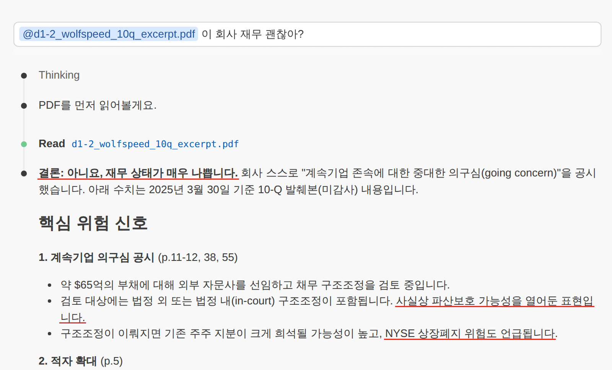{ loading=lazy }
  <figcaption>Before — 답은 구체적이지만 영어 원문 인용이 없고 결론 문장에는 쪽도 없어 검증하기 어렵습니다(시연 2 화면)</figcaption>
</figure>

<figure class="result" markdown="span">
  { loading=lazy }
  <figcaption>After — 같은 문서 · 같은 AI, 질문만 바꿨습니다. 인용과 쪽이 있어 1분 안에 원문과 대조할 수 있습니다(시연 2 화면)</figcaption>
</figure>

**배운 점**

- **같은 문서, 같은 AI, 질문만 바꿨습니다.** 한 줄 질문("이 회사 재무 괜찮아?")의 답은 생각보다 구체적이지만 **영어 원문 인용이 없고**, 결론 같은 판단 문장에는 쪽도 없습니다 — 읽을 수는 있어도 **검증하기 어려운 답**입니다.
- 6요소 프롬프트의 답은 신호 · **원문 인용** · **쪽** · 심각도 · 이유가 달린 표입니다. 인용 두 개를 PDF 뷰어에서 ++ctrl+f++로 1분 안에 확인할 수 있었습니다. PDF 뷰어는 "4 / 11"이라 하는데 쪽 바닥 번호는 12라서, 프롬프트에 **"쪽은 각 쪽 바닥의 원문 번호"**라고 못 박은 이유가 여기서 보입니다.
- 같은 결과를 **JSON 배열**로 다시 받으면 칸 이름이 그대로 엑셀 · 코드로 이어집니다(표와 JSON의 개수가 늘 같지는 않습니다).
- **두 번째 AI(ChatGPT 등)에 같은 일**을 시키면 신호 수 · 심각도 · 인용한 쪽이 달라집니다. 정답이 하나인 계산이 아니라 판단이라서입니다 — **겹치는 곳은 믿을 만한 출발점, 갈리는 곳이 사람이 볼 곳**입니다.
- 차이를 만든 것은 모델이 아니라 **'근거를 요구했느냐'**입니다. 인용을 직접 확인한 뒤라면 이 표를 '초안'으로 올릴 수 있습니다. → 오후 [실습 A-2](lab-a.md#a2)에서 다른 회사(Halden)의 보고서를 Claude Code로 읽고 파일로 저장합니다.

---

## 05 개발 환경 세팅 {#ch05}

왜 채팅창이 아니라 VS Code일까요? 채팅창에는 파일 몇 개를 올릴 수 있을 뿐이지만, VS Code에서는 AI가 **프로젝트 폴더 전체**를 보고, 코드를 실행하고, 바뀐 **이력**까지 남깁니다. 개발자가 되자는 것이 아니라 **AI와 함께 파일을 다루는 작업대**를 갖추자는 것입니다.

### VS Code 화면 다섯 구역

<div class="tf-stack" markdown>

| 번호 | 구역 | 한 줄 |
|---|---|---|
| ① | **탐색기** | 프로젝트 폴더의 파일을 고른다 |
| ② | **편집기** | CSV · Markdown · 코드 · 노트북을 보고 고친다 |
| ③ | **터미널** | 글자로 명령을 내리는 창 |
| ④ | **소스 제어** | 바뀐 파일 보기 · 커밋 · push (파란 숫자 = 바뀐 파일 수) |
| ⑤ | **Claude Code 패널** | 대화로 일을 시키고, 바뀔 내용(diff)을 먼저 본다 |

</div>

<figure markdown="span">
  { width="680" loading=lazy }
  <figcaption>① 탐색기 ② 편집기 ③ 터미널 ④ 소스 제어 ⑤ Claude Code 패널 — 입력창 아래에 모드와 모델 이름</figcaption>
</figure>

엑셀에 비유하면 탐색기는 파일 목록, 편집기는 시트, 터미널은 매크로 실행 창, 소스 제어는 변경 기록, Claude Code는 옆자리 동료입니다. 확장은 **세 개**만 설치합니다 — Claude Code for VS Code(게시자 Anthropic) · Python · Jupyter.

### 터미널과 파이썬 준비

```text
pwd                     # 지금 있는 폴더
ls                      # 파일 목록
cd tradefin-my-T1-01    # 내 저장소 폴더로
git --version           # Git 설치 확인
uv --version            # 파이썬 도구 uv 확인
uv sync                 # 잠금 파일대로 .venv에 설치
uv run python scripts/hello.py
code .                  # 이 폴더를 VS Code로 열기
```

- **uv** — 파이썬 · 패키지 · **가상환경(`.venv`)**을 한 번에 맡는 도구. `.venv`는 프로젝트마다 따로 쓰는 파이썬 상자입니다.
- **잠금 파일(`uv.lock`)** — 설치한 패키지의 정확한 판을 적은 파일. 레시피의 '밀가루 적당히'가 아니라 '312g'이라서 누가 `uv sync`를 해도 같은 환경이 됩니다. `pyproject.toml` · `uv.lock`은 커밋하고 `.venv`는 커밋하지 않습니다.
- **판을 고정하는 이유**: 올해 pandas 3이 나오면서 예전 문법이 조용히 달라졌습니다. AI는 학습할 때 본 옛 문법으로 코드를 쓰기 쉬우니, 코드가 깨지면 **오류 메시지 전문**을 그대로 AI에게 다시 줍니다 — 2026년식 AI 코딩의 기본 순환입니다.

### 노트북 vs 스크립트

<div class="tf-stack" markdown>

| | 노트북 (Jupyter, `.ipynb`) | 스크립트 (`.py`) |
|---|---|---|
| 역할 | **탐색하고 설명한다** | **반복하고 검증한다** |
| 특징 | 코드 · 결과 · 설명이 셀마다 함께 남는다. 커널은 프로젝트의 `.venv` | `uv run`으로 처음부터 끝까지 한 번에 — 매달 같은 숫자, 테스트 · 자동화의 단위 |
| 주의 | 셀을 오가며 실행하면 **숨은 상태**가 생긴다 → 마무리는 **'커널 재시작 후 전체 실행'** | AI가 고친 줄을 diff로 리뷰하기 쉽다 |

</div>

탐색은 노트북, 반복은 스크립트 — 노트북에서 굳은 처리는 스크립트로 옮기고, 둘 다 Git으로 이력을 남깁니다.

### Claude Code 설치와 로그인

① 확장 탭에서 'Claude Code'를 검색해 **게시자가 Anthropic**인 'Claude Code for VS Code'를 설치 → ② 폴더를 열 때 **'이 작성자를 신뢰합니까'**에서 신뢰(제한 모드에서는 확장이 동작하지 않음) → ③ 편집기 오른쪽 위 Claude 아이콘으로 로그인(구독 계정은 **Claude.ai Subscription**, API 계정은 Anthropic Console) → ④ 첫 질문 "이 저장소 구조를 설명해 줘". 무료(Free) 플랜으로는 로그인되지 않습니다.

<figure markdown="span">
  { loading=lazy }
  <figcaption>설치 → 신뢰 → 로그인 → 첫 질문. 입력창 아래의 모드 표시(Manual)를 꼭 확인합니다(시연 준비 화면)</figcaption>
</figure>

!!! warning "그럴듯한 말도 확인합니다"
    같은 첫 질문에서 Claude가 두 군데 틀린 적이 있습니다 — 고쳐 둔 파일이 있는데 'git 상태가 깨끗하다'고 했고, 한글 파일 이름을 git이 따옴표로 감싸 보여 준 것을 '이상한 이름'이라고 했습니다. AI의 말도 **소스 제어 화면과 명령 출력**으로 다시 봅니다.

### 권한 모드 — 얼마나 맡길까

권한 모드는 'AI가 묻지 않고 해도 되는 일'의 범위로, 회사의 **전결 규정**과 같습니다 — 조회와 초안은 위임하고 발송과 삭제는 결재를 받습니다.

<div class="tf-stack" markdown>

| 모드 | AI가 묻지 않고 하는 일 | 언제 |
|---|---|---|
| **Manual** | 읽기만 — 편집 · 명령은 매번 승인 | **오늘 수업** · 중요한 파일 |
| Edit automatically | 읽기 + 파일 편집 + 폴더 안 파일 명령 | 익숙한 반복 작업 |
| **Plan 모드**(계획 모드) | 읽고 계획만 — 승인 전에는 편집 차단 | 여러 단계 작업의 시작 |
| Auto | 별도 검토 모델이 사람 대신 허락을 판단 | 최신판의 기본 시작 모드 |
| Bypass permissions | 검사 없이 전부 실행 | 쓰지 않는다 — 격리된 환경 전용 |

</div>

- 시작 모드는 PC마다 다를 수 있어서, 입력창 아래 모드 표시를 꼭 확인하고 **Auto로 되어 있으면 Manual로 바꿉니다.**
- 허락 창이 뜨면 **무엇을 · 어디에 · 지우는지** 세 가지를 읽고, 파일 삭제 · 강제 push · `git reset --hard` 같은 명령은 거절합니다.
- 금지 목록(deny)은 어느 모드에서나 막습니다. 되돌리기는 대화 안의 체크포인트(터미널 명령으로 바뀐 파일은 못 돌립니다) + **Git 커밋**.

### CLAUDE.md — AI의 업무 매뉴얼

`CLAUDE.md`는 Claude Code가 대화를 시작할 때마다 **먼저 읽는 규칙 파일**입니다. 신입에게 주는 업무 매뉴얼처럼 매번 같은 말을 반복하지 않게 해 줍니다.

- **과정 저장소에 이미 들어 있습니다.** 폴더 규칙(원본 `data/`는 읽기만 · 내 작업은 `workbench/` · 코드는 `scripts/`)과 일하는 방식(한국어 · 숫자는 계산식과 코드 · 인용은 글자 그대로 · 모르면 '확인 필요' · 큰 작업은 계획부터 · 지우기 전에 먼저 묻기 · 커밋 메시지는 두 줄)이 적혀 있습니다. 새 프로젝트라면 `/init`으로 초안을 받고, 이미 있으면 내 업무에 맞게 고쳐 씁니다.
- `@` 뒤에 파일 이름을 치면 그 파일을 보고 답하게 할 수 있고, 이름 일부만 쳐도 후보를 찾아 줍니다.
- 주의: `CLAUDE.md`는 **지침이지 강제 장치가 아닙니다**(꼭 막을 것은 권한의 금지 목록으로). 길수록 오히려 지시를 놓치니 "이 줄을 지우면 AI가 실수할까?"를 물어 짧게 다듬습니다.

---

## 06 Git · GitHub 입문 {#ch06}

AI는 파일을 빠르게, 그리고 많이 고칩니다. 그래서 **언제든 되돌릴 수 있는 기록**이 가장 중요한 안전장치입니다. Git을 쓰는 이유는 다섯 가지 — 이력 · 되돌리기 · 브랜치로 실험 나누기 · PR로 검토 후 합치기 · AI와 일할 때의 안전망입니다.

### 파일 이름 대신 이력으로

'최종_진짜최종.xlsx'처럼 파일 이름으로 버전을 관리하면 무엇이 최신인지, 무엇이 왜 바뀌었는지, 누가 고쳤는지 알 수 없게 됩니다. Git은 **파일은 하나, 이력이 쌓입니다.** 점 하나하나가 커밋이고, 커밋마다 **누가 · 언제 · 무엇을 · 왜** 바꿨는지가 남습니다. 되돌리기는 이전 커밋으로, 결정의 이유는 커밋 메시지로. (줄기가 갈라졌다 합쳐지는 branch · PR · merge는 내일 2일차에 직접 해 봅니다.)

<figure markdown="span">
  { loading=lazy }
  <figcaption>파일은 하나, 이력이 쌓인다 — 점 하나가 커밋이고 누가 · 언제 · 무엇을 · 왜가 남습니다</figcaption>
</figure>

### Git은 도구, GitHub은 서비스

<div class="tf-stack" markdown>

| | **Git** — 내 PC의 이력 도구 | **GitHub** — 온라인 저장소 서비스 |
|---|---|---|
| 뜻 | 변경을 스냅샷(커밋)으로 저장 · 비교 · 복원. **저장소 = 프로젝트 폴더 + 이력(`.git`)** | 저장소를 올려 백업 · 공유 · 협업 |
| 특징 | GitHub 없이도 쓴다 — 무료, 내 PC에서. `user.name` · `email`은 로그인이 아니라 **커밋 작성자 표시** | `clone` 내려받기 · `push` 올리기 · `pull` 받기. PR · 이슈 · Actions는 검토와 자동화(2일차부터) |

</div>

오늘은 **과정 템플릿**으로 각자 저장소를 만듭니다. 템플릿으로 만든 저장소는 커밋 하나로 새로 시작해 원본과 이력이 이어지지 않으므로, 매일 아침 그날 파일은 명령 하나로 받습니다.

### 작업 폴더 → 스테이징 영역 → 커밋 → push

택배로 비유하면 — 작업 폴더에서 파일을 고치고 **보낼 물건만 골라 포장대에 올리는 것이 `git add`**(포장대 = 스테이징 영역), **상자를 봉인하고 송장을 붙이는 것이 `git commit`**(세이브 포인트 + 메시지: 무엇 · 왜), **발송이 `git push`**입니다. 반대 방향 `pull`은 GitHub의 새 커밋을 받아 옵니다.

<figure markdown="span">
  { loading=lazy }
  <figcaption>작업 폴더 → 스테이징 영역 → 내 저장소(.git) → GitHub. 처음 한 번은 clone, 그 뒤로는 pull</figcaption>
</figure>

- **push하기 전까지 커밋은 내 PC에만** 있습니다. Git은 기록을 추가만 하므로 커밋한 것은 잃기 어렵고, 커밋하지 않은 변경은 잃을 수 있습니다.
- 왜 '고르는 단계'가 따로 있을까? 바뀐 파일 다섯 개 가운데 이번 결정과 관련된 두 개만 묶어 **하나의 기록**으로 남기기 위해서입니다. 그래야 그 결정만 따로 보고 되돌릴 수 있습니다.

```text
git status                            # 무엇이 바뀌었나
git diff                              # 바뀐 줄 보기
git add scripts/ar_by_method.py       # 커밋할 파일 고르기
git commit -m "1일차: 연체 기준 30일 → 60일" -m "왜: 경영진 보고 기준 통일"
git log --oneline                     # 이력 한 줄씩
git restore scripts/ar_by_method.py   # 커밋 전 변경 취소
git revert a1b2c3d                    # 커밋을 되돌리는 새 커밋
git push                              # GitHub에 올리기
git pull                              # GitHub의 새 커밋 받아오기
```

외우지 않아도 됩니다 — VS Code 소스 제어 버튼으로 하거나 Claude Code에게 "바뀐 내용을 요약해 커밋해 줘"라고 하면 같은 순서를 밟습니다. `commit -m`을 두 번 쓰면 첫 문단은 '무엇', 빈 줄 아래 둘째 문단은 '왜'가 됩니다(우리 `CLAUDE.md`의 형식). `revert`는 이력을 지우지 않고 되돌립니다. 이미 push한 이력을 고쳐 쓰는 두 명령(**강제 push, `reset --hard`**)만은 거절합니다.

### 시연 3 — Claude Code 첫 프로젝트와 첫 커밋

<div class="tf-flow" markdown>
<div markdown><b>상황</b> 결제방식별 미수금 · 연체를 매달 엑셀로 손집계하는데, 담당자가 바뀔 때마다 연체 기준(30일? 60일?)이 달라져 지난달과 비교가 안 됩니다.</div>
<span>→</span>
<div markdown><b>입력</b> 인보이스 CSV 5,033건 + 정의(연체일 · 분모 · 기준일)를 글로 못 박은 프롬프트 — Plan 모드로 계획부터</div>
<span>→</span>
<div markdown><b>결과</b> 집계 스크립트 · 결제방식별 표 · 차트 + GitHub 커밋 2개(30일 기준 → 60일 기준, 메시지에 `왜:`)</div>
</div>

<figure markdown="span">
  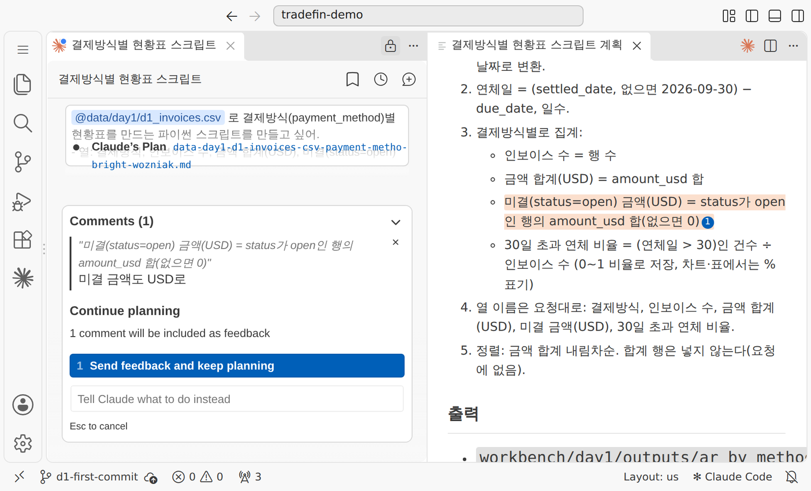{ loading=lazy }
  <figcaption>계획을 읽고 줄 하나에 코멘트를 달아 다시 받은 뒤 승인합니다(시연 3 화면)</figcaption>
</figure>

<figure class="result" markdown="span">
  { loading=lazy }
  <figcaption>커밋 두 개 — 기준을 바꾼 이유가 메시지 둘째 줄 <code>왜:</code>에 남습니다(시연 3 결과)</figcaption>
</figure>

**배운 점**

- **집계를 스크립트로 고정하고, 기준을 바꾼 이유를 이력으로 남깁니다.**
- **순서**: 계획 → 승인 → 실행 → 검산 → 커밋. Plan 모드에서 프롬프트를 보내 **계획 문서를 읽고**, 줄 하나에 코멘트('미결 금액도 USD로')를 달아 계획을 다시 받은 뒤 승인합니다.
- **프롬프트의 핵심은 '정의부터 적는다'**입니다. 열 이름만 주지 않고 '연체일'(= 결제일 − 만기일, 결제일이 없으면 기준일 2026-09-30 − 만기일)과 '30일 초과 연체 비율'(= 연체일이 30을 넘는 인보이스 수 ÷ 그 결제방식의 인보이스 수)의 정의를 글로 못 박았습니다. 정의를 비워 두면 AI는 그럴듯한 기준을 스스로 고릅니다 — 결제가 끝난 인보이스만 분모로 잡으면 D/A가 9.1%가 아니라 7.3%로 나옵니다. 계산은 둘 다 맞지만 **서로 다른 질문에 답한 것**입니다. 마지막 줄 "먼저 계획만 보여 줘"로 분모와 기준일을 눈으로 확인한 뒤 승인합니다.
- **검산**: AI가 낸 숫자 하나는 반드시 다른 방법으로 다시 셉니다(예: LC_SIGHT 인보이스 수를 pandas 한 줄로 → 203 = 203).
- **결과(30일 초과 연체 비율, 기준일 2026-09-30)**

    | 결제방식 | D/A | O/A | D/P | T/T 분할 | L/C · 선수금 |
    |---|---|---|---|---|---|
    | 비율 | 9.1% | 7.1% | 5.0% | 3.9% | 0% |

    첫 커밋은 30일 기준, 두 번째 커밋은 60일 기준(D/A 4.8% · O/A 2.6%)이며 메시지에 `왜: 경영진 보고 기준 통일`이 남습니다. 다음 달에 누가 "왜 60일이죠?"라고 물으면 이 커밋을 보여 주면 됩니다 — 엑셀 파일 이름으로는 남길 수 없던 기록입니다.

- 허락 창은 하나씩 읽고 `1 Yes`. 허락 범위를 넓히는 선택(`allow all edits …`)은 쓰지 않습니다.

→ 오후 [실습 A-1](lab-a.md#a1)에서 같은 흐름(템플릿 → clone → CLAUDE.md 고치기 → 첫 커밋)을 따라 합니다.

---

## 07 데이터 탐색(EDA) 방법론 {#ch07}

### 분석의 표준 순서 — CRISP-DM

데이터 분석에는 업종을 가리지 않는 표준 순서가 있습니다. 6단계를 **앞뒤로 오가며** 갑니다(평가에서 문제가 나오면 준비나 비즈니스 이해로 돌아갑니다).

<div class="tf-stack" markdown>

| 단계 | 하는 일 | 이 과정에서 |
|---|---|---|
| ① 비즈니스 이해 | 무엇을 결정하나 · 성공 기준 | **1일차** |
| ② 데이터 이해 | 구조 · 품질 · 분포 탐색 | **1일차** |
| ③ 데이터 준비 | 정제 · 특성 만들기 | 2일차 |
| ④ 모델링 | 연체 예측 모델 | 3일차 |
| ⑤ 평가 | 지표 · 비용 · 한계 | 3–4일차 |
| ⑥ 배포 | 상황판 · 에이전트 · 도입 | 5–6일차 |

</div>

가장 흔한 실패는 **첫 칸을 건너뛰는 것**입니다. '무엇을 결정하려는 분석인가'가 없으면 예쁜 차트만 남습니다. 오늘 실습 B의 **결제방식별 현안 정의서**가 바로 그 첫 칸입니다.

### 데이터 유형과 깔끔한 표

| 유형 | 예 | 요약 방법 | 흔한 문제 |
|---|---|---|---|
| 수치 · 연속 | 금액 · 비율 | 평균 · 중앙값 · 분포 | 숫자가 글자로 저장('1,200원') |
| 수치 · 이산 | 연체일수 · 건수 | 빈도 · 분포 | 숫자 칸에 '미정' 같은 글자 |
| 범주 · 명목 | 국가 · 결제방식 | 빈도 · 비율 | 같은 값의 다른 표기 |
| 범주 · 순서 | 등급 S · A · B · C | 순서를 지정해 정렬 | 글자순 정렬로 뒤섞임 |
| 날짜 | 선적일 · 만기일 | 기간 계산 | 형식이 여러 가지 |
| 텍스트 | 재무 요약 문장 | AI 요약 · 키워드 | 길이 · 언어가 제각각 |

**깔끔한 표(tidy data)** = **한 행에 관측 하나 · 한 열에 변수 하나 · 한 칸에 값 하나.** 병합 셀과 소계 줄이 있는 엑셀은 깔끔한 표가 아닙니다. '흔한 문제' 열이 곧 "데이터를 의심하라"의 체크리스트입니다(오후 파일의 실제 문제는 직접 찾습니다).

### 인코딩 — 한글이 깨지는 이유 {#term-encoding}

**인코딩(Encoding)** — 글자를 0과 1로 저장하는 규칙. 파일이 망가진 것이 아니라 **저장할 때 쓴 규칙과 읽을 때 쓴 규칙이 다른** 것입니다.

- **UTF-8** = 세계 표준(웹 · 파이썬 · AI 도구), **CP949** = 예전 한글 Windows 표준. 한글 Windows의 엑셀은 앞머리 표식(BOM)이 없는 CSV를 CP949로 열기 때문에 깨집니다.
- 엑셀: **데이터 › 텍스트/CSV에서** 열고 파일 원본 **65001: UTF-8**을 고른다 / 파이썬: `encoding='utf-8-sig'`로 읽고, 깨지면 `'cp949'` / 저장: **'CSV UTF-8'** 형식.
- AI에게 올릴 때도 같습니다 — 깨진 채로 올리면 AI도 깨진 글자를 읽고 그럴듯한 엉터리 답을 만듭니다. → [실습 A-1 · 01](lab-a.md#a1-check)에서 연습 파일 두 개를 열어 견줘 봅니다.

<figure markdown="span">
  { width="560" loading=lazy }
  <figcaption>같은 글자도 저장 규칙에 따라 바이트가 다릅니다 — 규칙을 맞추면 다시 읽힙니다</figcaption>
</figure>

### 기술통계와 분포 — 평균만 보면 속는다

시연 3의 인보이스 5,033건 금액으로 보면 **평균 15,239달러, 중앙값 10,240달러**입니다. 오른쪽 꼬리 끝의 37만 달러짜리 거래처럼 큰 거래 몇 건이 평균을 끌어올립니다.

- 한쪽으로 치우친 데이터(금액 · 연체일수)는 **중앙값과 사분위수**를 같이 봅니다. 표준편차도 큰 값에 끌려갑니다.
- **사분위범위 IQR = Q3 − Q1**(가운데 50%의 폭). 이상치 후보는 Q3 + 1.5×IQR 위, Q1 − 1.5×IQR 아래입니다. 이상치는 '틀린 값'이 아니라 **'확인할 값'** — 큰 수주일 수도, 단위를 잘못 넣은 행일 수도 있으니 **지우기 전에 원인부터** 묻습니다.
<figure markdown="span">
  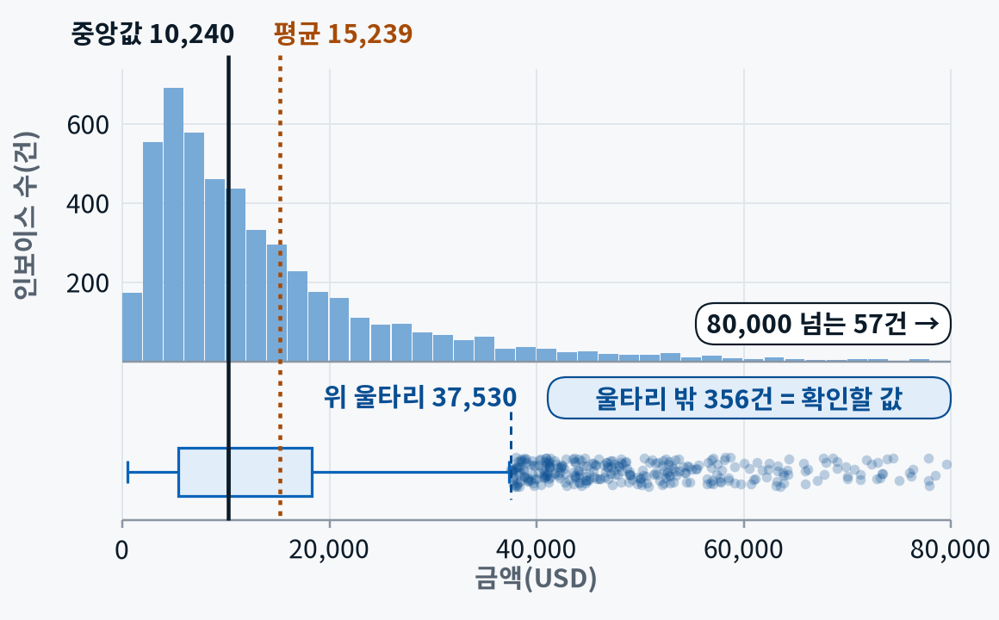{ width="560" loading=lazy }
  <figcaption>오른쪽으로 긴 꼬리 — 평균이 중앙값보다 크고, 울타리 밖 356건은 '틀린 값'이 아니라 '확인할 값'입니다</figcaption>
</figure>

- **결측**: 몇 개 · 어느 열 · 왜? 이 파일에서 결제일이 빈 316건은 오류가 아니라 **대금을 받지 못한 인보이스**(미결 · 대손 · 부도)입니다 — 빈칸에도 뜻이 있습니다.

### 질문에 맞는 차트 고르기

<div class="tf-stack" markdown>

| 질문 | 차트 | 예 |
|---|---|---|
| 비교 | 막대 | 국가별 연체 비율 |
| 추이 | 선 | 월별 인보이스 금액 |
| 분포 | 히스토그램 · 상자 | 연체일수 |
| 구성 | 100% 누적 막대 | 결제방식 비중 |
| 관계 | 산점도 | 유동비율 vs 연체일 |

</div>

숫자 요약만 보면 놓치는 것이 있습니다. 평균 · 분산 · 상관이 소수 둘째 자리까지 같은데 모양이 전혀 다른 네 데이터(앤스컴 콰르텟)처럼 — **EDA는 숫자와 그림을 함께** 봅니다.

<figure markdown="span">
  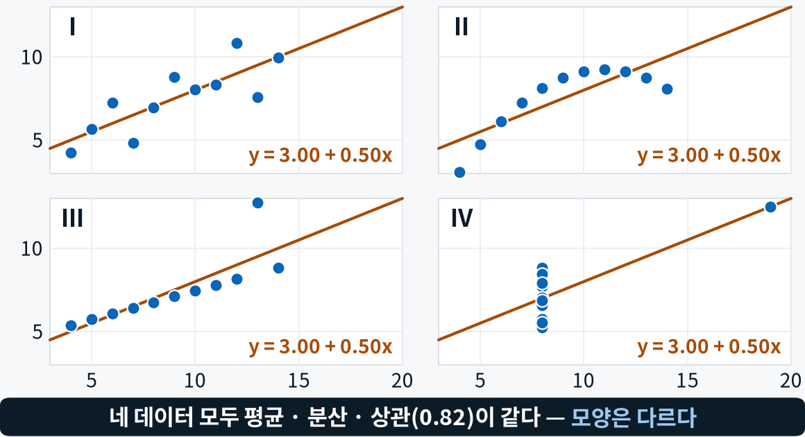{ width="560" loading=lazy }
  <figcaption>네 데이터 모두 평균 · 분산 · 상관이 같지만 모양은 다릅니다 — 그래서 그림을 봅니다</figcaption>
</figure>

 AI에게 차트를 시킬 때는 **질문 · 차트 종류 · 정렬 · 축 · 단위**를 함께 말합니다("국가별 연체 비율을 큰 순서로 막대로, 축은 0부터, 단위는 %"). 산점도는 상관을 보여 줄 뿐 원인을 말해 주지 않습니다.

### EDA 다섯 단계와 데이터 사전

<div class="tf-stack" markdown>

| 단계 | 하는 일 | pandas에서 |
|---|---|---|
| ① 구조 | 한 행이 무엇인가 · 열 유형 · 키 · 중복 | `shape` · `dtypes` |
| ② 품질 | 결측 · 단위 · 표기 흔들림 · 범위 밖 값 | `isna()` · `value_counts()` |
| ③ 분포 | 기술통계 · 히스토그램 · 상자그림 | `describe()` · `hist()` |
| ④ 관계 | 그룹 비교 · 교차표 · 상관 — 결제방식별 연체 | `groupby()` · `crosstab()` |
| ⑤ 질문 · 기록 | **데이터 사전**에 적고 다음에 확인할 질문 3개 | `.md`로 저장 · 커밋 |

</div>

가장 많이 빠지는 단계가 ⑤입니다. **데이터 사전(= 변수 정의서)**은 열 이름 · 뜻 · 유형 · 단위 · 허용값 · 결측 수를 적은 문서이고, 재무 지표 열은 **공식과 위험 방향**(높을수록 위험인지, 낮을수록 위험인지)까지 씁니다. AI에게 맡길 때는 세 가지만 기억하세요 — **원본은 고치지 말 것 · 고치기 전에 진단부터 · 숫자는 코드로.**

### 시연 4 — 엉망인 엑셀에서 EDA 노트북까지

<div class="tf-flow" markdown>
<div markdown><b>상황</b> 영업팀이 보낸 9월말 미수금 엑셀 — 이대로 피벗하면 소계가 한 번 더 더해져 합계가 부풀고 연체 구간이 틀립니다. 팀장의 질문은 하나, **"연체가 어디에 몰렸나?"**</div>
<span>→</span>
<div markdown><b>입력</b> 병합된 제목 · 2단 머리글 · 담당별 소계 줄 · 1,000배로 잘못 들어간 금액 · 세 가지 날짜 표기가 섞인 다중 시트 엑셀</div>
<span>→</span>
<div markdown><b>결과</b> 품질 보고서 · 분석용 읽기 함수 · 데이터 사전 · 실행된 EDA 노트북 — 원본은 한 칸도 바뀌지 않음</div>
</div>

<figure markdown="span">
  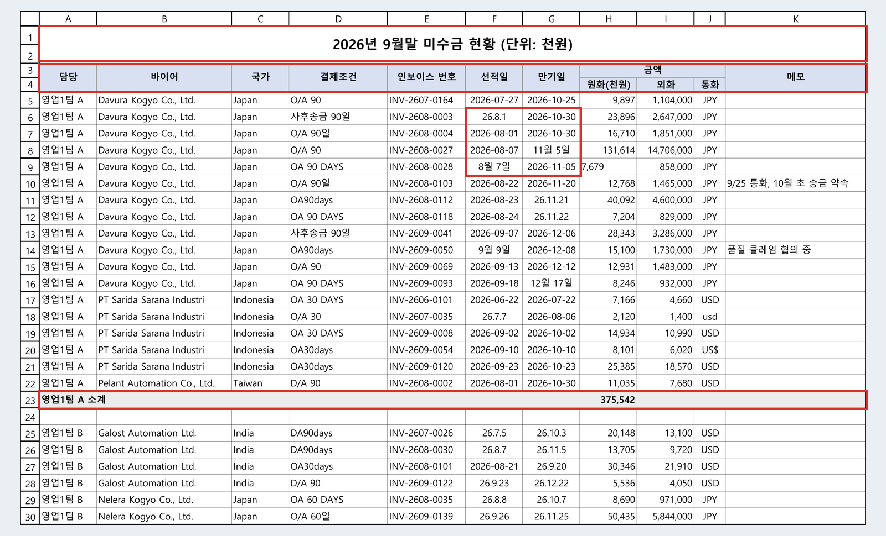{ loading=lazy }
  <figcaption>입력 — 사람이 보기 좋게 만든 표는 분석하기 나쁜 표입니다(시연 4 입력, 가상 데이터)</figcaption>
</figure>

**배운 점**

- **세 개의 프롬프트로 한 번에 하나씩**: ① 진단 — "원본은 절대 수정하지 마", 문제는 위치(시트 · 행 · 열)와 함께, 처리는 **제안까지만** → ② 분석용 읽기 함수(`scripts/read_ar.py`)와 데이터 사전 — 중복은 지우지 않고 **표시만** → ③ EDA 노트북 — 구조 → 기술통계 → 차트 → 해석 → 다음 질문.
- 노트북은 만들고 실행할 때마다 **승인 창**이 뜹니다. 실행 명령의 허락 창이든, 확장 버전에 따라 셀마다 뜨는 Execute 창이든 무엇이 실행되는지 읽고 승인하는 것이 우리 몫입니다. 마무리는 **커널 재시작 후 전체 실행**.
- **AI도 첫 판에 틀립니다.** 보고서를 쓴 뒤 숫자를 코드로 다시 세어 스스로 고친 곳이 있었고, 해석문을 차트와 대조해 맞지 않는 두 곳을 고쳤습니다. 반대로 '사후송금'을 O/A로 볼지는 용어만으로 확정할 수 없어 **사람이 정할 일로 남겼습니다.**
- **결과**: 금액의 84.7%(254건)는 아직 만기 전이고, 연체는 46건(15.3%) — 연체 건수로는 대부분 30일 안쪽이지만 90일 넘게 묵은 9건은 모두 '부도' 메모가 붙은 건입니다. 결제방식은 O/A가 금액의 74.6%. 원본은 한 칸도 바뀌지 않았고 고치는 일(정제)은 내일입니다.

<figure class="result" markdown="span">
  { loading=lazy }
  <figcaption>결과 — 셀 아래에 차트, 바로 밑에 해석. 해석도 차트와 대조해 고칩니다(시연 4 결과)</figcaption>
</figure>

→ 오후 [실습 B](lab-b.md)는 바이어 150곳 파일로 같은 순서를 밟습니다. 이번에는 **오류를 여러분이 직접 찾습니다.**

---

## 08 무역금융 기초 {#ch08}

> 여기서부터는 업무 지식입니다. 무역금융을 깊이 배우는 시간이 아니라, 오후에 숫자를 해석하는 데 필요한 만큼만 봅니다.

### 결제방식과 위험의 위치 — 대금을 언제 받느냐가 누가 위험을 지는지 정한다

<div class="tf-stack" markdown>

| 결제방식 | 돈이 오는 때 | 위험은 |
|---|---|---|
| **T/T 선수금** | 선적 전에 전액 | 수출자 안전 — 돈 먼저, 물건 나중 |
| **L/C**(신용장) | 서류가 조건과 맞으면 **은행이 지급을 약속** | 바이어에서 개설은행으로 옮겨 간다(은행 · 나라 위험은 남는다) |
| **D/P**(지급인도 추심) | 대금을 내야 서류를 내준다 | 수출자 쪽으로 기운다 |
| **D/A**(인수인도 추심) | 어음 인수만으로 서류를 내주고, 만기에 지급 | 수출자 쪽으로 더 기운다 |
| **O/A**(사후송금) | 물건 먼저, 선적 후 N일 뒤 송금 | **수출자 몫** |

</div>

<figure markdown="span">
  { width="560" loading=lazy }
  <figcaption>대금을 언제 받느냐가 누가 위험을 지는지 정합니다 — 아래로 갈수록 수출자 위험</figcaption>
</figure>

시연 3 결과와 맞춰 보면, 우리 인보이스에서 L/C와 선수금은 30일 넘는 연체가 없었고 D/A 9.1% · O/A 7.1%가 가장 높았습니다 — 그림의 오른쪽(수출자 위험)일수록 대체로 연체가 많습니다. 그래서 이 과정의 AI 실습 대상은 **O/A · D/A 채권, 즉 바이어 신용위험**입니다.

### L/C와 T/T — 가장 많이 헷갈리는 두 용어

- **L/C(신용장)** — 은행의 지급 약속. 흐름: 수입자 신청 → 개설은행 → 통지은행 → 수출자. 오해: "L/C면 무조건 안전" → **서류 한 글자가 어긋나도 지급이 거절**될 수 있고, 개설은행과 그 나라의 위험은 남습니다.
- **T/T(전신송금)** — 은행을 통한 송금일 뿐이고, 위험은 **'언제 보내느냐'**가 정합니다. 선적 전이면 선수금, 선적 후 N일이면 사후송금(O/A). 장부에 'T/T'라고만 적혀 있으면 안전한지 위험한지 알 수 없습니다.
- 실제 결제조건은 'T/T 30 days after B/L'처럼 **자유롭게** 적힙니다. 조건을 읽어 **표준 코드로 나눠야** 집계가 됩니다 — 오후 실습 B의 코드표가 바로 이 일이고, 애매한 행은 AI가 아니라 여러분이 판단합니다.

### 바이어 신용정보는 어디서 오나

<div class="tf-stack" markdown>

| 원천 | 무엇 | 이 과정에서 |
|---|---|---|
| **공적 기관** — K-SURE(한국무역보험공사) | 국외기업 신용조사 · 바이어 등급 · 무역보험 | 4일차 한도 · 보험 |
| **신용조사 회사** — D&B · NICE D&B | 전 세계 기업 신용보고서, 지급 점수(1–100) | 실습 데이터의 `pay_score` 열 |
| **공시** — 미국 SEC EDGAR(10-K · 10-Q), 한국 DART | 재무제표 원문 | 시연 2의 분기 공시 |
| **국가위험** — OECD 국가위험분류(0–7) | 나라별 대외 지급 위험 등급 | 실습 데이터의 `oecd_crc` 열 |

</div>

주의할 점: **보고서도 틀리거나 조작될 수 있습니다.** 분식이 의심되는 재무제표로 수입자 등급이 크게 오른 뒤 무역보험 사고가 난 사례가 보도됐습니다. 그래서 숫자는 원문과 대조하고 비율은 직접 계산합니다.

### 재무비율 4종

<div class="tf-stack" markdown>

| 비율 | 식 | 뜻 · 주의 |
|---|---|---|
| **유동비율** (Current Ratio) | 유동자산 ÷ 유동부채 | 1년 안에 갚을 빚 대비 1년 안에 현금이 될 자산(배). **1 미만이면 단기 지급 압박.** 부채 만기 분류가 바뀌면 크게 흔들린다 |
| **부채비율** (Debt-to-Equity) | 총부채 ÷ 자기자본 | 빚에 기대는 정도(배). **자본이 0 이하(자본잠식)면 해석 불가** — 따로 표시. 업종마다 정상 범위가 다르다 |
| **DSO** (Days Sales Outstanding) | 매출채권 ÷ 매출 × **기간 일수** | 외상으로 판 돈을 받는 데 걸리는 평균 날수. **분기 매출이면 91일** — 365를 곱하면 약 4배로 부풀려진다 |
| **영업이익률** (Operating Margin) | 영업이익 ÷ 매출 | 본업으로 남긴 비율. 손실이 이어지면 현금이 마른다(지급 지연 신호). 남겨도 대금이 안 들어오면 위험 — DSO와 함께 읽는다 |

</div>

- **비율 하나는 좋아 보일 수 있습니다.** 시연 2의 회사는 분기 공시에서 유동비율이 4.64배로 아주 건강해 보였지만, 7주 뒤 회생 절차를 신청하자 장기부채가 유동부채로 바뀌면서 0.36배가 됐습니다. 그래서 같은 업종 · 같은 회사의 과거와 비교하고, 분자와 분모의 **단위와 기준일**부터 맞춥니다. 네 비율은 **함께** 읽습니다.
- **DSO(회사 평균) ≠ 연체일수(인보이스 · 바이어별)**. 실습 데이터의 `max_dpd_days`는 바이어별 연체일수입니다.

#### 짧은 라이브 2 — 공시 재무비율을 코드로 계산시키기 {#live2}

Wolfspeed 분기 공시 발췌로 "공식, 대입한 숫자와 위치, 계산 코드를 보여 주고, 분기 매출이므로 기간 일수는 91일로" 계산시켰습니다. 결과는 유동비율 **4.64배** · 부채비율 **34.6배**(총부채 = 유동부채 + 비유동부채) · DSO **80.8일** · 영업이익률 **−104.9%**. 요점은 계산이 아니라 세 가지 — ① `@`로 **파일을 직접 지정**(기억이 아니라 이 문서의 숫자로) ② **공식 · 대입한 숫자와 그 위치**(눌러서 확인) ③ **계산 코드**(숫자는 암산이 아니라 다시 돌릴 수 있는 코드가 낸다). 유동비율만 보면 안전해 보이지만 부채비율 34.6배, 영업이익률 −104.9%, 계속기업 의문까지 — 숫자는 함께 읽어야 합니다. → 오후 [실습 A-2 · 03](lab-a.md#a2-ratios)에서 다른 회사로 해 봅니다.

---

## 정리 {#wrap}

### 시연 5 — Cowork로 오늘을 보고서로

<div class="tf-flow" markdown>
<div markdown><b>상황</b> 하루 동안 만든 표 · 차트 · 노트북 · 진단 보고서가 파일 여섯 개로 흩어졌습니다. 팀장에게 1쪽 메모와 보고 메일을 보내야 합니다.</div>
<span>→</span>
<div markdown><b>입력</b> 결과 폴더(이 폴더만 연결) + 만들 것 · 근거 표시 · 승인 시점을 정한 프롬프트</div>
<span>→</span>
<div markdown><b>결과</b> Word 메모 1쪽 + 메일 초안 5줄 — 숫자마다 근거 파일 이름</div>
</div>

<figure markdown="span">
  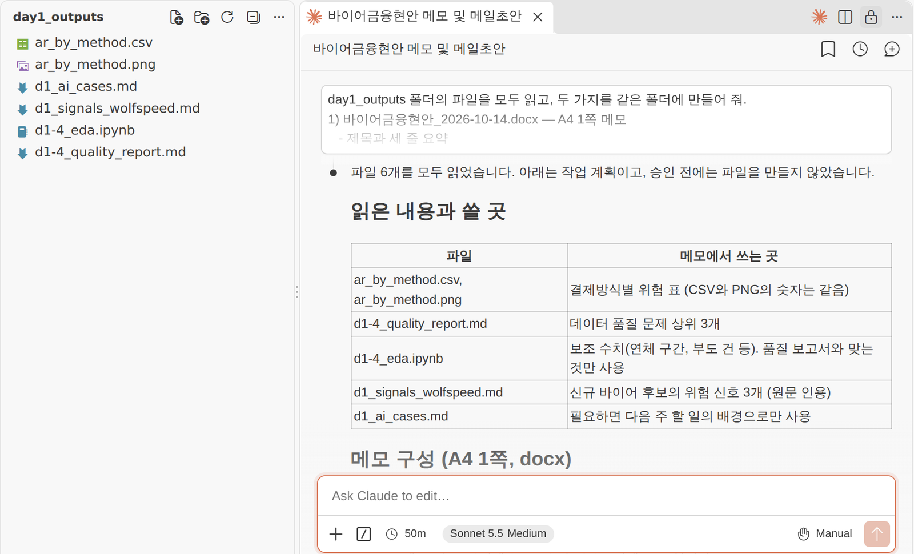{ loading=lazy }
  <figcaption>입력과 계획 — 승인 전에는 파일을 만들지 않고 계획부터 보여 줍니다(시연 5 화면 예시)</figcaption>
</figure>

<figure class="result" markdown="span">
  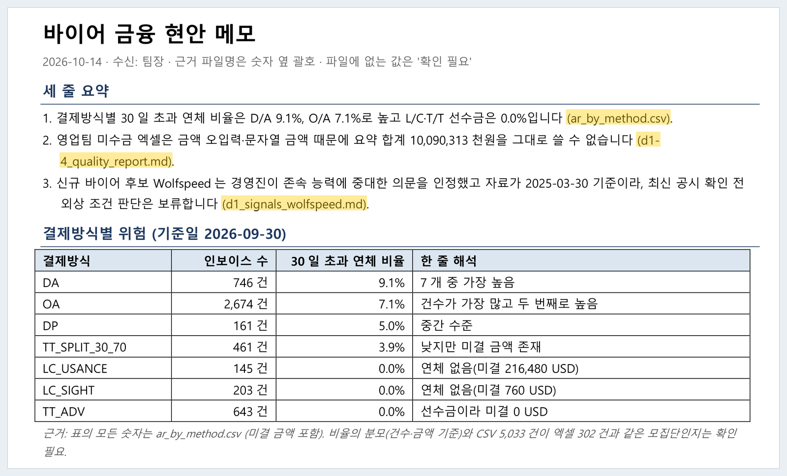{ loading=lazy }
  <figcaption>결과 — 숫자마다 괄호 속 근거 파일 이름이 붙어 있어 대조할 수 있습니다(시연 5 결과 예시)</figcaption>
</figure>

**배운 점**

- 업무 에이전트는 '여러 파일을 모아 문서로 만드는 일'에 강합니다.
- 프롬프트가 하는 일 세 가지: **만들 것을 파일 이름까지** 정하고, **'모든 숫자 옆에 근거 파일 이름을 괄호로'**로 검증할 길을 만들고, **'파일에 없는 숫자는 만들지 말고 애매하면 확인 필요'**로 할루시네이션을 막는 울타리를 치고, **'작업 계획을 먼저 보여 주고 승인 뒤에 진행'**으로 사람의 결재 지점을 둡니다.
- 승인 전에는 파일이 만들어지지 않습니다. AI가 계획 끝에서 되묻는 확인에 답하고 승인하며, 결과의 숫자 두 개는 근거 파일과 직접 대조합니다.
- 오전에 배운 프롬프트 6요소, 근거 요구, 권한 설계가 이 프롬프트 하나에 들어 있습니다. 내일부터 이 결과 폴더가 매일 커지고, 6일차에는 도입 기획의 근거가 됩니다.

### 오늘의 다섯 줄

1. **LLM은 다음 토큰을 확률로 고른다** — 그래서 그럴듯한 오답이 나온다. 근거를 주고 검증한다.
2. **일에 맞는 작업대** — 대화는 채팅, 조사는 딥 리서치, 맡기기는 Cowork, 만들기는 Claude Code.
3. **프롬프트보다 컨텍스트** — 6요소 · 태그 · 형식 · 근거.
4. **재현과 이력** — 스크립트 · 노트북 · `CLAUDE.md`, 그리고 Git 커밋이 AI 작업의 안전망.
5. **EDA는 구조 → 품질 → 분포 → 관계 → 질문** — 오늘은 결제방식별 위험까지 왔다.

**내일(2일차)** — 오늘 찾은 품질 문제가 내일의 정제 규칙이 되고, 오늘 만든 변수 정의서가 내일 만들 특성의 설계도가 됩니다. 첫 장은 Git 협업(이슈 → 브랜치 → PR → 리뷰 → 머지, worktree)입니다 → [2일차](../day2/index.md).

---

## 오늘의 용어 17개 {#terms}

<div class="tf-stack" markdown>

| 용어 | 한 줄 정의 | 어디서 |
|---|---|---|
| **에이전틱 AI** <small>Agentic AI</small> | 목표를 주면 계획 · 도구 사용 · 실행을 스스로 이어 가는 AI 방식 | [01 AI 지형](#ch01) |
| **버티컬 AI** <small>Vertical AI</small> | 범용 모델에 한 산업의 데이터 · 규정 · 도구를 붙여 특화한 AI | [01 AI 지형](#ch01) |
| **토큰** <small>Token</small> | 모델이 글을 다루려고 잘게 자른 조각 — 요금 · 한도의 단위 | [02 토큰](#term-token) |
| **컨텍스트 창** <small>Context window</small> | 모델이 답을 만들 때 한 번에 참고하는 텍스트의 최대량(토큰) | [02 컨텍스트 창](#term-context) |
| **할루시네이션** <small>Hallucination</small> | 그럴듯하지만 틀린 내용을 사실처럼 만드는 현상 | [02 할루시네이션](#term-hallucination) |
| **그라운딩** <small>Grounding</small> | 답을 주어진 근거(문서 · 검색 결과)에 묶는 방법 | [02 그라운딩](#term-hallucination) |
| **노트북** <small>Jupyter Notebook (.ipynb)</small> | 코드 · 결과 · 설명을 셀 단위로 함께 남기는 파일 — 탐색 · 설명용 | [05 노트북 vs 스크립트](#ch05) |
| **스크립트** <small>Python script (.py)</small> | 처음부터 끝까지 한 번에 실행하는 파일 — 반복 · 검증 · 자동화용 | [05 노트북 vs 스크립트](#ch05) |
| **Git** <small>Git</small> | 파일 변경 이력을 커밋 단위로 저장 · 비교 · 복원하는 도구 | [06 Git · GitHub](#ch06) |
| **GitHub** <small>GitHub</small> | Git 저장소를 인터넷에 올려 백업 · 공유 · 협업하는 서비스 | [06 Git · GitHub](#ch06) |
| **인코딩** <small>Encoding (UTF-8 · CP949)</small> | 글자를 0과 1로 저장하는 규칙 | [07 인코딩](#term-encoding) |
| **L/C(신용장)** <small>Letter of Credit</small> | 서류가 조건과 맞으면 개설은행이 지급을 약속하는 결제방식 | [08 무역금융](#ch08) |
| **T/T(전신송금)** <small>Telegraphic Transfer</small> | 은행 송금으로 대금을 받는 방식 — 시점이 위험을 정한다 | [08 무역금융](#ch08) |
| **유동비율** <small>Current Ratio</small> | 유동자산 ÷ 유동부채 — 단기 지급능력 | [08 재무비율](#ch08) |
| **부채비율** <small>Debt-to-Equity</small> | 총부채 ÷ 자기자본 — 빚에 기대는 정도 | [08 재무비율](#ch08) |
| **DSO(매출채권회전기일)** <small>Days Sales Outstanding</small> | 매출채권 ÷ 매출 × 기간 일수 — 외상 회수 평균 날수 | [08 재무비율](#ch08) |
| **영업이익률** <small>Operating Margin</small> | 영업이익 ÷ 매출 — 본업으로 남긴 비율 | [08 재무비율](#ch08) |

</div>
