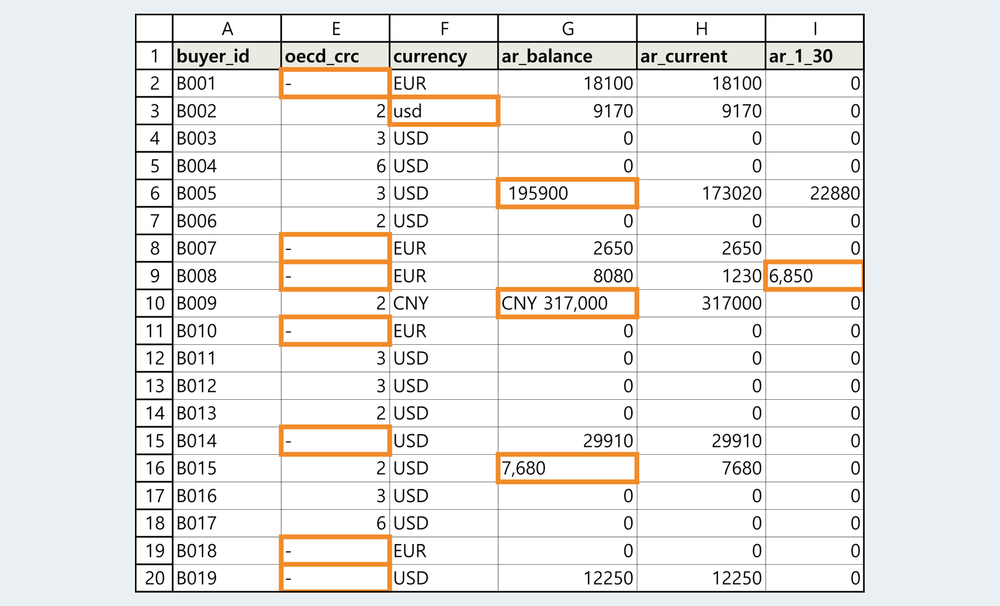
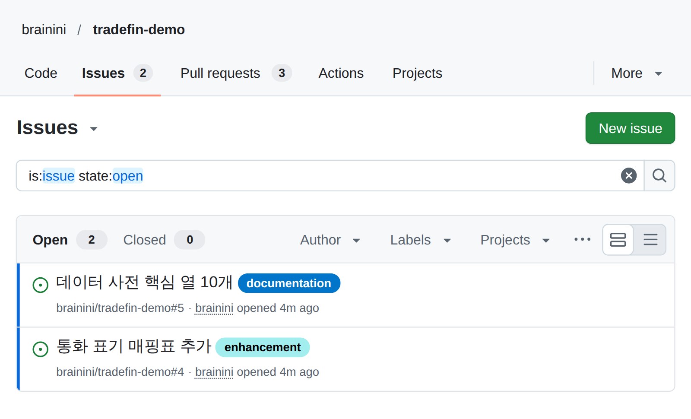
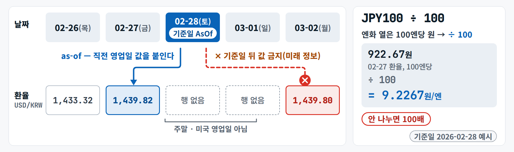
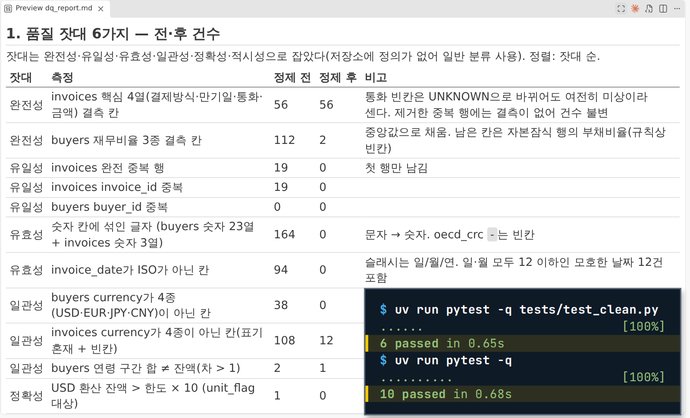
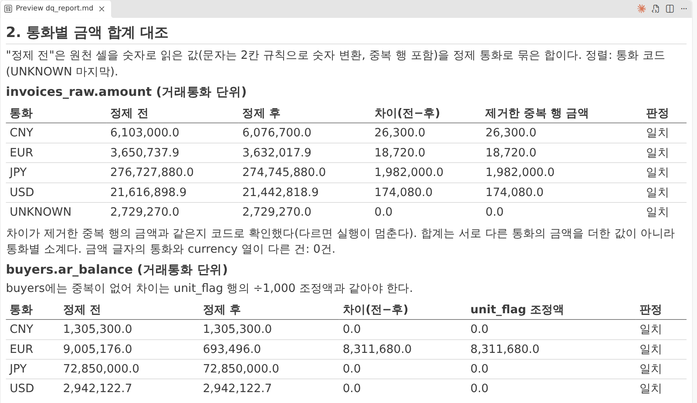
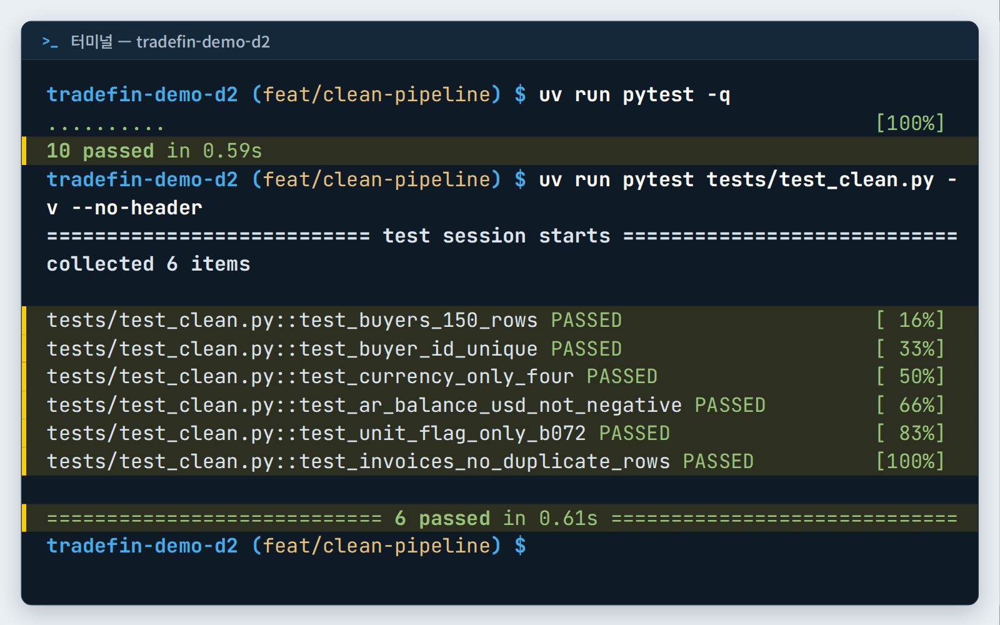
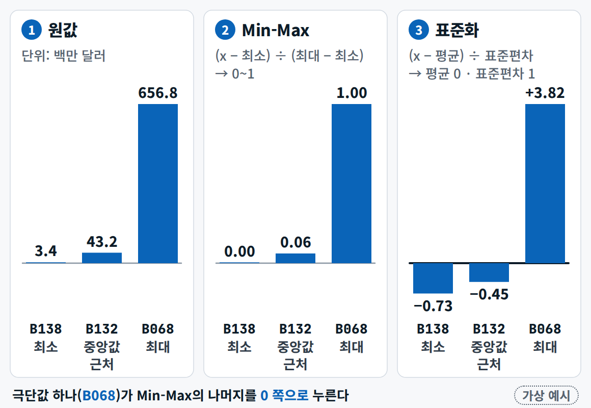
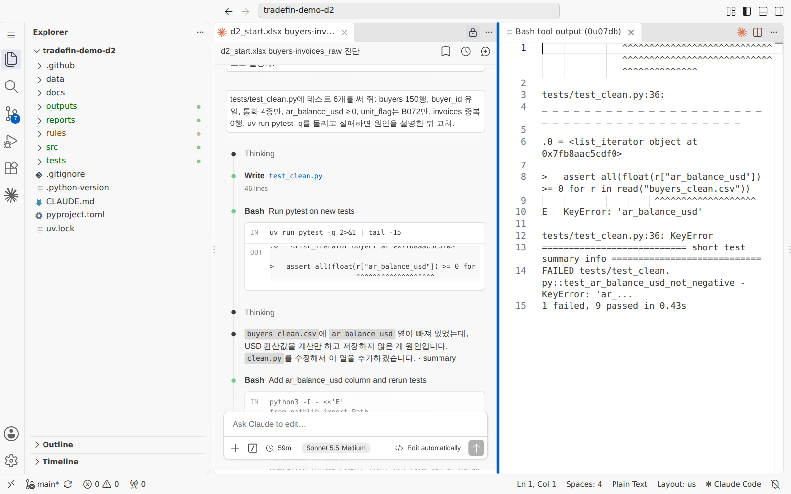
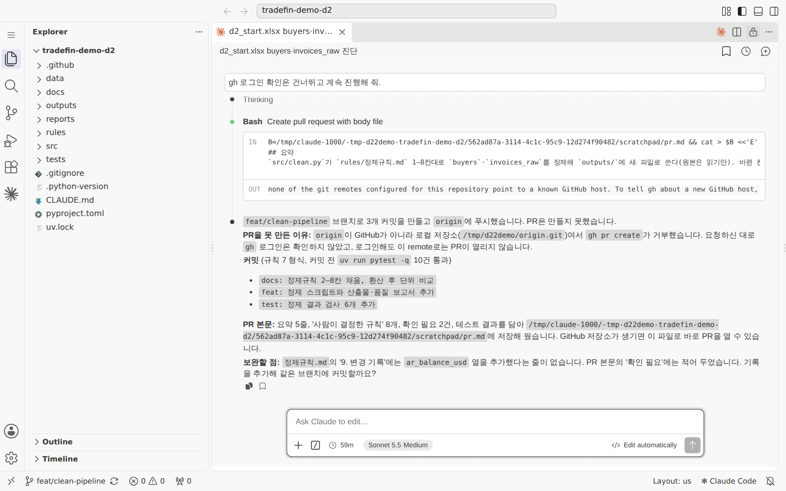
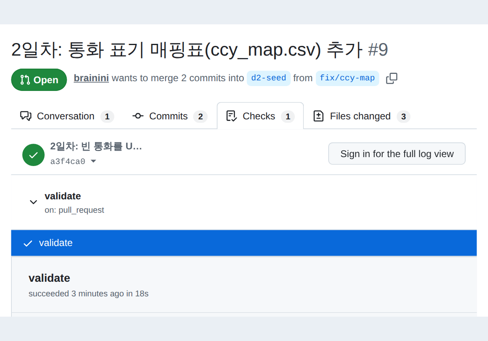

<div class="tf-lab" markdown>
<span class="tf-eyebrow">2일차 · 실습 A · 4–5교시 · 13:00–14:50 <span class="tf-daystate" data-tf-daystate="2"></span></span>

# 실습 A · 바이어 표 정제 파이프라인

<div class="tf-meta" markdown>
<span class="tf-chip tf-chip--time">13:00–14:50 · 110분</span>
<span class="tf-chip tf-chip--tool">Claude Code · Manual → Plan → Edit automatically</span>
<span class="tf-chip tf-chip--tool">Git · GitHub</span>
<span class="tf-chip tf-chip--tool">엑셀 · 완성본 열기</span>
</div>

<div class="tf-flow" markdown>
<div markdown><b>상황</b> (가상) 한빛정밀(주) 수출채권팀은 매달 바이어 150곳 스냅샷 엑셀을 손으로 고칩니다. 같은 통화가 9가지로 적히고, 숫자 칸에 글자가 섞이고, 재무 칸은 비고, 한 곳은 잔액이 1,000배로 들어갔습니다. 고친 이유는 어디에도 남지 않습니다.</div>
<span>→</span>
<div markdown><b>넣는 것</b> `d2_start.xlsx`의 시트 `buyers`(150행 × 28열, 기준일 2026-08-31) + 프롬프트 A1–A4 + 내가 고른 결측 방식 + 완성본 `d2_excel_check.xlsx`</div>
<span>→</span>
<div markdown><b>얻는 것</b> 이슈 1개(닫힘) · 규칙 문서 정제규칙.md · 정제 스크립트 · 테스트 · 정제 CSV 150행 · 품질 보고서 · 스케일 표 · **PR 1개(머지)**</div>
</div>

<div class="tf-lab__grid" markdown>
<div class="tf-lab__cell" markdown><span class="tf-lab__label">목표</span> 지저분한 바이어 표를 AI와 함께 **규칙 문서 · 스크립트 · 테스트**로 정제해, 다시 돌려도 같은 결과가 나오는 파이프라인을 **PR**로 남깁니다</div>
<div class="tf-lab__cell" markdown><span class="tf-lab__label">오전 시연과의 관계</span> 시연 2(엑셀 → 정제 파이프라인)의 축소판 — 시트 하나 · 프롬프트 4개 · 확인표. 시연 1의 GitHub flow를 이슈 1 · 브랜치 1 · PR 1로 처음부터 끝까지</div>
</div>

<small>macOS에서는 이 쪽 단축키의 ++ctrl++ 을 ++cmd++ 로 누릅니다. 터미널 ++ctrl+grave++ 과 소스 제어 ++ctrl+shift+g++ 만 macOS도 ++ctrl++ 그대로입니다.</small>

<div data-tf-map></div>
</div>

<div class="tf-phase" id="time" markdown>

<span class="tf-eyebrow">슬라이드 d2-68 · 실습 A · 13:00–14:50 · Claude Code · Git · GitHub · 엑셀</span>

**목표** buyers 시트를 규칙·테스트로 정제해 PR로

- **01** 준비 — 파일 받기 · 이슈 1개 · 브랜치 d2-clean
- **02** 진단 — Plan 모드로 buyers 시트 프로파일링
- **03** 규칙 — 정제규칙.md 1–7칸, 결측 대체는 내가 고른다
- **04** 스크립트 — 정제 CSV 150행 + 품질 보고서
- **05** 검증 — 테스트 · 확인표 · B001 손계산 · 스케일 표
- **06** 기록 — 커밋 2개+ → PR(Closes #n) → 짝 리뷰 → 머지

**산출물** PR 1개 — 규칙·스크립트·테스트·결과 · **시간** 110분

</div>

<figure markdown="span">
  { loading=lazy }
  <figcaption>오늘의 입력 <code>buyers</code> 시트 — 주황 테두리가 손으로 고쳐 오던 칸입니다. 오늘은 셀이 아니라 <b>규칙</b>을 고칩니다(오전 시연 2의 입력 화면)</figcaption>
</figure>

## 입력 파일 받기 {#files}

**13:00–13:05 오후 시작**(슬라이드 d2-67) — 오늘 산출물은 특성표 + PR 2개, 시작은 `git pull`과 파일 받기, 권한 모드는 **Manual로 시작 → 진단은 Plan → 만들기는 Edit automatically**, 짝 확인. 파일은 단계 01에서 명령 한 줄로 받습니다(`uv run python tools/get_day_files.py 2`). 저장소 없이 **채팅 경로**로 하는 분만 아래 카드에서 직접 받습니다.

--8<-- "docs/_snippets/day2/files_lab-a_cards.md"

카드에 잠금 표시가 있으면 그 시각 뒤에 받습니다 — `d2_start.xlsx`와 완성본 `d2_excel_check.xlsx`는 **10/15(목) 08:30**에 열립니다(1일차 실습의 답이 같은 데이터에 들어 있어서). 그 전에는 `get_day_files.py`도 `[열기 전]`으로 알려 줍니다.

!!! warning "원본은 읽기만 합니다"

    `data/checkpoints/`의 받은 원본은 고치지 않습니다. 고칠 것은 스크립트가 **새 파일**(`workbench/day2/outputs/`)로 씁니다. 원본은 `.gitignore`에 걸려 있어 `git restore`로 되돌릴 수 없습니다 — 덮어썼다면 `uv run python tools/get_day_files.py 2 --force`로 다시 받습니다.

### 슬라이드 · 시연 화면의 경로와 내 저장소 {#paths}

슬라이드 d2-31과 시연 캡처는 시연 저장소의 폴더 이름을 씁니다. 내 저장소에서는 `CLAUDE.md`가 정한 아래 자리에 놓이고, Claude Code가 그 파일을 먼저 읽으므로 프롬프트는 그대로 보내면 됩니다.

| 슬라이드 · 시연 화면 | 내 저장소 |
|---|---|
| `data/raw/`(읽기 전용) | `data/checkpoints/`(받은 원본, 읽기만) · 작업 사본 `workbench/day2/data/` |
| `src/` 스크립트 | 저장소 맨 위 `scripts/` |
| `tests/` | `workbench/day2/tests/`(`pytest.ini`가 `workbench/`의 테스트만 돌린다) |
| `rules/` | `workbench/day2/rules/` |
| `outputs/` · `reports/` | 둘 다 `workbench/day2/outputs/` |

## 01. 준비 — 파일 받기 · 이슈 1개 · 브랜치 d2-clean (13:05–13:15) { #a-prep .step data-tool="Claude Code, GitHub" }

**왜** 일 하나 = 이슈 하나 = 브랜치 하나. 이슈에 **완료 기준**을 먼저 적어 두면 AI와 사람이 어디서 멈출지 압니다. 오늘 파일 → 이슈 #번호 → 브랜치 `d2-clean`

!!! me "내가 할 일"

    1. VS Code에서 **내 저장소**를 열고 Claude Code 패널(오른쪽 위 Claude 아이콘)을 엽니다. 로그인 상태이고 입력창 아래 모드가 **Manual**인지 봅니다 — Auto나 Plan이면 Manual로 바꿉니다(PC마다 시작 모드가 다릅니다).
    2. 파일을 받습니다. 터미널(++ctrl+grave++)에서 `git pull` 다음 `uv run python tools/get_day_files.py 2` — 또는 아래 `a0` 프롬프트로 Claude Code에게 맡깁니다.
    3. **GitHub 웹에서 이슈를 하나** 만듭니다. 내 저장소 → **Issues** → 초록 **New issue** → 제목 **바이어 표 정제 파이프라인**, 본문은 아래 상자를 복사해 붙여 넣고 **Create**. 제목 옆 **번호**(`#1` 같은 글자)를 메모합니다 — 06에서 `Closes #번호`로 씁니다.
    4. 브랜치를 만듭니다. Claude Code에게 `d2-clean 브랜치를 만들어 줘`(허락 창의 `git switch -c d2-clean`을 읽고 `1 Yes`) — 또는 왼쪽 아래 상태 표시줄의 브랜치 이름 → `+ Create new branch…` → `d2-clean`.

    ```text
    ## 할 일
    data/checkpoints/d2_start.xlsx의 buyers 시트를 규칙·스크립트·테스트로 정제한다.

    ## 완료 기준
    - [ ] 테스트 통과 · 확인표 6줄 일치
    - [ ] 정제규칙.md 1–7칸 채움
    ```

???+ prompt "`a0` · 준비 맡기기(선택 · Manual)"

    --8<-- "labs/day2/prompts.md:a0"

!!! ai "AI가 하는 일"

    `a0`를 보내면 `git pull` · 파일 받기 명령마다 허락 창이 한 번씩 뜹니다(1–2분). 끝나면 받은 파일 목록 · 현재 브랜치 · `git status`를 보여 줍니다. 터미널에는 파일마다 `[받음] data/checkpoints/d2_start.xlsx  (사본 만듦)` 같은 줄이 나오고, 받은 파일은 `workbench/day2/data/`에 **작업 사본**도 생깁니다.

<figure class="result" markdown="span">
  { width="680" loading=lazy }
  <figcaption>Issues 탭 — 오른쪽 위 <b>New issue</b>(오전 시연 1 저장소 화면 예시)</figcaption>
</figure>

<figure class="result" markdown="span">
  { width="560" loading=lazy }
  <figcaption>이런 모양의 이슈가 됩니다 — 본문에 할 일과 완료 기준(시연 저장소의 이슈 예시)</figcaption>
</figure>

!!! ok "확인"

    - [ ] 터미널(또는 `a0` 보고)에 `[받음] data/checkpoints/d2_start.xlsx` · `[받음] labs/day2/d2_excel_check.xlsx` 줄이 있다(`fx_krw_daily.csv`는 저장소에 이미 있어 `[있음]`)
    - [ ] 이슈 #번호를 메모했다
    - [ ] 상태 표시줄이 `d2-clean`, 입력창 아래 모드가 **Manual**이다

??? fix "Claude Code 로그인이 안 되거나 무료 플랜이라고 나와요"

    Claude Code는 Pro 이상 구독이나 Console 계정이 필요합니다. 내 저장소의 Codespaces나 아래 [채팅 경로](#chat-path)로 같은 결과에 도착합니다 → [FAQ](../faq.md#q-claude-code-login).

??? fix "파일 받기가 [열기 전]이라고 해요"

    `d2_start.xlsx`는 **10/15(목) 08:30**에 열립니다. 시각이 지났는데도 그렇다면 PC 시계를 확인하고 같은 명령을 다시 실행합니다. 급하면 `uv run python tools/get_day_files.py 2 --now` · 또는 위 카드에서 받아 `data/checkpoints/`에 넣습니다.

??? fix "git pull이 로그인을 물어요 · Issues 탭이 없어요"

    VS Code 왼쪽 아래 계정 아이콘에서 GitHub에 로그인합니다. Issues 탭이 없으면 저장소 Settings → General → Features → **Issues** 체크(드뭅니다).

??? fix "브랜치를 안 만들고 진행해 버렸어요"

    커밋 전이면 터미널에서 `git switch -c d2-clean` — 바뀐 파일이 그대로 새 브랜치로 따라옵니다. `main`에 이미 커밋했다면 06의 '막히면'을 봅니다.

<p class="tf-check"><time>13:15</time> 손 점검 — 브랜치 <code>d2-clean</code> · 모드 Manual · 파일 받음</p>

## 02. 진단 — Plan 모드로 buyers 시트 프로파일링 (13:15–13:30) { #a-diag .step data-tool="Claude Code · Plan" }

**왜** 고치기 전에 무엇이 나쁜지 **이름을 붙입니다.** Plan 모드는 파일을 고치지 못하는 읽기 전용이라, 진단과 수정이 섞이지 않습니다. `buyers` 시트 → A1 → 진단 표 → `profile.md`

!!! me "내가 할 일"

    1. 입력창 아래 모드 표시기를 눌러 **Plan**으로 바꿉니다.
    2. 프롬프트 **A1**을 보냅니다.
    3. 진단 표를 읽습니다 — 표 끝이나 설명에서 AI가 **'사람이 정해야 한다'고 짚은 곳**을 찾아 둡니다. 그것이 03에서 내가 정할 규칙입니다.
    4. 끝에 **계획 승인 창**이 뜨면 **`3 No, keep planning`**을 고릅니다. 승인(1 · 2)하면 AI가 규칙도 없이 코드를 쓰기 시작합니다.
    5. 모드를 **Edit automatically**로 바꾸고 아래 `a1-save`로 표를 파일로 저장합니다(허락 창은 읽고 `1 Yes`).

!!! prompt "프롬프트 A1 — 진단(Plan 모드 · 고치지 않음)"

    --8<-- "labs/day2/prompts.md:a1"

!!! prompt "`a1-save` · 이어서 — 진단 표 저장(Edit automatically)"

    --8<-- "labs/day2/prompts.md:a1-save"

!!! ai "AI가 하는 일"

    엑셀을 읽는 명령을 몇 번 실행하고(Plan에서도 읽기는 됩니다) **열별 타입 · 결측 · 표기 종류 · 의심 값** 표를 화면에 씁니다(2–4분). 대개 통화 표기 여러 종, 숫자 칸의 글자, 재무 칸 빈칸, 자기자본 0 이하, 신용한도보다 훨씬 큰 잔액을 짚고, **결측을 어떻게 채울지 · 엔 · 위안 잔액을 달러 한도와 어떻게 비교할지 · 단위 의심을 고칠지**를 사람에게 묻습니다. 표의 모양과 문장은 실행마다 다릅니다.

<figure class="result" markdown="span">
  { loading=lazy }
  <figcaption>Plan 모드 진단의 예 — 오전 시연 2는 두 시트를 진단해 표가 더 깁니다. 입력창 아래 오른쪽에 <b>Plan</b> 표시가 보입니다</figcaption>
</figure>

!!! ok "확인"

    - [ ] 진단 표에 통화 표기 · 글자 섞인 금액 · 재무 빈칸 · 자기자본 0 이하 · 큰 잔액이 보인다
    - [ ] '사람이 정할 곳'을 1개 이상 메모했다
    - [ ] `workbench/day2/outputs/profile.md`가 생겼다

    진단 숫자(표기별 칸 수 · 글자 섞인 칸 수)는 05에서 확인표와 엑셀 검산본('확인표_A' 시트)으로 견줍니다.

??? fix "Plan 모드에서 저장하려다 멈췄어요"

    Plan은 읽기만 합니다. 모드를 **Edit automatically**로 바꾼 뒤 `a1-save`를 보냅니다.

??? fix "승인 창에서 1 · 2를 눌러 AI가 스크립트를 쓰기 시작했어요"

    ++esc++ 로 멈추고, 만들어진 파일이 있으면 읽어 둔 뒤 **03 규칙(A2)부터** 다시 합니다. 규칙 문서와 스크립트가 서로 맞는지는 04에서 봅니다 → [FAQ](../faq.md#q-mode).

??? fix "행이 153개라고 해요"

    1일차 `d1_buyers_raw`를 읽은 것입니다. "data/checkpoints/d2_start.xlsx의 buyers 시트"를 다시 지정합니다.

??? fix "표가 길어 잘려요"

    "문제 있는 열만 표로 다시"라고 보냅니다.

## 03. 규칙 — 정제규칙.md 1–7칸, 결측 대체는 내가 고른다 (13:30–13:50) { #a-rules .step data-tool="Claude Code" }

**왜** **규칙 문서가 먼저, 코드가 나중**입니다. 무엇을 어떻게 · 왜 고칠지는 사람이 정하고, 그 결정이 문서로 남아야 다음 달에도 같은 결과가 나옵니다. 진단 + 내 결정 → A2 → `workbench/day2/rules/정제규칙.md` 1–7칸 → 커밋 1

!!! me "내가 할 일"

    1. 결측을 채우는 방식을 **하나 고릅니다** — 아래 표. 짝과 달라도 좋습니다(나중에 비교).
    2. **A2**의 `{중위수 또는 KNN}`을 고른 방식으로 바꾸고, 끝에 **결정 줄**(`a2-decide`)을 이어 붙여 보냅니다.
    3. AI가 되묻는 말(예: "JPY 잔액을 한도와 어떻게 비교할까요?")에는 **내가** 답합니다 — 짝과 의논해도 됩니다.
    4. 소스 제어(++ctrl+shift+g++)에서 `정제규칙.md`의 diff를 읽습니다. 1–7칸에 `규칙:` · `왜:`가 채워졌고 **규칙 문서만** 바뀌었는지 봅니다.
    5. **규칙 문서만 먼저 커밋**합니다 — `a2-commit`을 보내거나 소스 제어에서 그 파일만 `+` → 메시지 → Commit.

    | 방식 | 한 줄 | 이럴 때 |
    |---|---|---|
    | **중위수** | 같은 기준일 150곳의 가운데 값 — 큰 회사에 끌리지 않지만 값이 모두 같아 분포가 좁아집니다 | 단순하고 설명이 쉬운 쪽 |
    | **KNN** | 가장 닮은 바이어 k곳의 값 — 맥락을 살리지만 스케일에 민감하고 설명이 어렵습니다 | 맥락을 살리고 싶을 때(스케일 조정 먼저) |

!!! prompt "프롬프트 A2 — 규칙 문서 1–7칸"

    --8<-- "labs/day2/prompts.md:a2"

    빈칸 `{중위수 또는 KNN}` — [빈칸 값 표](../prompts/day2.md#values)

???+ prompt "`a2-decide` · A2 덧붙임 — 결정 줄(권장 · 확인표가 이 정의를 전제로 합니다)"

    --8<-- "labs/day2/prompts.md:a2-decide"

???+ prompt "`a2-commit` · 이어서 — 규칙 문서만 먼저 커밋(커밋 1)"

    --8<-- "labs/day2/prompts.md:a2-commit"

!!! ai "AI가 하는 일"

    진단 결과와 내 결정으로 1–7칸을 '규칙/왜' 두 줄씩 채웁니다(Edit automatically라 파일 편집은 묻지 않습니다). 정하지 않은 곳은 되묻습니다. `a2-commit`을 보내면 `git add` · `git commit` 허락 창이 뜹니다 — **파일이 `정제규칙.md` 하나인지**, 메시지가 두 줄인지 읽고 승인합니다.

<figure class="result" markdown="span">
  { loading=lazy }
  <figcaption>규칙 문서 diff의 예(오전 시연 2) — 비어 있던 '규칙 / 왜' 칸이 채워집니다. 커밋 전에 이 화면을 읽습니다</figcaption>
</figure>

<figure markdown="span">
  { loading=lazy }
  <figcaption>7칸(환율 · 시차)의 기준 — 기준일 2026-08-31 또는 직전 영업일 환율로 USD 환산, 엔화는 100엔 단위(÷100), 기준일 <b>뒤</b> 환율은 쓰지 않습니다</figcaption>
</figure>

!!! ok "확인"

    - [ ] 1–7칸 모두 `규칙:`과 `왜:`가 있고, 3칸에 `fin_missing` 정의(다섯 항목 중 하나라도 빈칸이면 1)가 있다
    - [ ] 결측 대체 방식과 고른 이유가 '왜' 칸에 있다
    - [ ] `git log --oneline -3`에 `2일차: 바이어 정제 규칙 1–7칸 작성`이 보인다

??? fix "7칸 fx_chg_30d_lag30이 헷갈려요"

    결정 줄대로 합니다 — **30일 전 환율 ÷ 60일 전 환율 − 1**(30일 전 시점의 30일 변화), 기준일이 주말이면 직전 영업일 값. 시트 `fx_at_ref`에는 `chg_30d`가 이미 있습니다.

??? fix "KNN을 골랐어요"

    대체값이 중위수와 다르게 나오는 것이 정상이고, **결측 플래그 47곳은 같아야** 합니다. KNN은 거리를 재므로 스케일 조정을 먼저 하게 합니다.

??? fix "규칙 문서 말고 다른 파일까지 바뀌었어요"

    그 파일은 `git restore 파일`로 되돌립니다. `data/checkpoints/`의 원본이 바뀌었으면 `uv run python tools/get_day_files.py 2 --force`로 다시 받습니다(`.gitignore` 대상이라 restore로는 안 됩니다).

<p class="tf-check"><time>13:50</time> 손 점검 — 7칸 모두 '규칙/왜' · 3칸의 <code>fin_missing</code> 정의 · 규칙 문서 커밋</p>

## 04. 스크립트 — 정제 CSV 150행 + 품질 보고서 (13:50–14:15) { #a-script .step data-tool="Claude Code" }

**왜** 규칙을 **코드로** 옮겨야 다음 달에 버튼 한 번으로 같은 결과가 나옵니다. 규칙 문서 + 원본 + 기준일 환율 → A3 → `scripts/clean_buyers.py` · `d2_buyers_clean.csv` · `dq_report.md`

!!! me "내가 할 일"

    1. **A3** 끝에 **결과 열**(`a3-columns`)을 이어 붙여 보냅니다 — 오후 실습 B와 내일 3일차가 이 25열 이름을 씁니다.
    2. 허락 창의 명령(`uv run python scripts/clean_buyers.py` 같은 것)을 **읽고** `1 Yes`. 원본을 지우거나 덮어쓰는 명령이면 `No`.
    3. 결과 세 파일을 엽니다. 보고서는 ++ctrl+shift+v++ 로 미리보기.
    4. 터미널에서 `git status`를 칩니다 — 맨 위 `data/` 아래에 바뀐 파일이 없어야 합니다.

!!! prompt "프롬프트 A3 — 정제 스크립트(원본은 읽기만)"

    --8<-- "labs/day2/prompts.md:a3"

???+ prompt "`a3-columns` · A3 덧붙임 — 결과 25열(권장)"

    --8<-- "labs/day2/prompts.md:a3-columns"

!!! ai "AI가 하는 일"

    규칙 문서를 읽고 스크립트를 쓴 뒤 `uv run`으로 실행합니다. 허락 창은 실행 · 확인 명령마다 2–4번(3–5분). 결과로 **정제 CSV**(150행), 정제 전 · 후 건수를 나란히 놓은 **품질 보고서**를 만들고, 무엇을 몇 칸 고쳤는지 요약합니다. 숫자는 AI의 암산이 아니라 **스크립트가 낸 값**입니다.

<figure class="result" markdown="span">
  { loading=lazy }
  <figcaption>품질 보고서의 예(오전 시연 2 — 인보이스까지 정제한 판이라 표가 더 깁니다). 정제 전 · 후가 한 표에 있어야 합니다</figcaption>
</figure>

!!! ok "확인"

    - [ ] `workbench/day2/outputs/d2_buyers_clean.csv`가 **150행 × 25열**, `buyer_id` 첫 열 · `late_30d` 끝 열이다
    - [ ] `dq_report.md`에 정제 전 · 후 표(통화 표기 · 글자 섞인 칸 · 결측 · 단위 의심)가 있다
    - [ ] `git status`에서 맨 위 `data/` 변경이 없고, `scripts/clean_buyers.py`에 `data/` 안으로 **쓰는** 줄(`to_excel` · `save` · `to_csv`)이 없다 — 받은 원본(`d2_start.xlsx`)은 `.gitignore`라 바뀌어도 `git status`에 안 보입니다

    `workbench/day2/data/` 아래 **받은 파일 사본이 '추적 안 됨'(U)으로 여러 줄** 보이는 것은 정상입니다 — 커밋하지 않아도 됩니다.

??? fix "unit_flag가 12곳(엔 · 위안 바이어 + B072)이에요"

    거래통화 잔액을 USD 한도와 **환산 없이** 비교한 것입니다. "통화 환산 후 비교로 바꿔 줘. 환율은 `fx_at_ref` 2026-08-31 값(엔화는 100엔 단위)"이라고 보냅니다.

??? fix "ar_balance_usd 열이 없어요 · 열 이름이 달라요"

    `a3-columns`를 보냅니다. 오전 시연 2에서도 이 열이 빠져 A4 테스트가 KeyError로 실패했습니다.

??? fix "결과가 저장소 맨 위 outputs/에 생겼어요"

    내 저장소의 `CLAUDE.md`가 경로를 정합니다. "결과는 workbench/day2/outputs/에 다시 저장해 줘"라고 보내고, 맨 위의 잘못 생긴 파일은 지웁니다(지우기 전에 Claude가 묻습니다).

??? fix "A3가 규칙 문서까지 고쳤어요"

    데이터를 읽고 규칙을 좁히거나(예: ÷1,000을 잔액 열만) '확인 필요'를 채우는 경우가 있습니다(과정 준비 때 미리 해 본 실행에서도 그랬습니다). 소스 제어에서 `정제규칙.md` diff를 읽고 9칸 변경 기록에 한 줄이 있는지 봅니다. 동의하지 않는 줄은 "이 줄은 되돌려 줘" — **결정은 사람이** 합니다.

??? fix "B141의 '47.0k'는 어떻게 하나요"

    47,000으로 볼지 연령 구간 합계(47,030)로 볼지는 규칙 2칸에서 **사람이** 정합니다. 확인표에는 없는 항목이라 어느 쪽이든 규칙 문서에 기록만 남깁니다.

??? fix "합계가 맞는지 더 확인하고 싶어요"

    "dq_report.md에 통화별 잔액 합계를 정제 전 · 후로 대조하는 표를 더해 줘 — 차이는 단위 의심 조정액과 같아야 해"라고 보냅니다. 아래는 오전 시연 2가 만든 대조 표입니다.

    <figure class="result" markdown="span">
      { loading=lazy }
      <figcaption>합계 대조의 예(오전 시연 2 — 인보이스 시트 포함). 차이가 설명되면 '일치'</figcaption>
    </figure>

<p class="tf-check"><time>14:15</time> 확인표 — 슬라이드 d2-70이 화면에 뜹니다. 150행 · 원본 그대로인지 봅니다</p>

## 05. 검증 — 테스트 · 확인표 · B001 손계산 · 스케일 표 (14:15–14:35) { #a-verify .step data-tool="Claude Code, 엑셀" }

**왜** 결과를 **세 갈래**로 확인합니다 — 테스트(규칙의 실행판) · 확인표(인쇄된 기대값) · 엑셀 검산본(코드가 아닌 다른 길). 슬라이드의 'B001 손계산'은 **완성본 엑셀로 대신합니다** — 손으로 칠 시간을 AI 결과와 대조하는 데 씁니다. 순서는 인쇄본 그대로입니다.

#### 테스트

!!! me "내가 할 일"

    1. **A4**를 보냅니다 — 테스트 5개를 쓰고, 통과할 때까지 고친 뒤 커밋합니다(커밋 2).
    2. 터미널에서 직접 `uv run pytest -q`를 쳐서 `passed`를 봅니다.
    3. 실패하면 "고쳐 줘" 전에 **테스트 · 규칙 · 산출물 중 어느 쪽이 틀렸나**를 먼저 묻고 판단합니다.

!!! prompt "프롬프트 A4 — 테스트 쓰고 통과시키고 커밋"

    --8<-- "labs/day2/prompts.md:a4"

!!! ai "AI가 하는 일"

    `workbench/day2/tests/`에 테스트 파일(이름은 `test_clean.py` · `test_buyers_clean.py`처럼 실행마다 다릅니다)을 만들어 행 수 · ID 유일 · 통화 4종 · 금액 ≥ 0 · B072 단위 플래그 테스트를 쓰고 `pytest`를 돌립니다. 실패하면 원인을 설명하고 고친 뒤 다시 돌립니다. 마지막에 `git add` · `git commit` 허락 창 — 파일 목록과 두 줄 메시지를 읽고 승인합니다.

<figure class="result" markdown="span">
  { loading=lazy }
  <figcaption>테스트 통과의 예(오전 시연 2) — 항목 이름이 곧 규칙입니다</figcaption>
</figure>

#### 확인표 — 14:15

??? ok "실습 A 확인표 — 슬라이드 d2-70(내 숫자를 만든 뒤 펼칩니다)"

    | 확인 | 기대값 |
    |---|---|
    | 통화 정리 | USD 110 · EUR 23 · JPY 10 · CNY 7 |
    | B001 잔액(USD) | 21,026.82 (EUR 18,100 × 1,589.50 ÷ 1,368.25) |
    | 단위 의심 | B072 한 곳 → ÷1,000 후 9,665.37 USD |
    | 자본잠식 | B013 · B048 (부채비율 빈칸) |
    | 결측 처리 | 플래그 47곳 · 중위수라면 1.4218 · 1.4579 · 66.44 · 0.0654 |
    | 기록 | 테스트 통과 · 스케일 비교 표 · 커밋 2개+ · PR 1개(Closes #n) |

!!! prompt "`a-check` · 확인표 대조 — 눈 대신 AI가 내 파일에서 계산(고치지 않음)"

    --8<-- "labs/day2/prompts.md:a-check"

#### B001 손계산 — 완성본으로

!!! file "완성본 제공 — d2_excel_check.xlsx(엑셀 검산본)"

    <dl markdown>
    <dt>무엇</dt><dd markdown>확인표 여섯 줄을 **사람이 엑셀만으로 계산했다면** 어떻게 나오는지 보여 주는 통합 문서입니다. 'B001_손계산' 시트의 노란 칸 `=ROUND(B5*B6/B7,2)`가 슬라이드의 `=18100*1589.5/1368.25`이고, '확인표_A' 시트가 여섯 줄 전부를 수식으로 다시 셉니다.</dd>
    <dt>왜</dt><dd markdown>AI가 코드로 낸 숫자를 **코드가 아닌 다른 길**로 한 번 더 확인하는 기준입니다. 정답지가 아닙니다 — 다르면 어느 규칙에서 갈렸는지 찾는 것이 과제입니다. 엑셀을 직접 만들 필요는 없습니다.</dd>
    <dt>어떻게 만들었나</dt><dd markdown>'buyers_원본' · '환율_기준일' 시트에 `d2_start.xlsx`의 값을 **고치지 않고** 옮기고, 나머지는 모두 수식입니다(노란 칸 = 수식, 칸을 누르면 수식 막대에 보입니다). 통화는 표기 9가지 → 4종 대응표 + `VLOOKUP`, 결측 플래그는 `IF(OR(…=""))`, 중앙값은 대체 전 150행의 `MEDIAN`. 글자가 섞인 금액 13칸은 수식으로 숫자를 만들 수 없어 '글자 섞임'으로만 표시합니다 — 그래서 규칙을 문서로 정하고 스크립트로 고칩니다.</dd>
    </dl>

    [:material-microsoft-excel: 엑셀 검산본 받기](../downloads/day2/d2_excel_check.xlsx){ .md-button .md-button--primary download data-tf-open="2026-10-14T23:30:00Z" }

!!! me "내가 할 일"

    1. 01에서 받은 `labs/day2/d2_excel_check.xlsx`를 엑셀(또는 웹용 Excel)로 **읽기만** 엽니다. '읽는 법' 시트를 1분 읽습니다.
    2. 'B001_손계산' 시트의 노란 칸을 눌러 수식을 봅니다. 원하면 흰 칸 B13에 `=18100*1589.5/1368.25`를 한 번 직접 칩니다(1분).
    3. 아래 프롬프트로 AI 결과와 엑셀 검산본을 **항목마다 나란히** 놓습니다.
    4. '다름'이 있으면 원인 후보 하나를 엑셀에서 직접 봅니다 — 'buyers_원본' 시트의 노란 열('통화_표준' · `ar_balance_usd` · `unit_flag` · 비율 4열)에서 그 바이어 행이나 수식을 찾습니다.
    5. 원인에 **내가 동의하면** `a-fix`로 규칙 문서부터 고치고 스크립트를 다시 돌린 뒤, `a-check`를 한 번 더 보내 '같음'이 됐는지 봅니다(1–2분).

!!! prompt "`excel-compare` · 엑셀 검산본과 대조 — 어느 쪽이 맞는지는 쓰지 않게"

    --8<-- "labs/day2/prompts.md:excel-compare"

??? prompt "`a-fix` · 이어서 — 원인에 동의했으면 규칙부터 고치고 다시 돌리기"

    --8<-- "labs/day2/prompts.md:a-fix"

    결정 줄에 '비율 열을 채운다'가 없던 미리 해 본 실행에서는 대체값 두 줄이 '다름'이었고, `excel-compare`가 원인(재무 원값을 먼저 채운 뒤 비율을 계산함 — 검산본은 비율 열의 대체 전 중앙값)을 찾았습니다. `a-fix` 한 번(1분)으로 네 값이 모두 '같음'이 됐습니다.

#### 스케일 표

!!! me "내가 할 일"

    1. **A5**로 `scaling.md`를 만듭니다(확인표 '기록' 줄의 스케일 비교 표).
    2. 규칙 문서 **2칸(숫자 변환) 끝**에 `정규화:`로 시작하는 한 줄을 내가 적습니다 — **"정규화 열을 특성 파일에 넣지 않는 이유"**: 평가 데이터의 정보가 섞이고, 내일의 트리 모델은 스케일에 둔감합니다. 06의 A6이 이 줄을 `scaling.md`와 함께 커밋합니다.

!!! prompt "프롬프트 A5 — 스케일 비교 표(특성 파일에는 넣지 않음)"

    --8<-- "labs/day2/prompts.md:a5"

<figure markdown="span">
  { width="560" loading=lazy }
  <figcaption>매출이 약 190배 다른 세 곳 — 로그를 먼저 씌우고, 극단값 하나가 나머지를 0 쪽으로 누르는지 봅니다</figcaption>
</figure>

!!! ok "확인"

    - [ ] `uv run pytest -q` 통과(테스트 커밋 = 커밋 2)
    - [ ] 확인표 대조 표가 모두 '같음' — 다르면 그 줄의 원인을 한 줄로 안다
    - [ ] 엑셀 검산본과 대조했고 '다름'의 원인 후보를 하나 직접 확인했다
    - [ ] `workbench/day2/outputs/scaling.md` + 규칙 문서의 정규화 한 줄

??? fix "uv run pytest -q가 'no tests ran'이에요"

    A4 전이거나 테스트가 `workbench/` 밖에 생겼습니다. `uv run pytest -q 경로`로 돌리거나 "테스트를 workbench/day2/tests/로 옮겨 줘"라고 보냅니다.

??? fix "pytest가 streamlit 오류를 내요"

    `pytest.ini`가 없는 옛 저장소입니다. `git pull` 뒤 다시 하거나 `uv run pytest -q workbench/day2/tests`처럼 경로를 줍니다.

??? fix "테스트가 실패해요"

    실패 메시지를 보여 주며 "고치기 전에 테스트 · 규칙 · 산출물 중 어느 쪽이 틀렸는지 판단해 줘"라고 묻습니다. 판단이 맞는지 보는 것이 사람의 몫입니다.

    <figure class="result" markdown="span">
      { loading=lazy }
      <figcaption>실패의 예(오전 시연 2) — 열 하나가 빠져 KeyError. AI는 테스트가 아니라 결과를 고쳤습니다</figcaption>
    </figure>

??? fix "B001이 21,026.82가 아니에요"

    환율 기준일이 02-28이나 09-30입니다. **2026-08-31** 값을 씁니다. 다른 줄도 다르면 [어느 규칙에서 갈렸나](../prompts/day2.md#mismatch)를 먼저 묻습니다.

??? fix "fin_missing이 47이 아니에요 · 중앙값이 달라요"

    결측 정의가 다릅니다 — 유동자산 · 유동부채 · 총부채 · 자기자본 · 매출 중 **하나라도** 빈칸이면 1. 중앙값은 **대체하기 전 150행**(기준일 08-31)으로 계산합니다. 300행(두 기준일)이나 대체한 뒤의 값으로 계산하면 달라집니다.

    대체값이 1.52 · 1.51 · 60 · 0.05 근처로 나오면 AI가 **재무 원값(유동자산 · 매출 …)을 먼저 채운 뒤 비율을 계산한 것**입니다. 확인표 · 검산본은 비율 열(`current_ratio` …)을 먼저 계산하고 그 열의 빈칸을 대체 전 중앙값으로 채웁니다 — `a2-decide` 결정 줄에 이 정의가 있습니다. `excel-compare`로 원인을 확인하고 `a-fix`로 규칙 3칸부터 고칩니다.

??? fix "엑셀 검산본의 노란 칸이 비어 보이거나 #NAME?이 나와요"

    엑셀이 아닌 미리보기(브라우저 · VS Code)는 수식을 계산하지 않을 수 있습니다. 엑셀 2016 이상이나 웹용 Excel로 엽니다. '제한된 보기' 노란 띠가 뜨면 **편집 사용**을 눌러야 수식이 계산됩니다 → [FAQ](../faq.md#q-protected-view).

??? fix "A5가 매출 빈칸에서 오류를 내요"

    빈칸은 빼거나 규칙 3칸대로 채운 뒤 로그를 씌우게 합니다.

<p class="tf-check"><time>14:35</time> 손 점검 — 테스트 통과 · 확인표 여섯 줄 · 엑셀 검산본 대조</p>

## 06. 기록 — 커밋 2개+ → PR(Closes #n) → 짝 리뷰 → 머지 (14:35–14:50) { #a-pr .step data-tool="Claude Code, GitHub" }

**왜** PR은 '무엇을 왜 바꿨나'를 남기는 자리입니다. 다음 달 이 PR을 보는 사람이 규칙과 결과를 함께 봅니다. **머지 버튼은 사람이** 누릅니다. 커밋 목록 → A6 → PR(`Closes #번호`) → 짝 리뷰 → 머지

!!! me "내가 할 일"

    1. 커밋이 이미 **2개 이상**인지 봅니다 — 터미널 `git log --oneline main..`(03의 규칙 커밋 + 05의 테스트 커밋).
    2. **A6**을 보냅니다 — 남은 변경(`scaling.md` · 규칙 한 줄)을 커밋하고 push한 뒤 PR 본문 초안을 받습니다. 직접 하려면 소스 제어 → Commit → **Publish Branch**.
    3. 내 저장소 화면 위쪽 노란 띠 **Compare & pull request** → 본문 첫 줄 `Closes #번호` + A6이 쓴 초안 → **Create pull request**. (내 PC에 `gh`가 로그인돼 있으면 A6이 PR까지 만들 수 있습니다 — 그때는 Pull requests 탭에서 그 PR을 열어 본문 첫 줄만 확인합니다.)
    4. **짝의 PR**에 코멘트 하나 — Files changed에서 줄 왼쪽 `+`. 데이터 PR은 네 가지를 봅니다: **행 수 전 · 후 · 테스트 통과 · 실데이터와 키 없음 · 규칙 문서 갱신**.
    5. 받은 코멘트를 반영합니다 — 코멘트 글을 GitHub에서 **복사해** 아래 `review-fix`에 붙여 보냅니다. Claude Code는 PR 코멘트를 직접 못 읽는 경우가 많습니다(미리 해 본 실행에서 "PR의 리뷰 코멘트를 반영해 줘"만 보내자 "코멘트를 붙여 넣어 달라"고 답했습니다). 반영 커밋을 push하면 PR에 저절로 붙습니다.
    6. **Merge pull request → Create a merge commit → Confirm** — 내가 직접 누릅니다.
    7. 터미널에서 `git switch main` · `git pull` — 실습 B는 머지된 `main`에서 시작합니다.

!!! prompt "프롬프트 A6 — 남은 변경 커밋 · push · PR 본문(머지는 하지 않음)"

    --8<-- "labs/day2/prompts.md:a6"

    빈칸 `{번호}` — 01에서 메모한 이슈 번호(숫자만) · [빈칸 값 표](../prompts/day2.md#values)

??? prompt "`review-fix` · 짝의 리뷰 코멘트 반영 — 코멘트 글을 붙여 넣는다"

    --8<-- "labs/day2/prompts.md:review-fix"

!!! ai "AI가 하는 일"

    브랜치의 커밋 목록을 보여 주고, 남은 변경을 커밋 · push합니다(허락 창 2–3번 — **push 대상이 `d2-clean`인지** 읽습니다). PR 본문 초안(`Closes #번호` · 품질 보고서 요약 5줄 · 내가 정한 규칙 목록)을 화면에 씁니다. `gh`가 없으면 PR은 만들지 않고 본문만 줍니다 — PR은 브라우저에서 만듭니다.

<figure class="result" markdown="span">
  { loading=lazy }
  <figcaption>PR 본문의 예(오전 시연 2) — 요약과 '사람이 결정한 규칙'이 남습니다</figcaption>
</figure>

<figure class="result" markdown="span">
  { width="680" loading=lazy }
  <figcaption>리뷰 코멘트의 예(오전 시연 1) — 바뀐 줄 바로 아래에 '무엇이 빠질 수 있는지'를 적습니다</figcaption>
</figure>

!!! ok "확인"

    - [ ] PR 본문 첫 줄이 `Closes #번호`이고 커밋이 2개 이상이다
    - [ ] 짝의 PR에 코멘트 1개를 남겼고, 받은 코멘트를 반영했다
    - [ ] PR을 **내가** 머지했고 이슈가 자동으로 닫혔다(Issues 탭의 Closed)
    - [ ] 내 PC가 `main`이고 `git pull`로 정제 결과가 들어왔다

??? fix "A4가 모든 것을 커밋 하나에 넣었어요"

    03에서 규칙을 먼저 커밋했다면 이미 2개입니다. 아니면 `scaling.md`를 두 번째 커밋으로 넣어도 '커밋 2개+'가 됩니다.

??? fix "main에 커밋해 버렸어요"

    지금 상태에서 `git switch -c d2-clean` → 그 브랜치만 push하고 PR을 엽니다(`main`은 push하지 않습니다). 머지 뒤 `git switch main` · `git pull`이면 빨리 감기로 맞춰집니다.

??? fix "gh가 없어 PR을 못 만든다고 해요 · 노란 띠가 안 보여요"

    브라우저에서 만듭니다 — 노란 띠가 없으면 **Pull requests → New pull request → base `main` ← compare `d2-clean`**. A6의 초안을 본문에 붙여 넣습니다.

    <figure class="result" markdown="span">
      { loading=lazy }
      <figcaption>gh가 PR을 못 만들 때의 보고 예(오전 시연 2 리허설) — 커밋 · push는 끝났고 PR만 브라우저에서 엽니다</figcaption>
    </figure>

??? fix "짝이 코멘트를 못 달아요"

    저장소가 **비공개**입니다. Settings → Collaborators에서 짝을 초대하고 짝이 수락합니다.

??? fix "이슈가 안 닫혀요"

    PR이 `main`을 향해 머지됐는지, `Closes #번호`의 번호가 맞는지 봅니다. 이슈는 **main에 머지될 때** 닫힙니다.

??? fix "PR에 ✓ / ✗ 표시가 없어요"

    정상입니다. 내 저장소에는 자동 검사(GitHub Actions)를 켜 두지 않았습니다. 오전 시연 1의 저장소에서는 PR마다 서버가 테스트를 돌려 ✓를 붙였습니다.

    <figure class="result" markdown="span">
      { width="600" loading=lazy }
      <figcaption>자동 검사 통과의 예(오전 시연 1 저장소)</figcaption>
    </figure>

??? fix "push가 거부돼요(GH007 · 로그인)"

    VS Code 계정 아이콘에서 GitHub에 로그인합니다. `GH007 … private email`이면 `git config --global user.email`을 GitHub의 noreply 주소로 바꾸고 다시 커밋합니다 → [FAQ](../faq.md#q-push).

<p class="tf-check"><time>14:50</time> 손 점검 — PR 머지 · 이슈 닫힘 · <code>main</code>에 정제 결과</p>

## 완료 기준 {#checkpoint}

<div class="tf-checklist" data-title="실습 A에서 남길 것" markdown>

- [ ] `workbench/day2/rules/정제규칙.md` 1–7칸에 `규칙` · `왜`가 있고 결측 대체 방식과 이유가 적혀 있다
- [ ] `scripts/clean_buyers.py` · `d2_buyers_clean.csv`(150행 × 25열) · `dq_report.md` · `profile.md`가 있고 원본(`data/`)은 그대로다
- [ ] `uv run pytest -q` 통과 · 확인표 여섯 줄 · 엑셀 검산본 대조
- [ ] `scaling.md`와 규칙 문서의 정규화 한 줄
- [ ] 커밋 2개+ · PR 본문 `Closes #번호` · 짝 코멘트 반영 · 내가 머지 · 이슈 닫힘

</div>

!!! late "늦었다면"

    14:15에 아직 03이어도 괜찮습니다. 규칙 칸은 한 줄씩만 쓰고 → A3 → A4 → 06으로 갑니다(A5 · 엑셀 대조는 건너뛰기). 14:35까지 PR을 못 열면 [채팅 경로](#chat-path)의 웹 업로드로 PR만 엽니다. 정제 CSV가 끝내 없으면 손을 드세요 — 강사가 실습 B에 이어 갈 정제 표를 드립니다.

## 다 했으면 — 내 손으로 넓혀 보기 {#extend}

오늘의 순서(진단 → 규칙 → 스크립트 → 검증 → 기록)를 조금 바꿔 **AI가 어디까지 하는지** 직접 재 봅니다. 하나만 골라도 좋습니다. 시작 프롬프트는 [프롬프트 → 더 해 보기](../prompts/day2.md#more)에 있습니다.

<div class="grid cards tf-ext" markdown>

-   <span class="tf-level">기본 · 15분 · Claude Code</span>

    **인보이스 시트도 같은 파이프라인으로**

    `invoices_raw` 1,902행을 진단 → 규칙 → 스크립트 → 테스트. 슬래시 날짜는 일/월/연이고, 일 · 월이 모두 12 이하인 칸의 순서와 완전 중복 · 소수점 의심을 어떻게 볼지는 **사람이** 정합니다. 시작: [ax1](../prompts/day2.md#ax1)

-   <span class="tf-level">기본 · 10분 · Claude Code</span>

    **규칙 한 줄 바꿔 보기**

    단위 의심 기준을 한도의 10배 → 5배로 바꿔 테스트 · 보고서에서 무엇이 달라지는지 봅니다(미리 해 본 실행: 정상 바이어 한 곳이 더 잡히고 B072 테스트가 실패 — 스크립트에 숫자가 따로 박혀 있으면 규칙 문서만 고쳐서는 안 바뀐다는 것도 보입니다). 새 브랜치 `d2-try`에서 하고 커밋하지 않습니다. 끝나면 "이 실험의 변경을 되돌려 줘"(`git restore .`) → `git switch main`. 시작: [ax2](../prompts/day2.md#ax2)

-   <span class="tf-level">응용 · 15분 · Claude Code</span>

    **중위수 ↔ KNN 맞바꾸기**

    짝과 다른 방식으로 한 판을 따로 만들어 대체값 차이가 큰 바이어 5곳의 이유를 봅니다(MNAR · KNN의 스케일 민감). 결측 플래그 47곳은 같아야 합니다. 시작: [ax3](../prompts/day2.md#ax3)

-   <span class="tf-level">도전 · 20분 · Claude Code · DuckDB</span>

    **같은 정제를 SQL로**

    규칙 1 · 2 · 4칸을 DuckDB SQL로 다시 구현해 정제 CSV와 열마다 비교합니다 — 오전 시연 3처럼 AI가 쓴 쿼리를 원본 값으로 검증. 시작: [ax4](../prompts/day2.md#ax4)

-   <span class="tf-level">응용 · 10분 · ChatGPT · Claude</span>

    **내 업무 표라면 — 데이터 없이 규칙만**

    내 업무 엑셀의 **열 이름만** 일반 이름으로 바꿔 적고 정제 규칙 1–7칸 초안을 받아 봅니다. 숫자 · 회사 자료는 넣지 않고, 결과는 `private/` 폴더에 두고 커밋하지 않습니다 → [익명화 체크리스트](../setup.md#byod). 시작: [ax5](../prompts/day2.md#ax5)

</div>

## 채팅 경로 — Claude Code를 못 쓸 때 {#chat-path}

Claude Code 계정이 없거나 확장이 로그인되지 않으면 **Claude 웹**(코드 실행) 또는 **ChatGPT**(데이터 분석)에 파일을 **첨부**해 같은 결과에 도착합니다. 붙여 넣기 대신 첨부하고, 결과는 파일로 받습니다.

1. 위 카드에서 `d2_start.xlsx` · `rules_template.md` · `d2_excel_check.xlsx`를 받습니다.
2. 새 대화에 `d2_start.xlsx`를 첨부하고 **A1**을 경로만 빼고 보냅니다(진단 표를 읽고 '사람이 정할 곳'을 메모).
3. `rules_template.md`를 첨부하고 **A2 + 결정 줄**을 보낸 뒤, 아래 프롬프트로 규칙 문서와 정제 결과를 **파일로** 받습니다. 이어서 `a3-columns`(결과 25열)를 보냅니다.
4. 확인표는 위 05의 접힌 표와 `d2_excel_check.xlsx`로 대조합니다 — 엑셀 검산본도 첨부해 "엑셀 검산본과 대조" 프롬프트를 그대로 보내도 됩니다.
5. GitHub 웹에서 올립니다: 브랜치 선택(`main ▾`)에 `d2-clean` 입력 → **Create branch** → `workbench/day2/outputs/`에서 **Add file → Upload files**(결과 파일), `workbench/day2/rules/`에 `정제규칙.md` → 메시지 첫 줄 · 설명(`왜:`) → **Commit directly to the `d2-clean` branch** → **Compare & pull request**(본문 첫 줄 `Closes #번호`). 리뷰 · 머지는 06과 같습니다.

??? prompt "채팅 경로 — 규칙 문서와 정제 결과를 파일로 받기(Claude 웹 · ChatGPT)"

    --8<-- "labs/day2/prompts.md:chat-a"

!!! warning "GitHub 웹의 Upload files는 .gitignore를 보지 않습니다"

    고른 파일을 그대로 올립니다. 올리기 전에 파일 이름과 내용을 봅니다 — 회사 실데이터 · 키 · 실명은 올리지 않습니다. Claude 유료 계정이면 데스크톱 앱에 폴더를 연결해 맡기는 길(Cowork)도 있지만, 연결한 폴더의 파일은 클라우드에서 처리되니 오늘처럼 합성 데이터일 때만 씁니다.

## 막힐 때 {#troubleshooting}

| 증상 | 이렇게 해 보세요 |
|---|---|
| 허락 창이 너무 자주 떠요 | 정상입니다. 명령을 읽고 `1 Yes`, 모르는 명령이면 `No` 후 "이 명령이 뭐 하는 거야?" — `2 … for this project`는 쓰지 않습니다 → [FAQ](../faq.md#q-permission) |
| `git status`에 `workbench/day2/data/…`가 '추적 안 됨'으로 여러 줄 | 받은 파일의 작업 사본입니다. 정상이고 커밋하지 않아도 됩니다 |
| `git status`에 맨 위 `data/` 변경이 보여요 | 원본이 바뀐 것입니다. `uv run python tools/get_day_files.py 2 --force`로 다시 받고 "원본은 읽기만"을 다시 말합니다 |
| 확인표와 숫자가 달라요 | [어느 규칙에서 갈렸나](../prompts/day2.md#mismatch)를 먼저 묻습니다. 규칙 문서를 고치면 '9. 변경 기록'에 한 줄 |
| 사용 한도에 걸렸어요 | 풀리는 시각을 확인하고, 그동안 짝 화면이나 채팅 경로로 → [FAQ](../faq.md#q-usage-limit) |
| CSV를 엑셀로 열면 한글이 깨져요 | 데이터 → 텍스트/CSV에서 → 65001: 유니코드(UTF-8) → [FAQ](../faq.md#q-csv) |
| PR 머지 단추가 안 눌려요 · 충돌 | [FAQ](../faq.md#q-conflict) — 충돌은 B6 프롬프트로 맡기고 diff를 읽은 뒤 머지 |
