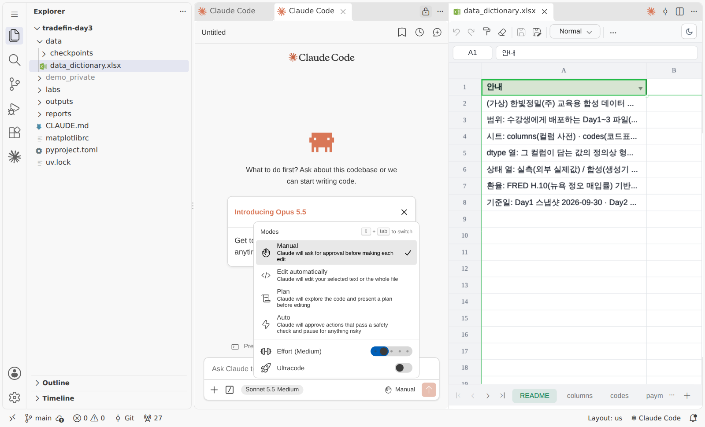
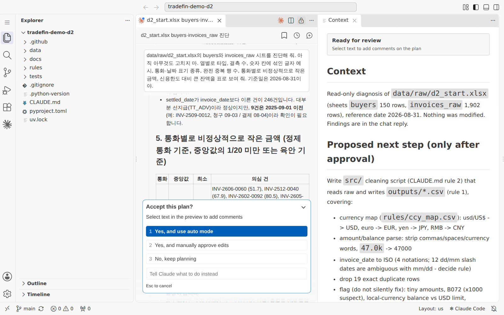
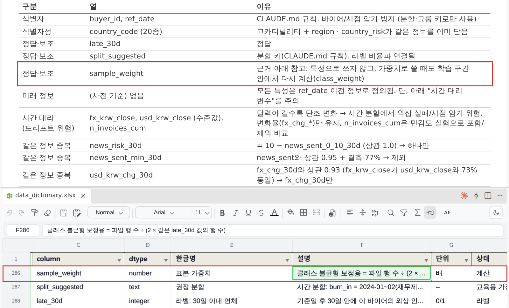
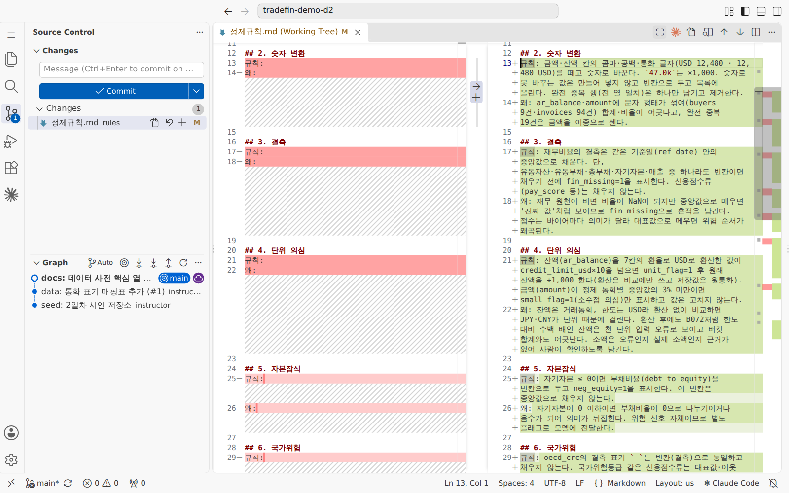
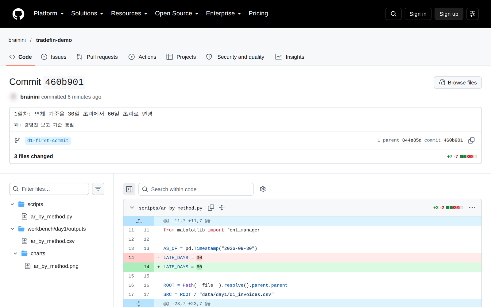
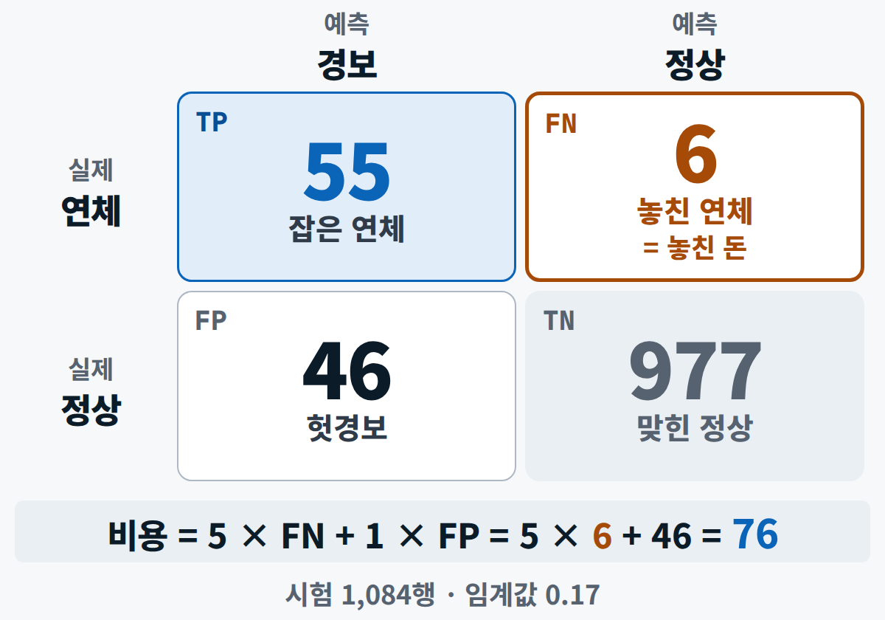
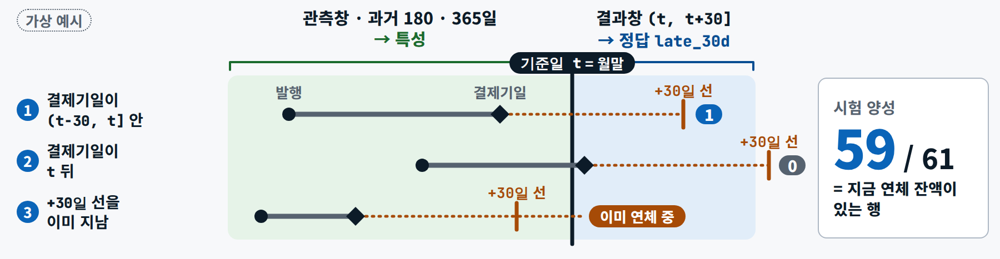
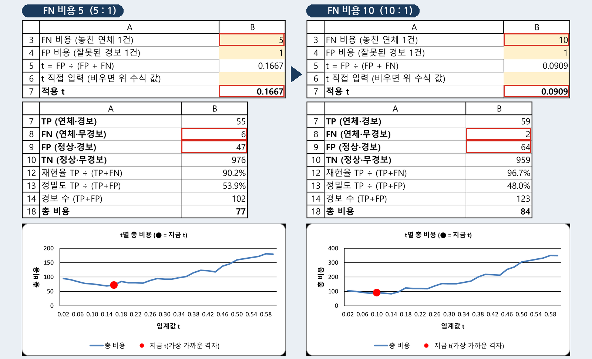
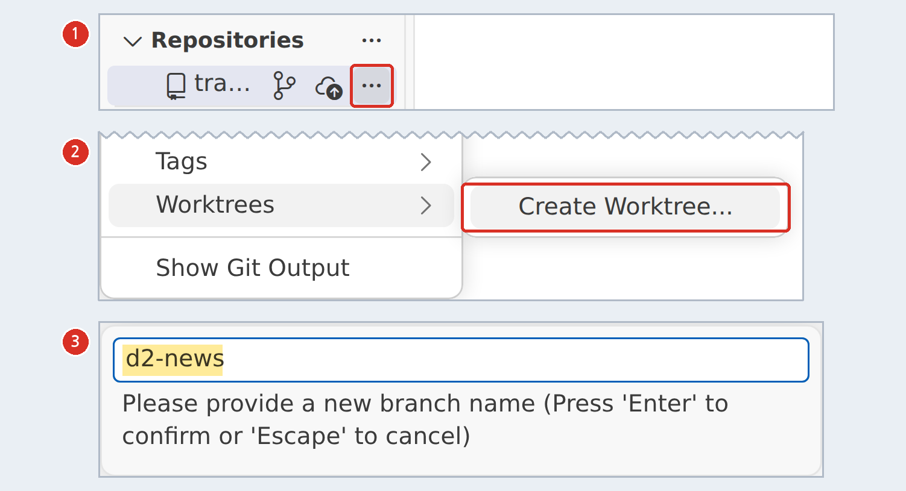

<div class="tf-lab" markdown>
<span class="tf-eyebrow">3일차 · 실습 A · 4–5교시 · 13:00–14:50 <span class="tf-daystate" data-tf-daystate="3"></span></span>

# 실습 A — 내 첫 연체 예측 모델

<div class="tf-meta" markdown>
<span class="tf-chip tf-chip--time">A-1 13:00–13:50</span>
<span class="tf-chip tf-chip--time">A-2 14:00–14:50</span>
<span class="tf-chip tf-chip--tool">Claude Code · Plan → Manual</span>
<span class="tf-chip tf-chip--tool">Git · GitHub</span>
<span class="tf-chip tf-chip--tool">채팅 경로 가능</span>
</div>

<div class="tf-flow" markdown>
<div markdown><b>상황</b> (가상) 한빛정밀(주) 채권관리팀은 매달 말 바이어 150곳을 점검합니다. '다음 30일 안에 결제기일 + 30일 선을 넘길 바이어'를 확률로 미리 알고 싶습니다. 오전에 본 'AUC 1.0 모델'은 누수였습니다 — 이번에는 내가 만들고, 내가 의심합니다.</div>
<span>→</span>
<div markdown><b>넣는 것</b> `d3_start_features.csv`(300행 × 53열 · 연체 16건) + 오늘의 규칙 `d3_rules.md` + 프롬프트 A0–A5</div>
<span>→</span>
<div markdown><b>얻는 것</b> 데이터 카드 · 학습 코드 · 평가표(AUC · PR-AUC · Brier) · 시험 예측 88행 · 모델 파일 · 비용 기준 임계값 표 · 커밋 2개 + push</div>
</div>

<div class="tf-lab__grid" markdown>
<div class="tf-lab__cell" markdown><span class="tf-lab__label">목표</span> 300행 특성표로 기준선과 LightGBM을 학습하고 **누수를 직접 확인**한 뒤, 오분류 비용으로 **임계값을 정하고** 놓친 바이어를 이름으로 봅니다</div>
<div class="tf-lab__cell" markdown><span class="tf-lab__label">오전 시연과의 관계</span> 시연 3(누수 탐정)을 **300행 · 모델 2개**로 줄여 직접, 시연 4(비용 엑셀)를 **Markdown 표 · 내 비용비**로. 무엇을 정답으로 볼지 · 어디서 나눌지 · 얼마나 아픈지는 **내가** 정합니다</div>
</div>

<div data-tf-map></div>
</div>

## 시작 전 확인 {#before}

슬라이드 57의 다섯 줄입니다. 점심 전에 끝내 두면 13:00부터 실습 시간을 온전히 씁니다. 하나라도 막히면 점심 전에 손을 듭니다.

<div class="tf-checklist" data-title="시작 전 확인 5가지" markdown>

- [ ] 오늘 파일 받기 — `uv run python tools/get_day_files.py 3`(막히면 아래 카드의 ZIP)
- [ ] VS Code에서 폴더 '신뢰' → Claude Code 로그인 · 권한 모드 확인(Auto면 Plan이나 Manual로)
- [ ] 오늘 데이터 파일 4개가 열리는지 확인
- [ ] 막히면 채팅만으로 — ChatGPT · Claude에 CSV를 올리고 같은 문장([채팅 경로](#chat-path))
- [ ] 회사 실데이터는 어떤 AI 도구에도 넣지 않는다

</div>

이 쪽의 단축키는 Windows 기준입니다. Mac은 ++ctrl++ 대신 ++cmd++를 누르고(미리보기 ++cmd+shift+v++), 터미널 ++ctrl+grave++와 소스 제어 ++ctrl+shift+g++만 Mac에서도 ++ctrl++입니다.

## 입력 파일 받기 {#files}

내 저장소에서 `uv run python tools/get_day_files.py 3` 한 번이면 아래 파일이 **같은 경로**(`data/checkpoints/…`)로 들어오고, 고쳐 써도 되는 작업 사본이 `workbench/day3/data/`에 생깁니다(A-1 · 01에서 합니다). 저장소 없이 채팅 경로로 하는 분만 카드에서 받으세요. 카드에 잠금 표시가 있으면 그 시각(10/16(금) 08:30) 뒤에 받습니다 — 2일차 실습의 결과가 들어 있는 파일이라서입니다.

--8<-- "docs/_snippets/day3/files_lab-a_cards.md"

**오늘의 데이터**(슬라이드 58) — 모두 가상 회사의 합성 데이터라 AI 도구에 넣어도 됩니다.

| 파일 | 크기 | 내용 | 주요 열 |
|---|---|---|---|
| `d3_start_features.csv` | 300행 × 53열 | 150곳 × 기준일 2개(2월 말 · 8월 말), 연체 16건 — **실습 A** | `buyer_id` · `late_30d` · `split_suggested` |
| `d3_features_panel.csv` | 4,017행 × 53열 | 바이어 × 월(2024-01~2026-08), 연체 215건 — 표준 트랙 | `ref_date` · `n_invoices_cum` · `avg_days_to_pay` |
| `d3_start_scoring.csv` | 150행 × 50열 | 2026-09-30 현재 150곳, 정답 없음 — 실습 B에서 점수를 붙일 대상 | 특성만(`late_30d` 없음) |
| `fx_forecast_inputs.csv` | 767행 × 4열 | 원/달러 일별 종가(2023-09~2026-09) — 실습 B | `date` · `usd_krw` · `split` |
| `data_dictionary.xlsx` | 시트 6개 | 열 이름 · 뜻 · 단위 · 코드표 — 저장소에 이미 있다 | `columns` · `codes` 시트 |

!!! warning "`sample_weight`는 특성이 아닙니다 — 오늘의 함정"

    불균형을 보정하려고 **정답으로 계산해 넣은 가중치**입니다(연체 행 9.375 · 정상 행 0.528, 두 값뿐). 특성으로 넣으면 곧바로 누수입니다. A-1 · 04에서 일부러 한 번만 넣어 봅니다.

## A-1 · 데이터 카드와 첫 모델 {#a1}

<div class="tf-phase" markdown>

<span class="tf-eyebrow">슬라이드 60 · 실습 A-1 · 13:00–13:50 · Claude Code · Git</span>

시연 3을 300행으로 줄여 직접 한다

**목표** 300행 특성표로 기준선과 LightGBM을 학습하고, 누수를 직접 확인한다

1. 오늘 파일 받기 → 브랜치 d3-model → Claude Code에 @d3_rules.md(오늘의 데이터 규칙)부터 읽히기
2. Plan 모드로 데이터 카드 → outputs/d3_data_card.md — 행 · 열 수, 기준일별 연체 건수, 쓰면 안 되는 열과 이유
3. split_suggested로 나눠 로지스틱 · LightGBM 학습 → d3_eval.md(AUC · PR-AUC · Brier)
4. 누수 실험: sample_weight를 넣으면? → AUC 비교 후 diff로 원상복구 확인
5. 커밋 — 메시지 두 줄(무엇 / 왜)

**결과물** d3_data_card.md · d3_eval.md · d3_train.py · 커밋 1개

</div>

### A-1 · 01 오늘 파일 받기 → 브랜치 d3-model → @d3_rules.md 읽히기 (13:00–13:10) { #a1-1 .step data-tool="터미널 · Claude Code" }

**왜** 모두가 같은 경로 · 같은 규칙으로 시작해야 프롬프트의 `@경로`와 결과 숫자가 사람마다 맞습니다. `get_day_files.py 3` → 브랜치 `d3-model` → **A0** → 오늘의 규칙 5줄

!!! me "내가 할 일"

    1. VS Code에서 **내 저장소**를 엽니다(폴더 **'신뢰'**). 편집기 오른쪽 위 Claude 아이콘으로 **Claude Code 패널**을 열고, 입력창 아래 모드 표시가 **Manual 또는 Plan**인지 봅니다 — Auto로 시작했다면 눌러서 바꿉니다(시작 모드는 PC마다 다릅니다).
    2. 터미널을 엽니다(++ctrl+grave++). 어제 PR을 머지했다면 내 PC를 `main`으로 맞춥니다.

        ```text
        git switch main
        git pull
        ```

    3. 처음 쓰는 PC면 `uv sync`를 한 번 하고, 오늘 파일을 받습니다.

        ```text
        uv run python tools/get_day_files.py 3
        ```

    4. 브랜치 `d3-model`을 만듭니다 — 일 하나에 갈래 하나. 왼쪽 아래 상태 표시줄의 브랜치 이름 → `+ Create new branch…`로 만들어도 됩니다.

        ```text
        git switch -c d3-model
        ```

    5. Claude Code 입력창에 `@d3_r`까지 치고 Tab → `@workbench/day3/rules/d3_rules.md` 칩이 붙으면 아래 **A0**을 보냅니다.

!!! prompt "프롬프트 A0 — 오늘의 규칙 읽히기(읽기만)"

    --8<-- "labs/day3/prompts.md:a0"

!!! ai "AI가 하는 일"

    `d3_rules.md`를 읽고 오늘 지킬 규칙을 **5줄로 요약**합니다 — 파일은 만들지 않습니다(30초). 앞의 터미널 명령은 파일마다 `[받음] data/checkpoints/d3_start_features.csv  (사본 만듦)` 같은 줄을 찍습니다.

<figure class="result" markdown="span">
  { loading=lazy }
  <figcaption>모드 메뉴 — 입력창 아래의 모드 이름(여기서는 Manual)을 누르면 열립니다. 오늘은 Plan으로 시작하고 Auto는 쓰지 않습니다(시연 준비 화면 예시)</figcaption>
</figure>

!!! ok "확인"

    - [ ] 왼쪽 아래 상태 표시줄에 `d3-model`
    - [ ] `data/checkpoints/`의 `d3_start_features.csv` · `d3_features_panel.csv` · `d3_start_scoring.csv`와 `labs/day3/fx_forecast_inputs.csv`가 열린다
    - [ ] A0 요약에 **빼는 열 5개**(`buyer_id` · `ref_date` · `late_30d` · `split_suggested` · `sample_weight`)와 **시드 42**

??? fix "`[열기 전] … 10/16(금) 08:30 이후에 받습니다`가 나와요"

    PC 시계가 맞는지 봅니다. 08:30이 지났으면 같은 명령을 다시 실행합니다. 계속 안 되면 위 [입력 파일 받기](#files) 카드나 3일차 ZIP으로 받아 저장소의 같은 경로(`data/checkpoints/`)에 둡니다.

??? fix "`d3_rules.md`가 없어요"

    `uv run python tools/get_day_files.py 3`을 다시 실행합니다 — 내 저장소에 없는 파일만 받아 줍니다(있는 파일은 덮어쓰지 않습니다).

??? fix "Claude Code에 로그인이 안 돼요(무료 플랜)"

    Claude Code는 Pro 이상 구독이나 Console 계정이 필요합니다. 오늘은 [채팅 경로](#chat-path)로 같은 단계를 따라옵니다. 회사 PC에서 설치가 막히면 내 저장소의 Codespaces를 씁니다(Plan 모드로 시작합니다).

??? fix "`uv`를 찾을 수 없대요 · 회사망이 파일 받기를 막아요"

    `uv`가 없으면 [사전 준비](../setup.md)의 설치를 따라 합니다. 회사망이 `raw.githubusercontent.com`을 막으면 사이트의 3일차 ZIP을 받습니다. 압축을 푼 `D3` 폴더에는 파일만 들어 있으니 자리를 나눠 둡니다 — `d3_start_features.csv` · `d3_start_scoring.csv` · `d3_features_panel.csv`는 `data/checkpoints/`에, 나머지(`fx_forecast_inputs.csv` · 완성본 · 양식 · 표본)는 `labs/day3/`에(`fred_dexkous.csv`는 이미 `data/external/`에 있습니다).

??? fix "`git switch -c`가 '이미 있다(already exists)'고 해요"

    아침에 만들어 둔 브랜치입니다. `git switch d3-model`로 옮겨 갑니다.

<p class="tf-check"><time>13:10</time> 손 점검 — 상태 표시줄 d3-model · A0 요약에 빼는 열 5개와 시드 42</p>

### A-1 · 02 Plan 모드로 데이터 카드 (13:10–13:20) { #a1-2 .step data-tool="Claude Code · Plan" }

**왜** AI가 데이터를 쓰기 전에 **먼저 읽고 표로 말하게** 합니다. 열의 뜻과 누수 후보는 AI가 초안을 쓰고 **사람이 확인**합니다. `d3_start_features.csv` → **A1**(Plan) → 계획 읽기 → `d3_data_card.md`

!!! me "내가 할 일"

    1. 입력창 아래 모드 표시기를 눌러 **Plan**으로 바꿉니다(파일을 고치지 못하는 계획 모드).
    2. 아래 **A1**을 보냅니다. `@d3_start_f`까지 치고 Tab — 같은 이름이 두 개(`data/checkpoints/`와 `workbench/day3/data/` 사본) 보이면 `data/checkpoints/` 쪽을 고릅니다.
    3. 계획이 열리면 **금지 열 표**(구분 · 열 · 이유)를 읽습니다. `sample_weight` · `split_suggested`가 '쓰면 안 되는 열'에 있는지 봅니다. 고칠 점이 있으면 계획 문서의 그 줄을 선택해 코멘트를 남겨도 됩니다.
    4. 승인 창에서 **`2 Yes, and manually approve edits`**를 고릅니다(맨 위 `use auto mode`가 아닙니다).
    5. 쓰기 허락 창에서 **무엇을 · 어디에**(`workbench/day3/outputs/d3_data_card.md` 새 파일)를 읽고 `1 Yes`. 끝나면 ++ctrl+shift+v++ 로 미리보기를 엽니다.

!!! prompt "프롬프트 A1 — 데이터 카드 · Plan 모드"

    --8<-- "labs/day3/prompts.md:a1"

!!! ai "AI가 하는 일"

    파일을 읽는 명령 몇 개로 행 · 열 · 연체 건수 · 빈칸을 센 뒤(Plan 모드라 아무것도 고치지 않습니다) **계획**을 보여 줍니다 — 열을 '식별자/메타 · 특성 · 레이블 · 쓰면 안 되는 열'로 나눈 표와 만들 파일 이름. 승인하면 **코드로 센 숫자만으로** 데이터 카드를 씁니다(2–4분).

<figure class="result" markdown="span">
  { loading=lazy }
  <figcaption>계획 승인 창 — 오늘은 <code>2 Yes, and manually approve edits</code>. 번호로 고릅니다(Esc는 취소). 2일차 시연 화면이라 계획 내용은 다르고 창 모양은 같습니다</figcaption>
</figure>

<figure class="result" markdown="span">
  { width="760" loading=lazy }
  <figcaption>계획의 '특성 제외 표'와 데이터 사전의 <code>sample_weight</code> 정의(빨간 상자) — 오늘 데이터 카드의 표도 이런 모양입니다(시연 3의 패널 파일 기준이라 열 목록은 조금 다릅니다)</figcaption>
</figure>

!!! ok "확인"

    - [ ] **300행 × 53열 · 연체 16건**, 기준일 2개(2월 말 3건 · 8월 말 13건)
    - [ ] '쓰면 안 되는 열'에 `sample_weight`(정답으로 계산한 가중치)와 `split_suggested`(분할 표시)가 이유와 함께
    - [ ] 숫자는 코드로 센 값이고, 모르는 것은 '데이터 확인 필요' · 추정은 '추정'

??? ok "참고 실행 값 — 내 카드를 만든 뒤 펼쳐 보기"

    같은 프롬프트로 한 번 돌린 값입니다. 표 모양과 문장은 매번 다르고, 숫자는 같아야 합니다.

    - `split_suggested`: train 212행(연체 12) · test 88행(연체 4) — 같은 바이어가 양쪽에 없다(바이어 단위 분할)
    - `sample_weight`: 0.5282 · 9.375 두 값뿐 — 정답(`late_30d`)으로 계산했다는 뜻
    - 빈칸 상위 5: `news_sent_min_30d` 230 · `pct_ar_31p` · `pct_91plus` · `pct_current` 각 107 · `dpd_trend` 105

??? fix "승인 창에서 `use auto mode`를 눌렀어요"

    괜찮습니다. 파일이 묻지 않고 만들어졌을 뿐입니다 — 소스 제어(++ctrl+shift+g++)의 diff로 만들어진 파일을 읽어 봅니다. 다음 프롬프트부터는 모드를 Manual로 둡니다.

??? fix "승인 창에서 Esc를 눌렀더니 멈췄어요"

    Esc는 그 도구 호출을 취소합니다. 같은 프롬프트를 다시 보내고, 승인 창에서는 **번호**(`2`)로 고릅니다.

??? fix "`sample_weight`가 '특성'으로 분류됐어요"

    "sample_weight의 뜻을 data/data_dictionary.xlsx의 columns 시트에서 읽고, 쓰면 안 되는 열로 옮겨"라고 보냅니다.

??? fix "숫자를 암산한 것 같아요"

    "이 숫자를 계산한 코드를 보여 줘"라고 묻습니다. 코드 없이 나온 숫자는 '데이터 확인 필요'로 바꾸게 합니다.

<p class="tf-check"><time>13:20</time> 손 점검 — 데이터 카드에 300행 · 연체 16 · 메타 열 2개(sample_weight · split_suggested)</p>

### A-1 · 03 분할대로 로지스틱 · LightGBM 학습 → d3_eval.md (13:20–13:40) { #a1-3 .step data-tool="Claude Code" }

**왜** 단순한 기준선(로지스틱)과 오늘의 기본 모델(LightGBM)을 **같은 분할 · 같은 지표**로 견줍니다. 데이터 카드 → **A2** → `d3_train.py` · `d3_eval.md` · `d3_test_pred.csv` · `model_v1.txt`

!!! me "내가 할 일"

    1. 모드를 **Manual**(또는 Edit automatically)로 두고 **A2**를 보냅니다.
    2. 허락 창의 실행 명령(`uv run python workbench/day3/outputs/d3_train.py`)을 끝까지 읽고 `1 Yes`.
    3. `d3_eval.md`에서 두 모델의 ROC-AUC · PR-AUC · Brier와 0.5 혼동행렬을 읽습니다.
    4. `d3_train.py`를 훑어봅니다 — 특성에 `sample_weight` · `split_suggested` · `buyer_id` · `ref_date`가 **없는지**, 문자 열은 `payment_method` 원-핫만인지, LightGBM 설정이 **프롬프트의 값 그대로**인지(`min_child_samples=10` …).

!!! prompt "프롬프트 A2 — 첫 모델 두 개"

    --8<-- "labs/day3/prompts.md:a2"

!!! ai "AI가 하는 일"

    학습 코드 `d3_train.py`를 쓰고(쓰기 허락 창) 실행합니다(실행 허락 창 · 1–2분). 결과로 **파일 네 개**를 남깁니다 — `d3_eval.md`(두 모델의 시험셋 지표 · 혼동행렬 · 패키지 버전) · `d3_test_pred.csv`(시험 88행의 `buyer_id` · `ref_date` · `late_30d` · `pd_30d` — 실습 B-1 · 04가 씁니다) · `model_v1.txt`(LightGBM — 실습 B-1 · 01이 씁니다) · `d3_train.py`.

<figure class="result" markdown="span">
  { width="680" loading=lazy }
  <figcaption>실행 허락 창 — 무엇을 · 어디서 실행하는지 끝까지 읽고 <code>1 Yes</code>. 범위를 넓히는 <code>2</code>는 쓰지 않습니다(1일차 시연 화면 예시)</figcaption>
</figure>

!!! ok "확인"

    - [ ] 시험셋 **88행 · 연체 4건**, 특성 48열 안팎(수치 41 + `payment_method` 원-핫 7)
    - [ ] ROC-AUC가 **0.80–1.00** 사이(로지스틱은 대개 0.80–0.90, LightGBM은 0.93–0.97) — 0.99 이상으로 붙어 있으면 누수부터
    - [ ] `workbench/day3/outputs/`에 `d3_train.py` · `d3_eval.md` · `d3_test_pred.csv` · `model_v1.txt`

??? ok "참고 실행 값 — 내 평가표를 만든 뒤 펼쳐 보기"

    | 모델 | ROC-AUC | PR-AUC | Brier | 0.5 혼동행렬 TN · FP · FN · TP |
    |---|---|---|---|---|
    | 로지스틱 | 0.851 | 0.355 | 0.0365 | 83 · 1 · 2 · 2 |
    | LightGBM | 0.949 | 0.429 | 0.0349 | 83 · 1 · 3 · 1 |

    시험 연체가 4건뿐이라 한 건만 달라도 AUC가 크게 움직입니다 — 오전 시연 1에서 본 표본의 흔들림입니다. 분할 · 특성 · 설정이 같으면 소수 셋째 자리가 조금 달라도 정상입니다.

??? fix "시험셋이 88행이 아니에요"

    `split_suggested`를 쓰지 않고 무작위로 나눈 것입니다. "분할은 split_suggested의 train / test 그대로"라고 다시 지시합니다.

??? fix "AUC가 0.99 이상으로 붙어 있어요"

    누수입니다. 특성 목록에 `sample_weight` · `buyer_id`가 있는지 봅니다 → [안 맞을 때](../prompts/day3.md#mismatch) 프롬프트로 원인부터 묻습니다.

??? fix "`import lightgbm` 오류 · 패키지가 없대요"

    저장소 맨 위에서 `uv sync`를 한 번 하고 다시 실행합니다. 패키지를 더할 때는 Claude Code가 `uv add 이름`을 하겠다고 먼저 알려 주면 읽고 승인합니다.

??? fix "LightGBM에서 `eval_set` 경고 · 오류가 나요"

    LightGBM 4.7부터 검증 세트 인자가 바뀌는 중입니다(`eval_X` · `eval_y`). 오류 메시지 전문을 그대로 AI에게 다시 주고 고치게 합니다.

??? fix "원본 CSV를 덮어쓰려고 해요"

    허락 창에서 `No` — `data/`는 읽기만 합니다. "원본은 읽기만 하고 결과는 workbench/day3/outputs/에 저장해"라고 다시 보냅니다.

<p class="tf-check"><time>13:40</time> 손 점검 — 시험셋 88행 · 연체 4 · d3_eval.md에 두 모델</p>

### A-1 · 04 누수 실험: sample_weight를 넣으면? → 원상복구 (13:40–13:45) { #a1-4 .step data-tool="Claude Code · Git" }

**왜** 오전의 'AUC 1.0 모델'을 **내 손으로** 만들어 봅니다 — 누수는 너무 좋은 숫자로 드러납니다. `d3_train.py` → **A3** → AUC 1.00 → 원상복구 → `git diff` 빈 출력

!!! me "내가 할 일"

    1. **A3**을 보냅니다. 허락 창(`git add …` · `uv run …`)을 읽고 승인합니다.
    2. AUC 두 개를 읽습니다 — `sample_weight` 하나로 정답을 읽을 수 있어 1.00 근처로 뜹니다.
    3. 실험이 끝나면 터미널에서 직접 확인합니다. **아무것도 나오지 않으면** 코드가 원래대로입니다.

        ```text
        git diff
        ```

!!! prompt "프롬프트 A3 — 누수 실험 후 원상복구"

    --8<-- "labs/day3/prompts.md:a3"

!!! ai "AI가 하는 일"

    지금 코드를 `git add`로 스테이징해 '원래 모습'의 기준으로 남기고 → `sample_weight`를 특성에 더해 두 모델을 한 번씩(결과 파일 `d3_test_pred.csv` · `model_v1.txt`는 덮어쓰지 않게) → 이유 3줄을 `d3_eval.md`에 → 코드를 되돌린 뒤 `git diff`가 비었는지 보여 줍니다(허락 창 3–4번 · 2분). 원본 대신 임시 사본으로 실험해 "되돌릴 것이 없었다"고 답하기도 합니다 — 그것도 정상이고, `git diff`가 비어 있으면 됩니다.

<figure class="result" markdown="span">
  { width="760" loading=lazy }
  <figcaption>diff 화면(2일차 시연) — 빨강 · 초록 줄이 남아 있으면 아직 되돌리지 않은 것입니다. 터미널 <code>git diff</code>가 빈 출력이면 바뀐 줄이 없습니다</figcaption>
</figure>

!!! ok "확인"

    - [ ] `sample_weight`를 넣은 두 모델의 AUC가 **1.00 근처**
    - [ ] 누수 이유 3줄이 `d3_eval.md`에
    - [ ] 터미널 `git diff`가 **빈 출력**

??? ok "참고 실행 값"

    로지스틱 · LightGBM 모두 ROC-AUC **1.000**(PR-AUC 1.000). `min_child_samples`를 20 · 30으로 돌리면 LightGBM은 0.946 · 0.932로 **오르지 않습니다** — 아래 첫 번째 '막히면'의 이유입니다.

??? fix "LightGBM의 AUC만 안 올라요"

    열이 빠진 것이 아닐 수 있습니다. 학습셋의 연체가 12건뿐인데 LightGBM의 기본 설정은 '잎 하나에 최소 20행'이라 그 12건을 따로 떼어 낼 수 없습니다. A2가 `min_child_samples`를 슬라이드의 30에서 10으로 낮춘 이유입니다 — 코드에 10이 들어갔는지 봅니다. 로지스틱은 설정과 상관없이 바로 오릅니다. 작은 표에서는 **모델 설정이 누수를 가리기도 합니다.**

??? fix "`git diff`에 줄이 남아 있어요"

    "d3_train.py를 스테이징한 모습으로 되돌려 줘"라고 보냅니다. `git diff`는 '스테이징한 뒤 바뀐 줄'만 보여 줍니다 — 어제 배운 작업 폴더와 스테이징 영역의 차이입니다.

??? fix "Claude가 `git checkout` · `git restore`를 쓰려고 해요"

    되돌리는 명령입니다. 허락 창에서 **대상 파일이 `d3_train.py` 하나뿐인지** 읽고 승인합니다. 다른 파일까지 되돌리려 하면 `No`.

??? fix "실험 뒤 A4 비용표가 완벽해요(FN 0 · FP 0) · B1에서 열 개수 오류가 나요"

    누수 실험이 결과 파일 `d3_test_pred.csv` · `model_v1.txt`를 누수 모델로 덮어쓴 것입니다(아직 커밋 전이라 `git diff`에 보이지 않습니다). 원래 코드로 한 번 더 돌려 되돌립니다 — 이 스크립트는 `d3_eval.md`도 새로 쓰므로 누수 3줄은 다시 붙여 달라고 합니다.

    ```text
    uv run python workbench/day3/outputs/d3_train.py
    ```

### A-1 · 05 커밋 — 메시지 두 줄(무엇 / 왜) (13:45–13:50) { #a1-5 .step data-tool="Git · Claude Code" }

**왜** 커밋 하나에 '무엇'과 '왜'를 남기면 월요일의 내가 같은 숫자를 다시 만들 수 있습니다. outputs 파일 → 두 줄 메시지 → 커밋 1개

!!! me "내가 할 일"

    1. 소스 제어(++ctrl+shift+g++)에서 `workbench/day3/outputs/`의 결과 파일과, Claude Code가 `scripts/`에 만든 코드(예: `scripts/d3_data_card.py` — 숫자를 만든 코드라 함께 올립니다)만 `+`로 고릅니다. 받은 데이터 사본(`workbench/day3/data/`)은 고르지 않습니다.
    2. 메시지 칸에 두 줄을 쓰고(첫 줄 · 빈 줄 · `왜:`) **Commit**을 누릅니다.

        ```text
        3일차: 데이터 카드와 첫 모델 추가

        왜: 300행 기준선과 LightGBM을 비교하고 sample_weight 누수를 직접 확인하려고
        ```

    3. Claude Code에 맡겨도 됩니다 — 아래 보조 프롬프트를 보내고 허락 창에서 **파일 목록 · 메시지 · 브랜치(`d3-model`)**를 읽고 승인합니다.

??? prompt "보조 프롬프트 — 커밋 맡기기"

    --8<-- "labs/day3/prompts.md:commit"

<figure class="result" markdown="span">
  { width="760" loading=lazy }
  <figcaption>GitHub에서 본 커밋 — 첫 줄이 제목, 빈 줄 뒤의 <code>왜:</code>가 본문입니다(1일차 시연 저장소 예시)</figcaption>
</figure>

!!! ok "확인"

    - [ ] 커밋 1개 — `git log --oneline`에 첫 줄만 보인다(빈 줄이 있다는 뜻)
    - [ ] 데이터 사본(`workbench/day3/data/`)이 커밋에 없다 · `scripts/`에 새 코드가 있었다면 함께 들어갔다

??? fix "커밋 메시지가 한 줄로 붙어 보여요"

    두 줄 사이에 **빈 줄**이 있어야 합니다. 첫 줄 · 빈 줄 · `왜:` 순서로 다시 씁니다(`git commit --amend`로 마지막 커밋 메시지를 고칠 수 있습니다).

??? fix "`Please tell me who you are` · `GH007 … private email`이 나와요"

    커밋 작성자를 한 번 정하고 다시 커밋합니다. 저장소가 공개라 이름은 실명 대신 별명, 주소는 GitHub **Settings → Emails**에 보이는 noreply 주소(숫자ID+아이디 꼴)를 그대로 복사해 넣습니다([사전 준비 0-2](../setup.md#git)).

    ```text
    git config --global user.name "내 별명"
    git config --global user.email "숫자ID+아이디@users.noreply.github.com"
    ```

    `GH007`은 push 때 나옵니다 — 이미 만든 커밋에 개인 메일이 찍혀 있다는 뜻입니다. 위 설정 뒤 소스 제어 **···** → **Commit → Undo Last Commit**을 오늘 만든 커밋 수만큼 누르고, 다시 Commit → push합니다(두 커밋을 하나로 합쳐도 됩니다).

??? fix "데이터 사본까지 스테이징됐어요"

    소스 제어의 Staged Changes에서 그 파일 옆 `−`를 눌러 뺍니다.

<p class="tf-check"><time>13:50</time> 커밋 1개 — 메시지에 왜: 줄. 10분 쉽니다</p>

## A-2 · 비용 기준 임계값 {#a2}

<div class="tf-phase" markdown>

<span class="tf-eyebrow">슬라이드 61 · 실습 A-2 · 14:00–14:50 · Claude Code · Git</span>

시연 4를 내 모델과 내 비용비로

**목표** 오분류 비용으로 임계값을 정하고, 놓친 바이어를 이름으로 본다

1. t = 0.05~0.50 비용표(5 × FN + FP) → d3_threshold.md — 최소 비용 t와 이론값 1/6을 비교한다
2. 놓친 연체(FN) 바이어 목록과 주요 특성 3개 → 공통점 2줄
3. 내 회사 비용비(3:1 또는 10:1)로 다시 → 무엇이 바뀌나 1줄
4. 표준: 패널 시간 분할로 같은 실험 · 도전 ①: class weight · SMOTE 비교 · 도전 ②: 부트스트랩 AUC 구간 · worktree 병렬
5. 14:45 기대 범위 확인 → 커밋 · push

**결과물** d3_threshold.md · 커밋 2개 이상

</div>

### A-2 · 01 t = 0.05~0.50 비용표(5 × FN + FP) (14:00–14:20) { #a2-1 .step data-tool="Claude Code" }

**왜** 모델이 낸 확률을 **어디서 자를지**는 모델이 아니라 **비용**이 정합니다. 놓친 연체 1건 = 헛경보 5건(사내 가정)이면 이론값은 t = 1 ÷ 6 ≈ 0.17. `d3_test_pred.csv` → **A4** → `d3_threshold.md`(10줄 표 · 최소 비용 t · 놓친 바이어 표)

!!! me "내가 할 일"

    1. **A4**를 보냅니다 — 이 프롬프트가 A-2 · 02의 놓친 바이어 표까지 한 번에 만듭니다.
    2. `d3_threshold.md`를 미리보기로 엽니다.
    3. **한 줄을 손으로 검산**합니다 — t = 0.50 줄의 FN과 FP로 `5 × FN + FP`를 계산해 비용 칸과 같은지 봅니다(30초).
    4. 최소 비용 t를 찾아 이론값 0.17과의 차이를 **내 말로 1줄** 씁니다.

!!! prompt "프롬프트 A4 — 비용 기준 임계값 표"

    --8<-- "labs/day3/prompts.md:a4"

!!! ai "AI가 하는 일"

    `d3_test_pred.csv`를 읽어 임계값 0.05–0.50(0.05 간격) **10줄 표**(TP · FN · FP · TN · 재현율 · 정밀도 · 경보 수 · 비용)를 만들고 최소 비용 t를 이론값 1/6과 견줍니다. 이어서 **최소 비용 t와 t = 0.17 두 곳**의 놓친 바이어 표를 붙입니다(허락 창 1–2번 · 1분).

<figure markdown="span">
  { width="560" loading=lazy }
  <figcaption>혼동행렬과 비용 — 놓친 연체(FN) 1건을 헛경보(FP) 5건만큼 무겁게 셉니다(이론 그림은 시험 1,084행 기준이라 오늘 88행 표와 숫자가 다릅니다)</figcaption>
</figure>

!!! ok "확인"

    - [ ] `0.05, 0.10, … 0.50` **10줄**, 비용 = `5 × FN + FP`(한 줄을 손으로 맞춰 봤다)
    - [ ] 최소 비용 t와 이론값 0.17의 차이 1줄(내 말)
    - [ ] 몇 줄이 같은 값으로 계단처럼 움직여도 정상이다(시험 연체 4건 — 한 칸이 연체 1건)

??? ok "참고 실행 값(5:1) — 내 표를 만든 뒤 펼쳐 보기"

    | t | 놓친 연체 FN | 헛경보 FP | 비용 |
    |---|---|---|---|
    | 0.05 | 0 | 10 | 10 |
    | 0.10 | 1 | 9 | 14 |
    | **0.15** | 1 | 4 | **9 (최소)** |
    | 0.20 | 2 | 3 | 13 |
    | 0.25–0.40 | 3 | 2 | 17 |
    | 0.45–0.50 | 3 | 1 | 16 |

    최소 비용 t 0.15 — 이론값 0.1667과 한 칸 차이로, 슬라이드의 기대 범위(0.1–0.25) 안입니다.

??? fix "비용 열이 `5 × FN + FP`와 달라요"

    "비용 = 5×FN + FP로 다시 계산하고, 한 줄은 계산식을 보여 줘"라고 보냅니다.

??? fix "표가 0.05 간격 10줄이 아니에요"

    프롬프트를 그대로 다시 보냅니다. 간격을 바꾸면 이론값과 견주기 어렵습니다.

??? fix "최소 비용 t가 0.05나 0.30 이상이에요"

    시험 연체가 4건이라 생기는 계단입니다. 비용식이 맞는지만 확인하고, 이론값과의 차이를 1줄로 씁니다. 실무에서는 시험셋이 아니라 학습 기간의 월별 검증에서 비용이 가장 낮은 지점을 고릅니다.

<p class="tf-check"><time>14:20</time> 손 점검 — 10줄 표 · 최소 비용 t · 이론값과의 차이 1줄</p>

### A-2 · 02 놓친 연체(FN) 바이어와 특성 3개 → 공통점 2줄 (14:20–14:25) { #a2-2 .step data-tool="Claude Code" }

**왜** 모델이 **무엇을 못 보는지**는 놓친 바이어를 이름으로 볼 때 드러납니다. A4의 놓친 바이어 표 → **내가** 공통점 2줄

!!! me "내가 할 일"

    1. `d3_threshold.md`의 놓친 바이어 표(최소 비용 t · t = 0.17)에서 `pd_30d`와 주요 특성 3개를 나란히 봅니다.
    2. **공통점 2줄**을 `d3_threshold.md`에 직접 씁니다 — AI에게 쓰게 하지 않습니다.
    3. 오전 '한계' 장(연체 중인 바이어가 아니라 **새로 연체가 시작되는 바이어**를 늦게 본다)과 맞는지 견줍니다 → [이론 · 설명할 수 있어도 원인은 아니다](theory.md#ch3-limits).

!!! ai "AI가 하는 일"

    새로 보내는 프롬프트는 없습니다 — A4가 이미 놓친 바이어 표를 만들었습니다. 주요 특성이 엉뚱하면 아래 '막히면'의 한 줄로 다시 고르게 합니다.

<figure markdown="span">
  { loading=lazy }
  <figcaption>관측창과 결과창 — 기준일까지 연체 이력이 없다가 뒤 30일에 처음 연체하는 바이어는 특성에 신호가 거의 없습니다</figcaption>
</figure>

!!! ok "확인"

    - [ ] 공통점 2줄(내 말) — 놓친 바이어가 1곳뿐이면 그 1곳의 특징 2줄

??? ok "참고 실행 값"

    최소 비용 t 0.15에서 놓친 바이어는 **1곳**(B022 · 2026-08-31 · `pd_30d` 0.0617), t 0.17에서는 **2곳**(B022 · B087 · 0.1583)입니다. 둘 다 180일 연체 이력이 0이고(`max_dpd_180d` 0 · `late_share_180d` 0) 31일+ 잔액이 없으며 가장 오래된 미결이 짧습니다(21일 · 3일) — '연체 이력 없이 막 연체가 시작된 바이어를 모델이 늦게 본다'.

??? fix "놓친 바이어가 0곳이에요(최소 t가 0.05)"

    t = 0.17 쪽 표를 봅니다(A4가 함께 만듭니다). 거기서도 0곳이면 "t = 0.25에서 놓친 바이어 표도 더해 줘"라고 보냅니다.

??? fix "AI가 '주요 특성'을 아무 열이나 골라요"

    "연체 · 잔액 관련 열(oldest_open_days · max_dpd_180d · pct_current · overdue_amount_usd)로 다시 골라 줘"라고 보냅니다.

### A-2 · 03 내 회사 비용비(3:1 또는 10:1)로 다시 (14:25–14:30) { #a2-3 .step data-tool="Claude Code" }

**왜** 비용비는 모델이 아니라 **회사가** 정합니다(경영 결정). 같은 모델에서 선만 옮겨 경보 수와 놓친 연체가 어떻게 바뀌는지 봅니다. 내 비용비 → **A4 — 내 비용비로 다시** → `d3_threshold.md`에 이어 쓰기

!!! me "내가 할 일"

    1. 내 회사라면 놓친 연체 1건이 헛경보 몇 건만큼 아픈지 정합니다 — **3:1이면 t = 0.25, 10:1이면 t ≈ 0.09**.
    2. 근거를 숫자 대신 **한 줄**로 씁니다(예: "신규 선적을 보류하는 비용보다 미수금 손실이 훨씬 아프다").
    3. 아래 프롬프트의 `{FN비용}`을 `3` 또는 `10`으로 바꿔 보냅니다.
    4. **무엇이 바뀌었는지 1줄** — 경보 수 · 놓친 연체 수가 5:1과 어떻게 다른가.

!!! prompt "프롬프트 A4 — 내 비용비로 다시"

    --8<-- "labs/day3/prompts.md:a4-cost"

빈칸 `{FN비용}` — [빈칸 값 표](../prompts/day3.md#values)

!!! ai "AI가 하는 일"

    같은 10줄 표를 내 비용비로 다시 만들고 이론 t · 최소 비용 t · 경보 수 · 놓친 연체 수를 5:1과 나란히 놓은 뒤 변화를 1줄로 정리합니다(1분).

<figure class="result" markdown="span">
  { width="760" loading=lazy }
  <figcaption>오전 시연 4의 엑셀 — FN 비용 칸만 5 → 10으로 바꾸면 t 0.167 → 0.091, 놓친 연체 6 → 2 · 헛경보 47 → 64(시험 1,084행 기준이라 오늘 88행 표와 숫자는 다릅니다)</figcaption>
</figure>

!!! ok "확인"

    - [ ] 내 비용비 · 근거 1줄 · 바뀐 것 1줄이 `d3_threshold.md`에

??? ok "참고 실행 값"

    - **3:1** — 이론 t 0.25. 표의 최소 비용 t는 5:1과 같은 **0.15**(비용 7). t 0.25에서는 경보 3 · 놓친 연체 3 · 비용 11. 최소 t가 그대로라 "아무것도 안 바뀐다"로 보이지만 **이론 t와 그 t의 경보 수**가 바뀝니다.
    - **10:1** — 이론 t 0.0909(0.05 간격 표에는 없는 값 — 0.10 줄과 같습니다: 경보 12 · 놓친 연체 1 · 비용 19). 표의 최소 비용 t는 **0.05**(경보 14 · 놓친 연체 0 · 비용 10).
    - 1줄 예: "10:1이면 최소 비용 t가 0.15 → 0.05로 내려가 경보가 7건 → 14건으로 늘고 놓친 연체는 1 → 0건."

??? fix "3:1인데 최소 t가 그대로예요"

    정상입니다(같은 계단). 이론 t와 그 t의 경보 수 쪽 변화를 씁니다.

??? fix "10:1의 0.09 줄이 표에 없어요"

    "이론 t 행을 한 줄 더해 줘"라고 보냅니다.

### A-2 · 04 표준 · 도전 트랙(빨리 끝난 분) (14:30–14:45) { #a2-4 .step data-tool="Claude Code" }

**왜** 기본(300행)을 끝낸 분만 이어 갑니다. 하나만 골라도 됩니다 — 표본이 커지면(표준) · 불균형을 다루면(도전 ①) · 흔들림을 재면(도전 ②) 숫자가 어떻게 달라지는가. 트랙 프롬프트 → `d3_eval.md`에 300행 결과와 나란히

| 트랙 | 하는 일 | 확인 |
|---|---|---|
| **표준** | 패널 4,017행으로 **시간 분할** 같은 실험(학습 ≤ 2025-12-31 · 시험 2026-01~08) | LightGBM ROC-AUC **0.97–0.98**(시험 1,084행 · 연체 61건 — 300행보다 안정) |
| **도전 ①** | class weight · SMOTE(학습셋에만) 비교 | 평균 확률이 실제 연체율보다 부푸는지 1줄 |
| **도전 ②** | 바이어 단위 부트스트랩으로 AUC 95% 구간 · worktree 두 번째 작업대 | 시험 연체 4건이면 구간이 매우 넓다 |

!!! me "내가 할 일"

    1. 트랙 하나를 고르고 그 프롬프트를 보냅니다.
    2. 결과를 `d3_eval.md`의 300행 결과와 **나란히** 읽습니다.
    3. worktree(도전 ②): 소스 제어 › … › Worktrees › Create Worktree(브랜치 `d3-smote`) → 새 창에서 `uv sync`와 `uv run python tools/get_day_files.py 3`부터 → Claude Code를 하나 더 엽니다(터미널로는 `git worktree add ../tf-d3-smote -b d3-smote`).

???+ prompt "표준 — 패널 시간 분할"

    --8<-- "labs/day3/prompts.md:a5-std"

??? prompt "도전 ① — class weight · SMOTE 비교"

    --8<-- "labs/day3/prompts.md:a5-ch1"

??? prompt "도전 ② — 부트스트랩 AUC 구간"

    --8<-- "labs/day3/prompts.md:a5-ch2"

!!! ai "AI가 하는 일"

    표준은 패널을 읽어 시간 기준으로 다시 학습 · 평가하고(2–3분), 도전 ①은 `imbalanced-learn`이 없으면 `uv add`를 하겠다고 먼저 묻습니다. 도전 ②의 부트스트랩은 1,000번 반복이라 1–2분 걸립니다.

<figure class="result" markdown="span">
  { width="680" loading=lazy }
  <figcaption>worktree 만들기 — ① 소스 제어의 … ② Worktrees › Create Worktree… ③ 새 브랜치 이름(오늘은 <code>d3-smote</code>, 그림은 2일차 예시)</figcaption>
</figure>

!!! ok "확인"

    - [ ] (선택) 고른 트랙의 결과가 `d3_eval.md`에 300행 결과와 나란히 — 건너뛰어도 됩니다

??? ok "참고 실행 값"

    - 표준 — 학습 2,723행(연체 141) · 시험 1,084행(연체 61) · LightGBM ROC-AUC **0.976** · PR-AUC 0.708. 300행의 88행 · 4건보다 훨씬 안정적입니다.
    - 도전 ①(한 번 돌린 예) — ROC-AUC는 셋 다 0.95 안팎으로 비슷하고, 시험셋 평균 확률이 기본 0.040 → balanced 0.102 · SMOTE 0.090으로 실제 연체율 0.045의 약 2배가 됩니다(Brier도 나빠짐). 순위는 그대로, 확률만 부풉니다.
    - 도전 ②(한 번 돌린 예) — 시험 바이어 44곳을 1,000번 다시 뽑으면 LightGBM AUC 95% 구간이 약 0.87–1.00 — 위쪽이 1.0에 막힐 만큼 넓습니다.

??? fix "`imbalanced-learn`이 없대요"

    Claude Code가 `uv add imbalanced-learn`을 하겠다고 알리면 읽고 승인합니다. 설치가 막히면 class weight만 비교해도 됩니다. `uv add`는 `pyproject.toml` · `uv.lock`을 바꾸니 다음 커밋에 이 두 파일도 함께 올립니다(다른 PC에서도 같은 환경이 되게).

??? fix "worktree 폴더에 `.venv` · 받은 파일이 없어요"

    새 폴더는 빈 작업대입니다. 그 창의 터미널에서 `uv sync` → `uv run python tools/get_day_files.py 3`을 먼저 합니다.

??? fix "부트스트랩이 오래 걸려요"

    "1,000번 대신 200번으로"라고 덧붙입니다. 구간 폭을 보는 데는 충분합니다.

### A-2 · 05 14:45 기대 범위 확인 → 커밋 · push (14:45–14:50) { #a2-5 .step data-tool="Git · GitHub" }

**왜** 숫자가 다르게 나왔을 때 **정상적인 흔들림인지 오류인지** 가립니다. 범위 밖이면 숫자를 고치기 전에 오른쪽 칸부터 봅니다. 기대 범위 표 → 커밋 2 → push

**이 숫자 근처면 맞게 가고 있다**(슬라이드 64 — 14:45 · 16:40에 화면에도 띄웁니다)

| 확인할 것 | 기대 범위 | 아니면 |
|---|---|---|
| 데이터 카드 | 300행 · 연체 16 · 기준일 2개 | 파일과 인코딩 확인 |
| 시험셋(`split_suggested`) | 88행 · 연체 4 | 분할 열 확인 |
| AUC(300행) | 0.80–1.00, 모델 · 특성마다 흔들림 | 0.99 이상 고정이면 누수 점검 |
| `sample_weight` 넣으면 | AUC 1.00 | 안 오르면 열이 빠졌는지 |
| 패널 시간 분할 | LightGBM 0.97–0.98 | 분할 날짜 확인 |
| 비용 최소 t(5:1) | 0.1–0.25(이론 0.17) | 비용식 5 × FN + FP |
| 등급 · 환율 | S 대다수 · C 15–20곳 / 6/5는 95% 구간 밖 | IFS 순서 · 날짜 형식 |

!!! me "내가 할 일"

    1. 표와 내 숫자를 한 줄씩 대조합니다. 범위 밖이면 고치기 전에 **오른쪽 칸**부터 보고, 원인을 AI에게 먼저 묻습니다 → [안 맞을 때](../prompts/day3.md#mismatch).
    2. 두 번째 커밋을 합니다(두 줄).

        ```text
        3일차: 비용 기준 임계값 표와 내 비용비 추가

        왜: 놓친 연체 1건을 헛경보 몇 건으로 볼지에 따라 경보 선이 달라지는 것을 기록하려고
        ```

    3. **push** — 소스 제어의 **Publish Branch**(또는 터미널 `git push -u origin d3-model`). Claude Code에 맡기면 허락 창에서 push 대상이 **`d3-model`**인지 읽습니다.

??? prompt "보조 프롬프트 — 커밋 · push 맡기기"

    --8<-- "labs/day3/prompts.md:commit-push"

!!! ok "확인"

    - [ ] 기대 범위 7줄과 대조했다(범위 밖이면 원인 1줄)
    - [ ] 커밋 2개 이상 · GitHub에 `d3-model` 브랜치가 보인다

??? ok "참고 실행 값 한눈에(같은 프롬프트 · 시드 42로 한 번 돌린 값)"

    데이터 카드 300행 · 연체 16(2월 말 3 · 8월 말 13) / 시험 88행 · 연체 4 / AUC 로지스틱 0.851 · LightGBM 0.949 / 누수 실험 1.000 · 1.000 / 패널 시간 분할 0.976 / 비용 최소 t 0.15(비용 9) — 사람마다 다른 것이 정상이고, 절차(분할 · 특성 · 비용식)가 같으면 됩니다.

??? fix "push가 거부되거나 로그인을 물어요"

    VS Code 왼쪽 아래 **계정 아이콘**에서 GitHub에 로그인합니다. `GH007 … private email`이면 [A-1 · 05의 막히면](#a1-5)대로 noreply 주소로 바꾸고 오늘 커밋을 다시 만듭니다.

??? fix "Publish Branch 단추가 안 보여요"

    터미널에서 `git push -u origin d3-model`을 실행합니다.

<p class="tf-check"><time>14:50</time> 커밋 2개 이상 · d3-model push — 실습 B가 이 브랜치에서 이어집니다</p>

!!! late "늦었다면"

    13:30에 아직 A-1 · 03 전이면 데이터 카드는 AI가 쓴 그대로 읽기만 하고 로지스틱 하나로 `d3_eval.md`를 만듭니다. 13:50에는 누수 실험 숫자만 보고 diff는 건너뛰되 **커밋은 합니다.** 14:20에 비용표가 없으면 비용표 한 장 + 이론값 0.17로 기록하고 A-2 · 02–04는 건너뜁니다. 실습 B가 `model_v1.txt` · `d3_test_pred.csv`를 쓰니 14:45까지 이 둘을 만듭니다 — 못 만들었으면 [실습 B의 늦었다면](lab-b.md#b1-1) 길로 이어 갑니다.

## 다 했으면 — 내 손으로 넓혀 보기 {#more}

배운 것을 조금 바꿔 **AI가 어디까지 하는지** 직접 재 봅니다. 하나만 골라도 좋습니다. 회사 실데이터는 쓰지 않습니다 — 내 업무로 넓힐 때는 **열 이름만, 데이터 없이**.

<div class="grid cards tf-ext" markdown>

-   <span class="tf-level">기본 · 10분 · Claude 또는 ChatGPT</span>

    **AI가 '눈으로' 매긴 확률 vs 내 모델**

    시험 88행에서 `late_30d` · `sample_weight` · `split_suggested`를 **뺀** 표를 도구 없는 새 대화에 붙이고 "행마다 연체 확률을 0~1로, 코드 없이 판단으로만" → 그 확률의 AUC를 내 LightGBM과 견줍니다. 시연 3의 '직접 채점'을 내 데이터로 → [이론](theory.md#ch2-demo3)

-   <span class="tf-level">응용 · 10분 · Claude Code</span>

    **누수 탐정 2라운드**

    "정답(`late_30d`)과 너무 가까워 보이는 열을 의심 목록으로 뽑고, 하나씩 빼며 AUC 변화를 표로" → 누수인지 진짜 신호인지는 **내가** 판정합니다 → [누수 세 갈래](theory.md#ch2-leak)

-   <span class="tf-level">응용 · 15분 · Claude Code + 엑셀</span>

    **비용 칸 하나로 바뀌는 엑셀**

    [시연 4 프롬프트](../prompts/day3.md#demo-4)의 입력을 내 `d3_test_pred.csv`(88행)로 바꿔 엑셀 시뮬레이터를 만들게 하고, FN 비용 5 → 10을 엑셀에서 바꿔 봅니다. `#NAME?`이 보이면 "IFS를 못 쓰는 엑셀이면 중첩 IF로".

-   <span class="tf-level">도전 · 15분 · Claude 또는 ChatGPT</span>

    **내 업무의 '연체 레이블' 정의서**

    내 업무라면 무엇을 '연체'로 볼지(며칠 · 어느 날 기준) 한 줄 정의와 '쓰면 안 되는 열' 표를 AI와 함께 씁니다 — 열 이름만, 데이터 없이 → [내 업무를 AI 과업으로](../ax-project.md)

</div>

## 채팅 경로 — Claude Code를 못 쓸 때 {#chat-path}

Claude Code 계정이 없거나(무료 플랜은 쓸 수 없습니다) 확장이 로그인되지 않으면 **ChatGPT(데이터 분석) 또는 Claude(코드 실행)**에 CSV를 올려 **같은 문장**으로 합니다. 오늘 파일은 합성 데이터라 올려도 됩니다. 진행 표시는 같은 10단계 — 끝낸 단계의 '이 단계 완료'를 눌러 둡니다.

1. **A-1 · 01** — 새 대화에 `d3_start_features.csv`를 첨부하고, 규칙 파일 대신 이 한 줄을 먼저 보냅니다: "특성에서 buyer_id · ref_date · late_30d · split_suggested · sample_weight를 빼고, 분할은 split_suggested 그대로, 시드 42".
2. **A-1 · 02–04** — A1 → A2 → A3을 차례로 보냅니다. `@파일` 표기와 `workbench/…` 경로는 지우고 "코드를 실행해서 처리하고, 결과를 표와 파일로 내려받게 해 줘"를 덧붙입니다. LightGBM이 없다는 답이면 "scikit-learn의 HistGradientBoostingClassifier(min_samples_leaf=5, max_iter=200, learning_rate=0.05)로 바꿔 줘"(기본값 20이면 작은 표에서 누수가 보이지 않습니다). A3의 `git` 부분은 "원래 코드를 다시 보여 줘"로 바꿉니다.
3. **A-2 · 01–03** — A4 → 내 비용비로 다시.
4. **내려받기** — `d3_eval.md` · `d3_threshold.md` · `d3_test_pred.csv` · `model_v1.txt`를 내 PC의 같은 이름으로 `workbench/day3/outputs/`에 둡니다. 모델 파일을 못 받으면 실습 B의 채팅 경로가 '학습 + 점수'를 한 번에 합니다. ChatGPT 무료는 하루 업로드가 3개라 `d3_start_features.csv` · `d3_start_scoring.csv` · `fx_forecast_inputs.csv`만 올립니다.
5. **GitHub 웹에서 올리기** — 내 저장소의 브랜치 선택(`main ▾`)에 `d3-model`을 입력해 **Create branch** → `workbench/day3/outputs/`에서 **Add file → Upload files**로 결과를 끌어다 놓고 → 커밋 메시지 첫 줄과 설명 칸(`왜:`)을 쓴 뒤 **Commit directly to the `d3-model` branch** → **Commit changes**.

!!! warning "GitHub 웹의 Upload files는 .gitignore를 보지 않습니다"

    고른 파일을 그대로 올립니다. 올리기 전에 파일 이름과 내용을 한 번 봅니다 — 회사 실데이터 · 키 · 실명은 올리지 않습니다.

## 막힐 때 {#troubleshooting}

단계 안의 '막히면'에 없는 것만 모았습니다.

| 증상 | 이렇게 해 보세요 |
|---|---|
| 허락 창이 계속 뜬다 | 정상입니다. 읽고 `1 Yes`. 모르는 명령이면 `No` 하고 "이 명령이 뭐 하는 거야?"라고 묻습니다. `2 … for this project`는 쓰지 않습니다 |
| 그래프의 한글이 □로 나온다 | `CLAUDE.md`의 글꼴 `tools/fonts/NanumGothic-Regular.ttf`를 쓰라고 다시 지시합니다 |
| 숫자가 옆 사람과 다르다 | 시험 연체가 4건이라 정상입니다. 분할 · 특성 · 비용식이 같은지 먼저 보고, 다르면 [안 맞을 때](../prompts/day3.md#mismatch) 프롬프트로 원인을 묻습니다 |
| 사용 한도에 걸렸다 | 안내의 풀리는 시각을 확인하고, 그동안은 짝의 화면이나 채팅 경로로 진행합니다 → [FAQ](../faq.md#q-usage-limit) |
| `git status`에 `data/` 변경이 보인다 | 원본이 바뀐 것입니다. `git restore data/`로 되돌리고 강사에게 알립니다 |
