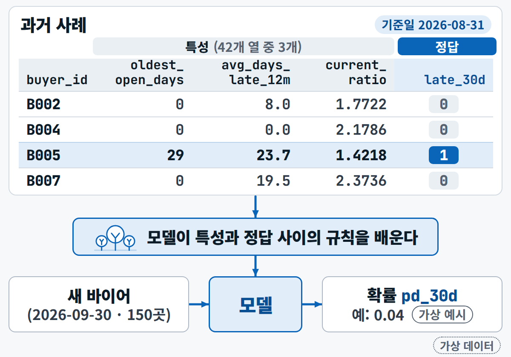
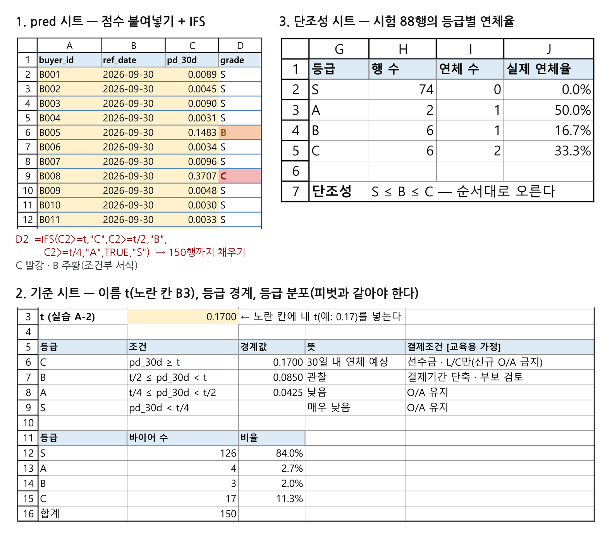
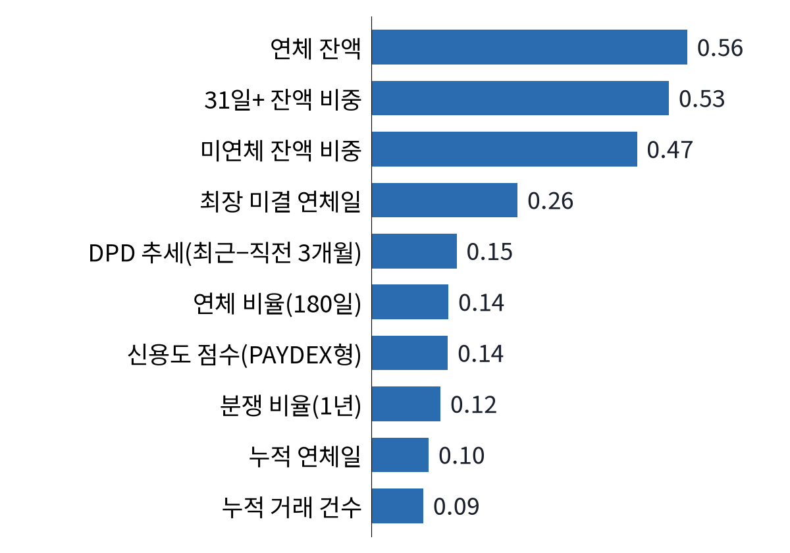
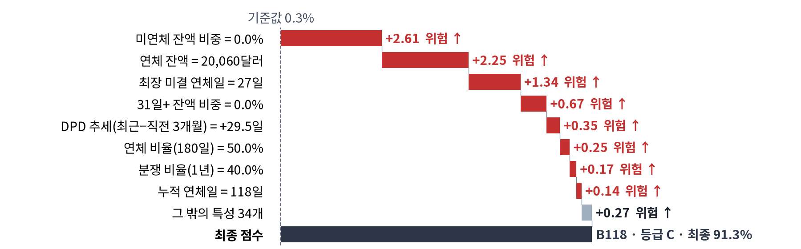
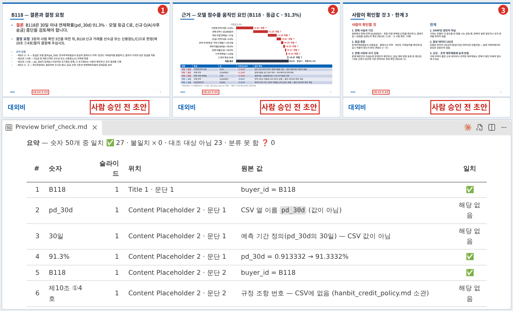
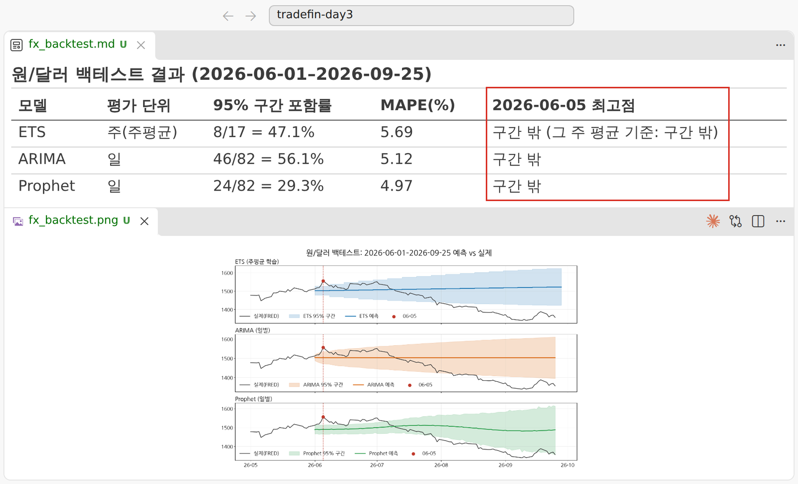
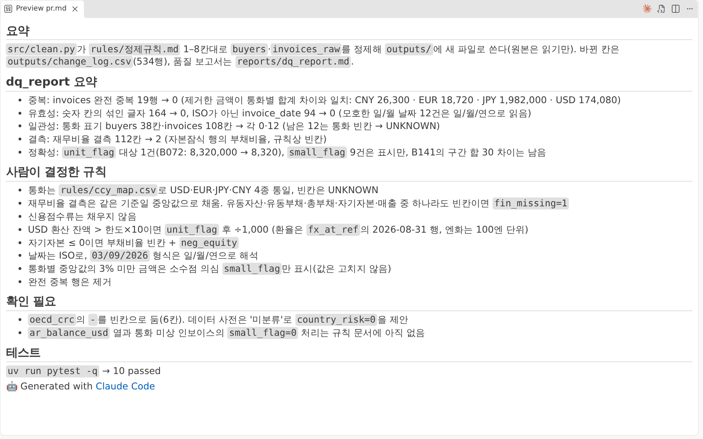

<div class="tf-lab" markdown>
<span class="tf-eyebrow">3일차 · 실습 B · 6–7교시 · 15:00–16:50 <span class="tf-daystate" data-tf-daystate="3"></span></span>

# 실습 B — 등급 · 근거 · 환율

<div class="tf-meta" markdown>
<span class="tf-chip tf-chip--time">B-1 15:00–15:50</span>
<span class="tf-chip tf-chip--time">B-2 16:00–16:50</span>
<span class="tf-chip tf-chip--warn">16:45 저장 확인</span>
<span class="tf-chip tf-chip--tool">Claude Code</span>
<span class="tf-chip tf-chip--tool">엑셀 · 완성본 열기</span>
<span class="tf-chip tf-chip--tool">Git · GitHub</span>
</div>

<div class="tf-flow" markdown>
<div markdown><b>상황</b> 월요일 한도 회의 전에 9월 말 기준 바이어 150곳에 연체 확률과 등급을 붙여 둡니다. 등급 규칙(C ≥ t · B ≥ t/2 · A ≥ t/4)은 **엑셀 완성본**에 이미 있습니다 — AI가 같은 규칙을 내 점수에 적용한 결과와 대조하고, 위원회에 올릴 C등급 1곳의 근거와 자금팀이 물은 원/달러 위험 폭을 답합니다.</div>
<span>→</span>
<div markdown><b>넣는 것</b> 실습 A의 `model_v1.txt` · `d3_test_pred.csv` + `d3_start_scoring.csv`(150곳 · 정답 없음) + 완성본 `d3_grade_banding_example.xlsx` · `d3_grade_example.csv` + `fx_forecast_inputs.csv` + 프롬프트 B1–B6</div>
<span>→</span>
<div markdown><b>얻는 것</b> `d3_scores.csv` · 대조 기록 `d3_grade_compare.md` · **`d3_end_scored.csv`(150행 · 6열)** · SHAP 그림 2 · 근거 메모 · 환율 구간 · `notes.md` · PR</div>
</div>

<div class="tf-lab__grid" markdown>
<div class="tf-lab__cell" markdown><span class="tf-lab__label">목표</span> 150곳에 `pd_30d`와 S/A/B/C를 붙이고 **엑셀(완성본)과 AI 결과를 대조**한 뒤, C등급 1곳의 근거 메모와 환율 위험 구간을 만들어 **16:45에 저장**하고 PR로 짝 리뷰를 받습니다</div>
<div class="tf-lab__cell" markdown><span class="tf-lab__label">오전 시연과의 관계</span> 시연 4(등급 · 단조성)는 **완성본 엑셀 + AI 대조**로, 시연 5(SHAP 위원회 슬라이드)는 **Markdown 메모 5칸**으로, 시연 2(환율 구간)는 **제공 CSV · 모델 하나**로 줄였습니다</div>
</div>

<div data-tf-map></div>
</div>

## 입력 파일 받기 {#files}

실습 A에서 `uv run python tools/get_day_files.py 3`을 했다면 모두 들어 있습니다 — 완성본 두 개는 `labs/day3/`에 있습니다. 저장소 없이 채팅 경로로 하는 분만 카드에서 받으세요. **완성본**(녹색 칩) 두 개는 슬라이드 B-1 · 02–04의 엑셀 손작업 대신 여는 파일입니다(B-1 · 02에 무엇 · 왜 · 어떻게 만들었는지).

--8<-- "docs/_snippets/day3/files_lab-b_cards.md"

카드에 잠금 표시가 있으면 그 시각 뒤에 받습니다(`get_day_files.py`도 그 전에는 '열기 전'). 강사 기준 등급 파일 `d3_end_scored.csv`(비교 기준)는 **내 결과와 이름이 같지만 폴더가 다릅니다**(`data/checkpoints/`) — 먼저 내 결과를 만든 뒤 월요일 출발점과 견주는 용도입니다.

!!! warning "원본은 읽기만 합니다"

    `data/`와 `labs/`의 파일(완성본 포함)은 고치지 않습니다. AI가 고쳐 쓸 것은 `workbench/day3/` 아래의 사본이나 새 파일입니다 — 허락 창에서 `labs/`나 `data/`를 바꾸려 하면 `No`.

## B-1 · 150곳 점수와 등급 매칭 {#b1}

<div class="tf-phase" markdown>

<span class="tf-eyebrow">슬라이드 62 · 실습 B-1 · 15:00–15:50 · Claude Code · Excel</span>

엑셀에서 끌어 매긴 등급을 AI 결과와 대조

**목표** 150곳에 pd_30d와 S/A/B/C를 붙이고, 엑셀과 AI 결과를 대조한다

1. 내 모델로 150곳 점수 → d3_scores.csv(buyer_id · ref_date · pd_30d)
2. d3_grade_banding.xlsx: pred 시트에 붙여넣기 → t 입력 → IFS 수식 → 채우기 핸들로 끌어 내리기
3. 조건부 서식(C 빨강 · B 주황 + 글자) → 피벗으로 등급 분포
4. 단조성: 시험셋 등급별 실제 연체율이 S < A < B < C인가
5. Claude Code로 같은 규칙 → 엑셀과 다른 행 찾기 → d3_end_scored.csv

**결과물** d3_end_scored.csv — 150행 · 6열 · UTF-8 · 등급 분포 · 단조성 표

</div>

**오늘은 02–04의 엑셀 손작업을 완성본으로 대신합니다.** 번호 · 제목 · 시각은 슬라이드 그대로이고, 붙여넣기 · 수식 끌어 내리기 · 피벗에 쓰던 시간을 **완성본을 읽고 AI가 같은 규칙으로 계산한 결과와 대조하는 데** 씁니다. 손으로 해 보고 싶으면 수업 뒤 [빈 양식](#more)으로.

### B-1 · 01 내 모델로 150곳 점수 → d3_scores.csv (15:00–15:15) { #b1-1 .step data-tool="Claude Code" }

**왜** 학습한 모델에 **정답 없는 새 행**(2026-09-30 현재 150곳)을 넣어 확률을 얻습니다. `model_v1.txt` + `d3_start_scoring.csv` → **B1** → `d3_scores.csv`(buyer_id · ref_date · pd_30d)

!!! me "내가 할 일"

    1. 왼쪽 아래 상태 표시줄이 `d3-model`인지 봅니다 — 실습 A에서 push한 **같은 브랜치에서 이어 갑니다**(PR은 B-2 · 05에서 오늘 것을 한 번에 엽니다).
    2. **B1**을 보냅니다. 허락 창을 읽고 `1 Yes`.
    3. `workbench/day3/outputs/d3_scores.csv`를 열어 **150행 · 3열**, `ref_date`가 모두 2026-09-30, `pd_30d`가 0–1인지 봅니다.

!!! prompt "프롬프트 B1 — 150곳 점수"

    --8<-- "labs/day3/prompts.md:b1"

!!! ai "AI가 하는 일"

    `model_v1.txt`를 불러 150곳에 **학습 때와 같은 특성 처리**(수치 열 + `payment_method` 원-핫, 같은 열 순서)를 하고 확률을 계산해 저장합니다. 끝에 '같은 특성 처리를 썼다'는 확인 1줄을 씁니다(허락 창 1–2번 · 1분).

<figure markdown="span">
  { width="560" loading=lazy }
  <figcaption>과거 사례로 배우고(실습 A) 정답 없는 새 바이어 150곳에 확률을 냅니다(지금)</figcaption>
</figure>

!!! ok "확인"

    - [ ] `d3_scores.csv` 150행 · 3열 · `pd_30d` 0–1
    - [ ] 대부분 0 근처이고 일부만 높은 쌍봉 모양
    - [ ] 답에 '학습 때와 같은 특성 처리(원-핫 포함)' 확인 1줄

??? ok "참고 실행 값 — 내 점수를 만든 뒤 펼쳐 보기"

    0.01 미만 111곳 · 0.01–0.17 22곳 · 0.17 이상 17곳(0.5 이상 7곳). 가장 높은 곳은 B048 0.7699 · B134 0.7092 · B118 0.7032 — 완성본의 `pred` 시트와 같은 점수입니다(같은 설정이면 같은 숫자).

??? fix "`model_v1.txt`가 없어요 — 실습 A를 못 끝냈어요"

    완성본의 점수로 이어 갑니다. 아래 프롬프트로 `d3_grade_example.csv`의 세 열을 내 `d3_scores.csv`로 저장하고 B-1 · 02부터 진행합니다. B-1 · 04는 완성본 `단조성` 시트를 읽는 것으로 대신하고, B-1 · 05를 보낼 때 `model_version`을 `'day3_example'`로 바꿉니다. B-2 · 01(SHAP)은 [채팅 경로](#chat-path)의 표본 파일로 합니다.

    --8<-- "labs/day3/prompts.md:b1-late"

??? fix "열 개수가 맞지 않는다는 오류가 나요"

    학습 때와 특성 처리가 다릅니다. "학습 때 열 순서로 맞춰(reindex) — 없는 원-핫 열은 0으로"라고 보냅니다.

??? fix "`pd_30d`가 0–100으로 보여요"

    값은 0–1 그대로 둡니다. 퍼센트로 보고 싶으면 엑셀 서식만 %로 바꿉니다.

<p class="tf-check"><time>15:15</time> 손 점검 — d3_scores.csv 150행 · '같은 특성 처리' 1줄</p>

### B-1 · 02 등급 매칭 시트 — 붙여넣기 · t · IFS · 채우기 핸들 (15:15–15:22) { #b1-2 .step data-tool="엑셀 · Claude Code" }

슬라이드의 엑셀 손작업(붙여넣기 → t 입력 → IFS 수식 → 채우기 핸들)은 **완성본으로 대신합니다** — 7분을 '어떻게 만들었나'를 읽고 AI의 설명과 대조하는 데 씁니다.

!!! file "완성본 제공 — d3_grade_banding_example.xlsx"

    <dl markdown>
    <dt>무엇</dt><dd markdown>슬라이드 B-1 · 02–04의 엑셀 작업을 **이미 해 둔** 등급 매칭 시트입니다. `pred`(150곳 점수 + IFS 등급 · C 빨강 · B 주황) · `기준`(이름 `t` = 0.17 · 경계 · 등급 분포) · `단조성`(시험 88행의 등급별 연체율과 판정) — 빈 양식 `d3_grade_banding.xlsx`와 같은 틀에 첫 시트 `00_만든 방법`이 더 있습니다. 같은 `pred` 값은 `d3_grade_example.csv`(4열 · 150행)에도 있습니다.</dd>
    <dt>왜</dt><dd markdown>규칙을 엑셀로 손수 매기는 일은 오늘 배울 것의 핵심이 아닙니다. 대신 **AI가 같은 규칙을 내 점수에 적용한 결과를 이 엑셀과 대조**합니다 — 엑셀(수식)과 AI(코드)가 같은 답을 내는지, 다르면 어디서 갈렸는지가 오늘의 과제입니다. 정답이 아니라 '같은 프롬프트로 한 번 돌린 참고 실행'입니다.</dd>
    <dt>어떻게 만들었나</dt><dd markdown>실습 A의 A2 설정 그대로(학습 212행 · LightGBM · 시드 42) 한 번 학습한 모델로 150곳 점수와 시험 88행 예측을 소수 4자리로 넣고, t = 0.17(비용 5:1의 이론값 1/6) · `IFS` 등급 수식(가장 위험한 C부터 검사) · 조건부 서식 · `COUNTIF` 분포(피벗과 같은 값) · 단조성 표를 **수식으로** 넣었습니다. 수식과 계산값을 함께 저장해 AI가 파일을 읽어도 값이 보이고, 모든 숫자는 파이썬으로 같은 규칙을 다시 계산해 맞췄습니다.</dd>
    </dl>

    [완성본 엑셀 받기](../downloads/day3/d3_grade_banding_example.xlsx){ .md-button .md-button--primary download data-tf-open="2026-10-15T23:30:00Z" }
    [같은 값 CSV 받기](../downloads/day3/d3_grade_example.csv){ .md-button download data-tf-open="2026-10-15T23:30:00Z" }

!!! me "내가 할 일"

    1. 완성본을 엑셀(또는 웹용 Excel)로 **읽기만** 엽니다 — `labs/day3/d3_grade_banding_example.xlsx`(받지 않았으면 위 단추). 첫 시트 `00_만든 방법`을 1분 읽습니다.
    2. `기준` 시트의 노란 칸 **B3**(이름 `t`)를 누르고, `pred` 시트의 **D2**를 눌러 수식 입력줄의 IFS와 D열의 색을 봅니다.
    3. 아래 **B1b**를 보내 AI의 설명과 내가 엑셀에서 본 것을 대조합니다 — 특히 "왜 C부터 검사하나"(A를 먼저 `>= t/4`로 검사하면 B · C 행까지 A가 됩니다). `@d3_grade_banding_e`까지 치고 Tab — 칩이 `labs/day3/d3_grade_banding_example.xlsx`인지 봅니다(완성본은 작업 사본을 만들지 않아 이 하나뿐입니다. `_example`이 없는 `d3_grade_banding.xlsx`는 빈 양식).

!!! prompt "프롬프트 B1b — 완성본 엑셀 읽기(읽기만)"

    --8<-- "labs/day3/prompts.md:b1b"

!!! ai "AI가 하는 일"

    엑셀 파일을 파이썬(`openpyxl`)으로 읽는 명령을 실행하겠다고 허락을 구합니다(1–3번 · 1분). 이름 `t`의 위치와 값, `pred!D2`의 수식, 조건부 서식 규칙, 분포 표, 단조성 판정 수식을 **수식과 저장된 값을 나란히** 표로 설명합니다. 엑셀 화면(색 · 칸 모양)은 보지 못하니 그 부분은 내가 엑셀에서 확인합니다.

<figure class="result" markdown="span">
  { width="760" loading=lazy }
  <figcaption>완성본의 세 시트(Windows Excel 화면) — ① pred: 점수 + IFS 등급 ② 기준: 이름 t와 등급 분포 ③ 단조성: 등급별 연체율과 판정. 그림 속 '붙여넣기 · 채우기' 글은 슬라이드의 손작업 순서입니다</figcaption>
</figure>

!!! ok "확인"

    - [ ] `t` = `기준!B3` = 0.17, `pred!D2` = `=IFS(C2>=t,"C",C2>=t/2,"B",C2>=t/4,"A",TRUE,"S")`(C부터)
    - [ ] C 빨강 · B 주황(글자도 함께) — 조건부 서식
    - [ ] AI의 설명과 내가 엑셀에서 본 것이 같다(다르면 어디가 다른지 1줄)

??? fix "엑셀이 '보호된 보기'로 열려요"

    읽기만 하니 그대로 둡니다. 편집 사용을 누르지 않아도 수식 입력줄은 보입니다.

??? fix "grade 열이 모두 `#NAME?`이에요"

    Excel 2016 이하라 IFS가 없습니다. 웹용 Excel(office.com)로 열거나, 같은 값의 `d3_grade_example.csv`와 B1b의 설명으로 진행합니다. 직접 매긴다면 중첩 IF `=IF(C2>=t,"C",IF(C2>=t/2,"B",IF(C2>=t/4,"A","S")))`로 같은 뜻입니다.

??? fix "엑셀이 없어요 · 맥 Numbers · VS Code에서 열었어요"

    값은 보이지만 수식은 엑셀에서만 보입니다. 웹용 Excel로 열거나, 수식 확인은 B1b의 AI 설명으로 대신합니다. Codespaces에서 하고 있으면 위 단추로 내 PC에 받아 엽니다.

??? fix "AI가 '값이 저장돼 있지 않다'고 해요"

    완성본은 계산값을 함께 저장했습니다. AI가 빈 양식 `d3_grade_banding.xlsx`를 읽었을 수 있으니 경로(`…_example.xlsx`)를 다시 확인하게 합니다.

### B-1 · 03 조건부 서식(C 빨강 · B 주황 + 글자) → 피벗으로 등급 분포 (15:22–15:35) { #b1-3 .step data-tool="Claude Code · 엑셀" }

슬라이드의 조건부 서식 · 피벗은 완성본에 이미 있습니다(`기준` 시트의 분포 = 피벗과 같은 값) — 13분을 **AI가 내 점수로 센 분포와 완성본의 분포를 대조**하는 데 씁니다.

**왜** 같은 규칙(t = 0.17, C부터)을 엑셀과 AI가 각각 계산해 같은 답이 나오는지 봅니다. `d3_scores.csv` + 완성본 `d3_grade_example.csv` → **B1c** → `d3_grade_compare.md` '분포' 절

!!! me "내가 할 일"

    1. **B1c**를 보냅니다(`{내 t}` — 실습 A-2에서 정한 값. 0.17이면 그 문장은 지워도 됩니다).
    2. 표에서 내 분포와 완성본 분포를 나란히 읽고, 다르면 AI가 쓴 이유 2줄(점수 차이 / 규칙 차이)을 내가 납득하는지 봅니다.
    3. (선택) 두 번째 프롬프트로 **내 점수를 넣은 엑셀**(`d3_grade_banding_mine.xlsx`)을 만들게 하고 엑셀로 엽니다 — 엑셀이 계산한 `기준` 시트 분포와 AI의 표가 같은지 봅니다. 같은 점수를 **엑셀과 AI가 각각 계산**한 대조입니다.
    4. 등급 분포를 `notes.md`에 적을 한 줄로 정해 둡니다(B-2 · 04에서 씁니다).

!!! prompt "프롬프트 B1c — 내 점수로 등급 분포 · 완성본과 대조"

    --8<-- "labs/day3/prompts.md:b1c"

??? prompt "선택 — 내 점수로 엑셀 다시 채우기(엑셀이 직접 계산)"

    --8<-- "labs/day3/prompts.md:b1c-mine"

빈칸 `{내 t}` — [빈칸 값 표](../prompts/day3.md#values)

!!! ai "AI가 하는 일"

    내 `d3_scores.csv`에 규칙을 적용해 등급별 곳 수 · 비율을 세고 완성본 CSV의 `grade` 분포와 한 표에 놓습니다(허락 창 1–2번 · 1분). 선택 프롬프트는 완성본을 복사해 점수 칸만 바꾸고, 엑셀이 열 때 다시 계산하도록 저장합니다 — 수식 · 서식 · 이름 `t`는 그대로입니다.

!!! ok "확인"

    - [ ] `d3_grade_compare.md` '분포' 절 — 내 분포 · 완성본 분포 · 같은지 · 다르면 이유 2줄
    - [ ] S가 대다수 · C 15–20곳 안팎(설정 · 특성을 바꿨다면 10–25곳까지)

??? ok "참고 실행 값 — 내 분포를 만든 뒤 펼쳐 보기"

    A2 설정 그대로면 t 0.17에서 **S 126 · A 4 · B 3 · C 17**(완성본과 같음). 최소 비용 t 0.15를 쓰면 S 125 · A 5 · B 2 · C 18, 3:1(t 0.25)이면 129 · 2 · 4 · 15, 10:1(t 0.09)이면 124 · 3 · 3 · 20. 확률이 '연체 없음'과 '연체 중'으로 갈라져 A · B가 적은 것이 정상입니다.

??? fix "C가 25곳을 넘거나 S가 100곳 아래예요"

    t 값(0.17인가 17인가)과 규칙 순서(C부터)를 봅니다. 비용비를 바꿔 t가 달라졌다면 분포가 달라지는 것이 정상입니다.

??? fix "`d3_grade_banding_mine.xlsx`가 빈칸으로 보여요"

    미리보기 앱이 아니라 **엑셀**로 엽니다 — 엑셀이 파일을 열 때 수식을 다시 계산합니다.

??? fix "저장이 막혀요(파일이 사용 중)"

    Windows는 엑셀이 연 파일을 잠급니다. 엑셀에서 그 파일을 닫고 같은 프롬프트를 다시 보냅니다.

<p class="tf-check"><time>15:35</time> 손 점검 — 등급 분포(S 대다수 · C 15–20곳 안팎)와 완성본 대조 2줄</p>

### B-1 · 04 단조성: 시험셋 등급별 실제 연체율이 S < A < B < C인가 (15:35–15:42) { #b1-4 .step data-tool="Claude Code · 엑셀" }

슬라이드의 '단조성 시트에 붙여넣기'는 완성본의 `단조성` 시트가 대신합니다 — 7분을 내 시험셋으로 AI가 센 표와 견주는 데 씁니다.

**왜** 등급이 쓸모 있으려면 **위험한 등급일수록 실제 연체가 많아야** 합니다. 정답이 있는 시험 88행으로만 확인할 수 있습니다(150곳은 정답이 없습니다). `d3_test_pred.csv` → **B1d** → `d3_grade_compare.md` '단조성' 절

!!! me "내가 할 일"

    1. **B1d**를 보냅니다.
    2. 표를 **건수와 함께** 읽고 S와 C부터 비교합니다.
    3. 판정 1줄을 내 말로 씁니다 — 예: "S < C는 맞다 · A · B는 행이 적어 흔들린다".
    4. 완성본 `단조성` 시트(G1:J5 표 · H7 판정)와 나란히 봅니다. H7은 행이 아주 적은 A를 빼고 **S ≤ B ≤ C**만 견주는 수식입니다 — AI가 A까지 넣어 '뒤집힘'이라고 해도 둘 다 계산은 맞고 기준이 다를 뿐이니, 내 판정 1줄에 어느 기준으로 봤는지 적습니다.

!!! prompt "프롬프트 B1d — 단조성 · 내 시험셋"

    --8<-- "labs/day3/prompts.md:b1d"

!!! ai "AI가 하는 일"

    `d3_test_pred.csv`에 같은 규칙으로 등급을 붙여 등급별 행 수 · 연체 수 · 연체율 표를 만들고, 5행 미만 등급에 '표본 적음'을 붙인 뒤 완성본 `단조성` 시트와 나란히 놓습니다(1분).

!!! ok "확인"

    - [ ] '단조성' 절 — 등급별 행 수 · 연체 수 · 연체율, '표본 적음' 표시, 판정 1줄
    - [ ] S 연체율 < C 연체율

??? ok "참고 실행 값 = 완성본"

    S 0/74(0%) · A 1/2(50%) · B 1/6(16.7%) · C 2/6(33.3%) — S < C는 맞고, A는 2행뿐이라 B · C보다 높게 뒤집혀 보입니다. 완성본 판정은 A를 뺀 'S ≤ B ≤ C — 순서대로 오른다', A까지 넣은 AI 판정은 '뒤집힘' — 같은 표를 다른 기준으로 읽은 것입니다. 오전 시연 4의 엑셀도 A가 작아서 ✗가 떴습니다. 최소 비용 t 0.15를 쓰면 S 0/74 · A 1/2 · B 0/5 · C 3/7.

??? fix "S 연체율이 C보다 높아요"

    건수가 충분한 등급끼리 순서가 뒤집히면 규칙을 업무에 쓸 수 없습니다. t 값과 규칙 순서(C부터)를 다시 봅니다.

??? fix "A 연체율이 50% · 100%예요"

    A가 몇 행뿐이라 생기는 일입니다(표본). 건수와 함께 읽습니다.

??? fix "시험셋이 88행이 아니에요"

    실습 A의 `d3_test_pred.csv`를 썼는지 봅니다 — 패널(1,084행) 예측을 쓰면 다른 표가 됩니다.

<p class="tf-check"><time>15:42</time> 손 점검 — 등급별 연체율을 건수와 함께 · S &lt; C</p>

### B-1 · 05 같은 규칙으로 엑셀과 다른 행 찾기 → 최종 CSV (15:42–15:50) { #b1-5 .step data-tool="Claude Code" }

**왜** "엑셀과 AI 결과가 한 행이라도 다르면 어느 쪽을 믿나?" — **둘 다 바로 믿지 않습니다.** 규칙이 같은지(①)와 점수가 같은지(②)를 따로 보고, 다른 행은 이유를 찾습니다. 완성본 CSV + 내 점수 → **B2** → `d3_grade_compare.md` '대조' 절 · **`d3_end_scored.csv`(150행 · 6열)**

!!! me "내가 할 일"

    1. **B2**의 `{내 t}`를 실습 A-2에서 정한 값으로 바꿔 보냅니다(흔들리면 0.17).
    2. 다른 행이 있으면 그 행의 두 점수와 **경계(0.0425 · 0.085 · 0.17)**를 직접 봅니다 — 경계 바로 옆인가, 점수 자체가 다른가.
    3. "둘 다 바로 믿지 않는다"를 내 말로 1줄 — `d3_grade_compare.md` '대조' 절 끝에 씁니다.
    4. `d3_end_scored.csv`를 열어 첫 줄과 행 수를 봅니다.

!!! prompt "프롬프트 B2 — 완성본과 대조 → d3_end_scored.csv"

    --8<-- "labs/day3/prompts.md:b2"

!!! ai "AI가 하는 일"

    ① 완성본 CSV의 점수에 같은 규칙을 다시 적용해 엑셀 등급과 150행을 맞춰 보고 ② 내 점수의 등급을 `buyer_id`로 한 행씩 견줘 다른 행을 표로 만든 뒤 ③ 최종 6열 파일을 UTF-8로 저장하고 행 · 열 수를 출력합니다(허락 창 2–3번 · 1–2분).

!!! ok "확인"

    - [ ] ① 규칙 점검 150/150 일치(엑셀 IFS = AI 규칙)
    - [ ] ② 다른 행 0개 — 또는 다른 행마다 이유(점수 차이 / 경계 옆)
    - [ ] `d3_end_scored.csv` 첫 줄 `buyer_id,ref_date,pd_30d,grade,threshold_used,model_version` · 150행 · 6열 · UTF-8

??? ok "참고 실행 값"

    A2 설정 그대로면 점수가 완성본과 같아 다른 행이 0입니다. 경계 가까이 있는 바이어는 t/4(0.0425) 옆의 B022(0.0449 · A)와 B083(0.0416 · S) — 특성 처리나 열 순서가 조금만 달라도 이 둘이 먼저 갈립니다.

??? fix "다른 행이 많아요"

    점수 자체가 다릅니다(특성 처리 · 열 순서 · 설정). 고치기 전에 [안 맞을 때](../prompts/day3.md#mismatch) 프롬프트로 어느 단계에서 갈렸는지부터 묻습니다.

??? fix "`threshold_used`가 17 · `model_version`이 비었어요 · 열 순서가 달라요"

    t는 0–1(0.17), `model_version`은 `day3_my_v1`, 열은 6개 순서 그대로입니다. B2의 ③만 다시 보냅니다.

<p class="tf-check"><time>15:50</time> 손 점검 — d3_end_scored.csv 150행 · 6열. 10분 쉽니다</p>

## B-2 · 근거 메모와 환율 구간 {#b2}

<div class="tf-phase" markdown>

<span class="tf-eyebrow">슬라이드 63 · 실습 B-2 · 16:00–16:50 · Claude Code · Git · GitHub</span>

시연 5 · 2를 줄여서 → 16:45 저장

**목표** C등급 한 곳의 근거 메모와 환율 위험 구간을 만들고 16:45에 저장한다

1. SHAP: 전역 상위 10 + C등급 1곳 워터폴 → PNG 2장
2. 메모 프롬프트(5칸) → d3_shap_memo.md — 결론 · 확인할 것 · 한계는 내가 고친다
3. 환율: 5/29까지 학습 → 95% 구간 · 6/5 포함 여부 → d3_fx.md
4. 16:45 저장 확인: d3_end_scored.csv 150행 · 6열 · UTF-8 → 커밋 · push
5. PR 열기 → 짝에게 링크, 짝은 코멘트 1개

**결과물** d3_shap_memo.md + PNG · d3_fx.md + PNG · PR 링크

</div>

### B-2 · 01 SHAP: 전역 상위 10 + C등급 1곳 워터폴 (16:00–16:15) { #b2-1 .step data-tool="Claude Code" }

**왜** 등급의 **이유**를 숫자로 봅니다 — SHAP은 한 예측을 '기준값 + 특성별 기여의 합'으로 나눕니다. `model_v1.txt` + `d3_start_scoring.csv` + 데이터 사전 → **B3** → PNG 2 · 기여 표 · 전역 상위 8 표

!!! me "내가 할 일"

    1. **B3**를 보냅니다.
    2. PNG 2장(`d3_shap_global.png` · `d3_shap_waterfall.png`)을 엽니다. 막대 이름이 **'한글 특성명 = 값'**으로 읽히는지 봅니다.
    3. 워터폴의 바이어가 **오늘의 C등급 1곳**입니다 — `buyer_id` · `pd_30d` · 등급 · t를 메모합니다(B4의 `{id}` `{p}` `{g}` `{t}`).
    4. 막대 숫자는 **로그오즈**라 확률로 읽지 않습니다 — 확률로 읽는 것은 기준값과 맨 아래 최종 `pd_30d` 둘뿐입니다.

!!! prompt "프롬프트 B3 — SHAP 그림 2장 · 기여 표"

    --8<-- "labs/day3/prompts.md:b3"

!!! ai "AI가 하는 일"

    모델로 150곳의 기여(`pred_contrib=True` — 별도 패키지 없이)를 계산하고 그림 2장과 표 2개(`d3_shap_table.csv` — 위험↑ 3 · 위험↓ 2, `d3_shap_global_top8.csv` — 전역 상위 8)를 저장합니다. 한글 이름은 데이터 사전의 '한글명'을 씁니다(허락 창 2–3번 · 2–3분).

<figure class="result" markdown="span">
  { width="560" loading=lazy }
  <figcaption>전역 설명의 예(오전 시연 5 · 강사 모델) — 재무비율보다 결제 행동이 먼저 말합니다. 내 모델은 학습 데이터가 달라 순서 · 숫자가 다릅니다</figcaption>
</figure>

<figure class="result" markdown="span">
  { width="760" loading=lazy }
  <figcaption>개별 설명의 예(오전 시연 5 · 강사 모델의 B118) — 내 C등급 1곳은 다른 바이어일 수 있고, 한글 이름도 데이터 사전 기준이라 조금 다릅니다</figcaption>
</figure>

!!! ok "확인"

    - [ ] PNG 2장 · `d3_shap_table.csv` · `d3_shap_global_top8.csv`
    - [ ] 오늘의 C등급 1곳의 `buyer_id` · `pd_30d` · 등급 · t를 메모했다

??? ok "참고 실행 값"

    오늘의 C등급 1곳 = **B048**(`pd_30d` 0.7699). 위험↑ 잔액 비중: 미연체 0(+2.13) · 미납결제금액 $24,530(+1.67) · 분쟁 비율(365일) 0.5(+0.76) / 위험↓ 영업이익률 −0.236(−0.11) · 청구통화 30일 변화율(−0.04). 전역 상위(평균 |SHAP|): 잔액 비중: 미연체 0.51 · 미납결제금액 0.40 · 연체 비율(180일) 0.21 · 분쟁 비율(365일) 0.20 · 평균 연체일(180일) 0.17. 기준값(로그오즈) −4.76(−4.765).

??? fix "`pred_contrib`에서 열 개수 오류가 나요"

    학습 때와 같은 열 순서 · 원-핫으로 만든 입력을 줬는지 봅니다. "B1과 같은 특성 처리로 다시"라고 보냅니다.

??? fix "AI가 `shap` 패키지를 쓰려고 해요"

    설치돼 있어 그대로 돌아가지만, "LightGBM의 pred_contrib=True로"라고 한 줄 덧붙이면 빠르고 숫자도 같습니다.

??? fix "한글이 □로 나오거나 이름이 오전 그림과 달라요"

    □는 `CLAUDE.md`의 글꼴(`tools/fonts/NanumGothic-Regular.ttf`)을 쓰라고 다시 지시합니다. 이름이 다른 것은 정상입니다 — 데이터 사전의 '한글명'을 쓰기 때문입니다.

??? fix "`model_v1.txt`가 없어요"

    [채팅 경로](#chat-path)의 SHAP 표본 파일(`shap_sample_3buyers.csv` — 강사 모델 값)로 B-2 · 02 메모부터 씁니다.

<p class="tf-check"><time>16:15</time> 손 점검 — PNG 2장 · 막대 이름이 '한글 특성명 = 값'</p>

### B-2 · 02 메모 프롬프트(5칸) — 결론 · 확인할 것 · 한계는 내가 (16:15–16:25) { #b2-2 .step data-tool="Claude Code" }

**왜** AI는 초안을 빨리 만들고, 책임 있는 문장은 사람이 씁니다. 기여 표 · 등급 → **B4**(+ Claude Code용 한 줄) → `d3_shap_memo.md` 5칸 → ① ④ ⑤를 내 말로

!!! me "내가 할 일"

    1. 아래 **B4**를 복사합니다 — 슬라이드에는 '메모 프롬프트(5칸)'라는 이름만 있습니다. `{id}` `{p}` `{g}` `{t}`를 B-2 · 01에서 메모한 값으로 바꿉니다.
    2. Claude Code로 보낼 때는 맨 끝에 아래 **한 줄**을 붙입니다 — 입력 숫자를 파일에서 읽고 결과 파일 이름을 정합니다.
    3. 초안을 열어 **① 결론 · ④ 확인할 것 · ⑤ 한계를 내 말로** 고칩니다(아래 표).
    4. 숫자를 기여 표와 한 줄씩 대조합니다 — 입력에 없는 숫자, "~ 때문에 연체" 같은 인과 문장, 뒤바뀐 부호를 고치고 마지막 줄이 '사람 승인 전 초안'인지 봅니다.

!!! prompt "프롬프트 B4 — 근거 메모 5칸(시연 5 프롬프트를 메모로 줄인 글)"

    --8<-- "labs/day3/prompts.md:b4"

!!! prompt "덧붙이는 한 줄 — Claude Code로 보낼 때"

    --8<-- "labs/day3/prompts.md:b4-cc"

| 칸 | 내가 고칠 것 |
|---|---|
| ① 결론 1문장 | 현행 유지 / 조건 강화 / 신규 O/A 중단 검토 중 하나 — **담당자만 아는 사정**을 한마디 넣어 |
| ④ 사람이 확인할 것 3 | 데이터 원천 · 최신성 · 조작 가능성 — 내 업무에서 **실제로 확인할 것**으로 |
| ⑤ 한계 3줄 | SHAP은 원인이 아님 · 합성 150곳 · 신규 · 조작 재무제표에 늦게 반응 — **내 말로** |

!!! ai "AI가 하는 일"

    기여 표 · 전역 상위 8 · 내 최종 파일에서 숫자를 읽어 5칸 초안을 쓰고 마지막 줄에 '사람 승인 전 초안'을 붙여 저장합니다(1분).

<figure class="result" markdown="span">
  { width="760" loading=lazy }
  <figcaption>오전 시연 5의 결과 — 같은 뼈대(역할 · 입력 · 출력 · 규칙)로 만든 위원회 슬라이드 3장과 숫자 대조표. 오늘은 Markdown 메모 5칸으로 줄였습니다</figcaption>
</figure>

!!! ok "확인"

    - [ ] 5칸 + 마지막 줄 '사람 승인 전 초안'
    - [ ] 입력에 없는 숫자 0 · 위험↑ / ↓ 부호 그대로
    - [ ] ① ④ ⑤가 내 문장

??? prompt "선택 — Word 양식이 필요하면(손으로 옮기지 않기)"

    --8<-- "labs/day3/prompts.md:b4-docx"

??? fix "입력에 없는 숫자나 '때문에 연체'가 있어요"

    "입력에 없는 사실은 지우고 '입력에 없음'으로 바꿔라" · "'때문에 연체한다'를 '모델이 위험을 높게 본 근거'로 고쳐라"라고 보냅니다.

??? fix "결론이 너무 세요('즉시 거래 중단')"

    결론은 세 가지(현행 유지 / 조건 강화 / 신규 O/A 중단 검토) 중 하나만 고르게 합니다 — B4의 [출력] ①이 그 약속입니다.

!!! info "SHAP은 원인이 아닙니다"

    SHAP은 **모델의 판단 근거**이지, 그 값을 바꾸면 연체가 줄어든다는 **인과**가 아닙니다. 이 모델은 '지금 연체 중인가'가 판단을 지배하고, 이력이 짧은 신규 바이어나 조작된 재무제표에는 늦게 반응합니다. 한도를 30% 넘게 줄이거나 거래를 멈추는 결정은 모델 결과만으로 확정하지 않습니다 — 사람이 승인하고 기록합니다.

<p class="tf-check"><time>16:25</time> 손 점검 — 메모 5칸 · 모든 숫자가 입력에 있다 · ① ④ ⑤는 내 문장</p>

### B-2 · 03 환율: 5/29까지 학습 → 95% 구간 · 6/5 포함 여부 (16:25–16:40) { #b2-3 .step data-tool="Claude Code" }

**왜** 자금팀의 질문 "원/달러 위험 폭은?"에 **시점이 아니라 폭**으로 답합니다. 구간은 그날을 맞히는 도구가 아니라 시나리오의 폭입니다. `fx_forecast_inputs.csv` → **B5** → `d3_fx.md` · `d3_fx.png`

!!! me "내가 할 일"

    1. **B5**를 보냅니다. Prophet을 쓰려면 먼저 터미널에서 `uv sync --group forecast`(무거운 선택 묶음) — 시간이 빠듯하면 ETS로 합니다(statsmodels는 이미 있습니다).
    2. `d3_fx.md`와 `d3_fx.png`를 엽니다.
    3. **6월 5일 1,555.96원이 구간 안이었는지** 1줄을 씁니다 — 원인은 데이터에 없으니 '확인 필요'라고 쓰면 좋은 답입니다.
    4. 3줄 요약에 '시점 예측이 아니라 시나리오 폭'이 들어 있는지 봅니다.

!!! prompt "프롬프트 B5 — 환율 95% 구간"

    --8<-- "labs/day3/prompts.md:b5"

!!! ai "AI가 하는 일"

    `split = train`(2026-05-29까지)만으로 모델을 학습하고 06-01~09-25를 예측해 95% 구간 · 포함률 · MAPE · 6/5 판정 · 그림 · 3줄 요약을 씁니다(ETS면 1분 안팎, Prophet은 첫 학습이 느립니다).

<figure class="result" markdown="span">
  { width="760" loading=lazy }
  <figcaption>오전 시연 2의 백테스트(강사 PC) — 95% 구간인데 실제로 들어온 비율은 ETS(주 단위) 47% · ARIMA 56% · Prophet 29%. 6월 5일 급등은 세 구간 모두 밖이었습니다</figcaption>
</figure>

!!! ok "확인"

    - [ ] `d3_fx.md`에 포함률 · MAPE · 6/5 판정 · 3줄 요약(시나리오 폭이라는 말 포함)
    - [ ] **6/5는 95% 구간 밖** — 어떤 모델을 골라도 같습니다

??? ok "참고 실행 값"

    학습 685일(마지막 2026-05-29 1,503.96원) · 확인 82일(최고 6/5 **1,555.96** · 최저 9/9 1,339.81). 6/5는 모든 모델에서 95% 구간 밖입니다(일 단위 ETS의 그날 구간 약 1,471–1,539원). 포함률은 모델 · 단위에 따라 다릅니다 — **일 단위 ETS 65–72%** · 주 단위 ETS 47% · ARIMA 56% · Prophet 29%, MAPE 5–6%. 모두 95%보다 낮다는 것이 요점입니다.

??? fix "6/5가 구간 안으로 나와요"

    `valid`까지 학습했는지(`split = train`만이어야 합니다) · 95% 구간인지 · `date` 열이 날짜로 읽혔는지 봅니다.

??? fix "포함률이 시연(47 · 56 · 29%)과 달라요"

    정상입니다. Claude Code가 흔히 고르는 일 단위 ETS는 65–72%가 나옵니다. 6/5가 구간 밖이고 모두 95%보다 낮다는 점이 같으면 됩니다.

??? fix "Prophet 설치가 느리거나 실패해요"

    ETS로 합니다. Prophet은 `uv sync --group forecast`가 먼저 필요하고 첫 학습이 느립니다.

<p class="tf-check"><time>16:40</time> 손 점검 — 6/5는 구간 밖 · 3줄 요약. 16:45 저장을 준비합니다</p>

### B-2 · 04 16:45 저장 확인: 150행 · 6열 · UTF-8 → 커밋 · push (16:40–16:45) { #b2-4 .step data-tool="터미널 · Claude Code · Git" }

**왜** 금요일 저장은 줄이지 않습니다 — 월요일에 모두 같은 3일차 기준 등급 파일로 한도 계산을 시작하면서 **내 결과와 견주기** 때문입니다. 저장 점검 → **B6** 재현 메모 → 커밋 · push

**오늘 남길 것과 저장할 곳**(슬라이드 65) — 오늘 폴더 = `workbench/day3`, 결과 파일은 `outputs`, `notes.md`만 폴더 바로 아래.

| 결과물 | 파일 | 어디에 |
|---|---|---|
| 연체 확률 모델 결과 | `d3_end_scored.csv`(150행 · 6열) | outputs 폴더 |
| 평가 · 임계값 기록 | `d3_eval.md` · `d3_threshold.md` | outputs 폴더 |
| SHAP 근거 메모 | `d3_shap_memo.md` + PNG 2 | outputs 폴더 |
| 환율 위험 구간 | `d3_fx.md` + PNG | outputs 폴더 |
| 재현 메모 | `notes.md`(시드 · 버전 · AUC · t · 비용비 근거) | 오늘 폴더 |
| 공유 | PR 링크 | 제출 칸에 붙여 넣기 |

!!! me "내가 할 일"

    1. 터미널에서 저장을 점검합니다 — `(150, 6)`과 열 이름 6개, 등급 건수가 보이면 됩니다.

        ```text
        uv run python -c "import pandas as pd; d=pd.read_csv('workbench/day3/outputs/d3_end_scored.csv'); print(d.shape, list(d.columns)); print(d.grade.value_counts().to_dict())"
        ```

    2. (있으면) 8교시 품질 게이트의 점검표로 10가지를 한 번에 봅니다 — `labs/day3/quality_gate/`는 `get_day_files.py 3`이 받아 둡니다.

        ```text
        uv run python labs/day3/quality_gate/check_scored.py
        ```

    3. **B6 — 재현 메모**를 보내 `workbench/day3/notes.md`를 만들고, **비용비를 그렇게 정한 이유 1줄**과 등급 분포 한 줄은 내가 씁니다.
    4. 커밋 · push — `workbench/day3/outputs/` · `notes.md` · `scripts/`에 새로 생긴 코드만(데이터 사본 제외), 메시지 두 줄. 보조 프롬프트로 맡기면 허락 창의 파일 목록에 **`notes.md`가 있는지** 봅니다.

        ```text
        3일차: 연체 확률 150곳 · 등급 · 근거 메모 추가

        왜: 오늘 결과를 월요일 기준 등급과 견주어 보려고 저장
        ```

!!! prompt "프롬프트 B6 — 재현 메모"

    --8<-- "labs/day3/prompts.md:b6-notes"

??? prompt "보조 프롬프트 — 커밋 · push 맡기기"

    --8<-- "labs/day3/prompts.md:commit-push"

!!! ai "AI가 하는 일"

    `d3_eval.md` · `d3_threshold.md`에서 숫자를 읽어 `notes.md`(시드 · 패키지 버전 · 시험 AUC · t · 비용비)를 쓰고, 이유 칸은 '(내가 쓴다)'로 비워 둡니다(1분). 커밋을 맡기면 파일 목록 · 메시지 · 브랜치를 먼저 보여 줍니다.

!!! ok "확인"

    - [ ] `(150, 6)` · 열 6개 순서 그대로 · 등급 건수
    - [ ] `notes.md` — 시드 · 버전 · AUC · t · 비용비 이유 1줄(내 문장)
    - [ ] push 됨 — GitHub의 `d3-model`에 오늘 커밋이 보이고, 그 커밋에 `notes.md`가 들어 있다

??? fix "열 이름 · 순서가 다르거나 150행이 아니에요"

    B-1 · 05의 B2에서 ③만 다시 보냅니다. 150행이 아니면 `d3_start_scoring.csv`(2026-09-30 · 150곳)를 썼는지 봅니다.

??? fix "메모 · 환율을 못 끝냈어요"

    **`d3_end_scored.csv`와 `notes.md`부터** 커밋 · push합니다 — 16:45 저장은 줄이지 않는 단계입니다. 나머지는 끝나는 대로 같은 브랜치에 더 올립니다.

<p class="tf-check"><time>16:45</time> 저장 확인 — 헬퍼가 자리마다 d3_end_scored.csv 150행 · 6열 · UTF-8 · notes.md · push를 봅니다</p>

### B-2 · 05 PR 열기 → 짝에게 링크, 짝은 코멘트 1개 (16:45–16:50) { #b2-5 .step data-tool="GitHub" }

**왜** 짝이 읽어 주는 PR이 오늘의 제출입니다 — 무엇 / 왜가 보이게 씁니다. `d3-model` → PR → 짝 코멘트 → 제출

!!! me "내가 할 일"

    1. GitHub 내 저장소 화면의 노란 안내 **Compare & pull request**를 누릅니다(안 보이면 Pull requests → New pull request → base `main` ← compare `d3-model`).
    2. 제목 **`3일차: 연체 확률 모델 · 등급 · 근거 메모`**, 본문에 **무엇 / 왜**와 시험 AUC · 쓴 t · C등급 곳 수를 쓰고 **Create pull request**.
    3. 짝에게 PR 링크를 보냅니다. 짝은 **Files changed**에서 줄 왼쪽 `+`로 코멘트를 **하나** 남깁니다 — 보는 것 다섯: 바뀐 파일 · 커밋 메시지의 '왜' · 실데이터가 없는지 · 키가 없는지 · 한 줄 코멘트.
    4. PR 링크를 <span data-tf-link="submit_form">제출 폼</span>에 붙여 넣습니다. 머지는 8교시 PR 리뷰 뒤에 **내 손으로** 누릅니다.

??? prompt "선택 — Claude Code에 PR까지 맡기기(GitHub CLI `gh`가 있을 때)"

    --8<-- "labs/day3/prompts.md:b6-pr"

!!! ai "AI가 하는 일"

    맡겼다면 커밋 · push 뒤 `gh pr create`로 PR을 만듭니다(허락 창 3–4번). `gh`가 없거나 로그인되지 않았으면 PR 만들기에서 멈춥니다 — 그때는 위 1–2번처럼 웹에서 만듭니다.

<figure class="result" markdown="span">
  { width="760" loading=lazy }
  <figcaption>PR 본문의 예(2일차 시연) — 무엇 · 왜 · 확인 필요가 한눈에 보이게 씁니다</figcaption>
</figure>

<figure class="result" markdown="span">
  { width="680" loading=lazy }
  <figcaption>짝의 줄 코멘트 — Files changed에서 줄 왼쪽 <code>+</code>를 눌러 남깁니다(2일차 예시)</figcaption>
</figure>

!!! ok "확인"

    - [ ] PR 열림 — 제목 · 본문(무엇 / 왜 · AUC · t · C등급 곳 수)
    - [ ] 짝 코멘트 1개 · 제출 폼에 PR 링크

??? fix "Compare & pull request가 안 보여요"

    브랜치를 push했는지 봅니다. Pull requests 탭 → New pull request → base `main` ← compare `d3-model`로 만듭니다.

??? fix "비공개 저장소라 짝이 코멘트를 못 달아요"

    Settings → Collaborators로 짝을 초대하고 짝이 수락합니다. 시간이 없으면 PR 본문에 짝의 `@아이디`를 적고 강사가 코멘트합니다.

<p class="tf-check"><time>16:50</time> PR — 짝 코멘트 1개 · 제출 폼에 링크</p>

!!! late "늦었다면"

    15:30에 아직 B-1 · 01이면 완성본 점수로 이어 갑니다(B-1 · 01의 '막히면'). 16:10에 SHAP을 못 돌렸으면 채팅 경로의 표본 파일로 메모부터 씁니다. 16:35에는 메모를 결론 · 위험↑ 3 · 한계 3만, 환율은 1줄로 줄이고 **`d3_end_scored.csv` · `notes.md` 저장과 push를 먼저** 합니다 — 16:45 저장은 줄이지 않습니다.

## 다 했으면 — 내 손으로 넓혀 보기 {#more}

배운 것을 조금 바꿔 **AI가 어디까지 하는지** 직접 재 봅니다. 하나만 골라도 좋습니다. 회사 실데이터는 쓰지 않습니다.

<div class="grid cards tf-ext" markdown>

-   <span class="tf-level">기본 · 10분 · 엑셀 + Claude Code</span>

    **t를 바꾸면 무엇이 바뀌나**

    완성본 사본의 노란 칸 t만 0.25(3:1) · 0.09(10:1)로 바꿔 엑셀이 다시 계산한 분포 · 단조성과, 같은 t로 AI(B1c)가 센 표를 견줍니다 — 비용비 하나가 C 곳 수를 얼마나 움직이나 → [임계값은 경영 결정](theory.md#ch3-threshold)

-   <span class="tf-level">응용 · 15분 · Claude Code</span>

    **메모를 위원회 슬라이드 3장으로**

    [시연 5 프롬프트](../prompts/day3.md#demo-5)의 입력만 내 것으로 바꿔 보냅니다 — `shap_top3.csv` → `workbench/day3/outputs/d3_shap_table.csv` · `waterfall_B118.png` → `d3_shap_waterfall.png` · 규정 → `rag/corpus/hanbit_credit_policy.md` · B118 → 내 C등급 1곳 · 양식 줄 → "양식 없이 기본 슬라이드로"(시연의 회사 양식은 저장소에 없습니다). 끝에 "슬라이드의 숫자를 d3_shap_table.csv와 한 줄씩 대조한 표도"를 붙입니다. `python-pptx`가 없으면 Claude Code가 설치 · 실행 방법을 먼저 묻습니다(읽고 승인). 결론 문장은 내가 고칩니다.

-   <span class="tf-level">응용 · 10분 · Claude Code</span>

    **경계 옆 바이어의 메모**

    t 바로 아래 B등급 1곳으로 같은 B4 메모를 쓰고, C등급 메모와 무엇이 다른지 2줄 — '임계값 근처는 사람이 더 본다' → [한계](theory.md#ch3-limits)

-   <span class="tf-level">도전 · 20분 · Claude Code</span>

    **환율 3모델 · 90일 전망**

    ARIMA · Prophet까지 포함률 표를 만들고, 최신 날짜까지 다시 학습해 손익분기 1,300원(가정) 아래로 갈 위험 구간을 봅니다 → [시연 2](theory.md#ch1-demo2)

-   <span class="tf-level">도전 · 20분 · Claude Code + GitHub</span>

    **품질 게이트를 내 PR에**

    `labs/day3/quality_gate/`의 `check_scored.py`로 로컬 점검 → `d3-check.yml`을 `.github/workflows/`에 → 내 PR에 ✓ / ✗(같은 폴더 README의 세 단계). 8교시 시연 6의 축소판입니다 → [시연 6](theory.md#ch4-demo6)

</div>

**슬라이드 B-1 · 02–04를 엑셀로 손수 해 보고 싶다면** — 빈 양식 `d3_grade_banding.xlsx`(카드 '등급 매칭 빈 양식')의 `00_사용법` 순서대로 붙여넣기 → t → IFS → 채우기 핸들 → 조건부 서식 → 피벗을 하고, 결과가 완성본과 같은지 봅니다.

## 채팅 경로 — Claude Code를 못 쓸 때 {#chat-path}

Claude Code 계정이 없거나(무료 플랜은 쓸 수 없습니다) 확장이 로그인되지 않으면 **ChatGPT 또는 Claude 웹**에 파일을 올려 **같은 문장**으로 합니다. 오늘 파일은 합성 데이터라 올려도 됩니다. 진행 표시는 같은 10단계입니다.

1. **B-1 · 01 점수** — 대화 환경이 초기화됐을 수 있으니 **'모델 학습 + 150곳 점수'를 한 프롬프트로** 보냅니다. `d3_start_features.csv`와 `d3_start_scoring.csv`를 함께 올리고 A2의 ①–③에 "학습한 모델로 150곳의 pd_30d를 계산해 d3_scores.csv로 내려받게 해 줘"를 이어 붙입니다.
2. **B-1 · 02–05 등급** — 완성본 엑셀은 엑셀(또는 웹용 Excel)로 열어 봅니다. 대화에는 `d3_grade_example.csv`의 **내용을 붙여 넣고**(업로드 3개 한도) B1c · B1d · B2와 같은 문장을 보내 최종 6열 CSV를 내려받습니다.
3. **B-2 · 01–02 메모** — SHAP은 계산이 필요하니 저장소의 **`labs/day3/shap_sample_3buyers.csv`**(B118 · B005 · B085의 점수 · 등급 · 위험을 올린 상위 3 · 낮춘 상위 2 — 강사 모델 값)를 대화에 붙이고 B4를 보냅니다. `[입력]`의 전역 상위 8은 [프롬프트 쪽의 채팅 경로](../prompts/day3.md#chat-path)에 있는 줄을 그대로 씁니다. 결론 · 확인할 것 · 한계를 **내 말로 고치는 것**은 같습니다.
4. **B-2 · 03 환율** — ChatGPT에 `fx_forecast_inputs.csv`를 올려 B5와 같은 질문을 합니다. ChatGPT 무료는 하루 업로드가 3개 — `d3_start_features.csv` · `d3_start_scoring.csv` · `fx_forecast_inputs.csv`로 정합니다.
5. **B-2 · 04–05 올리기** — 결과를 내 PC의 같은 이름으로 `workbench/day3/outputs/`에 두고, GitHub 웹에서 `d3-model` 브랜치를 고른 뒤(없으면 입력해 **Create branch**) **Add file → Upload files** → 커밋 메시지 첫 줄과 설명 칸(`왜:`) → **Commit directly to the `d3-model` branch**. `notes.md`는 `workbench/day3/`에 같은 방법으로 올리고, 저장소 첫 화면의 **Compare & pull request**로 PR을 엽니다. Upload files는 `.gitignore`를 보지 않으니 올리기 전에 파일 이름과 내용을 한 번 봅니다.

## 막힐 때 {#troubleshooting}

단계 안의 '막히면'에 없는 것만 모았습니다.

| 증상 | 이렇게 해 보세요 |
|---|---|
| 허락 창이 계속 뜬다 · push가 거부된다 | [실습 A의 막힐 때](lab-a.md#troubleshooting)와 같습니다 — 읽고 `1 Yes`, 로그인은 VS Code 왼쪽 아래 계정 아이콘에서 |
| 엑셀과 AI의 등급이 한 행 다르다 | 그 행의 `pd_30d`가 경계값(t/4 · t/2 · t) 바로 옆인지, 반올림 때문인지, `>=`와 `>`가 섞였는지 봅니다 — 둘 다 바로 믿지 않습니다 |
| `@` 목록에 같은 파일이 두 개 보인다 | `get_day_files.py`가 `data/`의 표로 만든 작업 사본(`workbench/day3/data/`)입니다. 읽기만 하는 단계면 어느 쪽이든 괜찮고, 원본 경로(`data/…`)를 고르면 확실합니다. `labs/day3/`의 완성본 · 양식은 사본이 없습니다 |
| 18:00 뒤 `d3_end_scored.csv`가 두 개다 | `data/checkpoints/`의 것은 강사 기준(17열 · 비교용 — 작업 사본은 만들지 않습니다)이고, 내 것은 `workbench/day3/outputs/`(6열)입니다. 프롬프트에는 전체 경로를 씁니다 |
| 사용 한도에 걸렸다 | 안내의 풀리는 시각을 확인하고, 그동안은 짝의 화면이나 채팅 경로로 진행합니다 → [FAQ](../faq.md#q-usage-limit) |
