# 3일차 이론 요약 — AI 기반 대금 결제 연체 및 바이어 부도 리스크 예측

!!! abstract "오늘의 이야기 한 줄"
    **위험을 확률로 정의하고, 데이터로 그 확률을 배우고, 비용으로 자르고, 근거와 함께 남긴다** — 드문 연체를 AI와 함께 예측하되 **계산은 코드가 · 초안은 AI가 · 정의와 결정은 사람이** 맡는다.

1 · 2 · 3교시와 8교시의 이론을 **네 장(챕터)**으로 줄였습니다. 장마다 이론 → 현업 문제 · 용어 → 시연 순서이고, 시연은 **문제 상황 · 입력 · 진행 · 결과** 네 칸으로 정리했습니다. 이론의 대부분은 AI · 통계 · 개발 방법론이고, 무역금융 업계 지식(문제 상황과 용어)은 필요한 자리에만 짧게 들어 있습니다.
실습의 기대 범위는 이 페이지가 아니라 [실습 A-2 · 05](lab-a.md#a2-5)에 있습니다. 슬라이드 PDF(발표자 노트 제외)는 아래 카드에서 받습니다 — 인쇄본과 같은 판입니다.

--8<-- "docs/_snippets/day3/files_pdf_cards.md"


## 오늘의 지도 {#map}

<figure markdown="span">
  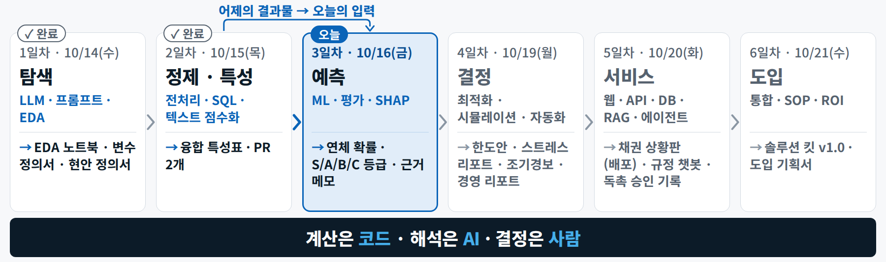{ loading=lazy }
  <figcaption>정제 · 특성(2일차) → 예측(오늘) → 결정(4일차) — 어제의 특성표가 오늘 모델의 입력이고, 오늘의 등급이 월요일 한도 계산으로 이어집니다</figcaption>
</figure>

| 장 | 제목 | 교시 | 오늘의 질문 | 오후에 직접 해 보는 곳 |
|---|---|---|---|---|
| [1](#ch1) | 위험을 확률로 정의하기 | 1교시 | 무엇을 예측하나, 확률을 어떻게 읽나 | 실습 A-1 · 실습 B-2 · 03 환율 |
| [2](#ch2) | 데이터로 학습하는 모델 | 2교시 | 데이터로 확률을 배우고, 성적에 속지 않으려면 | 실습 A-1 |
| [3](#ch3) | 평가하고, 정하고, 설명하기 | 3교시 | 얼마나 맞나, 어디서 자르나, 왜 그런가 | 실습 A-2 · 실습 B-1 · B-2 · 01–02 |
| [4](#ch4) | 같은 입력이면 같은 결과 | 8교시 | 월요일에 다시 돌려도 같은 등급이 나오려면 | 실습 B-2 · 04–05(`notes.md` · PR) |

**오늘 만들 것 — 연체 확률 150개와 그 근거.** 바이어 150곳 × 기준일 2026-09-30에 `pd_30d`(30일 안에 선을 넘을 확률)와 S/A/B/C 등급을 붙이고, 가장 위험한 한 곳의 근거 메모를 씁니다. 학습의 정답 `late_30d`는 맞혀야 할 값이라 **특성에 넣지 않습니다.**

## 오늘의 용어 {#terms}

슬라이드에서 한 장으로 설명한 용어(**용어 장** 15개)와 설명 중에 나오는 용어(**본문**)입니다. 전체 목록은 [용어집 → 3일차](../glossary.md#day3)에 있습니다.

| 용어 | 한 줄 정의 | 어디서 |
|---|---|---|
| **신뢰구간 · 부트스트랩** | 표본에서 잰 값이 다시 뽑으면 어디까지 흔들릴지 보여 주는 범위 — 표본을 복원추출로 수천 번 다시 뽑아 직접 만든다 | [1장](#ch1-ci) |
| **시계열** | 같은 대상을 시간 순서대로 잰 값 — 순서 자체가 정보다 | [1장](#ch1-ts) |
| **지도학습** | 정답(레이블)이 붙은 과거 사례로 '특성 → 정답' 규칙을 배우는 방법 | [2장](#ch2-supervised) |
| **학습 · 검증 · 시험 분할** | 데이터를 역할별로 나눠, 본 적 없는 데이터로 성능을 잰다 | [2장](#ch2-split) |
| **과적합** | 학습 데이터의 우연한 무늬까지 외워 새 데이터에서 약해지는 상태 | [2장](#ch2-overfit) |
| **데이터 누수** | 예측 시점에 쓸 수 없는 정보가 학습에 섞여 성능이 부풀려지는 일 | [2장](#ch2-leak) |
| **그래디언트 부스팅** | 앞 나무가 틀린 만큼을 다음 나무가 고치며 수백 그루를 더하는 모델 | [2장](#ch2-gbdt) |
| **SMOTE** | 드문 쪽(연체) 사례 사이에 새 사례를 합성해 비율을 맞추는 방법 | [2장](#ch2-smote) |
| **혼동행렬** | 실제(연체 · 정상) × 예측(경보 · 정상) 네 칸에 건수를 센 표 | [3장](#ch3-cm) |
| **ROC-AUC · PR-AUC** | 임계값을 0 → 1로 옮기며 그린 곡선 아래 넓이 — 순서의 질을 한 숫자로 | [3장](#ch3-auc) |
| **보정 · 브라이어 점수** | 예측 확률과 실제 비율이 맞는 정도 — Brier = (확률 − 실제)²의 평균 | [3장](#ch3-calib) |
| **SHAP** | 한 예측을 '기준값 + 특성별 기여의 합'으로 나눠 보여 주는 방법 | [3장](#ch3-shap) |
| **실험 추적** | 실행마다 설정 · 지표 · 산출물 · 코드 커밋을 자동으로 남겨 비교하는 일 | [4장](#ch4-track) |
| **모델 카드** | 모델의 목적 · 데이터 · 성능 · 임계값 근거 · 한계를 적은 한 장 | [4장](#ch4-card) |
| **드리프트 · PSI** | 학습 때와 지금의 데이터 분포가 달라지는 현상, PSI는 그 크기를 재는 지표 | [4장](#ch4-drift) |

??? note "본문에 나오는 용어"
    | 용어 | 한 줄 정의 |
    |---|---|
    | 기저율(사전 확률) | 어떤 사건이 원래 일어나는 바탕 비율 — 우리 패널의 연체는 5.4% |
    | 베이즈 정리(자연 빈도) | 경보가 울렸을 때 진짜일 확률을 '1,000건에서 세어 보는' 방식으로 구하는 계산 |
    | 연체(DPD) · 부도 | 연체: 결제기일이 지났는데 안 들어온 상태(날짜로 잼) / 부도: 받을 수 없게 된 상태 |
    | 예측 구간 · 백테스트 | 다음 값이 들어올 폭 / 어느 날까지만 학습하고 그 뒤를 맞혀 보는 검증 |
    | MAPE | 평균 절대 % 오차 — 회귀(숫자 맞히기)의 지표 |
    | ETS · ARIMA · Prophet | 고전 시계열 모델 셋 — 최근 값에 무게 · 차분 + 과거 오차 · 추세 + 계절 + 휴일 |
    | 분류 · 회귀 | 범주를 고르는 예측 / 숫자를 맞히는 예측 |
    | 레이블(정답) · 특성 | 맞혀야 할 값(`late_30d`) / 기준일까지 알던 입력 열 42개 |
    | 월별 확장창 | 그 달 이전 데이터로 학습하고 그 달을 맞히는 일을 한 달씩 늘려 되풀이하는 검증 |
    | 하이퍼파라미터 | 학습 전에 사람이 정하는 설정값(나무 수 · 잎 수 …) — 임계값은 아니다 |
    | 로지스틱 회귀 | 특성 × 가중치의 합을 0~1 확률로 바꾸는 기준선 모델 |
    | 정밀도 · 재현율 · F1 | 경보 중 진짜의 비율 / 실제 연체 중 잡은 비율 / 둘의 조화평균 |
    | 임계값(t) · 비용비 | 확률을 경보로 자르는 선 / 놓친 연체 1건이 헛경보 몇 건만큼 아픈가 |
    | 리스크 등급(S/A/B/C) | 확률을 t/4 · t/2 · t로 나눈 회사 내부 관리 등급 |
    | 로그오즈 | SHAP 막대의 단위 — 확률이 아니라 확률을 늘려 쓴 점수 |
    | 품질 게이트 | PR마다 기준 모델과 견주어 지표가 나빠지면 병합을 막는 검사 |
    | 배치 · 온라인 서빙 | 모아서 한 번에 점수 / 요청마다 즉시 점수(API) |

---

## 1장 · 위험을 확률로 정의하기 {#ch1}

**핵심** — 업무 문장을 **레이블 한 줄**로 만들고, 확률은 **얼마나 확실한지(구간)**와 함께 읽습니다. 정확도가 아니라 **놓친 연체**부터 셉니다.

### 현업 문제 — 선적은 끝났는데 돈은 아직이다 {#ch1-problem}

<figure markdown="span">
  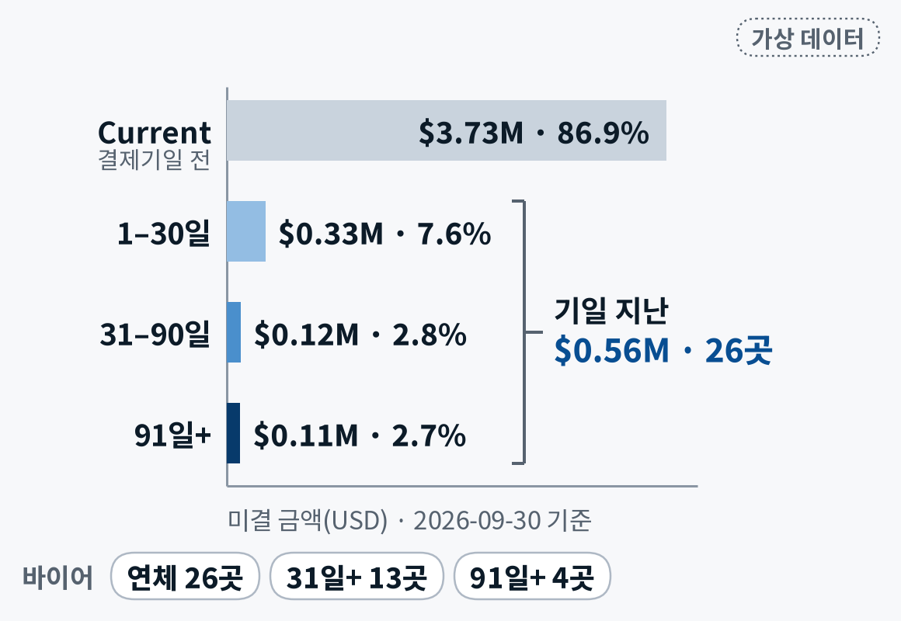{ width="560" loading=lazy }
  <figcaption>2026-09-30 현재 미결 $4.29M — 87%는 아직 결제기일 전이고, 나머지가 꼬리처럼 늘어집니다(가상 데이터)</figcaption>
</figure>

- 바이어 150곳 · 20개국, 그중 외상(O/A · D/A · D/P) 거래가 116곳입니다. 미결 $4.29M 중 기일이 지난 것이 $0.56M(26곳), **30일 선을 넘긴 곳이 13곳**입니다.
- 한 사람이 150곳을 매일 다 볼 수 없으니 모델의 역할은 **'누구를 먼저 볼지' 정하는 순번표**입니다. 독촉 · 선적 보류 같은 조치는 담당자가 정합니다.
- 오늘의 질문: **기준일 뒤 30일 안에 '결제기일 + 30일' 선을 넘는 미결이 생길 확률 `pd_30d`.**

### 연체와 부도는 다른 사건이다 {#ch1-vs}

| | 연체(Delinquency) | 부도(Default) |
|---|---|---|
| 뜻 | 결제기일이 지나도 대금이 안 들어온 상태 | 받을 수 없게 된 상태(파산 · 지급 불능 · 아주 긴 미회수) |
| 재는 법 | 날짜(DPD) — 2일차의 연령 구간 | 회계 기준(IFRS 9)은 90일 넘은 연체를 부도로 추정 |
| 우리 데이터 | 인보이스 5,033건 중 1,103건(22%)이 기일을 넘겼고, 30일을 넘긴 283건 중 247건(87%)은 결국 입금 | 부도 · 상각 26건(바이어 8곳) |
| 학습할 정답 | 30일 연체 215건 — 배울 수 있다 | 8곳뿐 — 너무 적다 |

**오늘 예측하는 것은 연체(30일 선)입니다.** 부도는 연체가 길어진 끝에 오고, 신호 단계에서 잡아야 조치할 시간이 생깁니다. 2026년 세계 기업 부도는 6% 늘어 5년 연속 증가가 전망됩니다(미국 · 중국 +9%, 서유럽 +3%, 분쟁이 길어지면 +10%) — 바이어가 쓰러지면 연체는 회수 불능이 되므로 그 앞 단계를 먼저 잡는 것입니다.

### 왜 하필 30일인가 — 세 개의 선 {#ch1-30}

<figure markdown="span">
  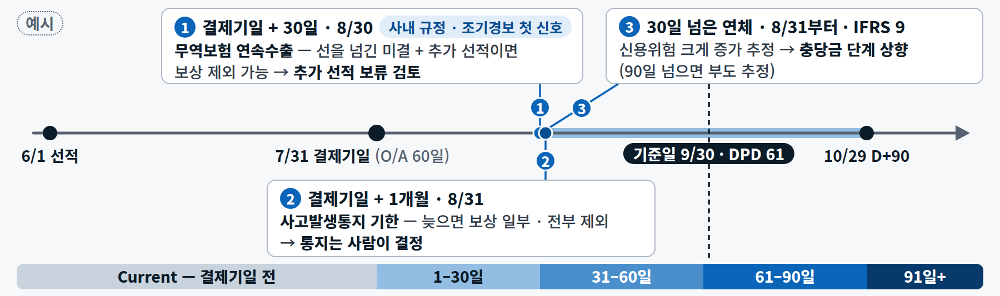{ loading=lazy }
  <figcaption>6/1 선적 · O/A 60일 → 결제기일 7/31 → 기준일 9/30이면 DPD 61 — 세 제도가 모두 30일 근처에 선을 긋습니다(교육용 가정)</figcaption>
</figure>

무역보험의 연속수출 선(결제기일 + 30일), 사고발생통지 기한(결제기일부터 1개월), 회계의 IFRS 9(30일 넘은 연체는 '신용위험이 크게 늘었다'는 신호)이 모두 30일 근처입니다. 그래서 오늘의 레이블을 이렇게 정했습니다.

!!! info "레이블 — `late_30d`"
    기준일 뒤 30일 안에 '결제기일 + 30일' 선을 넘는 미결 인보이스가 생기면 **1**, 아니면 0. **레이블을 정하는 일이 곧 문제를 정의하는 일**이고, 이 문장은 AI에게 맡기지 않고 사람이 정해 프롬프트에 적습니다.

### 통계 기초 — 기저율과 베이즈 {#ch1-base}

- **기저율**: 우리 패널의 연체는 4,017행 중 215행, **5.4%**입니다. 확률 0.2는 '이런 바이어 100곳 중 약 20곳'이라는 뜻입니다.
- **정확도의 함정**: 실습 300행(연체 16건)에서 '전부 정상'이라고만 답해도 정확도가 **94.7%**입니다 — 잡은 연체는 0건. 드문 사건에서는 정확도 대신 **놓친 연체부터 센다**.

<figure markdown="span">
  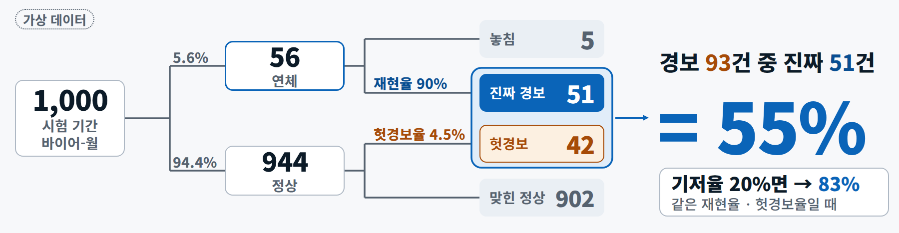{ loading=lazy }
  <figcaption>베이즈 정리를 공식 대신 '1,000건'으로 세어 보면 — 경보 93건 중 진짜 51건(55%), 기저율이 20%면 같은 경보의 83%가 진짜</figcaption>
</figure>

시험 기간의 바이어-월 1,000개를 놓으면 연체 56 · 정상 944입니다. 모델은 연체 56 중 51(재현율 90%)을 잡고, 정상 944 중 4.5%인 42건에 헛경보를 냅니다. **경보 두 건 중 한 건 가까이는 헛경보**입니다. 경보의 질은 모델만이 아니라 **기저율이 정합니다.**

### 신뢰구간 · 부트스트랩 {#ch1-ci}

<figure markdown="span">
  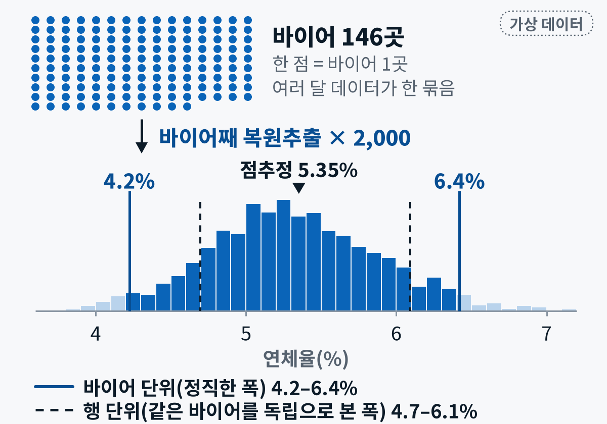{ width="560" loading=lazy }
  <figcaption>연체율 5.35%의 95% 구간 — 행을 독립으로 보면 4.7–6.1%, 바이어째 뽑으면 4.2–6.4%</figcaption>
</figure>

- 숫자 하나만 보고하면 얼마나 흔들릴지 알 수 없어 **구간**을 붙입니다. 부트스트랩은 가진 표본을 **복원추출로 수천 번 다시 뽑아** 흔들림을 직접 만들어 보는 방법이라, 공식을 몰라도 컴퓨터가 반복으로 답을 줍니다.
- 95% 신뢰구간은 '같은 방법으로 구간을 만들기를 반복하면 그중 약 95%가 참값을 품는다'는 뜻입니다('참값이 이 안에 있을 확률이 95%'는 흔한 오해입니다).
- 같은 바이어의 여러 달은 서로 닮아 독립이 아닙니다 → **바이어째 뽑아야** 정직한 폭이 나옵니다.
- 오후 실습의 시험셋은 88행에 연체 4건뿐입니다. 300행에서 90행을 뽑으면 시험셋의 연체가 **2–8건**으로 흔들리니, 조마다 AUC가 다른 것은 실수가 아니라 표본의 흔들림입니다.

### 시연 1 — 연체율은 얼마나 확실한가 {#ch1-demo1}

<div class="tf-flow" markdown>
<div markdown><b>상황</b> 팀장이 묻는다: "우리 연체율 5%대라던데 확실해?" — 숫자 하나 대신 구간으로 답한다</div>
<span>→</span>
<div markdown><b>입력</b> 패널 CSV 4,017행 × 53열(`d3_features_panel.csv`) · ChatGPT 대화창에 파일 첨부</div>
<span>→</span>
<div markdown><b>결과</b> 표 2 · 그래프 2 · 실행된 파이썬 코드 · 답: 5.35%, 구간 4.2–6.4%</div>
</div>

**진행** 두 방법(행 단위 · 바이어 단위)의 구간 → 월별 연체율 그래프 → 90행 시험셋 1만 번의 연체 건수 분포 → '코드 보여 줘'로 검산

<small>오후: 실습 A — 시험셋 88행 · 연체 4건이라 AUC가 사람마다 다른 이유 · [A-2 · 04 도전 ② 부트스트랩](lab-a.md#a2-4)</small>

<figure markdown="span">
  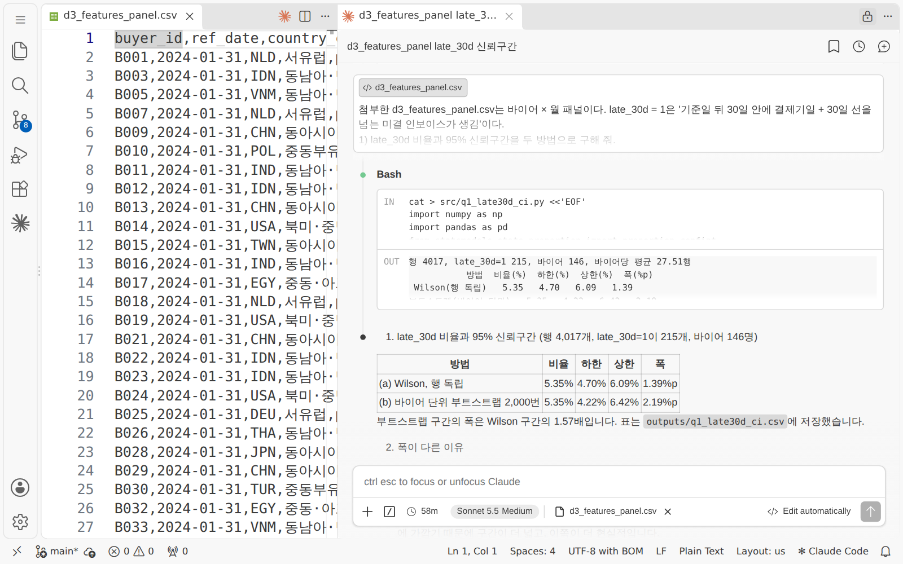{ width="760" loading=lazy }
  <figcaption>질문 1의 답(결과 예시 — 같은 질문을 Claude Code로 미리 돌린 화면, 수업에서는 ChatGPT 데이터 분석) — 바이어 단위 구간이 약 1.6배 넓습니다</figcaption>
</figure>

<figure markdown="span">
  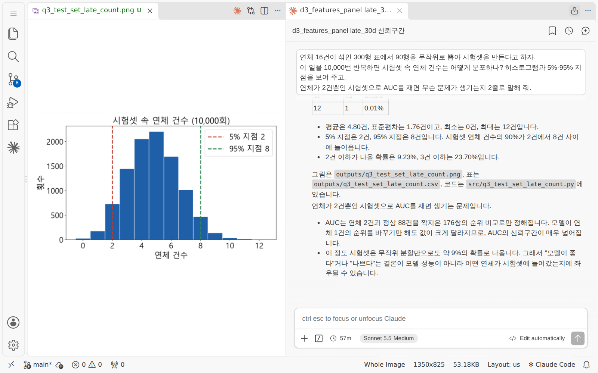{ width="760" loading=lazy }
  <figcaption>질문 3의 답(결과 예시) — 시험셋의 연체는 평균 4.8건, 5–95%가 2–8건</figcaption>
</figure>

프롬프트는 **정의(`late_30d`의 뜻) · 방법과 횟수 · 시드 · 코드 공개**를 문장으로 정해 줍니다. 정하지 않으면 AI가 아무 방법이나 골라 매번 다른 숫자를 냅니다. 표 모양과 문장은 매번 달라도 **값**은 같아야 합니다.

### 시계열 예측 — 환율, 위험은 언제 커지나 {#ch1-ts}

- **같은 10만 달러, 받는 날에 따라 다릅니다.** 6월 5일 원/달러 1,556원(2009년 3월 이후 최고)이면 1억 5,560만 원, 9월 9일 1,340원이면 1억 3,398만 원 — 석 달 사이 13.9%, 2,162만 원이 줄었습니다. 연체가 길어지면 그만큼 환율 위험에도 오래 노출됩니다.
- **시계열**은 같은 대상을 시간 순서대로 잰 값이라 **순서 자체가 정보**입니다. 행을 섞어 나누면 미래로 과거를 맞히게 되니 **시간 순서로 자릅니다.**

<figure markdown="span">
  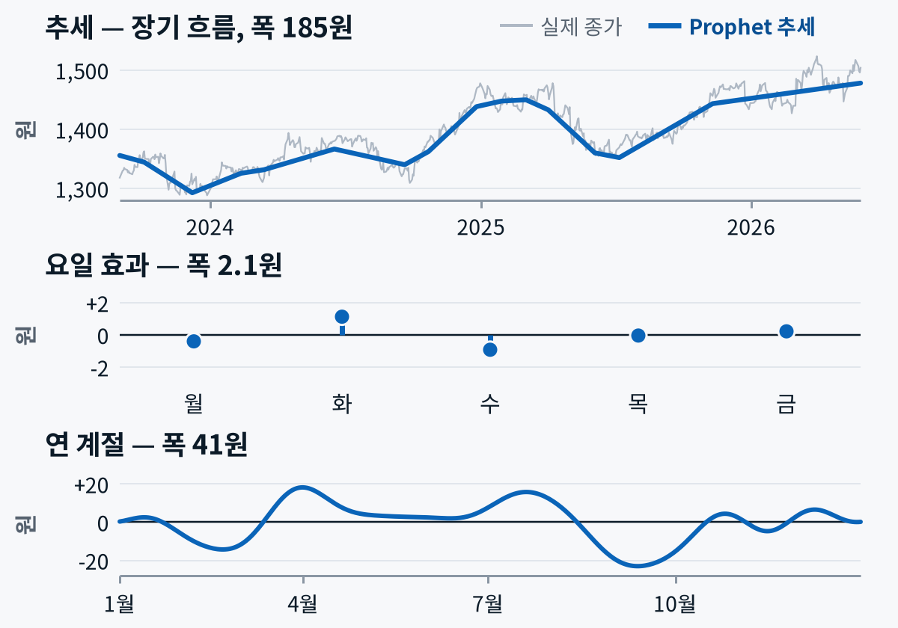{ width="560" loading=lazy }
  <figcaption>추세(폭 185원) · 요일 효과(2.1원) · 연 계절(41원) — 환율은 계절성이 약하고 대부분이 추세와 '사건'입니다</figcaption>
</figure>

| 모델 | 한 줄 |
|---|---|
| **ETS**(지수평활) | 최근 값에 더 큰 무게를 두며 수준 · 추세 · 계절을 갱신 — 엑셀 '예측 시트'도 ETS |
| **ARIMA** | 차분으로 추세를 지우고 과거 값 · 과거 오차로 다음 값을 잇는다 — 차수 (p,d,q) |
| **Prophet** | 추세 + 계절 + 휴일을 더하는 오픈소스 — 빈 날짜 · 휴일이 잦은 데이터에 강하다 |
| **사전학습 시계열 모델** | 많은 시계열로 미리 학습해 바로 예측('시계열판 LLM') — 예: TimesFM 3.0, 가중치는 비상업 라이선스라 업무 전에 조건 확인 |

네 모델 모두 '과거 패턴이 이어진다'고 가정해서 **사건(정책 · 금리 · 지정학)을 모릅니다.** 그래서 하나를 믿기보다 여럿을 같은 기준으로 **백테스트**해 비교합니다.

| | 예측 구간(Prediction interval) | 백테스트(Backtest) |
|---|---|---|
| 뜻 | 실제값이 들어올 폭 — 95% 구간이면 실제값의 95%가 들어와야 정상 | 어느 날까지만 학습하고 그 뒤를 예측해 실제와 비교 |
| 주의 | 평균의 흔들림인 신뢰구간보다 넓고, 멀리 볼수록 넓어진다 | 무작위로 섞어 나누지 않는다 — 시계열의 시험셋 |
| 지표 | 구간 포함률 | MAPE(평균 절대 % 오차) |

### 시연 2 — 공개 환율로 90일 위험 구간 {#ch1-demo2}

<div class="tf-flow" markdown>
<div markdown><b>상황</b> 자금팀: 석 달 안에 원/달러가 손익분기 1,300원(가정) 아래로 갈 위험은 언제 커지나?</div>
<span>→</span>
<div markdown><b>입력</b> FRED 원/달러 일별 CSV — 키 없이 받는 공개 주소(주 1회 갱신)</div>
<span>→</span>
<div markdown><b>결과</b> 백테스트 그림 · 표 · 90일 전망 그림 · CSV · 숫자 3줄 요약</div>
</div>

**진행** Plan 모드로 계획 → 계획의 한 줄에 코멘트 → 5/29까지 학습 · 백테스트 → 재학습 · 90일 예측 → 1,300원 선 · 요약

<small>오후: [실습 B-2 · 03](lab-b.md#b2-3) — 제공 CSV로 5/29까지 학습 → 95% 구간 · 6/5 포함 여부</small>

<figure markdown="span">
  { width="760" loading=lazy }
  <figcaption>백테스트 결과(강사 PC) — 95% 구간인데 실제로 들어온 비율은 ETS 47% · ARIMA 56% · Prophet 29%, 6월 5일 급등은 세 구간 모두 밖</figcaption>
</figure>

**구간은 '그날을 맞히는 도구'가 아니라 시나리오의 폭**입니다. 6월 5일 1,555.96원 급등도, 9월 9일 1,339.81원 급락도 세 구간 밖이었습니다 — 모델이 모르는 사건이기 때문입니다. ETS는 주 단위(17주 중 8주), ARIMA · Prophet은 일 단위(82일)라 서로 그대로 비교하지 않습니다. '구간 하단이 처음 1,300원 아래로 가는 날'은 모델마다 4주 가까이 달라, 날짜를 단정하지 않고 **'그 무렵부터 위험이 커진다'**로 읽습니다. 이 폭이 4일차 환율 충격 시나리오의 크기가 됩니다. **계획 단계에서 사람이 가정을 한 줄 고치는 것**(검증 기간 끝을 9/25로 고정)이 이 시연의 핵심이었습니다.

---

## 2장 · 데이터로 학습하는 모델 {#ch2}

**핵심** — 모델은 **정답이 붙은 과거**로 규칙을 배웁니다. 성적은 **어떻게 나누고 무엇을 정답으로 보느냐**에 달려 있고, 너무 좋은 숫자는 먼저 의심합니다.

### AI 지도 — 오늘 쓰는 것은 어디에 {#ch2-map}

<figure markdown="span">
  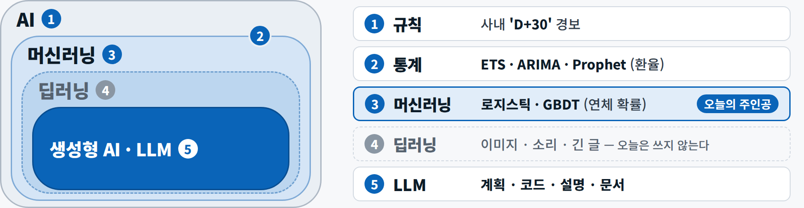{ loading=lazy }
  <figcaption>① 규칙 ② 통계 ③ 머신러닝 ④ 딥러닝(오늘은 쓰지 않음) ⑤ LLM — 숫자는 학습한 ML 모델이 내고, LLM은 그 모델을 만들고 설명하는 동료입니다</figcaption>
</figure>

표 데이터는 ML이, 코드 · 설명 · 문서는 LLM(Claude · ChatGPT)이 맡습니다. 'LLM에게 바로 연체 확률을 매기게 하면 안 되나요?'는 시연 3에서 숫자로 확인합니다.

### AI와 함께 모델을 만드는 여섯 단계 {#ch2-six}

| 단계 | 하는 일 | 누가 |
|---|---|---|
| ① 문제 정의 | 레이블 · 성공 기준 | **사람** |
| ② 데이터 카드 | 열의 뜻 · 누수 후보 | AI 초안 → 사람 확인 |
| ③ 검증 설계 | 분할 · 지표 · 오분류 비용 | **사람** |
| ④ 모델 실험 | 기준선 → 모델 코드 | AI가 쓰고 실행 |
| ⑤ 평가 · 결정 | 임계값 · 등급 | **사람이 결정** |
| ⑥ 기록 · 리뷰 | 모델 카드 · PR | AI 초안 → 사람 승인 |

①③⑤를 사람이 **문장으로** 정해 주면, 그 문장이 그대로 좋은 프롬프트가 됩니다.

### 지도학습 · 분류와 회귀 {#ch2-supervised}

<figure markdown="span">
  { width="560" loading=lazy }
  <figcaption>지도학습 — 과거 사례(특성 → 정답)로 배우고, 정답 없는 새 바이어 150곳에 확률을 냅니다</figcaption>
</figure>

- **특성** 42개(기준일까지의 결제 행동 · 잔액 · 재무 · 뉴스), **레이블** `late_30d`(0/1). 2,723행으로 배우고 1,084행으로 성적을 확인한 뒤, 3,807행 전체로 다시 배워 150곳에 점수를 냅니다. 정답 없이 비슷한 것끼리 묶는 것은 비지도학습입니다.
- 정답을 무엇으로 정했느냐가 모델이 배우는 것을 정합니다.

| | 분류(Classification) | 회귀(Regression) |
|---|---|---|
| 뜻 | 범주를 고른다 — 연체 0/1 | 숫자를 맞힌다 — 연체 일수 · 회수 금액 · 환율 |
| 모델 | 로지스틱 회귀 · 그래디언트 부스팅(대개 확률을 내고 임계값으로 자른다) | 선형 회귀 · 부스팅 · 시계열 모델 |
| 지표 | ROC-AUC · 정밀도 · 재현율 | MAE · RMSE · MAPE |
| 오늘 | `pd_30d` | 환율 예측 |

**'연체할까?'는 분류, '며칠 늦을까?'는 회귀** — 질문이 레이블 · 모델 · 지표를 함께 정합니다.

### 레이블 설계가 곧 문제 정의다 {#ch2-label}

<figure markdown="span">
  { loading=lazy }
  <figcaption>기준일 t(매월 말일)의 과거로 특성을, 뒤 30일로 정답을 만듭니다</figcaption>
</figure>

결제기일이 **(t−30, t]**에 있는 인보이스만 이번 창에서 선을 넘을 수 있습니다. 그래서 시험 양성 61건 중 **59건이 기준일에 이미 연체 잔액이 있는 행**입니다 — 3부에서 AUC가 높게 나오는 이유이자, 결과를 보고할 때 꼭 함께 말해야 할 한계입니다. 정답을 '90일 안에 부도'로 바꾸면 양성이 8곳뿐이라 배울 것이 없고 결과창이 길어져 전혀 다른 문제가 됩니다.

### 학습 · 검증 · 시험 분할 {#ch2-split}

<figure markdown="span">
  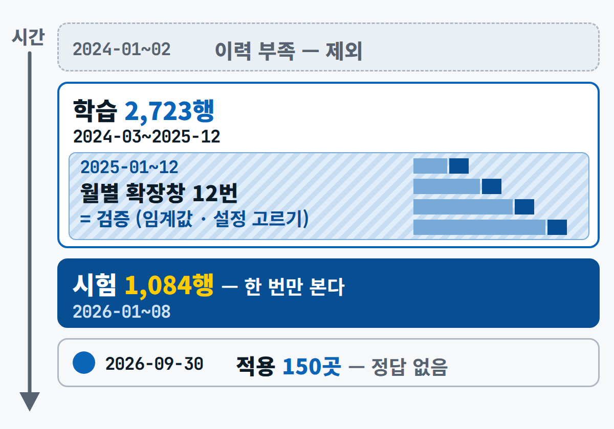{ width="560" loading=lazy }
  <figcaption>학습 2,723행 · 시험 1,084행 · 적용 150곳 — 시험은 마지막 성적표라 한 번만 봅니다</figcaption>
</figure>

| 구간 | 기간 · 규모 | 역할 |
|---|---|---|
| 제외 | 2024-01~02 | 재무제표가 아직 공시되기 전이고 과거 이력이 짧아 학습에서 뺀다 |
| 학습 | 2024-03~2025-12 · 2,723행 | 모델이 배운다. 안의 2025년 열두 달은 **월별 확장창**으로 검증(임계값 · 설정 고르기) |
| 시험 | 2026-01~08 · 1,084행 | 마지막 성적표 — 한 번만 본다. 오늘 화면의 숫자는 모두 이 시험셋 기준 |
| 적용 | 2026-09-30 · 150곳 | 정답 없이 점수만 매긴다 |

시험 점수를 보고 설정을 고치면 시험셋도 학습셋이 됩니다. 오후 실습은 300행이라 시험셋(88행)의 연체가 4건뿐이고, 그래서 조마다 AUC가 다른 것이 정상입니다.

### 과적합 {#ch2-overfit}

<figure markdown="span">
  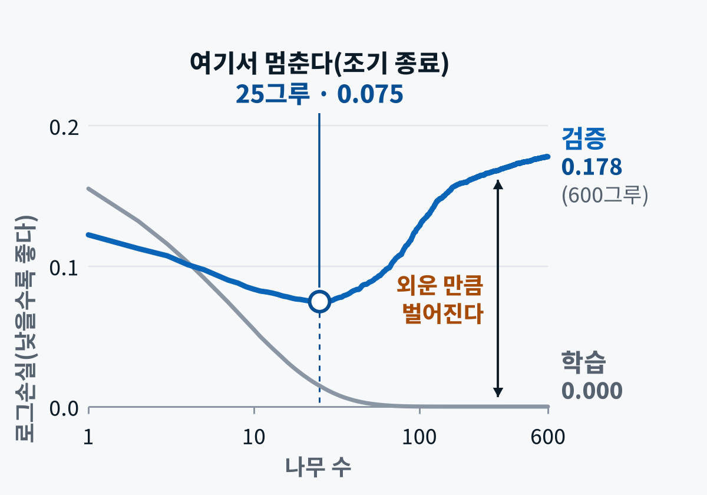{ width="560" loading=lazy }
  <figcaption>일부러 복잡하게 만든 LightGBM(잎 31 · 학습률 0.1) — 학습 손실은 0까지, 검증 손실은 25그루 0.075에서 600그루 0.178로</figcaption>
</figure>

'기출문제 답만 외운 학생'입니다. 처방은 **나무를 단순하게**(잎 수↓ · 잎당 최소 행↑) · **규제** · **조기 종료** · **데이터 더**. 과적합은 순위(AUC)보다 **확률의 질**(로그손실 · Brier)에서 먼저 드러납니다 — 8교시에 AUC는 거의 같은데 비용이 늘어난 모델을 다시 만납니다. 검증 손실이 가장 낮은 25그루도 검증셋을 보고 고른 값이라, 마지막 성적은 한 번도 보지 않은 시험셋으로 잽니다.

### 교차검증과 시간 분할 {#ch2-cv}

<figure markdown="span">
  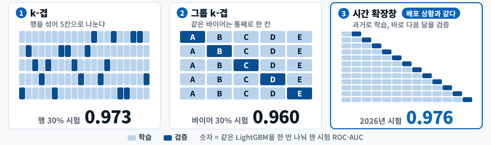{ loading=lazy }
  <figcaption>같은 LightGBM, 나누는 법만 바꾼 시험 AUC — 행 무작위 0.973 · 바이어 무작위 0.960 · 2026년 시험 0.976</figcaption>
</figure>

① **k-겹**은 데이터를 알뜰하게 쓰지만 같은 바이어의 이웃한 달이 학습과 검증에 갈립니다. ② **그룹 k-겹**은 같은 바이어를 한 묶음에만 넣어 '처음 보는 바이어'에 대한 실력을 잽니다. ③ **시간 확장창**은 과거로 학습하고 바로 다음 달을 검증하며 학습 기간을 한 달씩 늘립니다. 합성 데이터라 차이가 작지만 실제 데이터는 시간이 지나며 고객과 경기가 바뀌어 무작위 분할이 더 낙관적으로 나오기 쉽습니다. **숫자가 높은 분할이 아니라 믿을 수 있는 분할**을 고릅니다 — 우리 모델은 과거로 학습해 다음 달을 예측하므로 시간 분할이 가장 정직합니다.

### 데이터 누수 {#ch2-leak}

<figure markdown="span">
  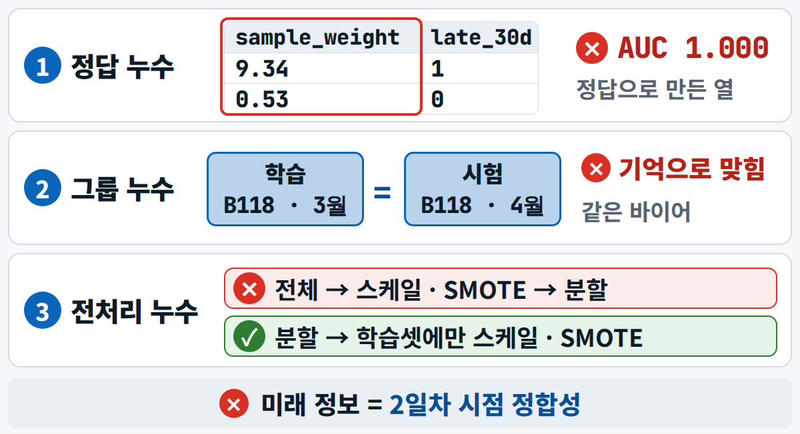{ width="560" loading=lazy }
  <figcaption>정답 · 그룹 · 전처리 — 세 갈래로 시험 전에 답안지를 봅니다</figcaption>
</figure>

| 갈래 | 무슨 일 | 오늘의 예 |
|---|---|---|
| **정답 누수** | 정답으로 계산한 열이 특성에 들어간다 | `sample_weight`(연체 행 9.34 · 정상 행 0.53 두 값뿐)를 넣으면 AUC 1.000 |
| **그룹 누수** | 같은 바이어의 다른 달이 학습 · 시험에 갈려 '기억'으로 맞힌다 | 바이어 단위로 나눈다 |
| **전처리 누수** | 전체로 스케일 · 오버샘플한 뒤 나누면 시험 정보가 샌다 | 순서는 늘 '먼저 나누고, 학습셋으로만 맞춘다' |

의심 신호 세 가지 — **AUC가 0.99를 넘을 때 · ID나 보조 열이 중요도 상위에 올 때 · 시험 성적이 검증보다 눈에 띄게 좋을 때** — 멈추고 열 목록부터 봅니다. 미래 정보(기준일 뒤 결제일 · 뉴스)는 2일차 '시점 정합성' 규칙으로 이미 막았습니다.

### 시연 3 — 누수 탐정과 모델 리그전 {#ch2-demo3}

<div class="tf-flow" markdown>
<div markdown><b>상황</b> 동료가 'AUC 1.0' 연체 모델을 보고했다 — 믿어도 되나? 정직한 비교표로 다시 만든다</div>
<span>→</span>
<div markdown><b>입력</b> 패널 CSV 4,017행 · 데이터 사전(엑셀) · 정답을 뺀 40행 표</div>
<span>→</span>
<div markdown><b>결과</b> HTML 리포트 · 시험 예측 CSV · `CLAUDE.md` 규칙</div>
</div>

**진행** Plan 모드로 금지 열 · 분할 계획 → 모델 4종 · 분할 3 비교 → Claude 직접 채점 → `CLAUDE.md`에 규칙 한 줄

<small>오후: [실습 A-1](lab-a.md#a1) — 300행 · 모델 2개 · 누수 실험 · 커밋</small>

<figure markdown="span">
  { width="760" loading=lazy }
  <figcaption>입력의 예 — 계획의 '특성 제외 표'와 데이터 사전의 `sample_weight` 정의(빨간 상자)</figcaption>
</figure>

<figure markdown="span">
  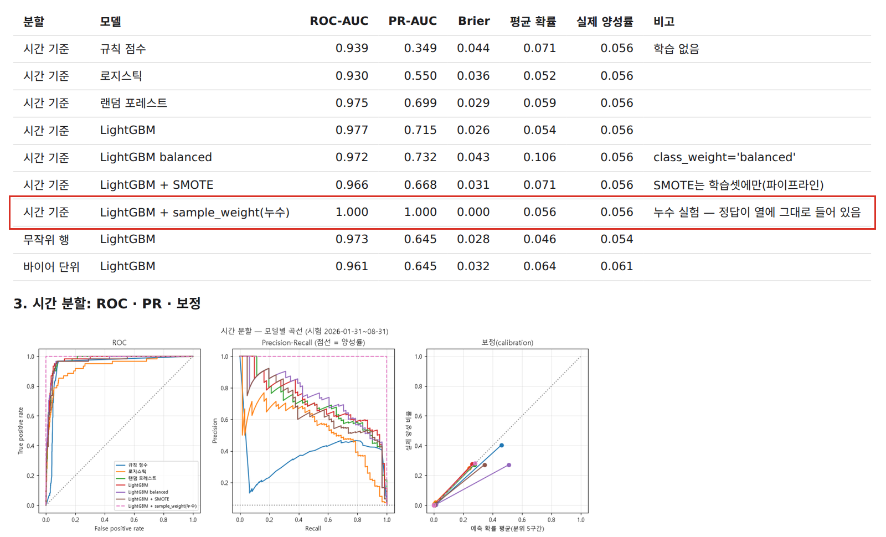{ width="760" loading=lazy }
  <figcaption>결과의 예(특성 63열로 실행한 판) — 규칙 0.939 · 로지스틱 0.930 · LightGBM 0.977 · 누수 1.000</figcaption>
</figure>

핵심은 **계획을 먼저 받아 금지 열 표를 읽는 것**입니다. `sample_weight`는 데이터 사전에 '파일 행 수 ÷ (2 × 같은 `late_30d` 값의 행 수)'라고 적힌, 정답으로 계산한 열이라 빼야 합니다. 같은 프롬프트라도 AI가 특성을 어떻게 고르느냐에 따라 소수 셋째 자리가 달라질 수 있습니다(이번 실행은 범주 열을 원-핫으로 풀어 63열, 강사 기준 모델은 42열) — 8교시 '같은 입력이면 같은 결과'의 출발점입니다. Claude에게 같은 40행을 **도구 없이 직접 채점**시킨 결과(미리 돌린 판)는 AUC가 0.903 · 0.927로 학습한 LightGBM(0.963)보다 낮았고, 두 번 물었을 때 순위도 조금 달랐습니다(순위상관 0.95). **숫자는 학습해 검증한 모델이 내고, LLM은 그 모델을 만들고 설명하는 데 씁니다.**

### 기준선부터 — 규칙 점수와 로지스틱 {#ch2-baseline}

새 모델은 단순한 기준선을 이겨야 쓸 수 있습니다.

| | 규칙 점수(Rule score) | 로지스틱 회귀(Logistic regression) |
|---|---|---|
| 방식 | 연체 잔액이 있으면 0.2 + 최장 미결 연체일 ÷ 100(60일 상한), 없으면 0.01 — 사내 'D+30' 경보를 점수로 | 특성 × 가중치의 합 z → p = 1 ÷ (1 + e^−z) |
| 장점 | 누구나 설명할 수 있다 | 계수의 부호가 위험의 방향, 평균 확률이 실제 비율(0.055 대 0.056)과 거의 같다 |
| 시험 성적 | ROC-AUC 0.939 · PR-AUC 0.349 | ROC-AUC 0.952 · PR-AUC 0.574 |

규칙 점수도 꽤 좋습니다 — **모델의 이득은 PR-AUC와 확률의 질에서 봅니다.** 로지스틱은 '연체일이 길수록 급격히 위험' 같은 곡선이나 상호작용을 사람이 특성으로 만들어 줘야 합니다.

### 그래디언트 부스팅 {#ch2-gbdt}

<figure markdown="span">
  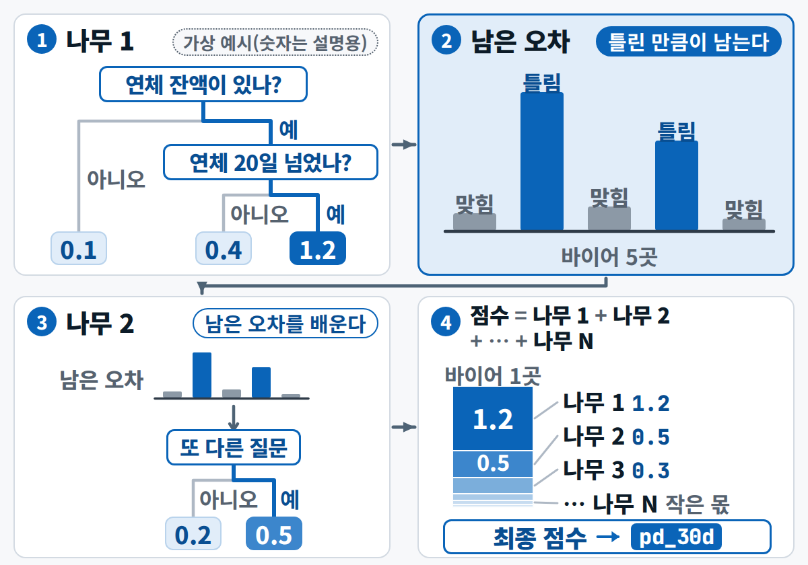{ width="560" loading=lazy }
  <figcaption>① 첫 나무가 예측 → ② 틀린 만큼이 남는다 → ③ 다음 나무가 그 오차를 배운다 → ④ 점수 = 나무들의 합(칸 안의 숫자는 설명용 가상 예시)</figcaption>
</figure>

- **트리**: 예 · 아니오 질문으로 나누는 나무 하나 — 혼자서는 약하고 데이터가 조금 바뀌어도 크게 흔들립니다.
- **배깅**: 다른 표본으로 키운 나무 수백 그루의 평균(랜덤 포레스트) — 시험 ROC-AUC 0.973.
- **부스팅**: 남은 오차를 다음 나무가 배웁니다(LightGBM · XGBoost · CatBoost) — **ROC-AUC 0.976 · PR-AUC 0.709, 오늘의 기본 모델.** 딥러닝이 아닙니다. 행과 열의 표 데이터에서는 지금도 나무 모델을 먼저 씁니다.

AI가 쓴 학습 코드는 이 열두 줄만 읽을 줄 알면 됩니다.

```python
train = df[df.ref_date.between("2024-03-31", "2025-12-31")]  # 시간 기준 분할
test = df[df.ref_date.between("2026-01-31", "2026-08-31")]   # 시험 8개월
model = lgb.LGBMClassifier(
    n_estimators=300,                                        # 나무 수
    learning_rate=0.03,                                      # 한 그루가 고치는 보폭
    num_leaves=7,                                            # 나무 하나의 복잡도
    min_child_samples=30,                                    # 잎 하나의 최소 행 수
    subsample=0.8, subsample_freq=1, colsample_bytree=0.8,   # 행 · 열 일부만
    reg_lambda=5.0, random_state=42)                         # 규제 · 시드
model.fit(train[cols], train.late_30d)                       # 학습
p = model.predict_proba(test[cols])[:, 1]                    # 연체 확률
roc_auc_score(test.late_30d, p)                              # 0.9759
```

**하이퍼파라미터**는 학습 전에 사람이 정하는 설정값입니다 — 잎과 보폭을 작게 잡은 것이 앞의 과적합 처방입니다. `subsample`은 `subsample_freq`를 1 이상으로 줘야 실제로 행을 덜어 냅니다(AI가 자주 빠뜨리는 줄). **임계값은 하이퍼파라미터가 아닙니다** — 학습이 끝난 뒤 비용으로 정합니다. LightGBM 4.7부터 검증 세트를 넘기는 인자가 `eval_set`에서 `eval_X` · `eval_y`로 바뀌는 중이라, AI가 옛 문법으로 쓰면 경고나 오류가 납니다 — 오류 메시지 전문을 그대로 AI에게 다시 줍니다.

### 데이터 모양이 모델을 고른다 {#ch2-shape}

| 데이터 | 먼저 쓸 모델 | 이 과정에서 |
|---|---|---|
| 표(행 · 열) | GBDT · 로지스틱, 작은 표는 표 전용 사전학습 모델(예: TabFM) | 연체 확률(오늘) |
| 텍스트 | LLM · 임베딩 | 뉴스 위험지수(2일차) · 규정 검색(5일차) |
| 이미지 · 스캔 서류 | 딥러닝(비전) · 멀티모달 LLM | 서류 판독 |
| 시계열 | ETS · ARIMA · Prophet · GBDT, 사전학습 시계열 모델 | 환율 구간(오늘) |
| **표를 LLM이 직접 채점?** | 기준선과 같은 시험셋으로 검증 — 재현 · 보정 · 비용이 약점 | 시연 3의 비교 |

표 전용 사전학습 모델(Google TabFM 등)도 나왔지만 가중치가 비상업 라이선스라 회사 업무에 쓰기 전에 조건부터 확인합니다.

### 불균형과 SMOTE {#ch2-smote}

<figure markdown="span">
  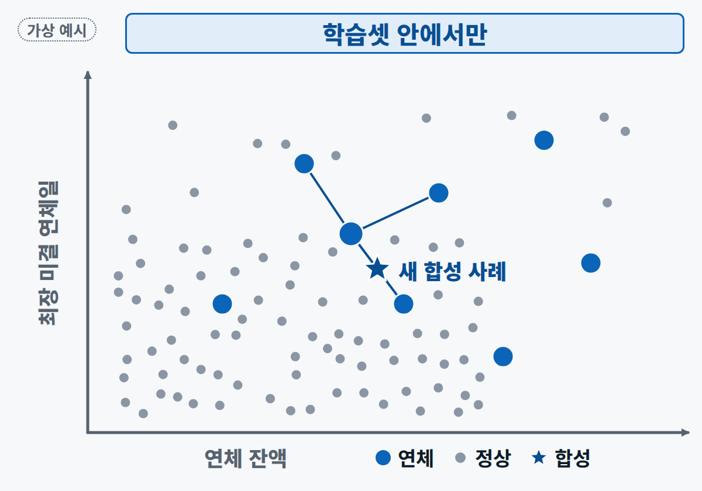{ width="560" loading=lazy }
  <figcaption>SMOTE — 연체 점과 가까운 연체 이웃(기본 5개 중 하나)을 잇는 선 위에 새 점을 만듭니다(복제가 아닙니다)</figcaption>
</figure>

학습셋은 연체 141 · 정상 2,582입니다. SMOTE는 **분할 뒤 학습셋에만** 씁니다(먼저 늘리고 나누면 합성점의 부모가 시험셋에 들어가 누수). 반대쪽 **언더샘플링**은 많은 쪽을 덜어 내 정보를 버리고, 세 번째 길 **class weight**는 데이터를 바꾸지 않고 연체 행에 무게만 더 줍니다.

| 방법(강사 기준 모델) | ROC-AUC | PR-AUC | Brier | 평균 확률 |
|---|---|---|---|---|
| **LightGBM 그대로** | 0.976 | 0.709 | 0.026 | 0.055 |
| LightGBM + class weight | 0.973 | 0.759 | 0.042 | 0.106 |
| LightGBM + SMOTE(학습셋만) | 0.965 | 0.697 | 0.028 | 0.071 |
| **로지스틱 그대로** | 0.952 | 0.574 | 0.035 | 0.055 |
| 로지스틱 + 균형 가중 | 0.956 | 0.538 | 0.057 | 0.149 |

**순위는 그대로, 확률만 부풉니다.** 시험 1,084행의 실제 연체율은 0.056인데 처리한 모델의 평균 확률은 0.071–0.149입니다. 부푼 확률을 4일차 기대손실 계산에 그대로 넣으면 손실이 두 배 가까이 크게 잡히니, 불균형의 첫 해법은 데이터를 바꾸는 것보다 **비용 기준 임계값**입니다(리샘플링을 쓰면 보정하거나 임계값을 다시 잡습니다).

---

## 3장 · 평가하고, 정하고, 설명하기 {#ch3}

**핵심** — 지표는 **업무 언어**로 바꿔 말하고, 임계값은 모델이 아니라 **비용(경영 결정)**이 정하며, 등급에는 **근거**를 붙이되 근거가 곧 원인은 아닙니다.

### 혼동행렬 {#ch3-cm}

<figure markdown="span">
  { width="560" loading=lazy }
  <figcaption>시험 1,084행 · t 0.17 — TP 55 · FN 6 · FP 46 · TN 977, 비용 = 5 × 6 + 46 = 76</figcaption>
</figure>

**FN은 놓친 돈**(경보 없이 계속 선적했다가 연체가 나고, 무역보험 보상에서 빠질 위험까지), **FP는 괜한 선적 보류와 잃는 매출**입니다. 두 오류의 무게가 다르니 비용으로 셉니다 — 놓친 연체 1건을 헛경보 5건만큼 무겁게 보면(사내 가정) 5 × FN + 1 × FP입니다. 헛경보는 현장에서 바로 눈에 띄지만 놓친 연체는 몇 달 뒤에야 보이므로 **FN을 일부러 셉니다.**

### 정밀도와 재현율은 서로 당긴다 {#ch3-pr}

| | 정밀도(Precision) | 재현율(Recall) |
|---|---|---|
| 식 | TP ÷ (TP + FP) = 55 ÷ 101 = **0.54** | TP ÷ (TP + FN) = 55 ÷ 61 = **0.90** |
| 업무 말 | '경보를 믿어도 되나' — 경보 중 진짜 비율 | '선을 넘을 바이어를 몇 % 미리 보나' |
| 올리려면 | 임계값을 높인다 — 놓치는 연체가 는다 | 임계값을 낮춘다 — 헛경보가 는다 |

임계값 0.5면 재현율 0.52 · 정밀도 0.68, 0.09면 0.97 · 0.48입니다. **F1**은 둘의 조화평균(t 0.17에서 0.68)으로 한쪽만 좋으면 낮게 나옵니다. 어느 쪽을 중시할지는 업무가 정합니다.

### ROC-AUC · PR-AUC {#ch3-auc}

<figure markdown="span">
  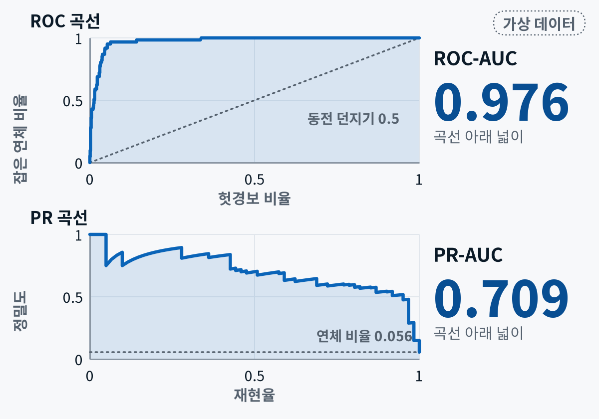{ width="560" loading=lazy }
  <figcaption>ROC-AUC 0.976 — 연체 1곳과 정상 1곳을 뽑으면 97.6% 확률로 연체 쪽 점수가 높다(0.5 = 동전 던지기)</figcaption>
</figure>

- **PR-AUC 0.709**: 아무렇게나 찍을 때의 기준선이 연체 비율 0.056이라 그 열두 배 남짓 — 드문 사건에서는 함께 봅니다.
- AUC는 임계값과 무관한 **순서의 질**일 뿐, 확률 자체가 맞는지는 말해 주지 않습니다(다음 절의 보정).
- **주의**: 레이블 설계 때문에 '이미 연체 중'인 쉬운 양성이 많습니다. 지금 연체 중인 바이어끼리만 보면 **AUC는 0.80**으로 내려가며, 이것이 '진짜 실력'에 더 가깝습니다. 보고서에 AUC 0.976만 적으면 새 연체를 미리 맞히는 능력을 과대평가합니다 — 조건부 AUC를 한 줄 같이 적습니다.

### 보정 · 브라이어 점수 {#ch3-calib}

<figure markdown="span">
  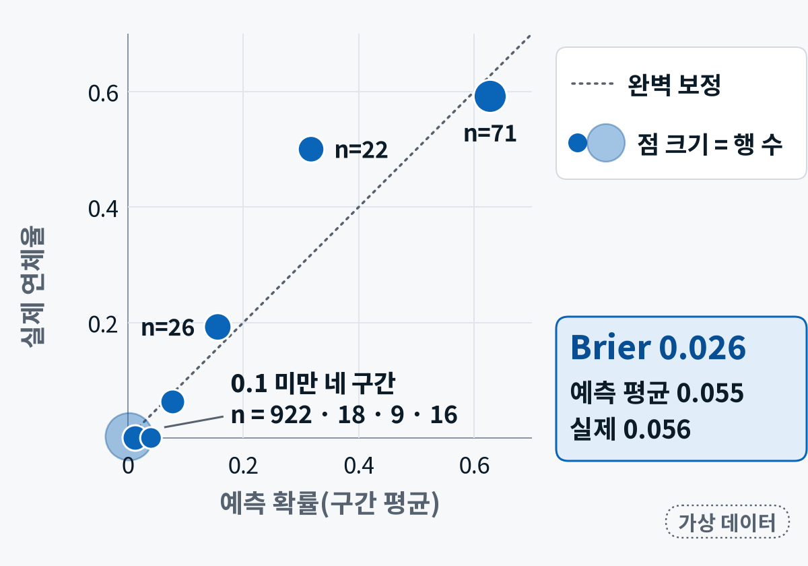{ width="560" loading=lazy }
  <figcaption>예측 0.1–0.2 구간 → 실제 19% · 0.2–0.4 → 50% · 0.4 이상 → 59%, Brier 0.026 — 점이 대각선에 가까울수록 잘 보정된 것</figcaption>
</figure>

보정은 '0.3이라고 말한 바이어 100곳 중 실제로 30곳쯤 연체하는가'를 보는 일이고, Brier는 (확률 − 실제)²의 평균(낮을수록 좋음)입니다. 빠른 점검은 **예측 평균(0.055)이 실제 비율(0.056)과 비슷한가**. class weight · SMOTE를 쓰면 평균이 0.106까지 부풀어 Platt(로지스틱으로 다시 맞춤) · Isotonic(계단 모양으로 다시 맞춤)으로 보정하거나 임계값을 다시 잡습니다. **AUC가 같아도 보정이 다르면 돈 계산이 달라집니다** — 4일차 기대손실 PD × LGD × EAD의 PD에 이 확률이 그대로 들어갑니다.

### 임계값은 경영 결정이다 {#ch3-threshold}

놓친 연체 1건 = 헛경보 5건이면 이론상 최적 임계값은 **t = FP 비용 ÷ (FP 비용 + FN 비용) = 1 ÷ 6 ≈ 0.17**입니다(확률이 보정돼 있을 때 성립).

| 임계값 | 놓친 연체 · 헛경보 | 비용(5 × FN + FP) |
|---|---|---|
| 기본값 0.5 | 29 · 15 | **160** |
| 비용 기준 0.17 | 6 · 46 | **76** |
| 비용비 10:1이면 t 0.09 | 재현율 0.97 · 헛경보 64 | – |

같은 모델, **선만 옮겨 비용 160 → 76**입니다. 비용비는 여신위원회가 정합니다(가상 규정). 실무에서는 학습 기간의 월별 확장창에서 비용이 가장 낮은 지점을 찾고(scikit-learn의 `TunedThresholdClassifierCV`), **시험셋을 보고 고르지 않습니다.**

### 지표를 업무 언어로, 등급은 조치로 {#ch3-grade}

위원회는 AUC가 아니라 놓친 돈과 일의 양을 묻습니다.

| 모델 지표 | 업무 언어 | 우리 숫자(시험 8개월) |
|---|---|---|
| 임계값 0.17 | 연체 확률 17% 이상이면 확인 대상 | 비용비 5:1 → 1 ÷ (1 + 5) |
| 재현율 0.90 | 선을 넘을 연체 10건 중 9건을 미리 본다 | 연체 61건 중 55건(바이어-월) |
| 정밀도 0.54 | 경보 2건 중 1건은 확인해 보면 정상 | 경보 101건 중 46건 |
| 경보 수 | 담당자 확인 업무량 | 월 8–16건(평균 약 13건) |
| 놓친 연체 | 미리 못 본 미수 | 6건(금액으로도 본다) |
| 등급 분포 | 결제조건 · 한도가 바뀌는 바이어 수 | C 18곳(2026-09-30) |
| 확률 | 기대손실(PD × LGD × EAD) | 4일차 입력 |

등급은 확률을 업무 언어로 바꾼 것입니다 — **C는 t 이상, B는 t/2, A는 t/4, 나머지는 S.**

<figure markdown="span">
  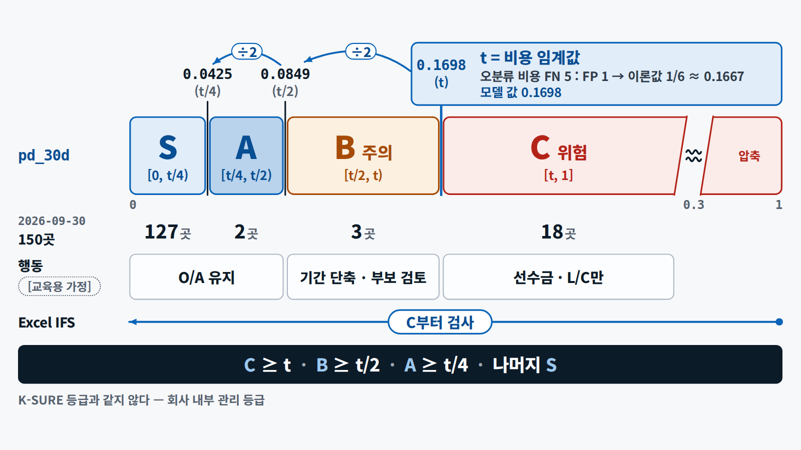{ loading=lazy }
  <figcaption>강사 기준 모델의 등급 컷(t 0.1698) — 경계는 t를 반씩 나눈 값이고 엑셀 IFS는 가장 위험한 C부터 검사합니다. 실습의 완성본은 t 0.17이라 곳 수가 조금 다릅니다</figcaption>
</figure>

| 등급 | `pd_30d` 구간 | 허용 결제조건 · 한도 상한(가상 규정) | 재검토 | 2026-09-30 |
|---|---|---|---|---|
| S | 0.042 미만 | O/A · D/A 90일 이내 · 별도 상한 없음 | 연 1회 | 127곳 |
| A | 0.042–0.085 | O/A · D/A 60일 이내 · 상한 $200,000 | 반기 1회 | 2곳 |
| B | 0.085–0.170 | 30일 이내(보험 필수) 또는 선수금 30% 이상 · 상한 $100,000 | 분기 1회 | 3곳 |
| C | 0.170 이상 | 선수금 · 신용장만 · 신용한도 0 | 분기 1회 | 18곳 |

확률이 '연체 없음'(0 근처)과 '연체 중'(높은 쪽)으로 갈라져 **S에 몰리고 A · B는 드뭅니다.** 등급이 쓸모 있는지는 등급별 실제 연체율로 확인합니다(시험 8개월 S 0.2% · A 0% · B 17.4% · C 54.5% — A는 16행뿐이라 흔들립니다). 이것은 무역보험의 신용등급과 다른 **회사 내부 관리 등급**이고, 엑셀 `IFS`로 매길 때는 **가장 위험한 C부터** 검사해야 경계가 겹치지 않습니다. **한도를 30% 넘게 줄이는 결정은 모델 결과만으로 확정하지 않습니다.**

### 시연 4 — 비용으로 움직이는 임계값 엑셀 {#ch3-demo4}

<div class="tf-flow" markdown>
<div markdown><b>상황</b> 여신위원회가 회의 중에 묻는다: "놓친 연체를 10배로 보면 경보가 얼마나 늘어나나?"</div>
<span>→</span>
<div markdown><b>입력</b> 시험 예측 CSV 1,084행 · 여신관리규정(Markdown, 가상)</div>
<span>→</span>
<div markdown><b>결과</b> 수식 · 차트가 살아 있는 엑셀(혼동행렬 · 비용곡선 · 등급) · 검산표</div>
</div>

**진행** 규정에서 임계값 · 등급 규칙 요약 → 엑셀 5시트를 **수식으로** 생성 → 파이썬 검산값과 대조 → FN 비용 5 → 10

<small>오후: [실습 A-2](lab-a.md#a2) 비용표 · 내 비용비 — [실습 B-1](lab-b.md#b1) 등급 · 단조성(완성본 엑셀과 AI 대조)</small>

<figure markdown="span">
  { width="760" loading=lazy }
  <figcaption>같은 엑셀에서 FN 비용 칸만 5 → 10으로 — t 0.167 → 0.091 · 놓친 연체 6 → 2 · 헛경보 47 → 64, 등급은 C 102 → 123곳(시험 예측 기준)</figcaption>
</figure>

핵심 한 문장은 **"계산은 전부 엑셀 수식으로 남겨 줘"**입니다. 값만 박힌 엑셀은 회의에서 숫자를 바꿀 수 없습니다. 거의 확실히 나오는 장면도 있습니다 — 처음에 '등급' 시트가 `#NAME?`으로 보이는 것입니다(AI의 저장 방식 때문이고 엑셀이 `IFS`를 못 쓰는 것이 아닙니다). `IFS를 못 쓰는 엑셀이면 중첩 IF로` 한 문장이면 고쳐집니다. AI는 "엑셀 수식 결과는 직접 확인하지 못했다"고 먼저 말합니다 — **열어서 대조하는 것은 사람**입니다. 등급 시트의 단조성 칸이 ✗로 나오는 것은 A가 몇 행뿐인 작은 표본 탓이니 건수와 함께 읽습니다.

### SHAP — 등급의 이유를 숫자로 {#ch3-shap}

<figure markdown="span">
  { width="560" loading=lazy }
  <figcaption>전역 설명(강사 모델) — 재무비율보다 결제 행동이 먼저 말합니다. 막대 끝 숫자는 평균 |SHAP|</figcaption>
</figure>

SHAP은 한 예측을 **'기준값 + 특성별 기여의 합'**으로 나눕니다(게임 이론의 섀플리 값, 나무 모델에는 빠른 계산법). **전역**은 모델 전체의 경향 — 150곳의 평균 |SHAP| 상위는 연체 잔액 0.56 · 31일+ 잔액 비중 0.53 · 미연체 잔액 비중 0.47 · 최장 미결 연체일 0.26 · DPD 추세 0.15이고, 재무비율은 부채비율 14위 · DSO 17위 · 유동비율 18위 · 영업이익률 20위입니다. 재무제표는 1년에 한두 번 바뀌지만 결제 행동은 매달 바뀌어, 30일 앞을 보는 모델에서는 **결제 행동이 먼저 말합니다.**

<figure markdown="span">
  { width="760" loading=lazy }
  <figcaption>지역 설명 — B118이 C등급인 이유: ① 미연체 잔액 비중 0%(+2.61) ② 연체 잔액 20,060달러(+2.25) ③ 최장 미결 연체일 27일(+1.34) → 최종 91.3%</figcaption>
</figure>

**지역**은 한 바이어의 이유입니다. 읽는 순서는 기준값(0.3%)에서 출발해 큰 막대부터이고, 막대의 단위는 **로그오즈**라 확률로 읽지 않습니다 — 확률로 읽는 것은 기준값과 맨 아래 최종 91.3%(= `pd_30d` 0.913) 둘뿐입니다. 위원회 자료의 '근거 3줄'이 이 세 막대입니다. 반면 B005는 연체 잔액이 $19,920로 비슷해도 미결의 94%가 아직 기일 전이고 가장 오래된 미결이 13일이라 막대가 작고 위험을 낮추는 막대도 보입니다 — 그래서 0.151, 임계값 0.17 바로 아래의 B등급입니다.

### 설명할 수 있어도 원인은 아니다 {#ch3-limits}

- **SHAP은 모델의 판단 근거**지, '이 값을 바꾸면 연체가 줄어든다'는 인과가 아닙니다.
- 레이블 구조상 **'지금 연체 중인가'가 판단을 지배**합니다 — 연체 중인 바이어끼리만 비교하면 AUC가 0.80으로 내려갑니다.
- 이력이 짧은 **신규 바이어 · 조작된 재무제표**에는 늦게 반응합니다 — 제출 직후 등급 급상승 + 외상 확대 요구는 사람이 먼저 봅니다.
- **대리 변수**: 국가 · 업종 열을 빼도 국가위험 점수 · 환율 · 결제조건 열이 대신할 수 있습니다 → 그룹별 오류율을 따로 점검합니다.
- 한도 30% 넘는 감액 · 거래 중단은 모델 결과만으로 정하지 않고 **사람이 승인하고 기록합니다.** 한국 AI 기본법(2026년 1월 시행)도 대출 심사를 고영향 AI의 예로 들며 최종 결정에 사람이 개입하는지를 중요하게 봅니다.

이 다섯 줄이 위원회 자료의 '한계' 칸이 됩니다.

### 시연 5 — SHAP 근거를 위원회 슬라이드로 {#ch3-demo5}

<div class="tf-flow" markdown>
<div markdown><b>상황</b> C등급 B118의 거래조건 변경을 내일 여신위원회에 올린다 — 숫자는 정확하게, 양식은 회사 것으로</div>
<span>→</span>
<div markdown><b>입력</b> 모델 · 150곳 CSV · 여신관리규정(Markdown) · 회사 양식(.pptx)</div>
<span>→</span>
<div markdown><b>결과</b> 위원회 슬라이드 3장 · 그림 4 · 사유 표 · 숫자 대조표</div>
</div>

**진행** Claude Code가 SHAP 계산 · 그림 4장 → Cowork(또는 Claude Code)로 슬라이드 3장 → 숫자 대조표 → 사람이 결론 문장 수정

<small>오후: [실습 B-2 · 01–02](lab-b.md#b2-1) — SHAP 그림 2장 · 메모 5칸</small>

<figure markdown="span">
  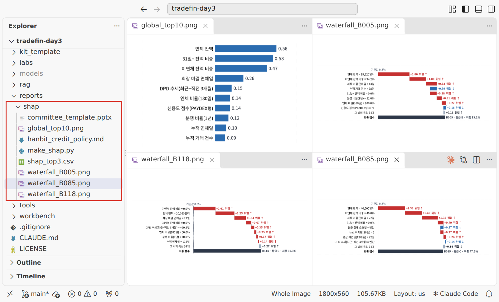{ width="760" loading=lazy }
  <figcaption>입력 — Claude Code가 만든 그림 4장과 사유 표가 든 폴더 <code>reports/shap</code>(빨간 상자). 규정과 슬라이드 양식 사본도 같은 폴더에 두고 이 폴더만 근거로 쓰게 합니다</figcaption>
</figure>

<figure markdown="span">
  { width="760" loading=lazy }
  <figcaption>결과의 예(같은 프롬프트를 Claude Code에 보낸 판) — 슬라이드 3장과 대조표, 숫자 50개 중 일치 27 · 불일치 0 · 대조 대상 아님 23</figcaption>
</figure>

작업을 둘로 나눕니다 — 계산 · 그림 · 대조처럼 **코드가 필요한 일은 Claude Code, 회사 양식과 문장을 다루는 문서 일은 Cowork**(같은 Claude, 다른 작업대)입니다. 프롬프트의 구조는 **근거 파일을 이름으로 못 박기 · 장별 구성 · 규칙('입력에 없는 숫자는 쓰지 않는다 · 기여의 부호를 바꾸지 않는다') · 모든 장 바닥글 '사람 승인 전 초안'**입니다. 결론은 세 가지 중에서 고르게 합니다(자유롭게 쓰게 하면 '즉시 거래 중단' 같은 과한 표현이 나옵니다). 슬라이드를 만든 뒤에는 **모든 숫자를 원본과 대조한 표**를 남기고, AI가 열어 보지 못한 화면은 사람이 PowerPoint로 열어 글자 넘침을 확인합니다. Cowork는 연결한 폴더의 파일이 Anthropic 클라우드에서 처리되므로 오늘처럼 합성 데이터일 때만 씁니다.

---

## 4장 · 같은 입력이면 같은 결과 {#ch4}

**핵심** — 노트북에서 한 번 돌린 모델은 **실험**입니다. 기록 · 버전 · 품질 게이트라는 **고리**가 돌아야 서비스가 됩니다.

### 모델은 배포한 날부터 낡는다 {#ch4-loop}

<figure markdown="span">
  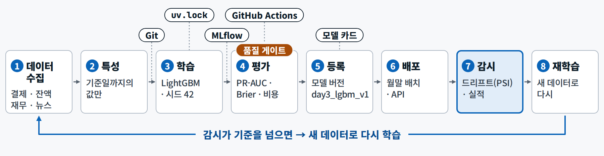{ loading=lazy }
  <figcaption>데이터 수집 → 특성 → 학습 → 평가(품질 게이트) → 등록 → 배포 → 감시 → 재학습 — 칸 위의 태그가 오늘의 도구입니다</figcaption>
</figure>

평가 칸이 **품질 게이트**입니다(PR-AUC · Brier · 비용이 기준보다 나빠지면 다음 칸으로 넘어가지 못함). 등록은 모델에 버전 이름(`day3_lgbm_v1`)을 붙여 보관하는 일, 배포는 월말 배치나 API로 실제 업무에 쓰는 일입니다. 바이어도 시장도 바뀌므로 감시 뒤에 고리가 다시 데이터로 돌아옵니다.

### 2일차 구조에 ML이 더하는 것 — 재현의 네 기둥 {#ch4-pillars}

2일차 구조(`data/` · `src/` · `tests/` · `CLAUDE.md` · `uv.lock`)에 ML이 더하는 것:

| 더하는 파일 | 무엇 |
|---|---|
| `params.yaml` | 하이퍼파라미터 · 비용비 — 설정을 코드 밖으로 |
| `src/train.py` · `score.py` · `evaluate.py` | 학습 · 점수 · 평가 코드 |
| `models/day3_lgbm.txt` | 학습된 모델(버전 이름 `day3_lgbm_v1`) |
| `models/model_card.md` | 모델의 이력서 |
| `models/metrics.json` | PR에서 비교할 지표 |
| `.github/workflows/train.yml` | PR마다 같은 데이터로 다시 학습 · 검사 |

실행은 한 줄입니다: `uv run python src/train.py --params params.yaml`

| 기둥 | 무엇으로 고정하나 |
|---|---|
| **코드** | Git 커밋 해시 — 어느 코드로 돌렸나 |
| **데이터** | 파일 해시(sha256), 큰 파일은 DVC · Git LFS |
| **환경** | `uv.lock` — Python 3.13 · LightGBM 4.7 · scikit-learn 1.9 |
| **시드** | `random_state = 42` — 무작위도 고정 |

**넷 중 하나만 달라도 숫자가 바뀝니다.** 월요일에 다시 돌린 등급이 금요일과 다르면 한도 결정의 근거가 흔들립니다. 재현이 왜 어려운지 보여 주는 숫자가 있습니다 — 한 연구에서 GitHub의 노트북 86만여 건을 다시 실행했더니 오류 없이 돈 것이 24%, 같은 결과를 낸 것은 4%뿐이었습니다. `params.yaml`처럼 설정을 코드 밖으로 빼 두면 설정만 바꾼 PR은 diff 몇 줄로 보입니다. 오늘 실습의 `notes.md`(시드 · 패키지 버전 · AUC · t)가 이 기록의 작은 판입니다 — [기초 F3](../foundations/f3.md).

### 실험 추적 {#ch4-track}

'어제 그 좋은 설정이 뭐였지?' — 엑셀 실험 일지를 손으로 쓰면 꼭 생기는 질문입니다. 실험 추적은 실행마다 **설정 · 지표 · 모델 파일 · 코드 커밋을 자동으로** 남기는 일이고, 오늘은 오픈소스 **MLflow**를 씁니다(`mlflow ui`로 내 PC 브라우저에서 비교). 핵심은 **사람이 옮겨 적지 않는다**는 것입니다. 옮기면 언젠가 설정과 결과가 어긋납니다.

<figure markdown="span">
  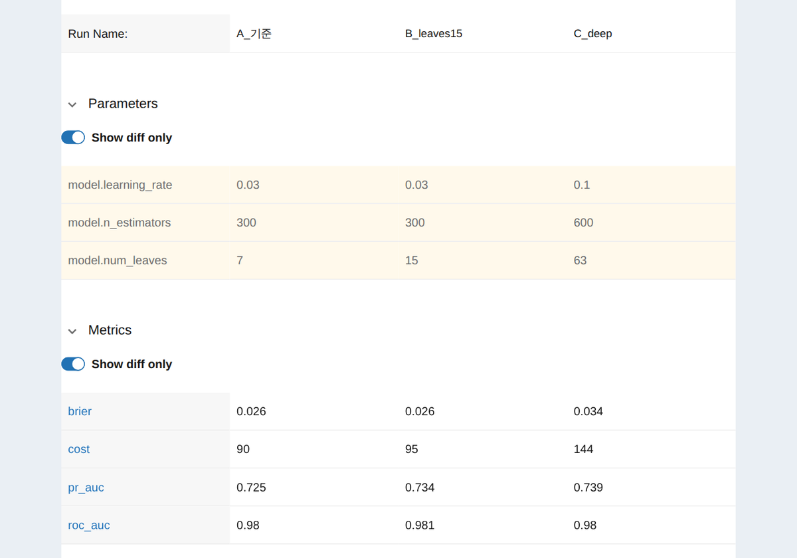{ width="560" loading=lazy }
  <figcaption>MLflow Compare(시연 6) — 서로 다른 설정 세 줄(learning_rate · n_estimators · num_leaves)과 지표 네 줄(brier · cost · pr_auc · roc_auc)</figcaption>
</figure>

### 모델 카드 {#ch4-card}

<figure markdown="span">
  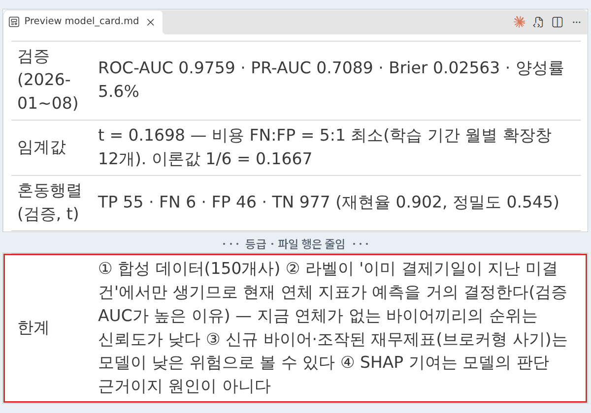{ width="560" loading=lazy }
  <figcaption>모델의 이력서 — 강사 모델 카드의 일부(빨간 상자가 '한계' 칸)</figcaption>
</figure>

무엇을 위해(`late_30d` → S/A/B/C), 어떤 데이터로(2024-03~2026-08, 3,807행), 얼마나 잘(시험 ROC-AUC 0.976 · PR-AUC 0.709 · Brier 0.026 · t 0.17), **어디까지 써도 되는지**(한계)를 한 장에 적습니다. 성능 숫자는 2025년 12월까지로 학습한 모델을 2026년 1–8월 시험셋으로 잰 값이고, 실제로 쓰는 모델은 평가가 끝난 뒤 8월까지 전체 기간으로 다시 학습한 것이라 카드에 둘을 구분해 적습니다(카드의 표는 이 시험 구간을 '검증'이라고 부릅니다). **가장 중요한 칸은 한계**입니다 — 위원회 보고 · 감사 · 인수인계가 모두 여기서 출발합니다. 초안은 Claude Code에게 맡겨도 되지만 미리 맡겨 보니 숫자 대부분은 맞았고 특성 개수를 42개가 아니라 43개로 적었습니다 — **카드의 숫자는 `metrics.json`과 코드로 대조하고, 한계는 사람이 씁니다.**

### 배포 — 모아서 한 번에냐, 요청마다냐 {#ch4-deploy}

| | 배치 점수(Batch scoring) | 온라인 서빙(Online serving) |
|---|---|---|
| 방식 | 모아서 한 번에 — 월말에 150곳을 한꺼번에 점수 | 요청마다 즉시 — `POST /predict` → `{"pd_30d": 0.91}` |
| 이어지는 곳 | CSV · DB → 등급 · 한도 · 대시보드 | 신규 바이어 심사 · 앱 연동 |
| 장단점 | 단순하고 감사가 쉽다 — **우리 기본 방식** | 응답 시간 · 인증 · 버전을 관리해야 한다 → 5일차 |

**업무 주기가 배포 방식을 정합니다.** 결제 데이터가 월말에 정리되면 실시간 API는 비용만 늘립니다. 배치를 '언제 돌리나'(스케줄 · 이벤트)는 4일차에, 실시간 연동 네 방식(폴링 · SSE · WebSocket · 웹훅)은 5일차에 다시 봅니다.

### 드리프트 · PSI {#ch4-drift}

<figure markdown="span">
  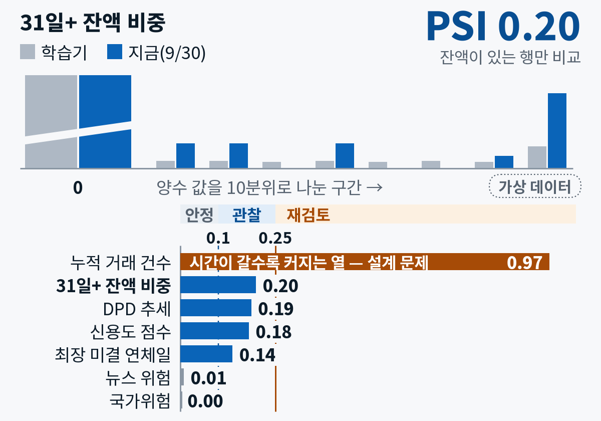{ width="560" loading=lazy }
  <figcaption>PSI 0.1 미만 안정 · 0.25 이상 재검토 — 31일+ 잔액을 가진 바이어 비율이 4.3% → 8.7%로 늘어 PSI 0.20</figcaption>
</figure>

PSI는 학습기와 지금을 같은 구간으로 나누고 구간별 비율 차이에 로그 비율을 곱해 더한 값입니다. DPD 추세도 0.19로 같은 방향(연체가 깊어지는 쪽)입니다. **누적 거래 건수 0.97**은 시장이 변해서가 아니라 시간이 갈수록 저절로 커지는 열이라서이니, 특성 설계 단계에서 '최근 12개월 건수'처럼 창을 정한 값이나 비율로 바꿉니다. 정답이 쌓이면 **실적 감시**도 합니다 — 2026-08 예측 평균은 6.4%였는데 실제 연체율은 9.0%였습니다. 드리프트는 **'언제 재학습할지'를 알려 주는 계기판**입니다.

### 시연 6 — 실험 기록과 PR 자동 검증 {#ch4-demo6}

<div class="tf-flow" markdown>
<div markdown><b>상황</b> 동료가 "나무를 깊게 하니 AUC가 올랐다"며 설정 변경 PR을 올렸다 — 감으로 병합하지 않는다</div>
<span>→</span>
<div markdown><b>입력</b> 시연용 GitHub 저장소 · 시연용 가상 패널 4,017행(특성 15) · `params.yaml` · 워크플로</div>
<span>→</span>
<div markdown><b>결과</b> MLflow 비교 화면 · PR 체크 실패 / 통과 · 검사 결과 · PR 코멘트</div>
</div>

**진행** MLflow로 설정 3개 비교 → 브랜치 → PR → Actions가 같은 데이터로 재학습 · 게이트 → 결과를 PR 코멘트로

<small>수업 뒤: [실습 B '다 했으면'](lab-b.md#more) — 품질 게이트를 내 PR에</small>

<figure markdown="span">
  { width="760" loading=lazy }
  <figcaption>입력 — PR의 변경은 `params.yaml` 일곱 줄뿐입니다(설정 C: 잎 63 · 600그루)</figcaption>
</figure>

<figure markdown="span">
  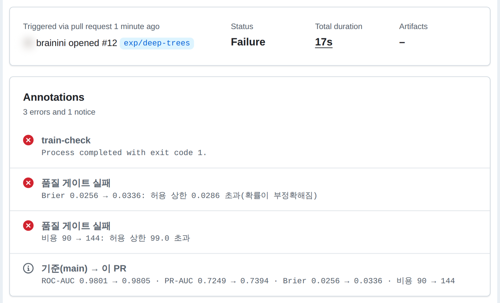{ width="760" loading=lazy }
  <figcaption>결과 — 게이트 실패: PR-AUC 0.7249 → 0.7394 · 비용 90 → 144 (Brier 0.0256 → 0.0336)</figcaption>
</figure>

**AUC가 올라도 비용이 늘면 병합하지 않습니다.** 깊은 나무 C는 오경보가 25건에서 14건으로 줄었지만 놓침이 13건에서 26건으로 두 배가 되어 5 × 26 + 14 = 144, 확률의 질을 재는 Brier도 나빠졌습니다 — 2장 과적합 그림을 PR에서 다시 만난 셈입니다. 품질 게이트는 세 줄입니다: **PR-AUC ≥ 기준 − 0.01 · Brier ≤ 기준 + 0.003 · 비용 ≤ 기준 × 1.10**(이번 값으로는 한도가 PR-AUC 0.715 · Brier 0.0286 · 비용 99). 잎 15인 설정 B는 비용 95로 한도 안이라 통과합니다. AI는 **요약과 권고만** 하고 병합 버튼은 사람이 누릅니다(게이트와 AI 권고가 엇갈리면 게이트를 따르고 이유를 확인). 시연 저장소의 패널은 과정 패널과 다른 가상 데이터라 숫자가 오전 값과 다르지만, 같은 비교 방식이 보이면 됩니다. 이 워크플로의 축소판은 `labs/day3/quality_gate/`(`get_day_files.py 3`이 받습니다)에 있습니다 → [실습 B '다 했으면'](lab-b.md#more).

---

## 오후에 직접 해 보는 것 {#afternoon}

| 시간 | 무엇을 | 오전의 어느 부분을 줄인 것인가 |
|---|---|---|
| 13:00–14:50 | **[실습 A](lab-a.md)** 내 첫 연체 예측 모델 — 데이터 카드(Plan) → 로지스틱 · LightGBM → 누수 실험 → 비용표 · 내 비용비 → 커밋 · push | 시연 3(300행 · 모델 2개) + 시연 4(엑셀 대신 Markdown 표, 비용비는 각자) |
| 15:00–16:50 | **[실습 B](lab-b.md)** 등급 · 근거 · 환율 — 150곳 점수 → 완성본 엑셀과 AI 대조 → SHAP 메모 → 환율 구간 → 16:45 저장 · PR | 시연 4(등급 — 완성본 엑셀) + 시연 5(메모 5칸) + 시연 2(제공 CSV · 모델 1개) |
| 17:00–17:50 | **8교시** 같은 입력이면 같은 결과 — 시연 6 · 수강생 PR 2–3개 화면 리뷰 · 정리 | – |

## 한 줄로 정리 {#recap}

1. 드문 사건은 **기저율**부터 — 정확도 대신 재현율 · 정밀도 · PR-AUC.
2. **레이블과 분할이 문제를 정한다** — 시간 · 바이어 단위로 나누고, 누수는 의심부터.
3. 임계값은 **비용으로 정하는 경영 결정**(5:1 → 0.17), 등급은 t/4 · t/2 · t.
4. SHAP은 **근거이지 원인이 아니다** — 자료의 숫자는 원본과 대조한다.
5. **같은 입력이면 같은 결과** — 실험 기록 · 버전 · 품질 게이트.

**월요일(4일차)** — 오늘의 등급이 안전 여신 한도 계산의 입력이 됩니다. 월요일 아침에는 모두 같은 3일차 기준 등급 파일로 시작하면서, 오늘 내 결과와 견주어 봅니다 → [3일차 개요](index.md#tomorrow).
