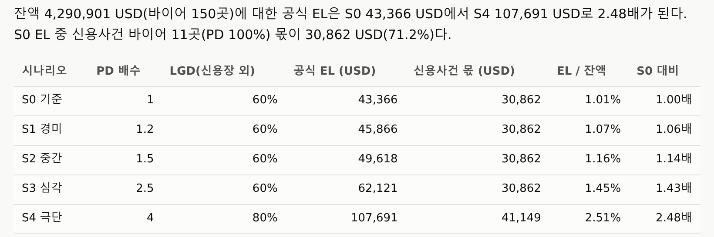

<div class="tf-lab" markdown>
<span class="tf-eyebrow">4일차 · 실습 A · 4–5교시 · 13:00–14:50 <span class="tf-daystate" data-tf-daystate="4"></span></span>

# 실습 A — 한도 최적화와 스트레스 테스트

<div class="tf-meta" markdown>
<span class="tf-chip tf-chip--time">13:00–14:50 · 쉬는 시간 13:50–14:00</span>
<span class="tf-chip tf-chip--tool">Claude Code · Plan</span>
<span class="tf-chip tf-chip--tool">uv · PuLP 3.3.2</span>
<span class="tf-chip tf-chip--tool">pytest</span>
<span class="tf-chip tf-chip--tool">Git · worktree · PR</span>
</div>

<div class="tf-flow" markdown>
<div markdown><b>상황</b> (가상) 한빛정밀 여신관리팀 — 9월 30일 기준 바이어 150곳의 한도를 다시 짭니다. 정책 숫자는 CSV · 규정에 흩어져 있고 한도는 엑셀 수작업이라 '왜 이 한도인지'를 못 댑니다. 경영진은 "총액을 늘리면 얼마나 좋아지나?" · "환율이 또 흔들리면 최악에 얼마?"를 묻습니다.</div>
<span>→</span>
<div markdown><b>넣는 것</b> 설계 1쪽 `MODEL_SPEC.md` + CSV 3종(바이어 · 정책 숫자 · 미결 인보이스) + 프롬프트 A1–A6 · 답안 카드 · 속성 테스트 8개 + 실험 카드 1장 + 시나리오 CSV</div>
<span>→</span>
<div markdown><b>얻는 것</b> 한도 엔진 `scripts/limits_lp.py` · 한도안 xlsx(한도 · 걸린 제약 · 잠재가격) · 모델 카드 · 실험 기록 `experiments.md` · 스트레스 표 · PR 1개</div>
</div>

<div class="tf-lab__grid" markdown>
<div class="tf-lab__cell" markdown><span class="tf-lab__label">목표</span> 정책 손잡이 하나를 바꿨을 때 **한도 · 잠재가격 · 손실이 어떻게 달라지는지 숫자로 설명**한다</div>
<div class="tf-lab__cell" markdown><span class="tf-lab__label">오전 시연과의 관계</span> 시연 1을 설계 1쪽 · 답안 카드 · 속성 테스트로 **줄이고**, 시연 2는 제공 스크립트에 **내 시나리오 하나**를 더합니다. 실험 카드 1장으로 사람마다 다른 결과를 냅니다</div>
</div>

<small>macOS에서는 이 쪽 단축키의 ++ctrl++을 ++cmd++로 누릅니다(미리보기 ++cmd+shift+v++). 터미널(++ctrl+grave++) · 소스 제어(++ctrl+shift+g++)는 macOS도 ++ctrl++ 그대로입니다.</small>

<div data-tf-map></div>
</div>

<div class="tf-phase" markdown>

<span class="tf-eyebrow">슬라이드 실습 A · 13:00–14:50 · 시연 1·2를 줄이고 나만의 실험 하나</span>

**목표** 정책 손잡이 하나를 바꿨을 때 한도·잠재가격·손실이 어떻게 달라지는지 숫자로 설명한다

1. 준비 — 브랜치 d4-limits · 파일 받기 · uv sync
2. 모델 — Plan 모드 표·질문 → 답안 카드 → 코드
3. 검증 — 속성 테스트 8개 · 걸린 제약·잠재가격 기록
4. 실험 카드 1장 — worktree로 나란히 돌린다
5. 스트레스 — 제공 스크립트 + 내 시나리오 1개 해석
6. 14:45 기대값 테스트 → PR(무엇을 · 결과 · 남은 질문)

**산출물** 한도안 xlsx · 스트레스 표 · 실험 기록 · PR · **도구** Claude Code · uv · PuLP 3.3.2 · pytest · Git

</div>

## 입력 파일 받기 {#files}

내 저장소에서 `uv run python tools/get_day_files.py 4`를 실행하면 아래 파일이 **같은 경로에** 들어오고 작업 사본(`workbench/day4/data/`)도 생깁니다. 저장소 없이 채팅 경로로 하는 분만 카드에서 받으세요. 카드에 잠금 칩이 있으면 그 시각 뒤에 받습니다(받기 명령도 그 전에는 '열기 전'이라고 알려 줍니다).

--8<-- "docs/_snippets/day4/files_lab-a_cards.md"

!!! warning "원본은 읽기만 · 비교 파일은 그 단계에서"

    `data/checkpoints/`와 `labs/day4/`의 원본은 고치지 않습니다 — 고쳐 쓸 것(정책 숫자 · 시나리오)은 `workbench/day4/data/`의 작업 사본에서 합니다. 기대값 테스트(14:45) · 카드 확인표(14:15) · 기준 결과 워크북은 **먼저 AI로 내 결과를 만든 뒤** 그 단계에서 엽니다. 총액 비율 70%(`TotalCapShare`)는 규정에 없는 **교육용 가정**이라 코드에 쓰지 않고 `d4_params.csv`에서만 읽습니다 — 오늘의 정책 실험이 바로 이 숫자를 바꾸는 일입니다.

## 01. 준비 — 브랜치 d4-limits · 파일 받기 · uv sync (13:00–13:10) { #a-prep .step data-tool="VS Code · 터미널 · Git" }

**왜** 오늘 일을 갈래 하나에 모으고, 모두 같은 파일로 시작합니다. 내 저장소 → 명령 다섯 줄 → 브랜치 `d4-limits` · 받은 파일 · `.venv`

!!! me "내가 할 일"

    1. VS Code에서 **내 저장소**를 열고(폴더 '신뢰'), 편집기 오른쪽 위 Claude 아이콘으로 **Claude Code 패널**을 엽니다. 로그인 상태와 입력창 아래 모드 표시를 봅니다.
    2. 터미널(++ctrl+grave++)에서 한 줄씩 실행합니다. 받기 명령은 파일마다 `[받음]` 한 줄, 끝에 `요약:` 한 줄을 씁니다.

        ```text
        git switch main
        git pull
        uv sync
        uv run python tools/get_day_files.py 4
        git switch -c d4-limits
        ```

    3. `labs/day4/MODEL_SPEC.md`를 미리보기(++ctrl+shift+v++)로 3분 읽습니다 — 1 미리 계산 → 2 결정변수 → 3 목적 → 4 제약 4종 → 5 출력 시트. 오늘 'AI에게 시킬 정책 문장'이 이 한 쪽입니다.
    4. (선택 1분) 금요일의 내 등급과 오늘 기준 파일을 견줍니다 — Claude Code에 "내 `workbench/day3/outputs/d3_end_scored.csv`의 등급 분포를 `data/checkpoints/d4_start_scored.csv`의 분포와 표로 견줘 줘".

!!! ai "AI가 하는 일"

    이 단계는 명령만 씁니다. 확인을 맡기고 싶으면 Claude Code에 "4일차 준비 상태를 점검해 줘 — 지금 브랜치 · `data/checkpoints/d4_*` 파일 · `uv` 환경"이라고 묻습니다(읽기 명령 허락 창 2–3번).

<figure class="result" markdown="span">
  { loading=lazy }
  <figcaption>이렇게 열려 있으면 준비 끝 — 설계 1쪽과 CSV 3종(오전 시연 1의 입력 화면 예시)</figcaption>
</figure>

!!! ok "확인"

    - [ ] 왼쪽 아래 상태 표시줄에 `d4-limits`
    - [ ] 받기 결과에 `data/checkpoints/d4_*` 6줄(`[받음]`, 아침에 받았으면 `[있음]`)과 마지막 `요약:` 줄이 있다 — `[열기 전]` 9줄은 정상(그 시각에 받는다)
    - [ ] `MODEL_SPEC.md`가 열리고 1–5절을 한 번 읽었다

??? fix "'열기 전'이라고 나와요"

    13:00에는 `[열기 전]` 줄이 **9개 있는 것이 정상**입니다 — 카드 확인표(14:15) · 기대값 테스트 2개(14:45) · 실습 B 파일 5개(15:00) · 기준 결과 워크북(18:00). 그 시각에 같은 명령을 다시 실행하면 새로 열린 파일만 받습니다. 시작 파일(`d4_start_scored.csv` · 엑셀판 모델)까지 '열기 전'이면 10/19(월) 08:30 전이거나 PC 시계가 틀린 것입니다 — 시계를 보고 시각이 지난 뒤 다시 실행합니다.

??? fix "'과정 저장소의 파일 목록을 확인하지 못했습니다'가 나와요"

    교실의 여러 PC가 한꺼번에 GitHub에 물으면 잠시 막힙니다. 명령이 대표 파일 이름으로 직접 받아 주니 끝까지 기다립니다. 계속 실패하면 위 '입력 파일 받기' 카드의 ZIP을 받아 같은 폴더에 풉니다.

??? fix "uv sync가 실패해요(사내 망 · 프록시)"

    손을 듭니다. 내 저장소의 **Codespaces**(브라우저 VS Code)로 옮기거나 [채팅 경로](#chat-path)로 같은 실습을 합니다 → [사전 준비 — Codespaces](../setup.md#codespaces).

??? fix "git pull이 '로컬 변경' 때문에 거부돼요"

    3일차 변경이 커밋되지 않은 채 남아 있습니다. 소스 제어에서 남길 파일만 커밋한 뒤 `git pull`을 다시 합니다(지워도 되는 파일인지 모르면 손을 듭니다).

??? fix "'a branch named d4-limits already exists'"

    이미 만든 브랜치입니다. `git switch d4-limits`로 옮겨 갑니다.

??? fix "Claude Code에 로그인이 안 돼요"

    Claude Code는 유료 플랜(Pro 이상)이나 API 계정이 필요합니다. 오늘은 [채팅 경로](#chat-path)로 같은 순서를 따라갑니다.

<p class="tf-check"><time>13:10</time> <span>손 점검 — 브랜치 <code>d4-limits</code>와 열린 <code>MODEL_SPEC.md</code>를 봅니다.</span></p>

## 02. 모델 — Plan 모드 표·질문 → 답안 카드 → 코드 (13:10–13:35) { #a-model .step data-tool="Claude Code · Plan" }

**왜** AI가 코드를 쓰기 전에 **표로 말하고 질문하게** 합니다 — 질문에 답하는 일이 사람이 끼어드는 자리입니다. `MODEL_SPEC.md` + CSV 3종 → A1(Plan) → 표 · 질문 3개 → A2(답안 카드) → `scripts/limits_lp.py` · `limits_proposed.xlsx` · `model_card.md`

!!! me "내가 할 일"

    1. 입력창 아래 모드 표시기를 눌러 **Plan**으로 바꿉니다(Plan은 계획을 승인하기 전에 파일을 고치지 않습니다).
    2. 프롬프트 **A1**을 글자 그대로 붙여 넣고 보냅니다.
    3. 계획이 올 때까지(3분 안팎) `MODEL_SPEC.md`를 다시 읽습니다. 그사이 `uv run` 허락 창이 뜨면 명령을 읽고 `1 Yes`.
    4. 계획의 **표**(결정변수 1 · 목적 1 · 제약 4종 + 상하한)와 **질문 3개**를 읽습니다. 질문은 보통 규정과 설계가 어긋나거나 모호한 곳입니다.
    5. 아래 **답안 카드**에서 고른 답으로 **A2**를 채워 보냅니다. 승인 판정 · 선적 보류 두 줄은 질문이 없어도 이미 들어 있습니다.
    6. 계획 승인 창에서 **`2 Yes, and manually approve edits`**를 고릅니다. 맨 위 `use auto mode`는 고르지 않습니다.
    7. 파일 · 명령 허락 창마다 **무엇을 · 어디에**(`scripts/limits_lp.py` 새 파일 · `uv run pytest …`)를 읽고 `1 Yes`.

!!! prompt "프롬프트 A1 — 시작(Plan 모드 · 슬라이드와 같은 글)"

    --8<-- "labs/day4/prompts.md:a1"

??? note "질문 답안 카드 — 계획의 질문을 읽은 뒤 펼칩니다"

    질문은 실행마다 조금 다르게 나옵니다. 아래에서 **해당하는 것**을 골라 그대로 답하고, 카드에 없는 질문은 `MODEL_SPEC.md`로 따져 내가 정합니다. 답이 규정과 다르면 "모델 카드의 가정 · 한계에 적는다"가 오늘의 약속입니다. 이 카드는 저장소의 프롬프트 파일에는 넣지 않았습니다 — Plan 중에 Claude가 읽으면 질문 없이 답을 가져가기 때문입니다.

    <div class="tf-stack" markdown>

    | # | 질문(흔한 모양) | 답 |
    |---|---|---|
    | 1 | '사람 승인 필요'를 무엇 기준으로 세나? 규정 제15조 ③과 설계는 "현행 대비 30% 이상 감액" | **제안 한도(L) 기준**으로 센다. 신용장 · 전액 선수금 바이어는 신용한도 조항을 적용하지 않으니(규정 제2조 ②) **승인 판정에서 뺀다**(`approval` 열에 '대상 아님') |
    | 2 | 규정 제27조는 연체 45일 초과에서 선적 보류, 설계는 30일(D+30). 어느 쪽? | **설계대로 D+30**(보험 면책 기준). 규정과 다른 점은 `model_card.md`에 '규정 개정 검토 사항'으로 |
    | 3 | 제16조 EL 식과 설계의 근사식이 다르다 | **설계식**을 쓴다. 차이는 `model_card.md`의 한계에 |
    | 4 | 총허용익스포저 70%(`TotalCapShare`)는 규정에 없는 숫자인데 그대로 쓰나? | **교육용 가정**이다. `d4_params.csv`에서만 읽고 코드에 쓰지 않는다 — 실험 카드에서 바꿔 볼 값 |
    | 5 | 제17조 ① 바이어 1곳 한도는 자기자본의 10% 이하 — 설계에는 없다. 넣나? | 모든 상한이 그 값보다 작아 **걸릴 수 없으니 제약으로 넣지 않는다.** 코드로 확인만 하고 모델 카드에 |
    | 6 | 계수가 같은 바이어가 여럿이면 한도를 어떻게 나누나? | **솔버가 정한 대로.** 솔버끼리는 바이어별 한도가 아니라 **목적함수 · 걸린 제약 · 잠재가격**으로 비교한다 |
    | 7 | 분할 송금(`TT_SPLIT_30_70`) 바이어는 외상 한도 대상인가? | **대상이다** — 설계 1의 제외 목록(`LC_SIGHT` · `LC_USANCE` · `TT_ADV`)에 없다 |
    | 8 | 결제기간이 0일인 바이어(D/P)의 계수는? `L`을 하한에 묶는 후처리를 넣나? | **계수 0** — 설계 1의 coef는 `T > 0`일 때만 계산한다(0으로 나누지 않는다). **후처리는 넣지 않는다** — 설계에 없는 규칙이고, 비교는 목적함수 · 걸린 제약 · 잠재가격으로 한다 |
    | 9 | 감액률 30%의 분모는? 현행 한도가 0인 바이어는? | **현행 한도 `current_limit_usd`** — 외상 대상 바이어는 모두 0이 아니다. 0인 곳은 신용장 · 선수금 바이어라 1번대로 '대상 아님' |
    | 10 | 'IF · MIN · MAX 금지'는 어디까지인가? 설계의 UB · LB에도 MIN이 있다 | **LP 식(목적 · 제약)에서만 금지**한다. UB · LB · coef는 설계 1절대로 **열로 미리 계산**하고, 그때는 MIN을 써도 된다(A1 규칙의 뜻) |

    </div>

!!! prompt "프롬프트 A2 — 질문에 답하고 이어가기"

    --8<-- "labs/day4/prompts.md:a2"

!!! ai "AI가 하는 일"

    Plan 모드에서 설계 1쪽과 CSV를 읽고 **결정변수 · 목적 · 제약 표와 질문 3개**를 냅니다(1–3분). 승인하면 `scripts/limits_lp.py`(200줄 남짓 — PuLP와 HiGHS 두 솔버)를 쓰고, 엔진을 돌려 `workbench/day4/outputs/limits_proposed.xlsx`(limits · constraints · summary)와 `model_card.md`(보통 같은 `outputs/` 폴더 — 다른 곳에 두었으면 그 자리)를 만든 뒤 속성 테스트까지 돌립니다(1–2분). 끝에 '걸린 제약 2개와 잠재가격의 뜻'을 쉬운 말 3줄로 씁니다. 허락 창은 파일 쓰기 · `uv run`마다 한 번씩, 모두 5–8번 안팎 뜹니다.

<figure class="result" markdown="span">
  { loading=lazy }
  <figcaption>Plan 모드의 모양 — 코드 전에 표와 질문이 먼저 옵니다. 입력창 오른쪽 아래에 <code>Plan</code>(2일차 시연 화면 예시 · 다른 과제)</figcaption>
</figure>

!!! ok "확인"

    - [ ] 계획의 표에 결정변수 1(바이어별 한도 `L`) · 목적 1(연 기대이익) · 제약 4종(총액 · EL 예산 · 국가별 · B등급 비중) + 상하한
    - [ ] 질문 3개에 A2로 답했다(승인 판정 · 선적 보류 두 줄 포함)
    - [ ] 코드까지 돌았다면 `limits_proposed.xlsx` · `model_card.md`가 생겼다

??? fix "모드가 Auto · Manual로 시작했어요"

    시작 모드는 PC마다 다릅니다. 표시를 눌러 **Plan**으로 바꾸고, 새 대화에서 A1을 다시 보냅니다.

??? fix "질문에 답하지 않고 승인해 버렸어요"

    괜찮습니다. `model_card.md`에 AI가 고른 가정이 적혀 있으니 읽고, 답안 카드와 다르면 "이 가정은 답안 카드의 N번대로 바꿔 줘"라고 다시 시킵니다.

??? fix "계획 승인 창에서 use auto mode를 눌렀어요"

    파일이 묻지 않고 바뀌었을 뿐입니다. 소스 제어(++ctrl+shift+g++)에서 바뀐 파일의 diff를 읽어 봅니다. 다음부터 `2 Yes, and manually approve edits`.

??? fix "3분이 넘게 응답이 없어요"

    Plan은 파일을 여러 개 읽어 3분 안팎 걸립니다. 그동안 `MODEL_SPEC.md`를 읽고, 5분이 넘으면 손을 듭니다(입력창의 `/model`로 다른 모델을 고를 수도 있습니다).

??? fix "'선형이 아니다'(non-linear) 오류가 나요"

    결정변수 식에 `IF` · `MIN` · `MAX`가 들어갔습니다. "상한 · 하한 · 계수는 열로 미리 계산하고, 식에는 곱과 합만 둬"라고 다시 시킵니다(A1의 규칙 줄).

??? fix "pulp에서 LpVariable · 솔버 호출 오류가 나요"

    AI가 PuLP 4.0 문법을 섞어 썼습니다. 이 저장소는 **3.3.2로 고정**입니다 — 오류 전문을 번역하지 말고 그대로 붙여 "PuLP 3.3.2 문법으로 고쳐 줘".

<p class="tf-check"><time>13:35</time> <span>손 점검 — 계획의 표(결정변수 1 · 목적 1 · 제약 4종)와 내 답(A2)을 봅니다.</span></p>

## 03. 검증 — 속성 테스트 8개 · 걸린 제약·잠재가격 기록 (13:35–13:50) { #a-test .step data-tool="pytest · Claude Code" }

**왜** 'AI가 다 됐다고 말한 것'은 완료가 아닙니다 — **테스트가 통과해야** 완료입니다. 기록은 손으로 옮기지 않고 AI가 시트 값 그대로 씁니다. 한도안 → 속성 테스트 8개 → A3-기록 → `experiments.md` → 커밋

!!! me "내가 할 일"

    1. 터미널에서 엔진과 속성 테스트를 내 눈으로 한 번 더 돌립니다. **`8 passed`**여야 합니다.

        ```text
        uv run python scripts/limits_lp.py
        uv run pytest labs/day4/tests/test_limits_props.py -q
        ```

    2. 실패하면 바로 고치게 하지 말고 **A3**(고장 보고 4요소)로 원인 후보부터 받습니다 — 실패한 테스트 이름이 가리키는 성질 하나만 봅니다.
    3. **A3-기록**을 보내 `workbench/day4/experiments.md`의 '## 기준 모델' 절을 AI가 쓰게 합니다.
    4. 그 절의 잠재가격 두 개를 `constraints` 시트(엑셀이 없으면 "constraints 시트를 표로 보여 줘")와 **눈으로 대조**합니다.
    5. (선택) **A3-대조**로 엑셀판 같은 모델(완성본)의 참고 잠재가격과 표로 견줍니다.
    6. 커밋합니다 — 소스 제어(++ctrl+shift+g++)에서 `scripts/limits_lp.py` · `workbench/day4/outputs/limits_proposed.xlsx` · `workbench/day4/outputs/model_card.md` · `workbench/day4/experiments.md`를 골라(`+`) 두 줄 메시지로. 받은 작업 사본(`workbench/day4/data/`)과 버그 카드 결과(`outputs/bug/`)는 올리지 않아도 됩니다.

        ```text
        4일차: 바이어별 한도 엔진과 모델 카드 추가

        왜: 정책 문장을 최적화 모델로 옮기고 속성 테스트로 확인하려고
        ```

!!! prompt "프롬프트 A3-기록 — 기준 모델을 실험 기록에(시트 값 그대로)"

    --8<-- "labs/day4/prompts.md:a3-log"

??? prompt "프롬프트 A3 — 테스트가 실패하면(고장 보고 4요소)"

    --8<-- "labs/day4/prompts.md:a3"

!!! ai "AI가 하는 일"

    A3-기록을 받으면 `constraints` · `summary` 시트를 읽어 목적함수 · 걸린 제약(slack 0 · shadow_price > 0) · 잠재가격 · 쉬운 말 한 줄을 씁니다. 새로 계산하지 않고 시트 값을 옮기며, 다음 단계에서 채울 빈 절 세 개(실험 · 스트레스 · 기대값 대조)를 만들어 둡니다. 허락 창은 파일 쓰기 1–2번.

<figure class="result" markdown="span">
  { loading=lazy }
  <figcaption>결과 예시(오전 시연 1) — 테스트 통과 · 두 솔버의 목적함수 약 3,135,799 · 걸린 제약 2줄: 총액 0.6723 · 나이지리아 국가 캡 1.3959</figcaption>
</figure>

!!! file "완성본 제공 — d4_limit_model.xlsx(엑셀판 같은 모델)"

    <dl markdown>
    <dt>무엇</dt><dd markdown>오늘 엔진과 **같은 한도 LP**(+ 할인율 · 시나리오 · 8주 유동성 갭)를 엑셀 수식과 해 찾기 모델로 만든 워크북(시트 17개)입니다. `16_Compare`에는 강사 PC에서 PuLP로 푼 **참고 잠재가격**이, `10_LimitLP`의 P열에는 참고 해가 들어 있습니다.</dd>
    <dt>왜</dt><dd markdown>엑셀 모델을 손으로 만들지 않습니다. AI가 짠 내 엔진의 숫자를 **다른 사람이 따로 만든 풀이**(엑셀 수식 · 해 찾기 모델과 그 안에 저장된 참고 해 · 잠재가격)와 맞춰 보는 기준선입니다 — 같으면 확인, 다르면 어디서 갈렸는지가 과제입니다. 시험 실행에서는 제약 23줄이 모두 차이 0.001 안으로 같았습니다.</dd>
    <dt>어떻게 만들었나</dt><dd markdown>같은 CSV(`d4_start_scored` · `d4_params`)에서 생성 스크립트가 수식 · 이름 정의 · 해 찾기 모델을 채웠습니다. 수식 칸은 엑셀이 열 때 계산하므로 **파이썬으로 읽으면 비어 있습니다** — 그래서 A3-대조는 숫자가 저장된 칸(16_Compare D열)만 읽게 합니다.</dd>
    </dl>

    [:material-microsoft-excel: 완성본 받기](../downloads/day4/d4_limit_model.xlsx){ .md-button .md-button--primary download data-tf-open="2026-10-18T23:30:00Z" }

??? prompt "프롬프트 A3-대조 — 엑셀판 같은 모델과 잠재가격 맞춰 보기(선택)"

    --8<-- "labs/day4/prompts.md:a3-compare"

!!! ok "확인"

    - [ ] `8 passed`
    - [ ] `experiments.md` '## 기준 모델'에 `total_cap` · `ctry_NGA`와 잠재가격, 쉬운 말 한 줄(`total_cap`의 slack 0.01은 센트 반올림 — 걸린 제약이 맞다)
    - [ ] 잠재가격 두 개가 `constraints` 시트와 같다(눈으로 대조)
    - [ ] 커밋 1개 — 메시지 두 줄(`4일차: …` / 빈 줄 / `왜: …`)

### 버그 카드(선택) — 속성 테스트가 잡을까? {#a-bug}

`data/checkpoints/d4_params_bug.csv`는 정책 숫자 표에서 **한 칸이 틀린 판**입니다. 엔진을 이 파일로 돌려 별도 폴더에 결과를 내고 같은 테스트를 겁니다(A2에서 `--params` · `--out` 옵션을 넣었으니 그대로 됩니다). **먼저 예측하세요 — 8개가 통과할까요?**

```text
uv run python scripts/limits_lp.py --params data/checkpoints/d4_params_bug.csv --out workbench/day4/outputs/bug
uv run pytest labs/day4/tests/test_limits_props.py -q --params data/checkpoints/d4_params_bug.csv --result workbench/day4/outputs/bug/limits_proposed.xlsx
```

결과를 보고 ① 목적함수의 부호와 크기 · 한도 합계를 기준과 견주고 ② 속성 테스트가 왜 못 잡는지(규칙은 지키는 '틀린 답'도 있다) ③ 무엇이 잡는지(14:45 기대값 테스트 · 목적함수 점검 · 입력 단위 점검)를 A3의 4요소로 적어 봅니다. 힌트 — 금리는 소수(0.04047)로 적는 칸입니다.

??? fix "결과 파일이 없다고 테스트가 실패해요"

    테스트는 엔진이 만든 `limits_proposed.xlsx`를 읽습니다. `uv run python scripts/limits_lp.py`를 먼저 돌립니다.

??? fix "국가 캡이 안 맞아요"

    국가 캡의 기준은 **총허용익스포저 × 국가 비율**입니다(바이어 상한의 합이 아닙니다). 총허용익스포저가 10만 달러 단위로 반올림됐는지도 봅니다(`ROUND(…, −5)`).

??? fix "uv run pytest -q만 쳤더니 테스트가 하나도 안 돌아요"

    저장소의 `pytest.ini`는 기본으로 `workbench/`만 봅니다. 오늘 테스트는 **경로를 꼭 줍니다** — `uv run pytest labs/day4/tests/test_limits_props.py -q`.

??? fix "소스 제어에 모르는 새 파일이 여러 개 보여요"

    받기 명령이 만든 작업 사본(`workbench/day4/data/` — 데이터 CSV · 15:00 뒤 지표 JSON)과 버그 카드 결과(`outputs/bug/`)입니다. 커밋할 파일만 골라 `+`를 누르면 되고, 나머지는 그대로 둡니다(지우지 않습니다).

??? fix "엑셀이 없어요"

    Claude Code에 "limits_proposed.xlsx의 constraints 시트를 표로 보여 줘"라고 하면 됩니다. 엑셀 파일은 웹용 Excel(office.com)로도 열립니다.

<p class="tf-check"><time>13:50</time> <span>손 점검 — <code>8 passed</code> · 기준 모델 절 · 커밋 1개. 13:50–14:00 쉬는 시간.</span></p>

## 04. 실험 카드 1장 — worktree로 나란히 돌린다 (14:00–14:15) { #a-exp .step data-tool="VS Code worktree · Claude Code" }

**왜** 같은 저장소에 작업 폴더를 하나 더 펼치면, 한 창의 Claude Code가 기준 모델을 다루는 동안 다른 창에서 정책을 바꿔도 서로의 파일을 덮지 않습니다. 카드 → **예측(사람)** → worktree → A4 → 결과 폴더만 가져오기(A4-가져오기) → 한 줄 판정(사람)

!!! me "내가 할 일"

    1. 14:00 강사의 worktree 장(2분)을 봅니다. 그리고 **03 커밋을 했는지** 확인합니다 — 커밋하지 않은 변경은 새 폴더에 따라오지 않습니다.
    2. `labs/day4/experiment_cards.md`에서 **카드 1장**을 고릅니다(①–⑤ 권장, 짝과 다르게).
    3. 원래 창의 `experiments.md` '## 실험' 절에 **예측 한 줄**을 먼저 씁니다 — 목적함수가 늘까 줄까 · 걸린 제약이 바뀔까.
    4. 소스 제어 → 저장소 줄의 `…` → **Worktrees › Create Worktree…** → `+ Create new branch…` → `d4-exp`(카드 ①이면 `d4-cap80`) → 폴더 경로는 기본값 그대로 Enter.
    5. 새 창으로 엽니다 — File › New Window → Open Folder(방금 만든 폴더), 또는 터미널에서 `code -n 경로`.
    6. 새 창 터미널에서 `uv sync` → `uv run python tools/get_day_files.py 4`(새 폴더는 `.venv`도 받은 파일도 없습니다).
    7. 새 창 Claude Code에 **A4**(`{바꿀 값}` = 카드의 값 — 카드 ①이면 `TotalCapShare를 0.8로`)를 보내고, 3줄을 읽은 뒤 같은 속성 테스트를 겁니다.

        ```text
        uv run pytest labs/day4/tests/test_limits_props.py -q --params workbench/day4/data/d4_params.csv --result workbench/day4/outputs/exp/limits_proposed.xlsx
        ```

    8. 새 창에서 **남길 실험만 커밋**합니다 — `workbench/day4/outputs/exp/` + 바꾼 `workbench/day4/data/d4_params.csv`.
    9. 원래 창으로 돌아와 **A4-가져오기** → AI가 쓴 결과 줄 아래 '예측과 맞았나'를 내가 한 단어로 씁니다.

!!! prompt "프롬프트 A4 — 정책 실험(새 창)"

    --8<-- "labs/day4/prompts.md:a4"

!!! prompt "프롬프트 A4-가져오기 — 결과 폴더만 원래 브랜치로(원래 창)"

    --8<-- "labs/day4/prompts.md:a4-bring"

!!! ai "AI가 하는 일"

    새 창 — (옵션이 없으면) `--params` · `--out`을 더하고, 작업 사본의 정책 숫자를 바꿔 `workbench/day4/outputs/exp/`로 다시 푼 뒤 기준(3,135,799)과 견준 3줄을 씁니다(1–2분, 허락 창 3–4번 안팎). 원래 창 — `git checkout {실험 브랜치} -- workbench/day4/outputs/exp`로 **결과 폴더만** 가져와 시트 값 그대로 결과 한 줄을 `experiments.md`에 더합니다. 브랜치를 병합하지 않으니 PR은 `d4-limits` 하나로 모입니다.

<figure class="result" markdown="span">
  { loading=lazy }
  <figcaption>worktree 만들기 — ① 저장소 줄의 … ② Worktrees › Create Worktree… ③ 새 브랜치 이름(시연 화면 예시)</figcaption>
</figure>

**잠재가격을 실험으로** — 카드 ①(총액 70% → 80%)이면 오전 잠재가격 0.6723으로 한 어림(총액 +30만 → 이익 약 +20만)과 실제로 다시 푼 값(+202,745)을 견줍니다. 실제가 조금 큰 이유는 국가 캡도 총액에 비례해 함께 늘기 때문입니다 — 크게 바꿀 때는 어림이 아니라 다시 풀어 확인합니다. 승인 · 증액 곳 수는 솔버마다 달라도 정상이고, 비교는 **목적함수 · 걸린 제약 · 잠재가격**으로 합니다.

!!! ok "확인"

    - [ ] 원래 창(`d4-limits`)의 `experiments.md`에 예측 한 줄 · 결과 한 줄 · '예측과 맞았나'
    - [ ] 기준 결과 `workbench/day4/outputs/limits_proposed.xlsx`가 덮이지 않았다(실험 결과는 `outputs/exp/`)
    - [ ] 실험 결과도 속성 테스트 `8 passed`

??? fix "새 폴더에 scripts/limits_lp.py가 없어요"

    03에서 커밋하지 않았습니다. 원래 창에서 커밋한 뒤, 명령 팔레트(++ctrl+shift+p++ · macOS ++cmd+shift+p++) → `Git: Delete Worktree…`로 새 폴더를 지우고 다시 만듭니다.

??? fix "저장소 줄(…)이 안 보여요"

    소스 제어 제목줄의 `…` 메뉴에서 **Repositories**를 켜거나, 명령 팔레트(++ctrl+shift+p++ · macOS ++cmd+shift+p++) → `Git: Create Worktree…`를 고릅니다.

??? fix "'already checked out'이라고 해요"

    `d4-limits`처럼 이미 열린 브랜치를 골랐습니다. 같은 브랜치는 두 폴더에서 동시에 열 수 없으니 **새 브랜치**(`d4-exp`)를 만듭니다.

??? fix "code 명령이 없어요(Mac)"

    File › New Window → Open Folder로 엽니다(`code` 명령은 따로 설정해야 생깁니다).

??? fix "Codespaces라서(또는 PC가 느려서) 새 창을 열 수 없어요"

    worktree 없이 **같은 폴더에서** A4를 보냅니다. 결과가 `outputs/exp/`에 따로 생겨 기준 결과를 덮지 않습니다 — 이때 A4-가져오기는 필요 없습니다.

??? fix "기준 결과가 실험 값으로 바뀌었어요"

    `--out workbench/day4/outputs/exp`가 빠졌습니다. `uv run python scripts/limits_lp.py`로 기준 결과를 다시 만들고 A4를 다시 보냅니다.

??? fix "git merge d4-exp를 했더니 'untracked working tree files would be overwritten'"

    병합하지 않습니다. `git merge --abort`(진행 중이면) 뒤 **A4-가져오기**로 결과 폴더만 가져옵니다.

<p class="tf-check"><time>14:15</time> <span>손 점검 — <code>experiments.md</code>에 실험 한 줄(예측 + 결과).</span></p>

## 05. 스트레스 — 제공 스크립트 + 내 시나리오 1개 해석 (14:15–14:40) { #a-stress .step data-tool="터미널 · Claude Code" }

**왜** 손실을 숫자 하나가 아니라 **분포**로 보고, 평균과 '100번에 한 번' 두 숫자로 답합니다. 시나리오 S0–S4 + 내 U1 → 제공 시뮬레이터 → A5 → 해석 3줄

!!! me "내가 할 일"

    1. 원래 창(`d4-limits`)의 터미널에서 `uv run python labs/day4/stress_mc.py`(약 10초).
    2. 표를 네 가지로 읽습니다 — ① 공식 기대손실 S0 < … < S4 ② 시뮬레이션 평균 ≈ 공식 기대손실(±3%) ③ P99 ≫ 평균(꼬리) ④ ρ 0.2면 평균은 그대로, P99만 커진다. `workbench/day4/outputs/loss_hist.png`를 엽니다.
    3. **내 시나리오 U1의 가정을 내가** 정합니다 — 예: 바이어국 통화 −30% · 금리 +200bp를 한 묶음으로 보고 PD 배수 2.0 · LGD 0.7. (또는 선택지 (a) ρ 키우기 · (b) 반복 수 · (d) 나라별 기여 · (e) 구간 폭 대 꼬리 — [A5의 표](../prompts/day4.md#a5))
    4. **A5**를 보내고, 3줄에 **'가정 시나리오에서의 추정'**이 있는지 · 숫자가 `stress_results.csv`에서 왔는지 봅니다.
    5. `uv run pytest labs/day4/tests/test_stress_props.py -q` → `4 passed`.

!!! prompt "프롬프트 A5 — 내 시나리오 U1 더하고 3줄로 해석"

    --8<-- "labs/day4/prompts.md:a5"

!!! ai "AI가 하는 일"

    작업 사본 `d4_scenarios.csv`에 U1 한 줄을 더하고, 제공 스크립트를 `--scenarios`로 다시 돌린 뒤(약 10초) U1을 S3와 견준 3줄을 `stress_results.csv`의 숫자로만 써서 `experiments.md` '## 스트레스'에 더합니다. 허락 창은 파일 쓰기 2번 · 실행 1번 안팎.

<figure class="result" markdown="span">
  { loading=lazy }
  <figcaption>결과 예시(오전 시연 2의 표) — 제공 스크립트 표의 <code>el_formula_usd</code>가 같은 숫자입니다. S3의 P99는 상관 0이면 약 16만, ρ 0.2면 약 20만 달러로 커집니다</figcaption>
</figure>

!!! info "절감액은 정의에 따라 크게 달라집니다"

    한도안(`limits_proposed.xlsx`)이 있으면 스크립트가 **한도 재배정의 연 기대손실 절감액**을 한 줄 더 냅니다. '무엇을 세나'(외상 거래 바이어만인가 · 신용사건 바이어의 한도를 0으로 줄인 몫을 넣나)에 따라 숫자가 몇 배 달라지니, 보고서에는 **정의를 함께** 적습니다 — 제공 스크립트는 외상 거래 바이어만 · 한도 1달러당 기대손실(`elc`) 열을 씁니다.

??? ok "예시 U1(PD 배수 2.0 · LGD 0.7)로 했다면 — 내 결과와 견주기"

    공식 기대손실 65,145 · 시뮬레이션 평균 64,980 · P99 172,681(ρ 0) · 219,313(ρ 0.2)달러 — S3보다 기대손실이 약 4.9% 큽니다. 내 가정이 다르면 숫자도 다른 것이 정상이고, 순서(평균 < P95 < P99 · ρ가 꼬리만 키움)만 같으면 됩니다.

!!! ok "확인"

    - [ ] 공식 기대손실이 S0 < S1 < S2 < S3 < S4(43,366 → 107,691)
    - [ ] 시뮬레이션 평균이 공식 기대손실의 ±3% 안 · `4 passed`
    - [ ] `experiments.md` '## 스트레스'에 3줄 — '가정 시나리오에서의 추정'

??? fix "절감액 줄이 안 나와요"

    `workbench/day4/outputs/limits_proposed.xlsx`가 없는 폴더에서 돌렸습니다(실험 창이거나 02를 아직 못 끝냄). 원래 창에서 02를 마친 뒤 다시 돌립니다.

??? fix "결과를 다른 폴더에 내고 싶어요"

    `--out workbench/day4/outputs/이름`을 붙입니다(예: 선택지 (a)는 `--rho 0 0.2 0.4 --out workbench/day4/outputs/rho`). 기본 결과를 덮지 않습니다.

??? fix "해석에 계산된 적 없는 숫자가 있어요"

    "숫자는 `stress_results.csv`에서만 쓰고, 없으면 '확인 필요'라고 써"를 다시 보냅니다.

??? fix "P99가 오전 화면과 조금 달라요"

    난수를 뽑는 방식이 다르면 P99는 ±3% 안팎으로 달라집니다. **평균**이 공식 기대손실의 ±3%를 벗어나면 그때 코드를 의심합니다.

??? fix "그래프의 한글이 □로 나와요"

    제공 스크립트는 `tools/fonts/NanumGothic-Regular.ttf`를 씁니다. 내가 만든 그림이면 "한글 글꼴은 tools/fonts/NanumGothic-Regular.ttf로"라고 다시 시킵니다(`CLAUDE.md`의 규칙).

<p class="tf-check"><time>14:40</time> <span>손 점검 — 기대손실 순서 · 평균 ±3% · 해석 3줄.</span></p>

## 06. 14:45 기대값 테스트 → PR(무엇을 · 결과 · 남은 질문) (14:40–14:50) { #a-pr .step data-tool="pytest · Claude Code · GitHub" }

**왜** 속성 테스트가 '어떤 답이든 지킬 규칙'이라면 기대값 테스트는 **'이 데이터와 이 설계에서 나와야 하는 답'**입니다. 14:45 기대값 테스트 → 어긋나면 '어디서 갈렸나' → A6 → PR 1개

!!! me "내가 할 일"

    1. 14:45가 되면 `uv run python tools/get_day_files.py 4`를 한 번 더 실행해 **기대값 테스트 2개**를 받습니다(사이트 카드의 잠금 칩이 풀린 것과 같은 뜻).
    2. 기대값 테스트를 돌립니다.

        ```text
        uv run pytest labs/day4/tests/test_limits_expected.py labs/day4/tests/test_stress_expected.py -q
        ```

    3. `experiments.md` '## 기대값 대조'에 결과 한 줄을 씁니다 — 통과면 `8 passed`, 어긋나면 고치기 전에 **'어디서 갈렸나'**를 보내고 그 이유 한 줄. 실험 폴더(`--result workbench/day4/outputs/exp/limits_proposed.xlsx`)로 돌리면 일부러 어긋납니다 — 그 폭이 실험 결과입니다.
    4. **먼저 커밋합니다**(A6은 커밋된 변경만 읽습니다) — `workbench/day4/experiments.md` · `workbench/day4/outputs/exp/` · `stress_results.csv` · `stress_savings.csv` · `loss_hist.png`, 두 줄 메시지(예: `4일차: 실험 카드 ① · 스트레스 U1 · 기대값 대조 기록` / 빈 줄 / `왜: …`).
    5. **A6**으로 PR 제목 · 본문 3줄을 받습니다.
    6. 소스 제어 **Publish Branch**(또는 `git push -u origin d4-limits`) → GitHub의 **Compare & pull request** → A6의 제목 · 본문을 붙여 PR 만들기. 허락 창에서 push 대상이 `d4-limits`인지 읽습니다. **병합하지 않습니다.**
    7. PR 링크를 <span data-tf-link="submit_form">제출 폼</span>에 붙입니다.

!!! prompt "프롬프트 — 어디서 갈렸나(기대값과 다를 때)"

    --8<-- "labs/day4/prompts.md:mismatch"

!!! prompt "프롬프트 A6 — PR 제목 · 본문 3줄"

    --8<-- "labs/day4/prompts.md:a6"

!!! ai "AI가 하는 일"

    '어디서 갈렸나'에는 고치지 않고 단계(입력 · 정책 숫자 · 선적 보류 기준 · 제약 식 · 경계값 · 단위)별 원인 후보와 확인 방법만 답합니다. A6은 `git diff main...HEAD`와 `experiments.md`를 읽어 제목 · 본문 3줄을 쓰고, 파일에 없는 숫자는 '확인 필요'로 둡니다. 커밋 · push도 맡기면 허락 창에서 파일 목록 · 메시지 · 브랜치를 보여 줍니다.

??? ok "14:45 이후 — 기대값 테스트가 보는 숫자(내 결과와 견주기)"

    <div class="tf-stack" markdown>

    | 확인할 것 | 기대 | 어긋나면 먼저 볼 곳 |
    |---|---|---|
    | 목적함수(연 기대이익 지표) | 약 **3,135,799**(± 0.01%) | 정책 값을 원본에서 읽었나 · 선적 보류 30일 · 총액 반올림 |
    | 걸린 제약 · 잠재가격 | **총액 0.6723 · 나이지리아 국가 캡 1.3959** | 국가 캡 기준(총허용익스포저 × 국가 비율) |
    | 한도 합계 | 총허용익스포저와 같은 **2,600,000** | 상한 합 × 70%를 10만 단위로 반올림 |
    | '사람 승인 필요' · 증액 | **68곳** · 22곳(증액은 솔버마다 1–2곳 다를 수 있다) | 신용장 · 선수금 바이어를 승인 판정에서 뺐나(답안 카드 1) |
    | 공식 기대손실 | S0 43,366 · S3 62,121 · S4 107,691 | 신용사건 PD 100% · 신용장 LGD · 보상비율 |
    | 절감액(외상 거래 바이어 · `elc`) | S0 6,722 · S3 16,805 | 정의(위 05의 상자) |

    </div>

<figure class="result" markdown="span">
  { loading=lazy }
  <figcaption>PR 본문 3줄의 모양 — 무엇을 · 결과 · 남은 질문(2일차 시연 화면 예시 · 다른 과제)</figcaption>
</figure>

!!! ok "확인"

    - [ ] 기대값 테스트 결과(통과 또는 어긋난 이유 한 줄)가 `experiments.md` '## 기대값 대조'에
    - [ ] PR 링크가 있다(`d4-limits` → `main`, 병합하지 않음)

??? fix "'사람 승인 필요'가 94곳이라 테스트가 실패해요"

    신용장 · 선수금 바이어를 승인 판정에서 빼지 않았습니다(답안 카드 1). "승인 판정에서 신용장 · 선수금 바이어는 '대상 아님'으로 빼 줘"라고 고치게 한 뒤 엔진 · 테스트를 다시 돌립니다.

??? fix "증액 곳 수가 1–2곳 달라요"

    계수가 같은 바이어끼리 나누는 방식(동점 배분)이 솔버마다 다릅니다. 목적함수 · 걸린 제약 · 잠재가격이 맞으면 정상이고, 기대값 테스트도 증액은 22곳 ± 2를 통과로 봅니다('사람 승인 필요' 68곳은 정확히 맞아야 합니다).

??? fix "기대값 테스트 파일이 없어요 · '열기 전'이라고 해요"

    14:45부터 받습니다. PC 시계가 맞는지 보고 받기 명령을 한 번 더 실행합니다.

??? fix "push가 거부되거나 로그인을 물어요"

    VS Code 왼쪽 아래 **계정 아이콘**에서 GitHub에 로그인합니다. `GH007 … private email` 오류면 `git config --global user.email`을 GitHub의 noreply 주소로 바꾸고 다시 커밋합니다.

??? ext "수업 뒤 — 기준 결과 워크북과 견주기(A6-비교)"

    18:00 뒤 받기 명령을 한 번 더 실행해 4일차 기준 결과 워크북(`data/checkpoints/d4_end_limits.xlsx`)을 받고, 내 한도안이 있는 브랜치로 옮긴 뒤(`git switch d4-limits` — 실습 B를 하며 다른 브랜치에 있을 것입니다) **A6-비교**로 목적함수 · 제약 · 잠재가격을 표로 견줍니다 → [A6-비교 프롬프트](../prompts/day4.md#a6-compare). 시험 실행에서는 94개 값이 모두 0.01% 안으로 같았습니다.

<p class="tf-check"><time>14:50</time> <span>PR 링크 — 실습 A 완료. 14:50–15:00 쉬는 시간.</span></p>

!!! late "늦었다면"

    13:35에 아직 02 중이어도 괜찮습니다. 14:00까지 한도안이 없으면 [채팅 경로](#chat-path)로 바꾸고, 실험 카드는 오전 화면의 숫자(총액 70% → 80%: +202,745)로 한 줄을 씁니다. **실습 B는 실습 A의 결과를 쓰지 않으니** 14:50에 못 끝나도 15:00에 새로 시작합니다 — 그대로 커밋 · push만 해 둡니다.

## 다 했으면 — 내 손으로 넓혀 보기 {#more}

여기부터는 내 마음대로 — 오늘 배운 **'계산은 코드 · 해석은 AI · 결정은 사람'**을 지키며, AI가 어디까지 하는지 직접 밀어 봅니다. 하나만 골라도 좋습니다. 프롬프트는 [프롬프트 라이브러리의 확장 절](../prompts/day4.md#more)에 있습니다.

<div class="grid cards tf-ext" markdown>

-   <span class="tf-level">기본 · 10분 · ChatGPT + Claude Code</span>

    **LLM이 직접 푼 한도 대 솔버**

    채팅 AI에 CSV 3개를 주고 코드 없이 "최적 한도"를 묻습니다. 그 표가 제약을 지켰는지, 목적함수가 얼마나 다른지를 Claude Code로 내 엔진과 견줍니다 — 다시 물으면 숫자가 바뀌는지도. [확장 A1](../prompts/day4.md#ext-a1)

-   <span class="tf-level">기본 · 10분 · Claude Code</span>

    **잠재가격을 실험으로**

    `TotalCapShare`를 0.70 · 0.71 · 0.75 · 0.80으로 한 번에 풀어 '목적함수 변화 ÷ 총액 변화'와 0.6723을 표 · 그래프로 놓습니다. 어림이 어디서부터 벌어지나. [확장 A2](../prompts/day4.md#ext-a2)

-   <span class="tf-level">응용 · 15분 · Claude Code</span>

    **토네이도 — 어느 가정이 가장 비싼가**

    `Alpha` · `ShareCap_B` · `Spread_S` · `GM` · `Util`을 하나씩 ±10% 바꿔 목적함수 변화를 큰 순서 막대로. 정책 회의에서 먼저 따질 숫자가 보입니다. [확장 A3](../prompts/day4.md#ext-a3)

-   <span class="tf-level">응용 · 20분 · Claude Code</span>

    **카드 ⑧ ⑨ — 0·1 모델을 새로 세우기**

    회수 시간 배분(담당자 8시간)이나 조기결제 할인율 고르기를 Plan으로 세우고 풉니다. 다 풀었으면 카드 확인표(14:15부터)와 견줍니다. [확장 A4](../prompts/day4.md#ext-a4)

-   <span class="tf-level">도전 · 20분 · Claude Code</span>

    **시뮬레이터를 직접 만들어 견주기**

    시연 2 프롬프트로 내 `scripts/stress_mc.py`를 만들고, 제공 스크립트와 평균 ±3% · P99 차이를 표로 견줍니다. 차이가 난수 방식으로 설명되나. [확장 A5](../prompts/day4.md#ext-a5)

</div>

## 채팅 경로 — Claude Code를 못 쓸 때 {#chat-path}

Claude Code 계정이 없거나 확장이 로그인되지 않으면 **ChatGPT(데이터 분석) 또는 Claude(코드 실행)**에 파일을 올려 같은 문장으로 합니다. 오늘 파일은 합성 데이터라 올려도 됩니다. 위 카드에서 `d4_start_scored.csv` · `d4_params.csv` · `d4_open_inv.csv` · `MODEL_SPEC.md`를 받아 둡니다.

1. 새 대화에 CSV 3개를 **첨부**하고 `MODEL_SPEC.md`의 내용은 본문에 붙여 넣습니다(무료 계정은 하루 업로드가 3개라 이 조합이 맞습니다). A1에서 `@`와 경로를 지우고 끝에 **"SciPy linprog(HiGHS)로 풀어 xlsx로 내려 줘"**를 덧붙입니다.
2. 표와 질문 3개가 오면 위 [답안 카드](#a-model)로 답합니다(A2와 같은 글).
3. 결과 확인도 AI에게 맡깁니다 — 아래 프롬프트로 오전 화면의 숫자와 나란히 놓게 하고, 나는 같음/다름 표를 읽습니다.

    !!! prompt "채팅 경로 — 결과를 오전 화면의 숫자와 나란히"

        --8<-- "labs/day4/prompts.md:chat-a-check"

4. 스트레스는 `labs/day4/stress_mc.py`와 `d4_start_scored.csv` · `d4_scenarios.csv`를 올려 "이 스크립트를 그대로 실행해 표와 히스토그램을 보여 줘" → "scenarios 파일에 U1 한 줄을 더해 다시 실행해 줘".
5. (선택) 받은 파일을 내 저장소에 남기려면 GitHub 웹에서 브랜치 `d4-limits`를 만들고(브랜치 선택 `main ▾`에 이름 입력 → Create branch) `workbench/day4/outputs/`에 **Add file → Upload files** → PR. 웹 업로드는 `.gitignore`를 보지 않으니 회사 자료 · 키가 섞이지 않았는지 먼저 봅니다.

## 막힐 때 {#troubleshooting}

??? fix "허락 창이 계속 떠요"

    정상입니다. 읽고 `1 Yes`를 누릅니다. 모르는 명령이면 `No` 하고 "이 명령이 뭐 하는 거야?"라고 묻습니다. `2 … for this project`처럼 범위를 넓히는 선택은 쓰지 않습니다.

??? fix "숫자를 AI가 '암산'한 것 같아요"

    "숫자는 코드로 계산한 값만 쓰고 모르면 '확인 필요'라고 써"를 다시 보내고, 계산한 코드를 보여 달라고 합니다.

??? fix "금리 단위가 이상해요(4.047 대 0.04047)"

    정책 숫자 표의 값은 소수입니다(`TSOFR3M` 0.04047). "금리 칸의 값은 소수"라고 한 줄 덧붙입니다 — 단위 오류는 속성 테스트를 통과하기도 합니다(버그 카드).

??? fix "두 솔버의 바이어별 한도가 달라요"

    정상입니다. 계수가 같은 바이어끼리 나누는 방식이 솔버마다 다릅니다 — **목적함수 · 걸린 제약 · 잠재가격**으로 비교합니다.

??? fix "사용 한도에 걸렸어요"

    안내 메시지의 풀리는 시각을 보고, 그동안 짝의 화면이나 [채팅 경로](#chat-path)로 진행합니다 → [FAQ](../faq.md#q-usage-limit).
