# 4일차 이론 요약 — 수출채권 회수 전략 최적화 및 조기 경보 시뮬레이션

!!! abstract "오늘의 이야기 한 줄"

    **예측을 결정 · 경보 · 보고로 바꾼다** — 정책 문장을 최적화 모델로 옮겨 한도를 계산하고, 평균이 아니라 분포로 쇼크 손실을 읽고, 규칙으로 경보를 설계해 자동으로 돌리고, 보고서는 숫자 추적과 레드팀을 거쳐 사람이 서명한다. **식은 LLM이 · 계산은 솔버가 · 확인은 테스트가 · 결정은 사람이** 맡는다.

1 · 2 · 3교시와 8교시의 이론을 **현업 문제와 다섯 장(챕터)**으로 줄였습니다. 장마다 이론 → 현업 문제 · 용어 → 시연 순서이고, 시연은 **상황 → 입력 → 결과**와 진행 · 배운 점으로 정리했습니다. 이론의 대부분은 AI · 통계 · 개발 방법론이고, 무역금융 업계 지식(문제 상황과 용어)은 필요한 자리에만 짧게 들어 있습니다. 실습의 단계와 점검 숫자는 [실습 A](lab-a.md) · [실습 B](lab-b.md)에 있고, 슬라이드 PDF(발표자 노트 제외)는 아래 카드에서 받습니다.

--8<-- "docs/_snippets/day4/files_pdf_cards.md"


## 오늘의 지도 {#map}

<figure markdown="span">
  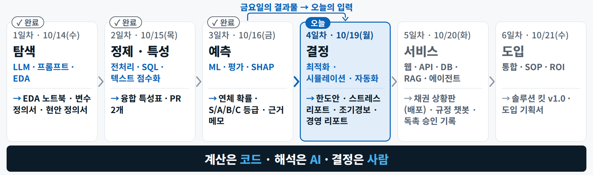{ loading=lazy }
  <figcaption>예측(3일차) → 결정(오늘) → 서비스(5일차) — 금요일의 결과물이 오늘의 입력이고, 오늘의 한도 · 경보 · 보고가 5일차 대시보드와 에이전트의 재료가 됩니다</figcaption>
</figure>

| 장 | 제목 | 교시 | 오늘의 질문 | 오후에 직접 해 보는 곳 |
|---|---|---|---|---|
| [현업](#ch0) | 한도는 획일적이고, 쇼크 손실은 모르고, 경보는 늦다 | 1교시 | 오늘 푸는 문제와 숫자는 무엇인가 | 실습 A · B 전체 |
| [1](#ch1) | 의사결정 최적화 | 1교시 | 누구에게 얼마를 줄지를 어떻게 계산하나 | [실습 A 02–04](lab-a.md#a-model) |
| [2](#ch2) | 시뮬레이션 | 2교시 | 최악에 얼마를 잃나 — 평균이 아닌 분포로 | [실습 A 05](lab-a.md#a-stress) |
| [3](#ch3) | 조기경보 설계 | 2교시 | 무엇을 · 누가 · 언제까지 — 규칙 · 모델 · 사람 | [실습 B 01](lab-b.md#b-engine) · 확장 |
| [4](#ch4) | 자동화 | 3교시 | 사람이 누르지 않아도 제때 도는 장치 | [실습 B 02](lab-b.md#b-auto) |
| [5](#ch5) | 문서·보고 자동화 | 3교시 | AI 초안을 믿어도 되나 — 숫자 추적 · 레드팀 · 서명 | [실습 B 03–05](lab-b.md#b-card) |
| [8교시](#ch6) | 정리 | 8교시 | 아침에 건 예약은 돌았나 · 엑셀 안의 AI | [실습 B 확장](lab-b.md#more) |

**오늘 만들 것 — 한도 · 경보 · 보고서 한 벌.** 바이어 150곳 × 기준일 2026-09-30의 한도안과 스트레스 표, 내 규칙을 더한 경보가 저절로 도는 워크플로와 자동 이슈, 독자에 맞춘 보고 파일 한 장. 학습의 정답을 알려 주는 열이나 숫자는 없고, 모든 입력은 가상 데이터입니다.

## 오늘의 용어 {#terms}

슬라이드에서 한 장으로 설명한 용어(**용어 장**)와 설명 중에 나오는 용어(**본문**)입니다. 전체 목록은 [용어집 → 4일차](../glossary.md#day4)에 있습니다.

| 용어 | 한 줄 정의 | 어디서 |
|---|---|---|
| **기대손실(EL)** | 평균적으로 잃을 것으로 예상하는 금액 = 부도확률 × 손실률 × 노출액 | [현업](#ch0-el) |
| **여신 한도 · 허용 여신 총액** | 바이어 한 곳에 허용하는 최대 외상 잔액 / 회사 전체가 감당할 외상의 상한 | [현업](#ch0-limit) |
| **수학적 최적화** | 제약을 지키면서 목적을 가장 좋게 만드는 결정값을 찾는 방법 — 결정변수 · 목적함수 · 제약 | [1장](#ch1-parts) |
| **LP · MIP** | 변수가 연속이고 식이 일차식인 최적화 / 0·1·정수 변수가 섞인 최적화 | [1장](#ch1-lpmip) |
| **모델 언어 · 솔버 · 판 고정** | 문제를 '쓰는' 도구(PuLP) · '푸는' 엔진(CBC · HiGHS) · 같은 답이 다시 나오게 버전을 못 박는 일 | [1장](#ch1-tools) |
| **잠재가격 · 감소비용** | 제약 1단위를 풀 때 목적함수가 느는 양 / 0인 변수가 해에 들어오려면 필요한 계수 개선폭 | [1장](#ch1-shadow) |
| **모델링 코파일럿** | 업무 문장을 식으로 옮기는 일을 LLM이 돕는 방식 — 계산은 솔버가 · 확인은 테스트가 | [1장](#ch1-copilot) |
| **속성 테스트 · 기대값 테스트 · 교차검증** | 어떤 답이든 지킬 규칙 / 이 데이터에서 나와야 할 답 / 솔버 둘의 목적함수 비교 | [1장](#ch1-trust) |
| **몬테카를로 시뮬레이션** | 난수로 가능한 미래를 수천 번 만들어 결과의 분포를 얻는 방법 | [2장](#ch2-mc) |
| **시드 · 재현성** | 난수 생성기를 고정해 같은 입력이면 같은 결과가 나오게 하는 일 | [2장](#ch2-mc) |
| **VaR · 기대부족액(ES)** | 100번 중 99번은 넘지 않는 손실(P99) / 그 선을 넘은 손실들의 평균 | [2장](#ch2-var) |
| **시나리오 분석 · 민감도 분석 · 스트레스 테스트** | 가정을 묶어 바꿈 / 하나만 바꿈 / 극단 시나리오에서 손실을 점검 | [2장](#ch2-scen) |
| **상관(ρ)** | 경기 · 환율 같은 공통 충격이 여러 바이어를 함께 움직이는 정도 | [2장](#ch2-rho) |
| **회수 단계 · 연속수출 면책** | D-3에서 D+30까지 말투 · 채널 · 담당이 바뀌는 사다리 / 30일 이상 못 받은 바이어에게 또 선적하면 그 선적분은 보상받기 어렵다는 보험 조항의 개념 | [3장](#ch3-ladder) |
| **규칙 경보 · 모델 경보** | 사람이 정한 조건 / 데이터로 배운 확률 — 둘이 부딪치면 규칙이 이긴다 | [3장](#ch3-rule) |
| **경보 등급(P1–P4)** | 긴급도에 따라 응답 시간 · 조치 · 담당을 나눈 체계 | [3장](#ch3-tier) |
| **경보 정밀도 · 경보 피로** | 울린 경보 중 실제 조치가 필요했던 비율 / 너무 많이 울려 무시하게 되는 현상 | [3장](#ch3-fatigue) |
| **사람 개입(HITL) · 감사 추적** | 경보를 사람이 확인해 승인하는 흐름 / 누가 · 언제 · 무엇을 · 왜를 지울 수 없게 남긴 기록 | [3장](#ch3-hitl) |
| **트리거 · cron** | 프로그램을 언제 돌릴지 정하는 방아쇠(한 번 · 주기 · 조건 · 상시) / 분 · 시 · 일 · 월 · 요일 다섯 칸으로 적는 시각 | [4장](#ch4-trigger) |
| **웹훅** | 일이 생긴 쪽이 정해진 주소로 JSON을 보내 주는 '거꾸로 부르는 API' | [4장](#ch4-webhook) |
| **멱등성 · 로그** | 여러 번 실행해도 한 번과 같은 성질 / 언제 · 무엇을 · 어떤 결과로 했는지의 기록 | [4장](#ch4-idem) |
| **템플릿 · 구조화 출력** | 모양과 숫자를 고정하는 틀 / LLM의 출력을 정해진 칸의 JSON으로 받는 방식 | [5장](#ch5-template) |
| **레드팀 · 숫자 추적** | 다른 AI가 허점을 찾는 검토 / 문장 속 숫자를 입력과 기계적으로 대조 | [5장](#ch5-red) |

??? note "본문에 나오는 용어"
    | 용어 | 한 줄 정의 |
    |---|---|
    | PD · LGD · EAD | 부도확률(연) / 부도 시 손실률 / 부도 시 노출액 — 오늘 등급별 연 PD는 S 0.5 · A 1.5 · B 4 · C 10%[교육용 가정] |
    | 보상비율 · 면책 위험 | 보험에 들면 손실의 95%를 보상(그래도 0은 아니다 — 연속수출 · 통지 태만 면책) |
    | 할인율 · 2/10 net 30 | 나중에 받을 돈을 오늘 가치로 바꾸는 비율 = 돈의 값 + 위험의 값 / 10일 안에 내면 2% 깎아 주는 조건 — 연 36.7%짜리 돈 |
    | 가능 영역 · 꼭짓점 · 심플렉스 | 모든 제약을 지키는 한도 조합 / 선형계획의 답이 있는 모서리 / 꼭짓점을 따라 걸으며 더 좋은 쪽으로 옮겨 가는 알고리즘 |
    | 분지한계법 · 최적성 격차 | 정수 문제를 가지를 나눠 풀되 격차가 충분히 작으면 멈추는 방법 |
    | 확률변수 · 분포 · 두꺼운 꼬리 | 결과가 확률로 정해지는 값 / 결과를 쌓은 히스토그램 / 극단이 정규분포 예상보다 자주 오는 모양 |
    | 1-요인 모델 | 모두가 나눠 받는 충격 z(비중 ρ)와 바이어별 충격 e로 상관을 흉내 내는 모델 |
    | 방아쇠 schedule · workflow_dispatch | 정해진 시각(UTC) 실행 / Actions 화면의 'Run workflow' 수동 버튼 |
    | 아티팩트 · Secrets | 실행 결과 파일을 보관하는 곳 / 비밀번호 · 웹훅 주소를 두는 저장소의 금고 |
    | 프롬프트 체이닝 | 한 번에 쓰지 않고 단계마다 검사 관문을 두는 흐름(경로를 사람이 미리 정한다) |
    | 고장 보고 4요소 | 넣은 것 · 기대한 결과 · 실제 결과 · 재현 절차 |
    | worktree | 같은 저장소에 작업 폴더를 하나 더 펼친 것 — 정책 실험을 나란히 돌린다 |

---

## 현업 문제 — 한도는 획일적이고, 쇼크 손실은 모르고, 경보는 늦다 {#ch0}

**핵심** — 세 문제 모두 **손으로 하던 계산과 확인은 코드에 맡기고, 결정은 사람이** 합니다.

### 오늘 풀 세 가지 {#ch0-three}

| 문제 | 상황 | 오늘의 방법 |
|---|---|---|
| **한도가 획일적이다** | 바이어 위험은 다 다른데 한도는 일률적 — 위험한 곳은 과다 노출, 좋은 곳은 기회 손실 | **최적화**(시연 1 · 실습 A) |
| **쇼크 손실을 모른다** | 금리 · 환율이 흔들릴 때 보유 채권에서 얼마를 잃을지 숫자가 없다 | **시뮬레이션**(시연 2 · 실습 A 05) |
| **경보는 늦고 보고는 반나절** | 기준을 넘어도 사람이 엑셀을 열어야 보이고, 경영진 보고서 한 장에 반나절 | **메일 판독 · 경보 자동화 · 리포트 파이프라인**(시연 3–5 · 실습 B) |

### 오늘의 입력 — 3일차의 등급 {#ch0-input}

한빛정밀(가상)의 2026-09-30 기준 데이터입니다. 바이어 **150곳**(S 127 · A 2 · B 3 · C 18), 미결 채권 **약 429만 달러**(원화 약 58억 원 · 바이어 원장 기준), 무역보험 부보 비중 **68%**, 파산 · 회생 · 장기 미회수 같은 **신용사건 11곳**(오늘 손실 계산에서 부도확률 100%). 등급이 S에 쏠려 있어 **등급표만으로는 한도를 가를 수 없습니다** — 결제기간 · 보험 · 할인율을 담은 바이어별 계수로 최적화합니다. 같은 미결 채권도 파일에 따라 숫자가 달라지니(인보이스 300건 합 약 427.5만 달러) 보고서에는 **기준을 함께** 적습니다.

### 기대손실(EL) {#ch0-el}

<figure markdown="span">
  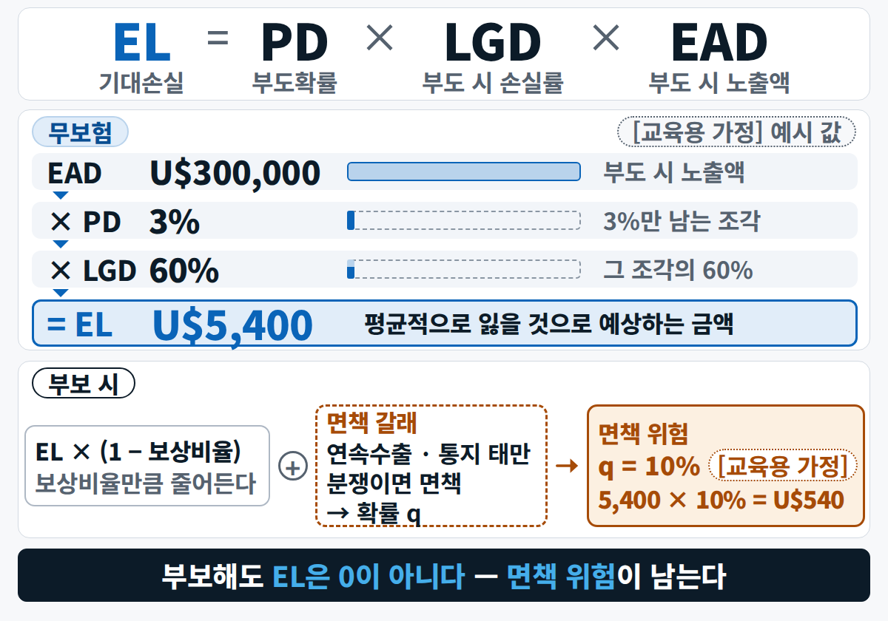{ width="560" loading=lazy }
  <figcaption>30만 달러 채권에 연 부도확률 3% · 손실률 60%면 연 기대손실은 5,400달러 — 보험에 들어도 면책 위험은 남습니다</figcaption>
</figure>

- 3일차의 `pd_30d`는 **30일 안에 연체할 확률**이고, 여기서 쓰는 PD는 **1년 안에 부도날 확률**이라 같은 숫자가 아닙니다 → 등급별 연 PD를 [교육용 가정]으로 바꿔 씁니다.
- 보험에 들면 보상비율 95%만큼 줄지만 0이 되지는 않습니다 — 연속수출 · 통지 태만이면 보험금을 못 받는 면책 위험이 남습니다. **보험에 든 채권의 기대손실을 0으로 보지 않습니다.**

### 한도는 바이어별, 총액은 회사 체력 {#ch0-limit}

| | 여신(외상) 한도 | 허용 여신 총액 |
|---|---|---|
| 뜻 | 바이어 한 곳에 허용하는 최대 외상 잔액 | 회사 전체가 감당할 외상의 상한 |
| 식 | **L = MIN(필요한도, 등급 상한, 인수한도 + 자기부담)** | 오늘은 상한 합 × **70%**(약 260만 달러) |
| 재료 | 필요한도 = 월매출 × (결제기간 + 15일) ÷ 30 · 등급 상한 S 필요한도 · A 20만 · B 10만 · C 0 | EL 예산 = 자기자본 × 3% · 국가 캡(총액 × 20 · 12 · 6 · 3%) |

총액을 일부러 상한 합보다 작게 잡았기 때문에 **바이어끼리 한도를 나눠 가져야** 합니다 — 누구에게 얼마를 줄지가 최적화 문제입니다. 숫자에는 두 종류가 있습니다: 약관 · 규정에서 온 숫자와, 회사가 정하는 **정책 숫자(가정)**.

### 할인율 = 돈의 값 + 위험의 값 {#ch0-discount}

<figure markdown="span">
  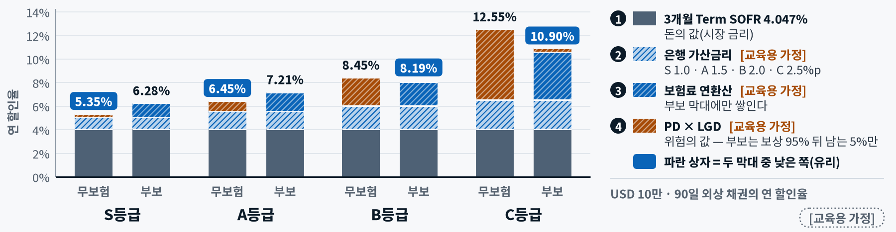{ loading=lazy }
  <figcaption>S등급은 무보험이 더 싸고(5.35% 대 6.28%), C등급은 부보가 더 쌉니다(10.90% 대 12.55%) — 좋은 등급은 위험층이 얇아 보험료가 더 비쌉니다</figcaption>
</figure>

한도 1달러의 연 가치(목적함수 계수) = **사용률 × (매출총이익률 × 365 ÷ 결제기간 − 할인율)**. 결제기간이 길거나 할인율이 높은 바이어는 같은 한도라도 가치가 낮습니다. 바이어가 "10일 안에 주면 2% 깎아 달라"(2/10 net 30)고 하면 그건 **연 36.7%짜리 돈**입니다 — 할인율도 우리가 고를 수 있는 손잡이입니다(실험 카드 ⑨).

---

## 1장 · 의사결정 최적화 {#ch1}

**핵심** — 업무 문장을 **결정변수 · 목적함수 · 제약** 세 부품으로 쓰면 컴퓨터가 최적을 계산합니다. LLM은 그 번역을 돕고, **계산은 솔버가 · 확인은 테스트가** 합니다.

### 데이터 분석 네 단계, 오늘은 '처방' {#ch1-stages}

무슨 일이 있었나(기술) → 왜 그랬나(진단) → 무엇이 될까(예측) → **그래서 무엇을 할까(처방)**. 3일차까지 예측에 왔고, 오늘 첫 장은 마지막 단계 — '가장 좋은 결정'을 계산하는 수학적 최적화입니다.

### 최적화의 세 부품 {#ch1-parts}

<figure markdown="span">
  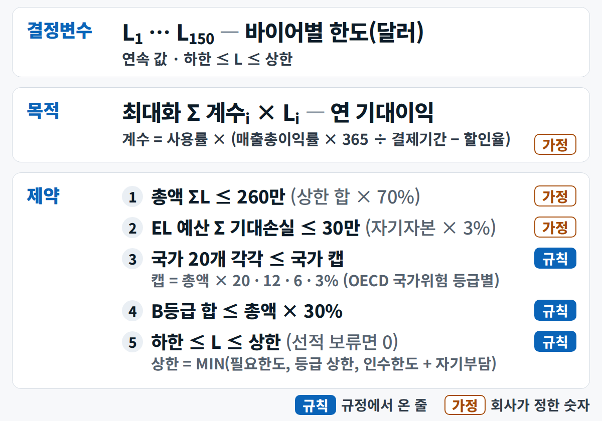{ width="560" loading=lazy }
  <figcaption>오늘 모델 전체 — 파란 '규칙' 꼬리표는 규정에서 온 줄, 주황 '가정' 꼬리표는 회사가 정한 숫자입니다. 가정 줄을 바꾸면 답이 바뀝니다(오후 정책 실험)</figcaption>
</figure>

- **결정변수** — 우리가 정할 값: 바이어 150곳 각각의 한도 `L`.
- **목적함수** — 키울 값: 연 기대이익 = Σ 계수 × `L`.
- **제약** — 넘으면 안 되는 선: 총액 · 기대손실 예산 · 국가별 캡 · B등급 비중 · 바이어별 상한과 하한.
- 흔한 오해는 'AI가 알아서 최적을 찾아 준다'입니다. **목적과 제약을 사람이 정하지 않으면 '최적'이라는 말에 뜻이 없습니다.**

### 답은 꼭짓점에 있다 {#ch1-vertex}

<figure markdown="span">
  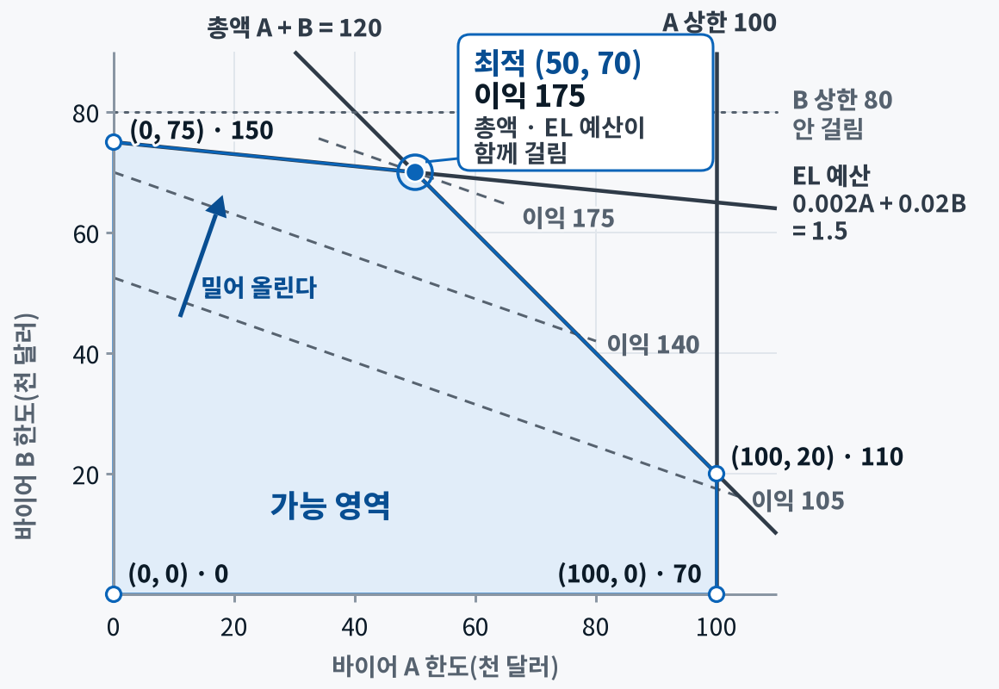{ width="520" loading=lazy }
  <figcaption>제약은 선이 되고, 모든 제약을 지키는 영역이 음영입니다. 등이익선을 밀어 마지막에 닿는 점이 최적 꼭짓점 — 총액과 EL 예산이 함께 걸립니다</figcaption>
</figure>

바이어를 두 곳으로 줄인 장난감 모델입니다(단위 천 달러). 총액 A + B ≤ 120, 상한 A 100 · B 80, EL 0.002A + 0.02B ≤ 1.5. 선형계획의 답은 늘 **꼭짓점**에 있어서 실제 150곳 모델에서도 대부분의 바이어가 '상한까지 채우거나 0'이 됩니다(상한이 있는 96곳 중 상한까지 64곳 · 0에 27~28곳 · 하한에 2~3곳). 현업 눈에는 극단적으로 보이는 이 해 때문에 **하한과 사람 검토**가 필요합니다.

### LP와 MIP — 연속인가, 정수인가 {#ch1-lpmip}

| | LP 선형계획 | MIP 혼합정수계획 |
|---|---|---|
| 변수 | 연속, 식은 모두 1차식 | 0·1·정수가 섞임 |
| 성질 | 큰 문제도 빠르고, **전역 최적 보장**, 잠재가격 · 민감도를 함께 준다 | 분지한계법 — 변수가 늘면 시간이 급증, **최적성 격차**를 보고 멈춘다 |
| 예 | 바이어별 한도 배분(오늘) | 이번 주 집중 회수할 바이어 고르기 · 조기결제 할인 제안(실험 카드 ⑧ ⑨) · '최소 5만 달러' 규칙 |

`IF`나 `MIN` 같은 판단은 **상한 · 하한 · 계수 열로 미리 계산**해 두면 모델이 LP로 남습니다.

### 모델 언어와 솔버는 다르다 {#ch1-tools}

| 도구 | 종류 | 잘하는 일 | 오늘 |
|---|---|---|---|
| **PuLP** | 파이썬 모델 언어 | LP · MIP를 읽기 쉬운 식으로 | 시연 · 실습 |
| **CBC** | 오픈소스 솔버 | PuLP 3.x의 기본 엔진 | 기본값 |
| **HiGHS** | 오픈소스 솔버(MIT) | LP · MIP, SciPy `linprog`의 기본 | 교차검증 |
| 엑셀 해 찾기 | 스프레드시트 솔버 | 단순 LP, 변수 200개까지 | 시연 6 · 선택 경로 |
| OR-Tools · Gurobi · CPLEX | 구글 도구 · 상용 솔버 | 일정 · 경로 · 대형 MIP | 참고 |

모델 언어는 문제를 **쓰는** 말이고 솔버는 **푸는** 엔진입니다(엑셀 해 찾기도 같은 구조 — 시트가 모델 언어). **같은 답이 다시 나오려면 판을 고정합니다** — PuLP 4.0(9월 25일)은 변수를 만드는 법과 솔버를 부르는 법이 바뀌었고 CBC도 기본으로 들어 있지 않아, 이 저장소는 `pulp==3.3.2`로 못 박았습니다. AI가 4.0 문법을 섞어 써서 코드가 깨지면 직접 고치려 하지 말고 **오류 전문을 그대로 AI에게 다시** 붙입니다.

```python
import pulp
ub   = {"A": 100, "B": 80, "C": 60}         # 바이어별 상한(천 달러)
coef = {"A": 0.7, "B": 2.0, "C": 1.0}       # 한도 1달러당 연 기대이익
elr  = {"A": 0.002, "B": 0.02, "C": 0.005}  # 한도 1달러당 기대손실
m = pulp.LpProblem("limit", pulp.LpMaximize)
L = {b: pulp.LpVariable(f"L_{b}", 0, ub[b]) for b in ub}         # 결정변수
m += pulp.lpSum(coef[b] * L[b] for b in L)                       # 목적함수
m += pulp.lpSum(L.values()) <= 150, "total_cap"                  # 제약: 총액
m += pulp.lpSum(elr[b] * L[b] for b in L) <= 2.0, "el_budget"    # 제약: EL 예산
m.solve(pulp.PULP_CBC_CMD(msg=False))
print({b: L[b].value() for b in L}, pulp.value(m.objective))
print({n: c.pi for n, c in m.constraints.items()})
# → {'A': 10.0, 'B': 80.0, 'C': 60.0} 227.0  /  {'total_cap': 0.7, 'el_budget': -0.0}
```

세 부품을 코드에서 찾아봅니다 — `LpVariable`이 결정변수, 7번째 줄이 목적함수, 8·9번째 줄이 제약. 숫자는 위 세 줄의 사전에만 있고 식에는 이름만 있습니다(정책 숫자를 식에 박아 넣지 않는 습관). 마지막 줄의 `.pi`가 잠재가격 — 총액 제약이 0.7인 것은 마지막으로 한도를 받은 한계 바이어 A의 계수와 같습니다. EL 예산은 2.0 중 1.92만 써서 걸리지 않으니 잠재가격 0입니다(`-0.0`은 소수 표기일 뿐 0과 같습니다).

### 잠재가격 — 제약 1단위의 값 {#ch1-shadow}

| | 잠재가격 | 감소비용 |
|---|---|---|
| 뜻 | 제약을 1단위 풀 때 목적함수가 느는 양 | 0인 변수가 해에 들어오려면 필요한 계수 개선폭 |
| 오늘 | 총액 **0.6723**(총액 1달러 → 연 이익 0.67달러) · 나이지리아 국가 캡 **1.3959** · EL 예산 0(안 걸림) | 90일 결제 · 부보 S등급 19곳은 계수가 0.0065 모자라 한도 0 |
| 경영 질문 | "총액을 늘리면 얼마나 좋아지나?" | "결제기간 · 부보를 바꾸면 한도가 생기나?" |

총액 +30만 달러는 어림으로 +20만 달러, 실제로 다시 풀면 +202,745달러입니다(실제가 조금 큰 것은 국가 캡도 총액에 비례해 함께 늘기 때문 — **크게 바꿀 때는 다시 풀어 확인**). 총액을 늘릴지는 잠재가격(한계 이익)과 자본 · 위험(한계 비용)을 견줘 **사람이** 정합니다. 오후 실습 A 04에서 정책을 바꿔 다시 풀며 이 숫자를 직접 확인합니다.

### LLM은 모델링 코파일럿 {#ch1-copilot}

정책 문장(예: 'C등급은 선수금이나 L/C만') → **LLM 초안**(변수 · 목적 · 제약 표와 모호한 곳 질문) → **사람 확인**(뜻과 가정 숫자를 답한다) → **솔버 계산** → **테스트**(속성 · 기대값 · 솔버 교차검증) → **해석 · 결정**(LLM은 쉬운 말로, 결정은 사람). 가장 어려운 일은 계산이 아니라 **업무 문장을 식으로 옮기는 일**이고 거기서 LLM이 강합니다. 한 문장으로: **LLM은 번역가, 솔버는 계산기, 테스트는 감사인.**

반대로 채팅창에 150곳 파일을 올리고 "최적 한도 알려 줘"라고 하면 그럴듯한 표가 나오지만, 최적인지 · 제약을 지켰는지 보장이 없고 다시 물으면 숫자가 바뀝니다. 오늘 시연과 실습은 모두 **'모델을 코드로 써 줘'** 방식입니다.

### 최적화 결과를 믿기 전 다섯 가지 {#ch1-trust}

1. **상태** — 솔버 상태가 Optimal인가(해 없음 · 무한 아님).
2. **속성 테스트** — 상하한 · 총액 · 국가 캡 · EL 예산을 모든 바이어에서 지켰나.
3. **기대값 테스트** — 목적함수 · 걸린 제약이 기대 범위 안인가.
4. **교차검증** — 솔버 두 개(CBC · HiGHS)의 목적함수 차이 < 0.01%. 바이어별 한도는 동점 바이어를 나누는 방식에 따라 최대 12만 달러까지 다를 수 있어, **비교는 목적함수 · 걸린 제약으로**.
5. **모서리 해** — 한도 0이나 상한에 붙은 바이어는 현업이 한 번 더 보고, 지금보다 30% 이상 깎이는 곳은 **사람이 승인**.

테스트가 실패하면 **고장 보고 4요소**(넣은 것 · 기대한 결과 · 실제 결과 · 재현 절차)로 적어 AI에게 다시 줍니다. 데이터 연동 오류도 테스트가 먼저 잡습니다 — 파일에 4.047로 적힌 금리를 0.04047로 바꾸지 않고 곱하면 할인율이 404.7%가 됩니다. 단, 이런 **단위 오류는 규칙을 지키는 '틀린 답'을 만들어** 속성 테스트를 통과하기도 합니다 — 그래서 기대값 테스트와 목적함수의 부호 · 크기 점검이 따로 필요합니다(실습 A의 버그 카드).

### 시연 1 · 규정 문장에서 한도 엔진까지 {#ch1-demo}

<div class="tf-flow" markdown>
<div markdown><b>상황</b> 규정 · 정책 숫자는 문서에, 한도는 엑셀 수작업 — 규정 한 줄이 바뀌면 재계산에 며칠, '왜 이 한도인지'도 못 댄다</div>
<span>→</span>
<div markdown><b>입력</b> 여신관리규정(MD) · CSV 3종 · 설계 1쪽 · 테스트 — Claude Code **Plan 모드**</div>
<span>→</span>
<div markdown><b>결과</b> 한도안 통합문서(한도 · 제약 · 잠재가격) · 모델 카드 · 테스트 로그 · 커밋</div>
</div>

<figure markdown="span">
  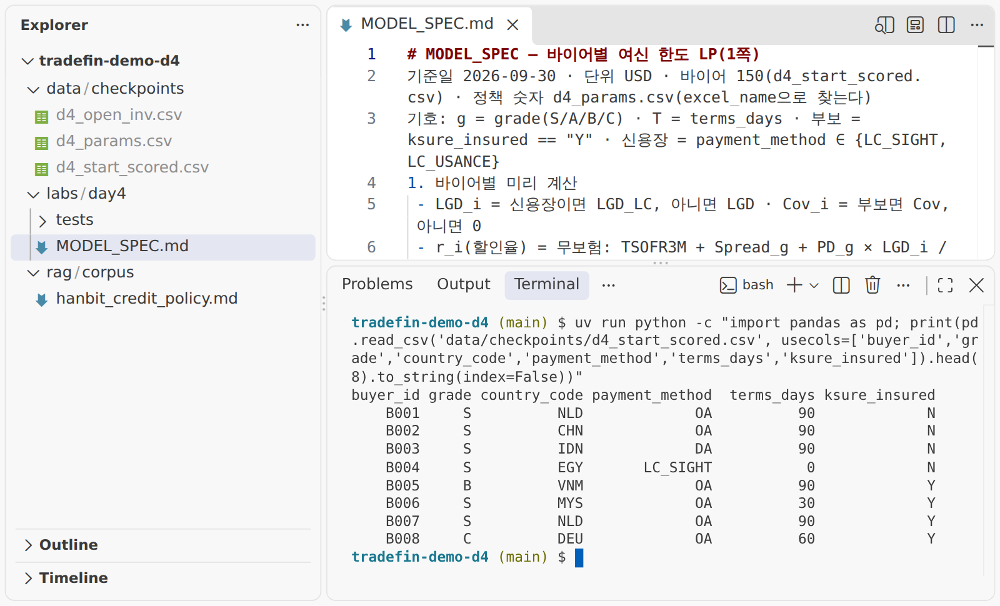{ loading=lazy }
  <figcaption>입력 — 설계 1쪽(MODEL_SPEC.md) · CSV 3종 · 규정을 VS Code에서 연 모습</figcaption>
</figure>

<figure class="result" markdown="span">
  { loading=lazy }
  <figcaption>결과 — 테스트 통과 · 두 솔버의 목적함수(약 3,135,799달러) · constraints 시트의 걸린 제약 2줄(총액 0.6723 · 나이지리아 국가 캡 1.3959)</figcaption>
</figure>

**진행** 변수 · 목적 · 제약 표와 질문 3개 → 사람의 답 → 코드 → pytest 통과 → 솔버 두 개로 교차검증.

**배운 점** Claude Code는 코드 전에 **규정과 설계가 어긋나는 곳**(승인 기준 · 선적 보류 일수 · EL 식)을 질문으로 올렸고, 사람이 답한 뒤 테스트 13개가 첫 실행에 통과했습니다. '사람 승인 필요' 표시가 붙은 바이어(30% 이상 감액)와 한도가 0인 바이어는 **모델이 제안하고 사람이 정합니다.**

<small>오후: [실습 A 02–03](lab-a.md#a-model) — 설계 1쪽 · 답안 카드 · 속성 테스트로 줄인 판</small>

---

## 2장 · 시뮬레이션 {#ch2}

**핵심** — 손실을 숫자 하나가 아니라 **분포**로 보고, **평균과 '100번에 한 번'** 두 숫자로 답합니다. 출발점은 머릿속 가정이 아니라 **실제로 일어난 경로**입니다.

### 석 달 만에 원/달러 −12% {#ch2-fx}

원/달러가 6월 9일 1,529.94원에서 9월 10일 1,345.63원으로 석 달 만에 **12% 떨어졌습니다**. 원화가 강해지면 달러로 받을 채권의 원화 가치가 줄어, 한빛정밀의 달러 채권 313.7만 달러 기준 **5.78억 원**이 사라진 셈입니다. 지난 3년의 석 달(63영업일) 변화율 하위 1%가 −11.4%이니 이번 움직임은 꼬리 끝에 있고, 3일차 백테스트의 95% 구간(넉 달 앞 반폭 ±6.6–8.6%)은 이 움직임을 담지 못했습니다 — **평소 변동으로 그린 구간은 꼬리를 얇게 봅니다.** 심각 시나리오의 바이어국 통화 충격 −45%는 2018년 터키 · 2022년 스리랑카에서 실제 있었던 크기입니다.

### 몬테카를로 — 내년을 1만 번 살아 보기 {#ch2-mc}

<figure markdown="span">
  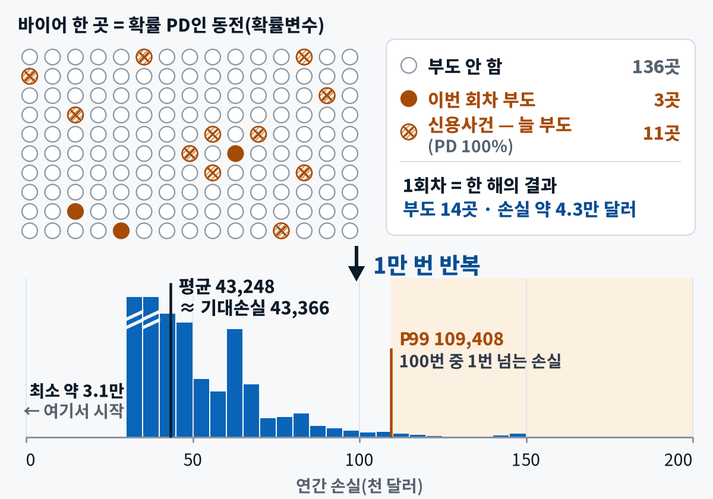{ width="560" loading=lazy }
  <figcaption>바이어 한 곳의 부도 = 확률 PD인 동전. 150개를 던지면 한 해의 손실, 1만 번이면 분포 — 기대손실은 그 평균 한 점일 뿐, '최악'은 오른쪽 꼬리에 있습니다</figcaption>
</figure>

- 난수 `u < PD`면 부도 → 손실 = 노출 × 손실률 × (1 − 보상비율) → 150곳을 더해 한 해의 손실 → 1만 번. 히스토그램이 0이 아니라 약 3만 달러에서 시작하는 것은 이미 신용사건이 난 11곳이 매번 손실로 잡히기 때문입니다.
- **시드를 고정**하면 같은 1만 개의 미래가 다시 나옵니다(`np.random.default_rng(42)`). 숫자를 보고서에 쓰려면 이 **재현성**이 먼저입니다.
- 첫 검산: **시뮬레이션 평균이 공식 기대손실의 ±3% 안**인가 — 어긋나면 꼬리를 해석하기 전에 코드부터 의심합니다. 난수를 뽑는 방식이 다르면 P95 · P99는 ±3% 안팎으로 달라집니다.

```python
import numpy as np
rng = np.random.default_rng(42)               # 시드 고정 = 재현 가능
p = np.minimum(1, pd_eff * pd_mult)           # 시나리오 부도확률(바이어 150곳)
loss_if = ead * lgd * (1 - cover)             # 부도 시 손실(보험 보상 뺀 몫)
u = rng.random((10_000, len(p)))              # 1만 회 × 150곳 난수
loss = ((u < p) * loss_if).sum(axis=1)        # 회차별 총손실
print(loss.mean(), np.percentile(loss, [95, 99]))
# S3 → 평균 ≈ 6.2만 · P95 ≈ 11.3만 · P99 ≈ 16.1만(달러)
```

### VaR와 기대부족액 {#ch2-var}

<figure markdown="span">
  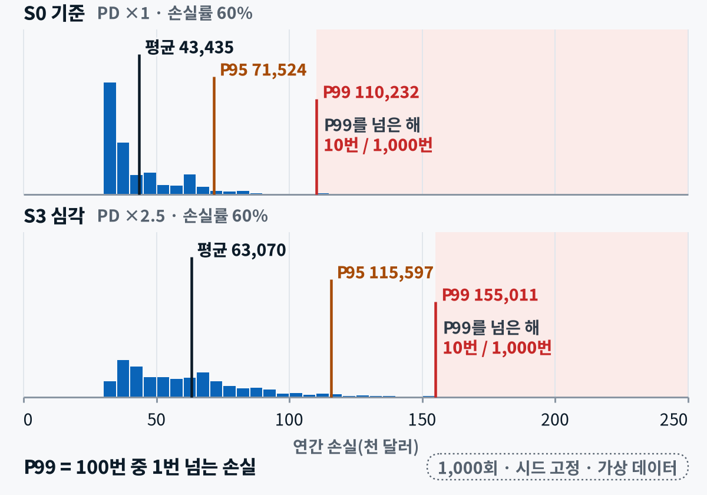{ width="560" loading=lazy }
  <figcaption>1,000회 결과 — S0 평균 43,435 · P99 110,232달러, S3 평균 63,070 · P99 155,011달러. P99를 넘은 해가 1,000번 중 10번입니다</figcaption>
</figure>

**VaR(P99)** = 100번 중 99번은 이보다 덜 잃는 선 — 경영진에게는 **평균과 이 숫자 둘**을 같이 드립니다(평균만 보고하면 꼬리를 숨깁니다). 단 VaR는 '최악'이 아닙니다 — 선을 넘었을 때 얼마나 큰지는 **기대부족액(ES)**(P99를 넘는 손실들의 평균)이 말해 줍니다(1만 회로 돌리면 S3의 ES는 약 18.6만 달러). 은행 규제도 같은 생각으로 꼬리 평균과 VaR 99% 점검을 함께 씁니다.

### 시나리오 분석과 민감도 분석, 스트레스 테스트 {#ch2-scen}

| | 시나리오 분석 · 스트레스 테스트 | 민감도 분석 |
|---|---|---|
| 방법 | 환율 · 금리 · PD · LGD를 **한 묶음**으로 바꾼다 | **가정 하나만** ± 로 움직이고 나머지는 고정 |
| 읽는 법 | 확률을 말하지 않는 '만약' — 예측이 아니다 | 영향이 큰 가정부터 위에(토네이도 차트) |
| 예 | 기준 S0 + 경미 · 중간 · 심각 · 극단 S1–S4 | PD 배수만 ×2.5 → ×3이면 손실은? |

리포트에는 **'가정 시나리오에서의 추정'**이라고 쓰고, 결과를 가장 크게 움직인 가정을 함께 적습니다.

| 시나리오 | 바이어국 통화 | 원/달러 | 금리 | PD 배수 · LGD | 기대손실(USD) |
|---|---|---|---|---|---|
| S0 기준 | 0% | 1,360 | 0 | ×1.0 · 60% | 43,366 |
| S1 경미 | −10% | 1,292 | +100bp | ×1.2 · 60% | 45,866 |
| S2 중간 | −25% | 1,550 | +250bp | ×1.5 · 60% | 49,618 |
| S3 심각 | −45% | 1,570 | +450bp | ×2.5 · 60% | 62,121 |
| S4 극단 | −70% + 송금 제한 | 1,960 | +450bp | ×4 · 80% | 107,691 |

충격의 크기는 **역사에서**(인도네시아 2025–26 −11% · 원화 2021–22 −25% · 터키 2018 · 스리랑카 2022 약 −45% · 이집트 · 나이지리아 · 아르헨티나 −70% 안팎, S4의 1,960원은 1997년 외환위기 수준) 가져오고, **PD 배수와 LGD는 교육용 가정**입니다. 기대손실 = Σ 잔액 × min(1, PD × 배수) × LGD × (1 − 보상비율), 신용사건 바이어는 PD 100% · 신용장 거래는 손실률 10%.

### 몇 번 돌려야 믿을 수 있나 {#ch2-conv}

<figure markdown="span">
  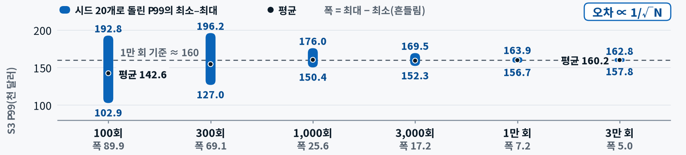{ loading=lazy }
  <figcaption>같은 모델을 시드만 바꿔 20번 돌렸을 때 S3의 P99 — 100회는 두 배 가까이 흔들리고 1만 회가 돼야 7천 달러 남짓으로 좁아집니다(오차 ∝ 1/√N)</figcaption>
</figure>

오차는 반복 수의 제곱근에 반비례해 **정확도를 열 배 높이려면 계산이 백 배** 필요합니다. 100회는 꼬리를 평균적으로도 작게 봅니다. 그래서 보고는 **'1만 회 · 시드 고정 · 시드를 바꿨을 때의 범위'**를 함께 적습니다. 시뮬레이션 숫자를 받으면 맨 먼저 물을 것은 "몇 번 돌렸나, 다시 돌리면 얼마나 변하나"입니다.

### 상관 — 바이어가 함께 무너질 때 {#ch2-rho}

<figure markdown="span">
  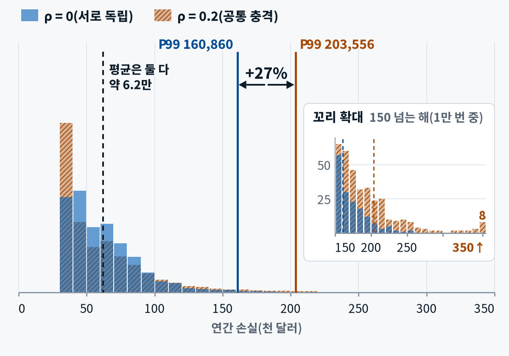{ width="560" loading=lazy }
  <figcaption>평균은 약 6.2만 달러로 그대로인데 오른쪽 꼬리만 두꺼워집니다 — ρ를 0.2만 줘도 P99가 27% 커집니다</figcaption>
</figure>

지금까지는 150곳이 서로 상관없이 따로 부도난다고 가정했습니다. 실제 위기에서는 같은 나라 · 같은 업종 바이어가 **함께** 흔들립니다. **1-요인 모델**은 '모두가 나눠 받는 경기 충격 z(비중 ρ) + 바이어별 충격 e'로 이를 흉내 냅니다. **독립 가정으로 낸 P99는 '적어도 이만큼'이라는 하한선**으로 읽습니다.

### 시연 2 · 쇼크 시뮬레이터와 웹 리포트 {#ch2-demo}

<div class="tf-flow" markdown>
<div markdown><b>상황</b> "환율이 또 흔들리면 최악에 얼마?"에 평균 하나뿐 — 3일차 95% 구간은 실제값의 29–56%만 담았다</div>
<span>→</span>
<div markdown><b>입력</b> 3일차 결과(포함률 표 · 90일 구간 CSV) · 원/달러 3년 일별 · CSV 3종 — Claude Code</div>
<span>→</span>
<div markdown><b>결과</b> 인터넷 없이 열리는 HTML 한 장(시나리오 표 · 분포 · 꼬리 그래프) · 결과 CSV · 그림 PNG · pytest 통과</div>
</div>

<figure class="result" markdown="span">
  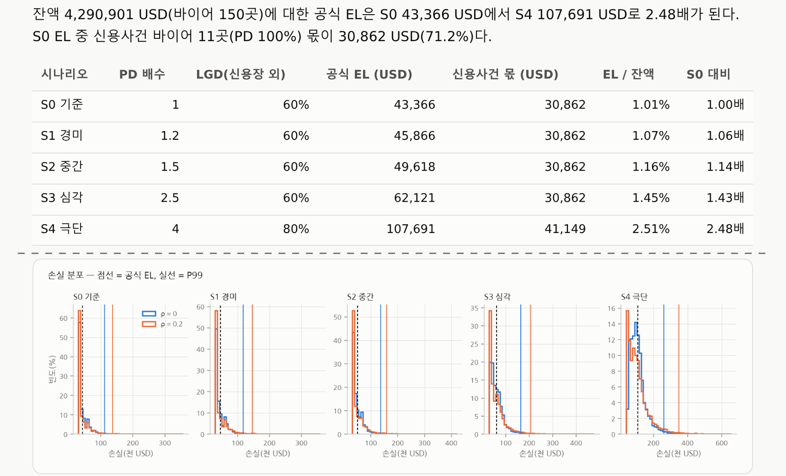{ loading=lazy }
  <figcaption>결과 — 인터넷 없이 열리는 HTML 한 장(시나리오별 공식 기대손실 표 · 손실 분포). 메일로 보낼 수 있습니다</figcaption>
</figure>

**진행** 구간 폭 대 역사적 꼬리 → 공식 기대손실 ↔ 시뮬레이션 평균 테스트 → ρ · 반복 수 → 절감액.

**배운 점** 시뮬레이션 숫자는 '몇 번 · 어떤 시드로 돌렸나 · 평균이 공식 기대손실의 ±3% 안인가'부터 확인한 뒤에 꼬리(P99 · ES99)와 상관을 해석합니다. 평균만 보고하면 꼬리를 숨깁니다.

<small>오후: [실습 A 05](lab-a.md#a-stress) — 제공 스크립트로 돌리고 내 시나리오 U1을 더해 해석</small>

---

## 3장 · 조기경보 설계 {#ch3}

**핵심** — **규칙이 후보를 올리고, 모델이 순서를 정하고, 사람이 결정**합니다. 규칙은 코드 밖 **파일**로 꺼내 다음 장의 자동 실행으로 넘깁니다.

### 회수 단계 사다리 {#ch3-ladder}

| 단계 | 하는 일 | 담당 |
|---|---|---|
| D-3 | 사전 안내 메일 — AI 초안 → 담당자 승인 | 담당자 |
| D+7 | 친절한 리마인더 — AI 초안 → 담당자 승인 | 담당자 |
| D+15 | 단호한 통지 | 영업 담당 참조 |
| D+30 | 최종 통지 · 선적 보류 검토 | 팀장 결정 |
| 결제기일 + 1개월 | 보험 사고발생통지 여부 결정 | 대표 결재 |

단계마다 **말투 · 채널 · 담당자**가 바뀝니다. 고위험 · 고액 바이어는 단계를 앞당기고 메일 대신 전화로 바꿉니다. 독촉 문안은 AI 초안을 쓸 수 있지만 **담당자가 승인한 뒤에만** 보내고, 법적 효력이 있는 최고장에는 AI 초안을 쓰지 않는 것이 가상 회사 규정입니다(**규정이 AI의 사용 범위를 정한다**).

### D+30과 연속수출 면책 {#ch3-d30}

> 결제기일부터 30일 이상 못 받은 바이어에게 또 실으면, 그 선적분은 **보상받기 어렵다.**

수출보험 약관의 '연속수출 면책' 개념입니다 — 1년을 거슬러 따지고, 보험에 들지 않은 거래도 포함하며, 신용장 거래는 예외입니다. 사고발생통지는 결제기일부터 1개월 안에 하고 **통지 여부는 사람이 결정**합니다(조항마다 조건이 다르니 일반화하지 않고, 약관 원문은 담당 부서와 확인합니다). 놀라운 점은 오늘 선적 보류 대상 19곳 중 **9곳을 3일차 모델이 가장 안전한 S등급**으로 봤다는 것입니다 — 6곳은 연체 없이 파산 · 회생 같은 신용사건만으로, 3곳(B044 · B075 · B083)은 오래된 연체로 걸렸습니다(그중 B044 · B083은 신용사건도 함께).

### 규칙 경보와 모델 경보 {#ch3-rule}

| | 규칙 기반 | 모델 기반 |
|---|---|---|
| 강점 | 설명 · 감사가 쉽다 — 약관 · 규정 문장과 일치 | 연체 **전에** 확률로 먼저 울리고, 상위 요인(SHAP)으로 이유를 붙인다 |
| 약점 | 연체가 난 **뒤에** 울린다 · 규칙에 없는 새 유형은 못 잡는다 | 시간이 지나면 성능이 변한다(드리프트) |
| 오늘 | 경계값(`>=` · `>`)을 파일에 적어 고정 | 임계값 t = 0.1698 — 놓친 연체 1건 = 헛경보 5건 |

답은 **결합**입니다 — 반드시 울려야 하는 것은 규칙으로, 순서와 이유는 모델로 정하고, **둘이 부딪치면 규칙이 이깁니다**(B044 · B075 · B083: 모델 S등급 → 선적 보류).

### 경보 등급 P1–P4 {#ch3-tier}

| 등급 | 신호 | 응답 | 담당 |
|---|---|---|---|
| **P1 긴급** | 파산 · 회생 인지, 사기 신호(계좌 변경 요청) | 즉시 — 선적 중단 · 콜백 확인 | 팀장 · 대표 |
| **P2 경고** | D+30 · 보험 통지 기한 10일 이내 · 경과 | 당일 — 선적 보류 · 통지 결정 | 채권관리팀장 |
| **P3 주의** | 한도 사용률 80% 이상 · 결제조건 변경 | 주간 — 사전 승인 · 서면 통지 | 담당자 |
| **P4 관찰** | `pd_30d` ≥ t · 뉴스 위험 ≥ 7 | 월간 — 등급 재평가 | 담당자 |

등급은 '얼마나 위험한가'보다 **'누가 언제까지 무엇을 하나'**를 정합니다. 5일차 대시보드가 같은 등급표를 그대로 씁니다.

### 시연 3 · 계좌 변경 메일을 먼저 읽는다 {#ch3-demo}

<div class="tf-flow" markdown>
<div markdown><b>상황</b> 송금 무역사기의 대부분이 메일 해킹 · 계좌 변경 — 바쁜 날 사람이 놓친다. 이런 신호는 원장에 남지 않는다(오늘 원장은 0건)</div>
<span>→</span>
<div markdown><b>입력</b> 메일 4통(.eml) · 바이어 연락처 · 사기 신호 점수표(13개) — Claude Code</div>
<span>→</span>
<div markdown><b>결과</b> 위험 점수 JSON · 콜백 목록(사람 승인 전) — 메일 02 · 03은 **멈춤(P1)**, 04는 **확인(P3)**, 01은 **기록**(점수표 기준)</div>
</div>

**진행** **헤더는 코드**(도메인 · 회신 주소) · **본문은 LLM**(신호와 근거 문장) · **합산은 코드**(멈춤 · 확인 · 기록).

**배운 점** LLM이 근거 문장을 다르게 골라도 **상태는 같아야** 합니다 — 다르면 그 자체가 정밀도 토론거리입니다. 콜백은 메일에 적힌 번호가 아니라 **등록된 번호로, 두 사람이, 확인 전에는 송금 · 서류 인도 금지**.

<small>오후: [실습 B 확장](lab-b.md#more) — 의심 메일 한 통을 두 AI로 판독</small>

### 경보 정밀도와 경보 피로 {#ch3-fatigue}

| | 경보 정밀도 | 경보 피로 |
|---|---|---|
| 뜻 | 울린 경보 중 실제 조치가 필요했던 비율(재현율 — 진짜 위험 중 울린 비율 — 과 당기는 관계) | 너무 많이 울려 결국 무시하게 되는 현상 |
| 숫자 | 부도율 2%에 민감도 99% · 특이도 91% 경보 → 울린 것 중 **18%만 진짜**(기저율 함정) | 대책: 등급화 · 하루 1회 요약 · 중복 제거 · 억제 기간 |

정밀도를 재려면 경보마다 **'확인 결과'를 기록**해 주 단위로 집계해야 하고, 정밀도가 떨어지면 임계값 · 규칙을 **PR로** 고칩니다.

<figure markdown="span">
  { loading=lazy }
  <figcaption>단계 경보는 인보이스 단위, 선적 보류는 바이어 단위 — 곳과 건은 더하지 않습니다. 선적 보류 19곳 = D+30 연체 13곳 ∪ 신용사건 11곳(겹침 5)</figcaption>
</figure>

### 사람이 고리 안에 {#ch3-hitl}

**신호 감지**(규칙 · 모델 · 메일 판독) → **후보 등록**(등급 · 기한 · 중복 제거) → **AI 사유**(상위 요인 → 한 줄 설명) → **담당자 결정**(확인 · 승인 · 반려 사유) → **조치**(승인된 권고만) → **감사 추적**(누가 · 언제 · 무엇을 · 왜). 시스템 알림만 보고 바이어에게 바로 연락하지 않습니다. Claude Code의 권한 모드도 같은 설계 — 무엇은 묻지 않고 하게 두고 어디서 사람이 승인할지를 정하는 일입니다.

### 경보 규칙은 코드 밖, 파일로 {#ch3-rules-file}

```yaml
stages: {D-3: [-3, -1], D+7: [7, 14], D+15: [15, 29], D+30: [30, null]}
rules:
  - id: R-D30-HOLD
    tier: P2
    when: "dpd >= 30 and payment_method not in ['LC_SIGHT', 'LC_USANCE', 'TT_ADV']"
    action: "선적 보류 권고(사람 승인 전)"
  - id: R-KSURE-NOTICE-SOON
    tier: P2
    when: "ksure_insured == 'Y' and dpd > 0 and 0 <= notice_days_left <= 10"
    action: "사고발생통지 여부 결정 요청"
  # … 이 밖에 신용사건 · 계좌 변경 · 통지 경과 · 결제조건 변경 · 연체 확률
```

규칙을 코드 속 `if`에 묻어 두지 않고 **YAML 파일**로 꺼내 두면 정책 담당자가 코드를 몰라도 읽고 리뷰할 수 있고, **규칙 변경 = PR 한 건**이라 누가 언제 왜 바꿨는지가 Git 이력에 남습니다. `>=`와 `>` 하나가 경보 건수를 바꾸므로 경계값을 파일에 적고 **테스트로 고정**합니다. `dpd`는 기준일 − 결제기일, `notice_days_left`는 통지 기한(결제기일 + 1개월)까지 남은 날수입니다. 규칙 7개와 연체 단계 경보를 합쳐 슬라이드에서는 '여덟 규칙'이라고 부릅니다.

---

## 4장 · 자동화 {#ch4}

**핵심** — **정해진 시각에 저절로 돌고 결과를 알리되, 자동은 알림까지 · 결정은 사람이** 합니다.

### 트리거 — 언제 돌릴까 {#ch4-trigger}

<figure markdown="span">
  { width="560" loading=lazy }
  <figcaption>방아쇠는 데이터가 바뀌는 주기에 맞춥니다 — 원장은 하루 한 번이라 1분마다 감시하는 상시 방식은 과합니다</figcaption>
</figure>

내가 눌러 **한 번** · 정해진 시각마다 도는 **주기**(알람 시계) · 어떤 일이 생기면 바로 도는 **조건**(초인종) · 늘 켜져 있는 **상시**. 조기경보는 주기와 조건의 조합입니다 — 평일 아침 9시 원장 점검(주기)과 의심 메일이 들어오면 바로 판독(조건). `dpd >= 30` 같은 규칙은 점검 안에서 거르는 조건식이지 프로그램을 깨우는 방아쇠가 아닙니다. 밤사이 300건을 모아 계산해 두고 아침엔 결과만 보는 것이 **배치**입니다.

### cron — 다섯 칸으로 시각 쓰기 {#ch4-cron}

다섯 칸은 차례로 **분 · 시 · 일 · 월 · 요일**입니다.

| cron | 뜻 |
|---|---|
| `0 9 * * 1-5` | 평일 09:00 — 서버 시간대가 한국(KST)일 때 |
| `0 0 * * 1-5` | 평일 09:00 KST = 00:00 UTC (GitHub Actions) |
| `30 23 * * 0-4` | 평일 08:30 KST = 전날 23:30 UTC — 요일도 하루 앞 |
| `*/15 0-9 * * 1-5` | 평일 09:00–18:45 KST, 15분마다 |
| `0 0 1 * *` | 매월 1일 09:00 KST |
| `17 7 19 10 *` | 10월 19일 16:17 KST — 오늘 시연 예약 |

별표는 '매번', `1-5`는 월~금, `*/15`는 15분마다. **GitHub Actions의 cron은 UTC**라 한국 시각에서 9시간을 빼고 날짜 · 요일이 넘어가는지 봅니다(변환은 Claude Code에 맡기기 좋은 일이지만 이 표로 한 줄씩 검산). 예약 실행은 붐비는 시각, 특히 정각에 늦게 시작하거나 건너뛸 수 있어 **17분처럼 정각을 비켜** 씁니다.

### 같은 Actions, 다른 방아쇠 {#ch4-actions}

<figure markdown="span">
  { loading=lazy }
  <figcaption>2일차에 PR마다 돌던 자동 검사와 같은 장치 — 달라지는 것은 ① 방아쇠 ② 권한 ③ 비밀값 ④ 결과물 네 가지뿐입니다</figcaption>
</figure>

```yaml
on:
  schedule: [{cron: "0 0 * * 1-5"}, {cron: "17 7 19 10 *"}]  # 평일 9시 · 오늘 16:17
  workflow_dispatch:                                         # 수동 실행 버튼
permissions: {contents: read, issues: write}
jobs:
  ews:
    runs-on: ubuntu-24.04
    steps:
      - uses: actions/checkout@v7
      - uses: astral-sh/setup-uv@v10.2.0
      - run: uv run python scripts/ews.py && uv run python scripts/post_issue.py
        env: {GH_TOKEN: "${{ github.token }}"}
      - {uses: actions/upload-artifact@v7, with: {name: alerts, path: workbench/day4/outputs/}}
```

- **방아쇠** — PR이 열릴 때가 아니라 `schedule`(정해진 시각, UTC)과 `workflow_dispatch`(수동 'Run workflow' 버튼). **스케줄과 수동 버튼은 기본 브랜치(main)에 있는 워크플로 파일만** 돕니다 — 'Run workflow 버튼이 안 보여요'는 거의 다 이 이유입니다.
- **권한** — 결과를 이슈로 남기려면 `issues: write`. 필요한 것만 줍니다(`contents: read` + `issues: write`).
- **비밀값** — 팀 채널로 보내는 웹훅을 붙이면 그 주소는 코드가 아니라 저장소 **Secrets**에 둡니다. 오늘은 실행마다 GitHub가 주는 `github.token`으로 충분합니다.
- **결과물** — 경보 파일은 **아티팩트**로 올려 실행 화면에서 내려받습니다.
- 러너는 매번 새로 빌리는 **빈 컴퓨터**라 저장소에 **커밋된 파일만** 봅니다 — 원본 데이터(`data/checkpoints/`)는 `.gitignore`로 빠져 있어, 경보 엔진은 작업 사본 `workbench/day4/data/`를 읽고 그 사본을 함께 커밋합니다. `@v7` 같은 **판 번호 고정**은 PuLP 판 고정과 같은 이유(같은 워크플로가 내일도 같게 돌게)입니다. `runs-on`은 `ubuntu-latest` 대신 판 번호까지 적은 `ubuntu-24.04`를 씁니다. 비용은 공개 저장소면 무료, 비공개는 무료 플랜 기준 월 2,000분입니다.
- 이 파일은 Claude Code가 써 주지만 **권한 줄과 cron 줄은 사람이 직접 읽고 승인**합니다.

### 웹훅과 알림 채널 {#ch4-webhook}

| | 웹훅 | 채널 |
|---|---|---|
| 뜻 | 이벤트가 생기면 정해진 URL로 HTTP POST(JSON) — 우리가 묻지 않아도 일이 생긴 쪽이 먼저 알려 주는 '거꾸로 부르는 API'(폴링의 반대) | 등급마다 알림 통로를 정한다 |
| 주의 | **주소 자체가 비밀번호** — 저장소 Secrets에 보관, 받는 쪽(Teams · Slack)은 회사 정책으로 막혀 있을 수 있다 | P1 → 메신저 + 전화(즉시) · P2 → 팀 채널 · GitHub 이슈(당일) · P3·P4 → 하루 한 번 요약 메일 |

오늘은 GitHub **이슈**를 알림 통로로 씁니다 — 이슈가 생기면 담당자에게 알림 메일과 앱 푸시가 가고, 담당자 · 상태 · 댓글 · 이력이 한곳에 모입니다. 알림은 **할 일로**(누가 · 무엇을 · 언제까지) 씁니다.

### 멱등성과 로그 {#ch4-idem}

자동화가 사람보다 위험해지는 순간은 **같은 일을 두 번 할 때**와 **무슨 일을 했는지 모를 때**입니다.

| | 멱등성 | 로그 |
|---|---|---|
| 뜻 | 여러 번 실행해도 결과가 한 번과 같은 성질(엘리베이터 버튼을 세 번 눌러도 한 번 온다) | 언제 · 무엇을 · 어떤 결과로 했는지 남긴 기록 |
| 방법 | 중복 키 = **인보이스 + 규칙 + 기준일** · 같은 제목의 열린 이슈가 있으면 새로 만들지 않고 **댓글로** 갱신 · 결과 파일은 덮어쓴다 | 실행 ID · 입력 파일 해시 · 규칙별 건수 · 한 줄에 JSON 하나(jsonl) — '안 돌았다'와 '돌았는데 0건'을 구분한다 |

문제가 생기면 **고장 보고 4요소**로 적고, 오류 메시지는 **맨 아래 줄부터** 읽습니다.

### 자동화 도구 지형 {#ch4-landscape}

| 유형 | 대표 도구 | 강점 | 같은 입력이면 | 이런 일에 |
|---|---|---|---|---|
| 코드형 스케줄러 | GitHub Actions · cron · Airflow | 이력 · 리뷰 · 테스트 | 같은 결과 | 매일 같은 계산 · 경보 |
| 노코드 워크플로 | Power Automate · n8n · Zapier · Make | 앱 연결이 빠르다 | 대체로 같은 결과 | 메일 · 메신저 · 결재 잇기 |
| AI 예약 작업 | ChatGPT 예약 작업 · Claude 예약 작업(Cowork) | 자연어로 설정 | 조금씩 다른 결과 | 뉴스 요약 · 리서치 메모 |
| AI 에이전트 실행 | Claude Code(헤드리스 · Actions) · Copilot cloud agent | 코드 수정 · PR까지 | 다른 결과 → PR 리뷰 | 코드 유지보수 · 리뷰 |

**결정적 계산(경보)은 코드형, 매번 조금 달라도 되는 일(요약)은 AI형** — AI에게 자동 실행을 맡길 때는 **결과가 PR로 돌아오게** 해서 사람의 리뷰를 안전장치로 남깁니다.

### 시연 4 · 조기경보를 평일 아침 9시에 {#ch4-demo}

<div class="tf-flow" markdown>
<div markdown><b>상황</b> 매일 아침 엑셀로 연체 확인 — 바쁜 날은 빠지고, D+30 바이어에게 또 선적하거나 통지 기한을 놓친다</div>
<span>→</span>
<div markdown><b>입력</b> 경보 규칙 YAML(단계 + 규칙 7개) · 미결 인보이스 · 바이어 점수 CSV · GitHub 저장소(Actions · Issues) — Claude Code</div>
<span>→</span>
<div markdown><b>결과</b> 실행 로그(녹색 체크) · 자동 이슈(다시 돌려도 1건) · 결과 파일 4종(아티팩트)</div>
</div>

<figure markdown="span">
  { loading=lazy }
  <figcaption>입력 — 규칙 파일(왼쪽)과 워크플로 파일(오른쪽)</figcaption>
</figure>

<figure class="result" markdown="span">
  { loading=lazy }
  <figcaption>결과 예시(연습 데이터) — 다시 실행해도 이슈는 하나, 댓글만 늡니다. 실행 요약 아래 아티팩트에 결과 파일 4종이 보관됩니다</figcaption>
</figure>

**진행** 엔진 코드 → 테스트 → 워크플로 → **Run workflow** → 이슈 → 다시 실행(멱등) → 오늘 16:17 예약 걸기.

**배운 점** 러너는 커밋된 파일만 보고, 버튼과 예약은 기본 브랜치(main)의 워크플로만 돕니다. 권한 줄과 cron 줄은 사람이 읽고 승인하고, 같은 제목의 열린 이슈에 댓글로 갱신해 몇 번을 돌려도 이슈는 하나입니다.

<small>오후: [실습 B 01–02](lab-b.md#b-engine) — 내 규칙 1개를 더하고 수동 버튼으로 실행</small>

---

## 5장 · 문서·보고 자동화 {#ch5}

**핵심** — **숫자는 코드가 · 문장은 AI가 · 서명은 사람이.** 한 번에 쓰지 않고 단계마다 **검사 관문**을 둡니다.

### 리포트 파이프라인 다섯 단계 {#ch5-pipeline}

| 단계 | 하는 일 |
|---|---|
| **집계** | 코드가 지표 JSON을 만든다 — 같은 입력이면 같은 숫자 |
| **재검산** | 다른 경로로 같은 숫자를 다시 계산해 대조한다 — 다르면 거기서 멈춘다 |
| **해석** | LLM이 문장을 쓴다 — 정해진 JSON 칸으로만 |
| **레드팀** | 다른 모델 · 다른 지시로 허점을 일부러 찾는다 |
| **서명** | 사람이 체크리스트로 확인하고 서명 · 발송한다 |

이 구조를 **프롬프트 체이닝**이라 부릅니다 — 경로를 사람이 미리 정한 워크플로라서, AI가 스스로 길을 정하는 에이전트보다 순서가 분명한 일에 안전합니다. **멈춤 규칙**: 숫자 불일치 1건이면 발송 중단, 표본 5건 미만(예: B등급 3곳)이면 비율을 내지 않고 판단 보류.

### 템플릿 채우기와 LLM 생성 {#ch5-template}

| | 템플릿(결정적) | LLM 생성(확률적) |
|---|---|---|
| 맡길 것 | 표 · 숫자 · 서식 · 로고 — Word는 docxtpl · 엑셀은 openpyxl → PDF | 요약 · 해석 · 권고 문장만 |
| 성질 | 같은 입력이면 언제나 같은 결과, 자리표시자 하나하나를 검사하기 쉽다 | 실행마다 조금씩 다르다 → **구조화 출력**으로, 입력에 없는 숫자는 금지, 'AI 작성 초안' 표시 · 검토자 기록 |

최신 Claude 모델은 `temperature`를 기본값 외로 주면 요청이 오류가 됩니다 — 흔들림은 **구조화 출력(스키마)과 숫자 검증** 두 가지로 잡습니다.

<figure markdown="span">
  { loading=lazy }
  <figcaption>LLM이 내는 것은 글이 아니라 칸이 정해진 JSON — 형식 오류는 스키마가, 숫자 오류는 숫자 추적이 잡습니다</figcaption>
</figure>

스키마는 형식을 지켜 주지만 **숫자가 맞는지는 모릅니다.** '선적 보류 21곳'은 형식도 완벽하고 21이라는 값도 입력에 있지만(D+30 연체 21건) **단위(곳 대 건)가 다릅니다** — 값만 맞춰 보면 통과해 버리니 단위까지 맞춰 봐야 잡힙니다.

### 레드팀과 숫자 추적 {#ch5-red}

| | 레드팀 | 숫자 추적 |
|---|---|---|
| 방법 | **초안을 쓴 AI와 다른** 모델에 "믿지 말고 입력과 문장 단위로 대조하라"는 다른 지시 | 초안의 숫자를 정규식으로 모두 뽑아 입력 JSON과 대조 — 쉼표 · 반올림은 정규화 |
| 찾을 것 | 숫자 불일치 · 입력에 없는 숫자 · 가정 표시 누락 · 승인 표기 누락 · 인과 과장 · 개인정보 · 약관 오기 | 불일치 0이어야 다음 단계 |
| 성격 | **지적은 후보, 확정은 사람** | 기계적 · 재현 가능 |

같은 AI는 자기 글에 관대하니 레드팀은 **다른 AI**로, 마지막 관문은 **코드 대조와 사람의 체크리스트**입니다. 템플릿 · 프롬프트 · 입력 · 출력을 모두 커밋해 두면 석 달 뒤에도 "9월 보고서는 어떤 숫자로 만들었나?"에 답할 수 있습니다.

### 시연 5 · 경영진 신용 리스크 리포트 {#ch5-demo}

<div class="tf-flow" markdown>
<div markdown><b>상황</b> 월말 경영진 보고에 반나절 — 옮겨 적다 틀리고, AI에 통째로 맡기면 그럴듯한 숫자가 섞인다</div>
<span>→</span>
<div markdown><b>입력</b> 오늘 결과 지표 JSON · Word 템플릿(자리표시자) · 해석 · 레드팀 프롬프트 — Claude Code + Claude + ChatGPT</div>
<span>→</span>
<div markdown><b>결과</b> Word · PDF 보고서 2쪽 · 숫자 대조표 · 레드팀 표 · 커밋 + 태그</div>
</div>

<figure markdown="span">
  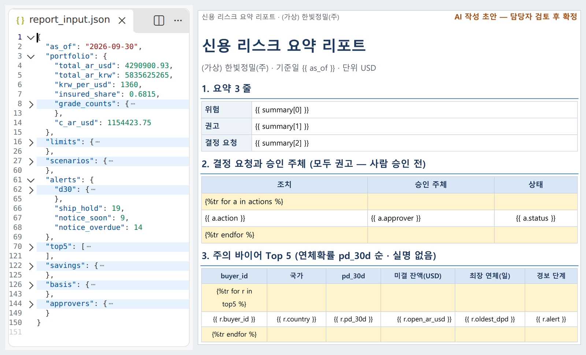{ loading=lazy }
  <figcaption>입력 — 지표 JSON(숫자)과 자리표시자 템플릿(모양). 승인 주체를 적은 <code>approvers</code> 칸이 있어 AI가 지어내지 않습니다</figcaption>
</figure>

<figure class="result" markdown="span">
  { loading=lazy }
  <figcaption>결과 예시 — 결정 요청마다 승인 주체가 있고 상태는 모두 '권고(사람 승인 전)', 머리글에 'AI 작성 초안 — 담당자 검토 후 확정'. 다른 AI의 지적 5건 중 2건을 사람이 반영하고 3건을 기각했습니다</figcaption>
</figure>

**진행** 렌더 · 숫자 대조 코드 → Claude가 해석 JSON → **일부러 틀린 숫자로 멈춤 확인** → ChatGPT 레드팀 → 사람.

**배운 점** 해석 프롬프트의 핵심은 두 가지 — 문장 속 숫자는 모두 `number_trace`에 입력 위치와 함께 적고, 합계 · 비율을 **새로 계산하지 않는다**(계산은 코드가 이미 했다). 분량 규칙(`summary` 줄마다 한 문장 · `sections` 항목마다 2문장)이 없으면 '요약 3줄'이 3문단이 됩니다. **검증 코드도 틀립니다** — 첫 대조 코드는 거짓 경보를 35건 냈고, 그 표를 다시 주어 고친 판이 오늘의 참고 스크립트입니다.

<small>오후: [실습 B 03–05](lab-b.md#b-card) — 독자 카드 1장 · 레드팀 · 기록</small>

---

## 8교시 · 정리 {#ch6}

### 아침에 건 예약, 정말 돌았나 {#ch6-schedule}

Actions 탭에서 이벤트를 `schedule`로 거르면 예약으로 돈 실행만 보이고, 이슈 맨 아래 댓글에 이벤트 · 실행 번호 · 시각이 남습니다 — 사람이 누른 버튼은 없습니다. 돌지 않았다면 그 자체가 좋은 디버깅 연습입니다(워크플로가 기본 브랜치에 있나 · cron을 UTC로 적었나 · 로그에 무엇이 남았나). **'돌았는데 0건'과 '안 돌았다'를 구분하는 로그**와, 정해진 시각까지 이슈가 갱신되지 않으면 알려 주는 장치가 필요합니다.

<figure markdown="span">
  { loading=lazy }
  <figcaption>실행 목록 — 수동 실행으로 거른 예시입니다. 예약 실행이면 이벤트가 <code>schedule</code>로 보입니다</figcaption>
</figure>

<figure markdown="span">
  { loading=lazy }
  <figcaption>자동 이슈의 맨 아래 댓글 — 수동 실행이 남긴 예시입니다. 예약이면 이벤트가 <code>schedule</code>로 적힙니다</figcaption>
</figure>

### 시연 6 · 엑셀 안의 AI와 한도 워크북 {#ch6-demo}

<div class="tf-flow" markdown>
<div markdown><b>상황</b> 넘겨받은 한도 워크북에 오류 셀이 있고, "자본이 늘면 한도도 늘까?"를 회의 전에 알아야 한다</div>
<span>→</span>
<div markdown><b>입력</b> 한도 워크북 xlsx(시트 17개 · 수식 · 해 찾기 모델) · 인수인계 중 생긴 오류 두 종류 — Excel + Claude for Excel</div>
<span>→</span>
<div markdown><b>결과</b> 오류 원인 · 수정 기록 · 셀 인용 설명 · 변경 내역 표 · 총액 80%의 재풀이</div>
</div>

<figure markdown="span">
  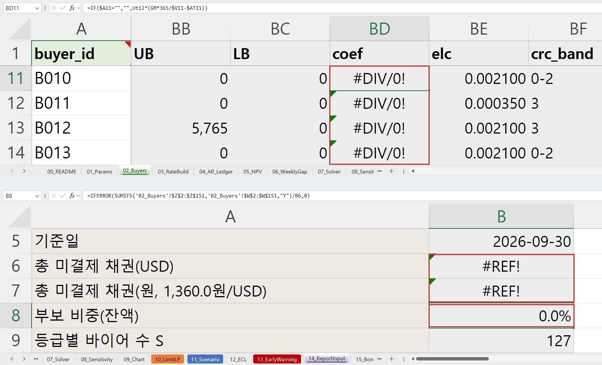{ loading=lazy }
  <figcaption>입력 — 넘겨받은 워크북의 오류 셀(#DIV/0! · #REF!)과 IFERROR가 숨긴 0%</figcaption>
</figure>

**진행** 오류 추적 → 원인 설명 → 자기자본 1,200만 달러로 바꾸면 바뀌는 셀 → 한도가 그대로인 이유 → 해 찾기는 사람.

**배운 점** **같은 모델이라도 일하는 자리가 다릅니다** — 대화와 맡기기는 Claude(채팅과 Cowork가 하나로 합쳐지는 중), 저장소는 Claude Code, 엑셀 안은 Claude for Excel입니다. Claude for Excel은 Pro 이상 유료 플랜에서 Microsoft 365 엑셀(웹 · Windows · Mac)의 추가 기능으로 쓰고, 데이터 표와 매크로는 다루지 못합니다. **셀 인용이 있어야 사람이 검증할 수 있고**, 오류를 0으로 덮는 `IFERROR`가 오류 표시보다 더 위험할 수 있습니다. 오류 두 종류 가운데 하나는 `IFERROR`가 숨겨 0%로 보이게 했습니다(실제 값은 68.2%). 자기자본을 늘려도 바뀌는 것은 자기부담과 EL 예산뿐이고 **상한 · 한도 · 목적함수는 그대로**입니다 — 상한이 MIN(필요한도, 등급 상한, 인수한도 + 자기부담)이라 더 작은 값이 정하기 때문입니다. **AI는 설명하고, 숫자를 바꾸는 결정과 해 찾기는 사람이** 합니다. 파일 속에 숨은 지시가 있을 수 있으니 신뢰하는 파일에서만 씁니다.

<figure markdown="span">
  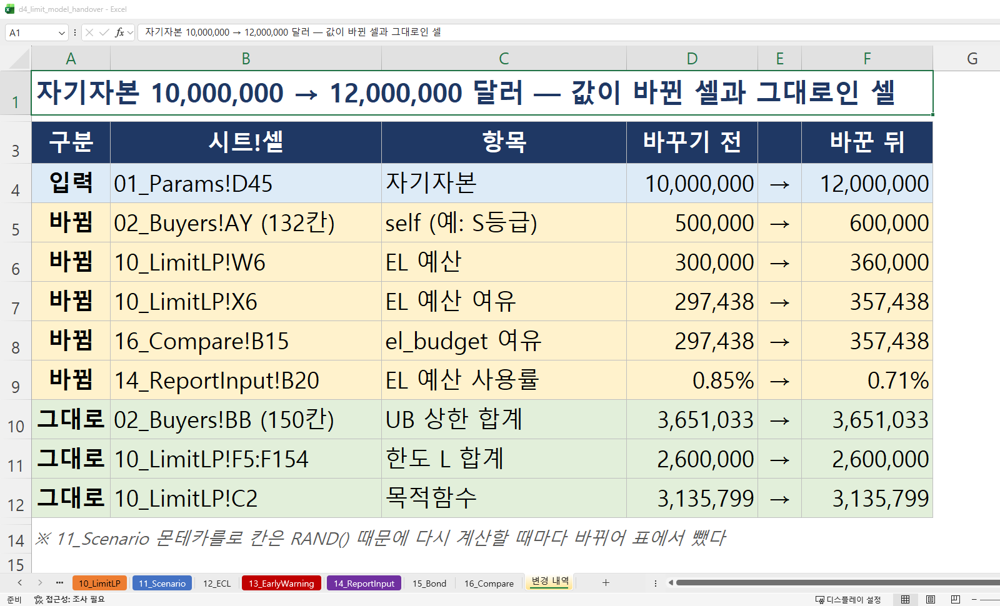{ width="760" loading=lazy }
  <figcaption>결과 예시 — 엑셀 재계산 표입니다(AI 패널 화면이 아닙니다). 바뀐 셀은 자기부담과 EL 예산 관련뿐입니다</figcaption>
</figure>

<small>해 보기: 같은 워크북이 실습 A의 완성본(`d4_limit_model.xlsx`)입니다 — [실습 A 03](lab-a.md#a-test)</small>

### 오늘의 다섯 문장 {#ch6-five}

1. **식은 LLM이, 계산은 솔버가, 확인은 테스트가.**
2. **잠재가격 = 제약 1단위의 값** — 경영 질문에 숫자로 답한다.
3. **평균이 아니라 분포** — P99와 상관을 본다.
4. **경보 = 규칙 + 모델 + 사람**, 자동은 알림까지.
5. **보고서 = 템플릿 + 구조화 출력 + 숫자 추적 + 서명.**

내일 5일차에는 오늘의 한도 · 경보 · 리포트를 **웹 대시보드와 AI 에이전트**로 묶습니다 — 오늘의 경보 등급 P1–P4를 대시보드가 그대로 씁니다.
