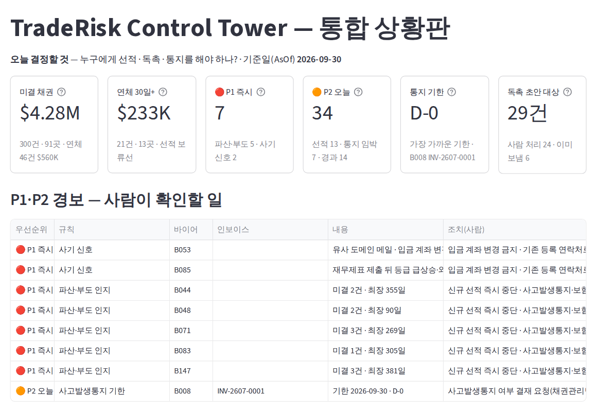
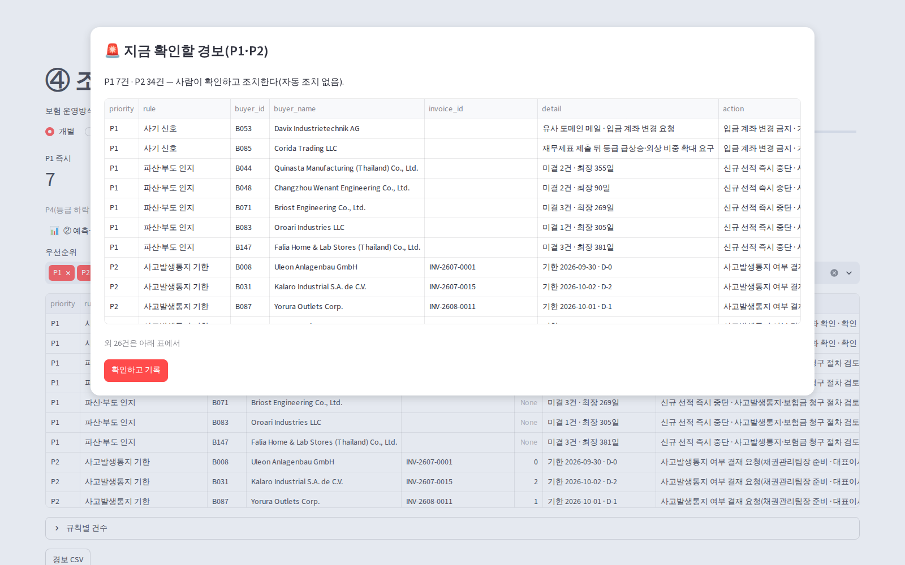
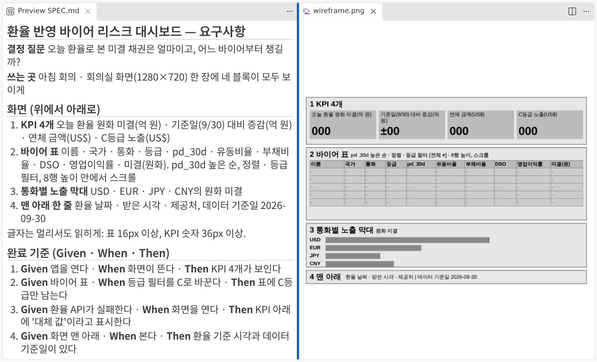
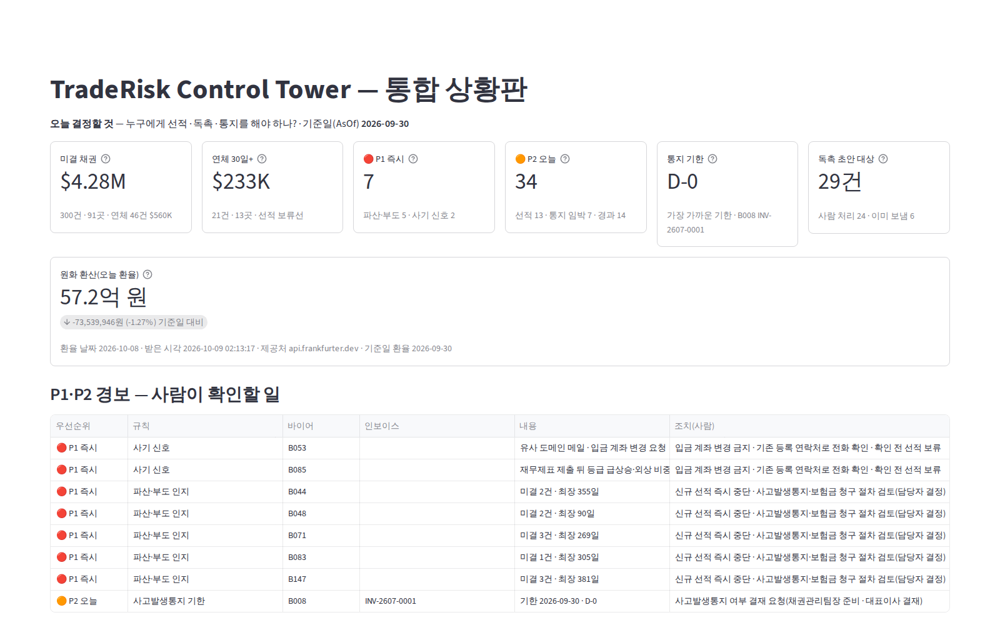
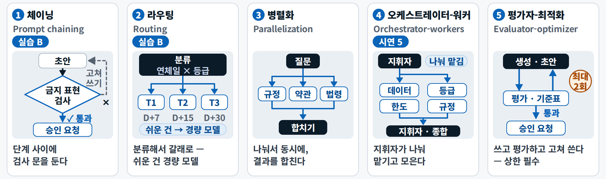
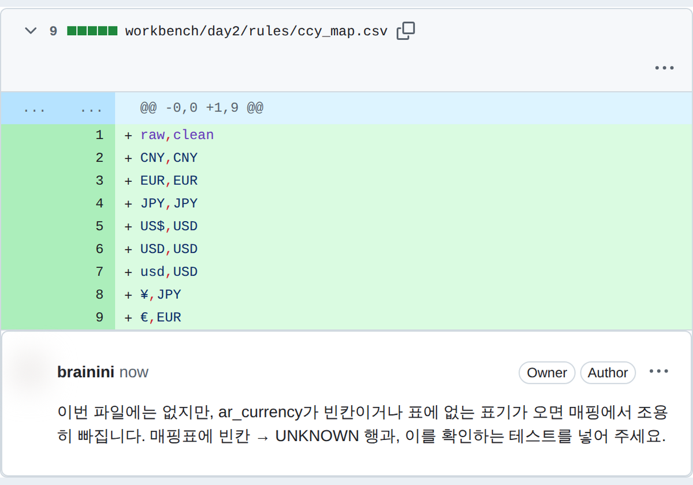
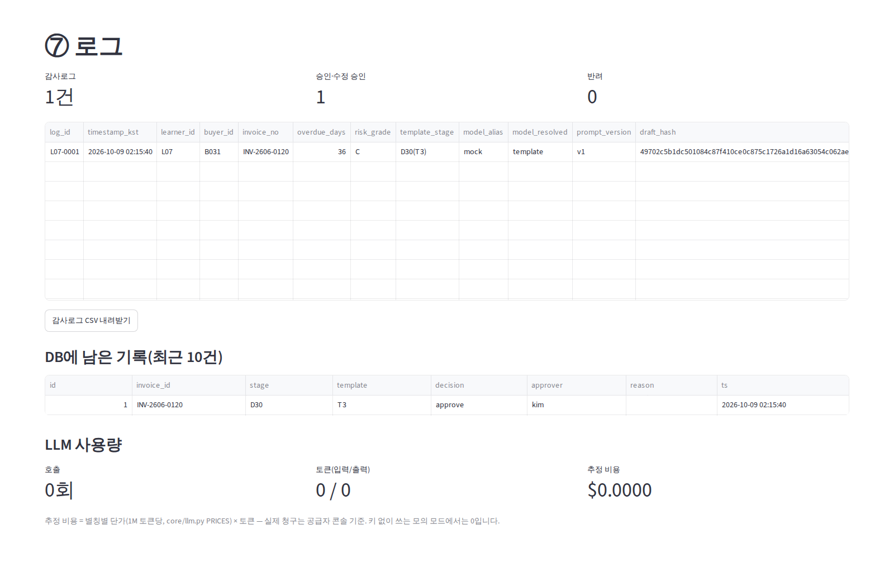
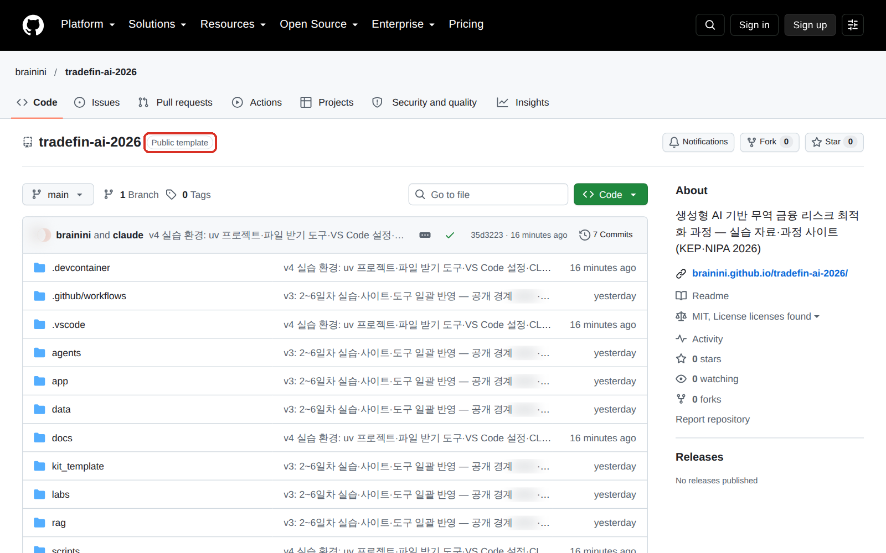
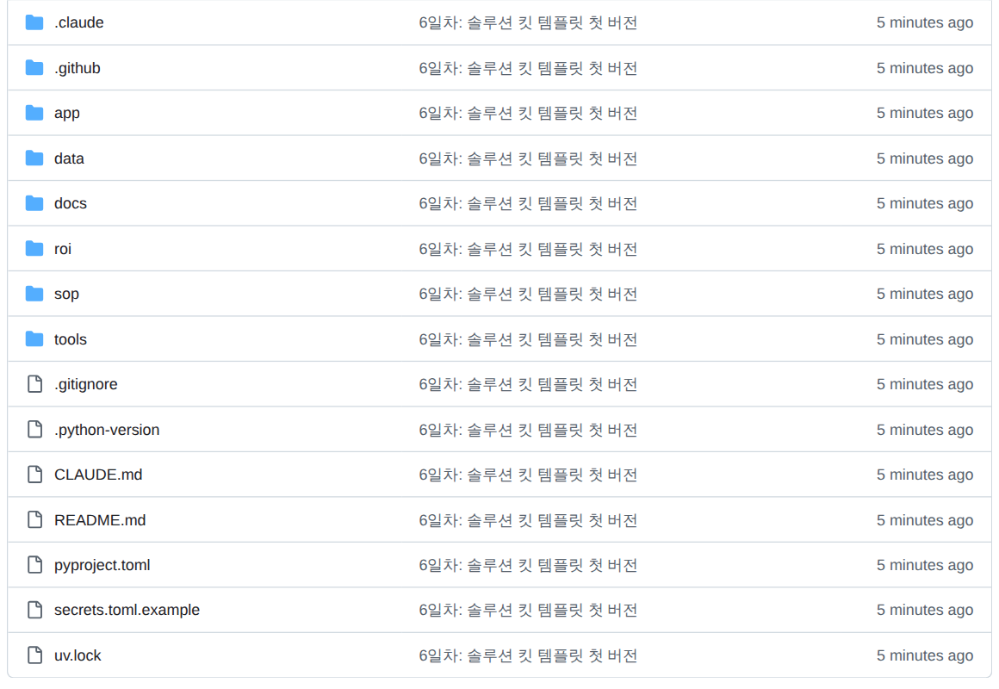

<div class="tf-lab" markdown>
<span class="tf-eyebrow">5일차 · 실습 B · 6–7교시 · 15:00–16:50 <span class="tf-daystate" data-tf-daystate="5"></span></span>

# 실습 B — 환율 상황판 · 독촉 워크플로 · 배포 · 승인 기록 DB

<div class="tf-meta" markdown>
<span class="tf-chip tf-chip--time">B ① 15:00–15:50</span>
<span class="tf-chip tf-chip--time">B ② 16:00–16:45</span>
<span class="tf-chip tf-chip--tool">Claude Code · Plan</span>
<span class="tf-chip tf-chip--tool">Streamlit</span>
<span class="tf-chip tf-chip--tool">GitHub</span>
<span class="tf-chip tf-chip--tool">Community Cloud</span>
</div>

<div class="tf-flow" markdown>
<div markdown><b>상황</b> 아침 회의 상황판(TradeRisk Control Tower ⓪)의 원화 금액이 9/30 환율에 묶여 있고, 독촉 톤 규칙(연체 단계 × 등급)은 코드에 박혀 실무자가 못 바꾸며, 승인 기록은 앱을 닫으면 사라집니다.</div>
<span>→</span>
<div markdown><b>넣는 것</b> 이미 도는 앱 `app/`(1–4일차 결과) + 기본 원장 `d5_start.csv` + 요구사항 카드 `spec_fx_tile.md` · 톤 표 `tone_matrix.csv` + 프롬프트 P5-B1 · B2 · B4 + 완성본 검산표 · 칸 영향표</div>
<span>→</span>
<div markdown><b>얻는 것</b> 환율 타일 · 내가 고친 톤 규칙 · 감사로그 2행 · **내 앱 주소** · `receivables.db` · PR 2개 · `links.md`</div>
</div>

<div class="tf-lab__grid" markdown>
<div class="tf-lab__cell" markdown><span class="tf-lab__label">목표</span> **시연 1 · 2를 파이썬 길로, 독촉은 워크플로로** — 그리고 **내 주소로 내보내고, 기록을 DB에 남깁니다**</div>
<div class="tf-lab__cell" markdown><span class="tf-lab__label">역할</span> 코드는 **Claude Code**, 요구사항과 확인은 **나**. 오늘 쓰는 독촉 메일은 모두 초안이라 **실제로 나가는 메일은 0통**입니다</div>
</div>

<div data-tf-map></div>
</div>

빈 저장소가 아니라 **이미 도는 앱**에 기능을 더한다는 점이 오전과 다릅니다. B3은 시연 1 · 2를 파이썬 · Streamlit 길로, B4는 시연 5 에이전트의 간소화판(워크플로), B7은 시연 3의 축소판입니다. **실습 B는 실습 A의 결과를 쓰지 않으니** A를 못 끝냈어도 15:00에 새로 시작합니다.

## 입력 파일 받기 {#files}

앱 · 요구사항 카드 · 톤 표 · 링크 양식은 **이미 내 저장소에 있습니다**. 기본 원장 `d5_start.csv`와 앞선 날의 결과(`d3_*` · `d4_*` · `models/`)는 B1의 `get_day_files.py 5`가 같은 경로로 받습니다 — 카드에 잠금 표시가 있으면 그 시각(10/20 08:30) 뒤에 받습니다. 저장소 없이 [채팅 경로](#chat-path)로 하는 분만 아래에서 받으세요.

--8<-- "docs/_snippets/day5/files_lab-b_cards.md"

!!! warning "원본은 고치지 않습니다 — 작업 사본에서"

    요구사항 카드와 톤 표는 `workbench/day5/data/`의 **작업 사본**(`get_day_files.py 5`가 만든다)에서 고칩니다. 원본 `labs/day5/`와 `data/`는 읽기만 합니다 — `git status`에 원본 변경이 보이면 `git restore labs/day5/`로 되돌립니다.

<div class="tf-phase" markdown>

<span class="tf-eyebrow">슬라이드 실습 B ① · 15:00–15:50 · Claude Code · Streamlit</span>

**실습 B ① 환율 타일과 독촉 워크플로** — 요구사항을 먼저 쓰고 맡긴다 — 독촉은 길을 사람이 정한 워크플로로

- **B1 앱 한 바퀴 · 10분** — 브랜치 d5-dashboard → uv sync --group dash → streamlit run → ⓪부터 ⑦까지
- **B2 요구사항 카드 · 8분** — spec_fx_tile.md 읽고 Then 한 줄을 내 말로 추가
- **B3 환율 타일 · 14분** — P5-B1 → pytest 통과 → 화면에서 Then 확인
- **B4 독촉 워크플로 · 15분** — tone_matrix.csv 한 칸 고치기 → P5-B2 → 초안 3건 → 승인 1 · 반려 1

**목표** 시연 1·2를 파이썬 길로, 독촉은 워크플로로 · **결과물** 환율 타일 · 바뀐 톤 규칙 · 감사로그 2행

</div>

## B1 앱 한 바퀴 { #b1 .step data-start="15:03" data-end="15:13" data-tool="터미널 · Streamlit" }

**왜** 오늘 기능을 더할 앱을 먼저 한 바퀴 봅니다 — 1–4일차의 등급 · 한도 · 경보가 이미 돌고 있습니다. 15:00–15:03은 강사가 실습 장을 안내하고, 15:03부터 10분입니다. 내 저장소 → 앱 실행 → ⓪ 숫자 · ④ 대화상자

!!! me "내가 할 일"

    1. 실습 A의 PR을 올렸다면 `main`으로 돌아와 새 브랜치를 만들고, 대시보드 패키지 · 오늘 파일을 받은 뒤 앱을 켭니다. **`--group dash`를 꼭 붙입니다** — 그룹 없이 `uv sync`만 다시 하면 streamlit이 지워집니다.

        ```bash
        git switch main
        git pull
        git switch -c d5-dashboard
        uv sync --group dash
        uv run python tools/get_day_files.py 5
        uv run streamlit run app/streamlit_app.py
        ```

    2. 브라우저에 `http://localhost:8501`이 열리고 **⓪ 통합 상황판**이 먼저 뜹니다. 맨 위 숫자 6칸을 읽습니다.
    3. 왼쪽 메뉴의 **④ 조기경보**를 열어 P1 · P2 대화상자를 읽고 **확인하고 기록**을 누릅니다.
    4. 나머지는 아래 앱 지도대로 **30초씩** 눈으로만 봅니다. 앱을 끌 때는 터미널에서 ++ctrl+c++(macOS도 Control 키 — ++cmd+c++는 복사입니다).

**앱 지도** — 필수는 ⓪ 숫자와 ④ 대화상자, 나머지는 눈으로 30초씩.

<div class="tf-stack" markdown>

| 쪽 | 볼 것 | 오늘 쓰는 곳 |
|---|---|---|
| ⓪ 통합 상황판 | 맨 위 숫자 6칸 — 미결 · 연체 30일+ · P1 · P2 · 통지 기한 · 독촉 초안 대상 | **필수** · B3에서 타일 하나를 더한다 |
| ① 업로드·전처리 | 기본 원장이 자동으로 정제된 결과 | 30초 |
| ② 예측·등급 | 점수표 · 등급 변화 | 30초 |
| ③ 한도·시나리오 | 한도 계산과 충격 시나리오 | 30초 |
| ④ 조기경보 | P1 · P2 대화상자 → **확인하고 기록**(감사로그 1건) | **필수** |
| ⑤ 독촉메일 | 독촉 판정표 · 초안 → 가드레일 → 승인 · 반려 | 30초 · B4에서 다시 |
| ⑥ RAG 규정검색 | 규정 질문 **1개만** — 인용과 근거 | 30초 |
| ⑦ 로그 | 감사로그 · LLM 사용량 | 30초 · B4 · B7에서 다시 |

</div>

⑥의 '골든셋 일괄 실행' 단추는 누르지 않습니다 — 앱 ⑥의 일괄 평가는 실습 A와 검색 방식 · 정의가 달라서 숫자가 다르게 나오고, 견줄 대상이 아닙니다.

!!! ai "AI가 하는 일"

    이 단계는 AI 없이 앱을 보는 시간입니다. 앱이 키 없이 **모의 모드**로 끝까지 돕니다(초안은 템플릿으로 만들어진다).

<figure class="result" markdown="span">
  { width="760" loading=lazy }
  <figcaption>⓪ 통합 상황판(기준일 2026-09-30) — 숫자 6칸 · 경보 표 · 바이어 표 · 근거. B3에서 여기에 환율 타일이 하나 더해집니다</figcaption>
</figure>

<figure class="result" markdown="span">
  { width="760" loading=lazy }
  <figcaption>④ 조기경보 — P1 · P2를 읽고 <b>확인하고 기록</b>을 누르면 감사로그에 1건이 남습니다(자동 조치는 없습니다)</figcaption>
</figure>

!!! ok "확인"

    - [ ] ⓪에 미결 **$4.28M** · 경보 **P1 7 · P2 34** · 독촉 초안 대상 **29건**이 보인다
    - [ ] ④에서 **확인하고 기록**을 눌렀다(왼쪽 사이드바 감사로그 1건)
    - [ ] 상태 표시줄에 `d5-dashboard`

??? ok "기준 숫자 더 보기 — ⓪ 6칸의 작은 글씨(기준일 9/30 기본 원장)"

    미결 300건 · 91곳 · 연체 46건 $560K / 연체 30일+ $233K(21건 · 13곳 · 선적 보류선) / P1 7(파산 · 부도 5 · 사기 신호 2) / P2 34(선적 13 · 통지 임박 7 · 경과 14) / 통지 기한 D-0 / 독촉 초안 대상 29건(사람 처리 24 · 이미 보냄 6). 다르면 기준일이 2026-09-30인지, ①에서 다른 파일을 올리지 않았는지 봅니다.

??? fix "`error: Failed to spawn: streamlit`"

    그룹 없이 `uv sync`를 다시 해서 streamlit이 지워졌습니다. `uv sync --group dash`.

??? fix "⓪에 '먼저 ① 업로드·전처리에서 원장을…' 경고가 떠요"

    `d5_start.csv`가 아직 없습니다. `uv run python tools/get_day_files.py 5`를 다시 실행합니다(10/20 08:30 전이면 `[열기 전]` — 수업 날에는 이미 열려 있습니다). 그래도 없으면 위 카드에서 받아 `data/checkpoints/`에 둡니다.

??? fix "포트가 사용 중이에요 · 브라우저가 안 열려요"

    이전 앱이 켜져 있습니다 — 그 터미널에서 ++ctrl+c++ 하거나 `--server.port 8502`를 붙입니다. 브라우저가 저절로 안 열리면 `http://localhost:8501`을 직접 엽니다.

??? fix "KPI 숫자가 `$4.…`처럼 잘려요"

    화면이 좁습니다. 왼쪽 사이드바를 « 로 접거나 브라우저 확대를 줄입니다.

??? fix "내 PC에서 앱이 안 돌아요"

    <span data-tf-link="demo_app" data-tf-empty="강사 데모 앱(수업 중 화면 · 오픈채팅 공지로 받은 주소)">강사 데모 앱</span>으로 ⓪–⑦을 보고, 이후 단계는 [채팅 경로](#chat-path)로 갑니다.

<p class="tf-check"><time>15:13</time> 손 점검 — 앱 한 바퀴: ⓪ 미결 $4.28M · 경보 P1 7 · P2 34 · 독촉 대상 29건</p>

## B2 요구사항 카드 (15:13–15:21) { #b2 .step data-tool="VS Code · Claude(선택)" }

**왜** AI에게 맡기기 전에 **완료가 무엇인지**부터 적습니다. 이 카드가 Claude Code의 일감이고 내 확인 기준입니다. `spec_fx_tile.md`(작업 사본) → Then 한 줄 → 완료 기준 4줄

!!! me "내가 할 일"

    1. `workbench/day5/data/spec_fx_tile.md`(작업 사본)를 열고 ++ctrl+shift+v++(macOS ++cmd+shift+v++)로 미리 봅니다 — 결정 질문 · 화면 · **완료 기준 3줄(Given · When · Then)** · 데이터와 계산 · 하지 않을 것.
    2. 완료 기준 **4번 줄**을 내 말로 채웁니다. 예: *Given 환율을 받은 시각이 있다 · When ⓪을 연다 · Then 캡션의 받은 시각이 한국 시각으로 보인다* / *증감이 마이너스일 때 글자로도 '감소'가 보인다*(색만으로 구분하지 않는 것이 이 앱의 원칙).
    3. 막막하면 아래 도움 문장으로 **후보 3개**를 받아 하나를 골라 **내 말로** 고쳐 씁니다.
    4. 카드의 두 약속을 눈여겨봅니다 — **기존 타일 · 세션 키는 바꾸지 않는다 · 새 패키지는 더하지 않는다.** 이미 도는 앱에 기능을 더할 때 AI가 가장 자주 어기는 것입니다.

??? prompt "도움 문장 — Then 후보 3개 받기(선택 · Claude 채팅 또는 Claude Code Plan)"

    --8<-- "labs/day5/prompts.md:help-b2-then"

!!! ai "AI가 하는 일"

    (선택) 후보 3개를 Given · When · Then 한 줄씩 제안합니다. 고르고 고치는 것은 내 몫입니다 — 요구사항은 사람이 씁니다.

<figure markdown="span">
  { width="760" loading=lazy }
  <figcaption>요구사항을 먼저 쓴다 — 오전 시연 2의 요구사항 문서(결정 질문 · 화면 · 완료 기준)와 와이어프레임. 오늘 카드는 이것을 타일 하나로 줄인 판입니다</figcaption>
</figure>

!!! ok "확인"

    - [ ] 카드에 Given · When · Then이 **4줄**이다(4번 줄은 내 말)
    - [ ] 원본 `labs/day5/spec_fx_tile.md`는 그대로다

??? fix "`workbench/day5/data/`에 작업 사본이 없어요"

    `uv run python tools/get_day_files.py 5`를 안 했습니다(A1 · B1). 실행하면 사본을 만듭니다.

??? fix "원본(`labs/day5/`)을 고쳐 버렸어요"

    `git restore labs/day5/spec_fx_tile.md`로 되돌리고 작업 사본에서 다시 씁니다.

## B3 환율 타일 (15:21–15:35) { #b3 .step data-tool="Claude Code · Plan" }

**왜** 시연 1의 같은 환율 API를 이번에는 **앱 안에서**, 캐시와 실패 처리까지 갖춰 부릅니다. 요구사항 카드 + P5-B1 → `app/core/fx_live.py`(새) · `app/views/p0_overview.py`(타일 1개) · 새 테스트

!!! me "내가 할 일"

    1. Claude Code **새 대화** · 모드 **Plan** → 아래 P5-B1을 보냅니다.
    2. 계획을 **읽습니다** — ① 바꿀 파일이 `fx_live.py`(새) · `p0_overview.py` · 새 테스트 파일(`app/tests/`)뿐인가 ② 캐시 10분(`ttl=600`) · 실패하면 저장된 환율로 가는가 ③ 기존 타일 · 세션 키를 건드리지 않는가 ④ 새 패키지 없이 `requests`인가. 마음에 안 드는 줄에는 코멘트를 달아 고치게 합니다.
    3. 승인 창에서 `2 Yes, and manually approve edits` → 파일마다 `1 Yes`.
    4. 끝나면 테스트가 통과하는지 봅니다: `uv run pytest app/tests -q`
    5. 앱을 **껐다 켭니다**(++ctrl+c++ → `uv run streamlit run app/streamlit_app.py`) — `core/`를 고치면 다시 켜야 반영됩니다. ⓪에서 카드의 Then 4줄을 눈으로 확인합니다.

!!! prompt "프롬프트 P5-B1 — 환율 타일 · Claude Code(Plan)"

    --8<-- "labs/day5/prompts.md:p5-b1"

!!! ai "AI가 하는 일"

    계획 → `fx_live.py`(5초 타임아웃 · 10분 캐시 · 실패하면 `fx_krw_daily.csv` 마지막 값 + '저장된 환율 사용') → ⓪에 타일 1개 → 인터넷 없이 도는 실패 경로 테스트 → `pytest` 결과와 '화면에서 확인할 3가지'. 허락 창 5–8번, 5–8분.

<figure class="result" markdown="span">
  { width="760" loading=lazy }
  <figcaption>완성된 모습의 예 — 총액(억 원) · 기준일 대비 증감(감소는 화살표와 글자로) · 캡션의 환율 날짜 · 받은 시각 · 제공처. 값은 찍은 날의 것이라 오늘 화면과 다릅니다</figcaption>
</figure>

슬라이드의 '화면에서 Then 확인'은 그대로 내가 합니다. 다만 **타일 숫자가 맞는지 손으로 계산하는 일은 완성본 검산표로 대신합니다** — 계산기 대신 AI 타일과 검산표를 나란히 놓습니다.

!!! file "완성본 제공 — b3_fx_check.md (환율 타일 검산표)"

    <dl markdown>
    <dt>무엇</dt><dd markdown>기준일 2026-09-30의 원화 총액 **5,788,865,573원(57.89억)**과 통화별 건수 · 잔액 · 9/30 환율 · 원화, ±2% 경고선, 인터넷이 막혔을 때(저장된 환율 9/25)의 값. 저장소에서는 `labs/day5/b3_fx_check.md`입니다.</dd>
    <dt>왜</dt><dd markdown>타일은 '오늘 환율'이라 날마다 다르지만 **기준일 값은 바뀌지 않습니다**. 그래서 `오늘 총액 − 증감 = 57.89억`이면 기준일 쪽 계산이 맞은 것입니다 — 손계산 없이 한 줄로 검산합니다.</dd>
    <dt>어떻게 만들었나</dt><dd markdown>기본 원장 300건을 앱과 같은 정제로 읽어 통화별 미결 잔액을 더하고, 같은 API의 2026-09-30 응답으로 통화 1단위당 원화(EUR = USD/KRW ÷ USD/EUR · 엔은 1엔당)를 구해 곱했습니다. 오전 시연 1의 결과 화면과 같은 숫자입니다.</dd>
    </dl>

    [:material-download: 검산표 받기](../downloads/day5/b3_fx_check.md){ .md-button .md-button--primary download="b3_fx_check.md" }

!!! me "내가 판단"

    1. 타일의 `오늘 총액 − 증감(원)`이 **약 57.9억**인지 봅니다(타일 총액은 소수 첫째 자리까지라 57.8–57.9억이면 맞습니다 — 원 단위까지는 아래 도움 문장이 통화별로 견줍니다).
    2. 다르면 아래 도움 문장으로 통화마다 나란히 놓고, 원인을 **내가** 고릅니다(엔 100엔 단위 · 환산 방향 · 기준일).

??? prompt "도움 문장 — 내 타일과 검산표 견주기(Claude Code)"

    --8<-- "labs/day5/prompts.md:help-b3-check"

!!! ok "확인"

    - [ ] `uv run pytest app/tests -q` 통과(기존 20개 + 새 테스트)
    - [ ] ⓪에 `원화 환산(오늘 환율)` 타일 — 억 원 총액(57억 원대) · 기준일 대비 증감(원 · %) · 캡션(환율 날짜 · 받은 시각 · 제공처)
    - [ ] 기존 숫자 6칸이 그대로다
    - [ ] `오늘 총액 − 증감` ≈ 57.9억 — 도움 문장의 통화별 대조에서 합계 5,788,865,573원(검산표)과 같다

??? fix "타일이 안 보여요 · `has no attribute` 오류가 나요"

    `core/`를 고쳤는데 앱을 다시 켜지 않았습니다. ++ctrl+c++ 후 다시 실행합니다(앱 오른쪽 위 ⋮ → **Rerun**으로는 부족할 수 있습니다).

??? fix "타일 글자가 '원화 환산(오…' · '57.2…'처럼 잘려요"

    타일이 기존 6칸과 같은 좁은 칸에 들어갔습니다. 먼저 사이드바를 « 로 접어 봅니다. 그래도 잘리면 "새 타일만 한 줄 전체 폭(또는 두 칸 폭)으로 넓혀 줘 — 기존 6칸은 그대로"를 보냅니다.

??? fix "증감이 '감소'인데 화살표가 ↑(초록)예요"

    `st.metric`의 증감 칸에 '감소 −…원'처럼 **글자를 앞에 붙이면** Streamlit이 부호를 읽지 못해 위쪽 화살표를 그립니다. "증감(delta)에는 숫자(음수)만 넘기고, '감소' 글자는 캡션이나 증감 뒤쪽에 써 줘"를 보냅니다 — 카드의 Then(색만으로 구분하지 않는다)과 화살표가 같은 방향인지 화면에서 확인합니다.

??? fix "총액 자릿수가 이상해요(570억 · 0.57억 …)"

    통화별 환산 오류입니다 — 엔화는 100엔당 환율을 1엔당으로 바꿔야 하고(÷ 100), EUR · CNY는 `USD/KRW ÷ USD/통화`입니다. 도움 문장으로 통화마다 견줍니다.

??? fix "'저장된 환율 사용' 경고가 뜨고 증감이 0이에요"

    **정상입니다**(완료 기준 2번). 회사 망 · 강의장 망이 환율 API를 막으면 저장본(마지막 날 2026-09-25)으로 계산합니다 — 그때 총액은 약 58.0억이고, 기준일 값도 저장본으로 계산되면 증감이 0입니다.

??? fix "인터넷을 끄면 테스트가 실패해요"

    실패 경로 테스트가 빠졌거나 테스트가 API를 직접 부릅니다. "테스트가 인터넷 없이 돌게 requests를 가짜로 바꾼 실패 경로 테스트를 추가해 줘"를 보냅니다.

??? fix "`pyproject.toml`에 새 패키지가 더해졌어요"

    '새 패키지 금지'를 어겼습니다. `git restore pyproject.toml uv.lock` 후 "HTTP는 이미 있는 requests로"를 다시 말합니다.

<p class="tf-check"><time>15:35</time> 손 점검 — 환율 타일: 원화 총액(57억 원대) · 기준일 대비 증감 · 기준 시각 · 테스트 통과</p>

## B4 독촉 워크플로 (15:35–15:50) { #b4 .step data-tool="Claude Code · Streamlit" }

**왜** 3교시 '독촉 운영' 표(연체 단계 × 등급 → 톤)를 앱 ⑤에서 **내 규칙으로** 바꿉니다. 길(라우팅 → 초안 → 금지 표현 검사 → 사람 승인 → 감사로그)을 사람이 정해 둔 **워크플로**입니다. 내가 고친 `tone_matrix.csv` + P5-B2 → `route()`가 표를 읽음 → 초안 3건 → 승인 1 · 반려 1 → 감사로그 2행. 시작 전에 강사가 ⑤를 1분 동안 한 번 눌러 보입니다.

!!! me "내가 할 일"

    1. `workbench/day5/data/tone_matrix.csv`(작업 사본)를 엽니다. 줄 = 연체 단계, 열 = 등급(S · A · B · C), 칸 = 템플릿이고 기본값은 지금 앱의 규칙 그대로입니다 — T1 정중한 리마인더 · T2 단호한 통지 · T3 최종 통지 + 선적 보류 예고.

        ```text
        stage,S,A,B,C
        D+7,T1,T1,T1,T2
        D+15,T2,T2,T2,T2
        D+30,T3,T3,T3,T3
        ```

    2. **한 칸**을 고칩니다. 권장은 **D+7 × B를 T2로** — 기준일 9/30에 이 칸의 인보이스가 1건이라 바뀐 건을 찾기 쉽고, 초안 대상 수(29)는 그대로입니다. 다른 칸을 고르려면 아래 '칸 영향' 표를 먼저 봅니다.
    3. 모드 **Plan** → 아래 P5-B2를 보냅니다. 계획에서 ① 단계 이름 매핑(`D+7` ↔ `D7`)이 한곳에 있는지 ② 표가 없거나 칸이 비면 지금 규칙 그대로인지 ③ **해석** — 템플릿 번호를 단계로 읽는지(T1 = D+7 단계 · T2 = D+15 · T3 = D+30)를 확인하고 승인합니다.
    4. 앱을 다시 켜고 **⑤ 독촉메일**의 '독촉 판정표'를 펼쳐, 내가 고친 칸 때문에 바뀐 인보이스를 찾습니다(Claude Code가 보고한 목록과 같은지).
    5. **초안 3건** — ① 내 칸 때문에 바뀐 건(템플릿만 확인) ② **INV-2606-0022**(승인) ③ **INV-2607-0001**(반려 · 사유 '기타' — 통지 여부를 먼저 정해야 하는 건). 오전 시연 5와 같은 세 건이라 8교시에 에이전트와 견주기 쉽습니다. 각각 **초안 만들기** → 가드레일 5개가 모두 ✅인지 → 승인자 칸에 **아이디 · 번호**(예: `L07` — 실명 금지) → **승인** 또는 **반려**.
    6. **⑦ 로그**에서 방금 두 줄(approve · deny)을 확인합니다.

**칸 영향**(기준일 9/30 기본 원장) — 대상이 0건인 칸은 바꿔도 아무것도 바뀌지 않습니다.

<div class="tf-stack" markdown>

| 칸 | 9/30 대상 | 바꾸면 |
|---|---|---|
| **D+7 × B**(권장) | 1건 | → T2: 1건이 T2 초안으로, 초안 대상 29 그대로 |
| D+7 × C | 8건 | → T1: 초안 대상 29 → 27(이미 1단계를 보낸 2건이 빠진다) |
| D+15 × C | 8건 + 이미 보냄 3 | → T3: 29 → 32(아직 안 보낸 단계라 늘어난다) · → T1: 29 → 21 |
| D+30 × C | 3건 | → T1 · T2: 29 → 26(3건 모두 '이미 보낸 단계') |
| 그 밖의 칸(S · A 열 전부 · B의 D+15 · D+30) | 0건 | 바꿔도 변화 없음 |

</div>

!!! prompt "프롬프트 P5-B2 — 톤 표를 읽는 라우팅 · Claude Code(Plan)"

    --8<-- "labs/day5/prompts.md:p5-b2"

!!! ai "AI가 하는 일"

    계획(매핑 · 기본값 · 해석) → `app/core/dunning.py`의 `route()`가 작업 사본의 표를 읽게 고침 → 표 기반 테스트 1개 → `pytest` → **내가 고친 칸 때문에 바뀐 인보이스 목록**을 보고합니다. 허락 창 4–6번, 5–7분.

슬라이드의 '한 칸 고치기 · 승인 · 반려'는 사람이 정하는 일이라 그대로 내가 합니다. 다만 **어느 인보이스가 왜 바뀌었는지 손으로 추적하는 일은 완성본 칸 영향표로 대신합니다** — Claude Code의 보고와 표를 나란히 놓고 해석이 같은지만 봅니다.

!!! file "완성본 제공 — b4_tone_impact.md (톤 표 칸 영향표)"

    <dl markdown>
    <dt>무엇</dt><dd markdown>톤 표의 칸마다 9/30 대상 수와, 템플릿을 바꾸면 **바뀌는 인보이스**(전 → 후)와 초안 대상 수. 저장소에서는 `labs/day5/b4_tone_impact.md`입니다. 이 파일은 **10/20(화) 08:30에 열립니다** — 인보이스별 판정이 들어 있어 기본 원장과 같은 시각에 엽니다.</dd>
    <dt>왜</dt><dd markdown>'고쳤는데 아무것도 안 바뀐다' · '초안 대상이 줄었다'에서 막히지 않게 하려고. 대상이 0건인 칸, '이미 보낸 단계'로 빠지는 건이 미리 보입니다.</dd>
    <dt>어떻게 만들었나</dt><dd markdown>기본 원장을 앱과 같은 정제로 읽고, 앱의 판정 코드(`route()`)에 '템플릿 번호를 단계로 읽는' 해석을 더해 칸마다 다른 템플릿을 넣어 다시 판정했습니다 — 그다음 앱의 '이미 보낸 단계' 규칙은 그대로 적용.</dd>
    </dl>

    [:material-download: 칸 영향표 받기](../downloads/day5/b4_tone_impact.md){ .md-button .md-button--primary download="b4_tone_impact.md" data-tf-open="2026-10-19T23:30:00Z" }

??? prompt "도움 문장 — 바뀐 인보이스와 칸 영향표 견주기(Claude Code)"

    --8<-- "labs/day5/prompts.md:help-b4-impact"

<figure markdown="span">
  { loading=lazy }
  <figcaption>지금 만든 것은 ② 라우팅(연체일 × 등급 → T1 · T2 · T3) + ① 체이닝(초안 → 금지 표현 검사 → 승인) — 8교시에 에이전트와 견줍니다</figcaption>
</figure>

!!! ok "확인"

    - [ ] ⑤ 판정표에서 내가 고친 칸대로 템플릿이 달라진 인보이스를 찾았다
    - [ ] 초안 3건 · 가드레일 5개 ✅ · 승인 1(승인자 = 아이디) · 반려 1(사유)
    - [ ] ⑦ 감사로그 2행(approve · deny — 본문을 고치고 승인하면 `edit`로 남는다)
    - [ ] `uv run pytest app/tests -q` 통과(표 기반 테스트 포함)

??? fix "표를 고쳤는데 아무것도 안 바뀌어요"

    ① 대상 0건 칸입니다(위 '칸 영향' 표) ② `route()`가 표를 읽지 않습니다 — P5-B2를 마쳤는지 ③ 원본 `labs/day5/`를 고쳤습니다 — 작업 사본에서 ④ 앱을 다시 켜지 않았습니다 ⑤ 단계 이름 매핑(`D+7` ↔ `D7`).

??? fix "초안 대상이 29건보다 줄었어요 · 늘었어요"

    정상일 수 있습니다. 템플릿이 앞 단계로 내려가면 그 단계를 이미 보낸 건이 '이미 보낸 단계'로 빠지고, 아직 안 보낸 단계로 올라가면 늘어납니다 — 칸 영향표와 같은지 봅니다. Claude Code가 '템플릿 이름만 바꾸고 단계는 그대로' 같은 다른 해석을 골랐다면 숫자가 다릅니다 — 계획에서 해석을 확인합니다.

??? fix "INV-2607-0001이 '이미 보낸 단계'라 초안을 만들 수 없어요"

    D+30 × C 칸을 고쳤다면 그렇습니다. 판정표에서 DRAFT인 다른 건으로 반려를 연습합니다.

??? fix "[승인]이 안 눌려요"

    가드레일에 ❌가 있거나 승인자 칸이 비었습니다. 밤에 혼자 연습할 때는 ⑤ 발송 시간창(수신지 현지 08–21시)에 걸립니다 — 내 PC의 `app/.streamlit/secrets.toml`(커밋되지 않는 파일)에 두 줄 `[app]` · `demo_clock = "2026-10-20 15:00"`을 적고 앱을 다시 켭니다. 배포한 앱은 Settings → Secrets에 같은 두 줄.

<p class="tf-check"><time>15:50</time> 손 점검 — 독촉 워크플로: 고친 톤 규칙대로 초안 · 승인 1 · 반려 1 · 감사로그 2행</p>

!!! late "늦었다면"

    B4까지 못 끝내도 16:00에는 B5로 넘어가 지금까지의 것을 커밋하고 배포(B6)부터 합니다 — 배포는 기다리는 시간이 있어 일찍 시작할수록 좋습니다. 20분 넘게 막히면 강사 완성본(막힌 단계의 파일만)으로 합류합니다.

<div class="tf-phase" markdown>

<span class="tf-eyebrow">15:50–16:00 쉬는 시간 · 슬라이드 실습 B ② · 16:00–16:45 · Claude Code · GitHub · Community Cloud</span>

**실습 B ② 배포와 승인 기록 DB** — 내 주소로 내보내고, 승인 기록을 DB에 남긴다

- **B5 커밋·PR·병합 · 10분** — 배포용 데이터는 git add -f로 함께(가상 데이터)
- **B6 배포 · 12분** — share.streamlit.io → Create app → Python 3.13 → Secrets(비우면 모의 모드)
- **B7 승인 기록을 SQLite에 · 18분** — P5-B4 → 승인 1건 = 두 표를 한 트랜잭션으로
- **B8 점검 · 5분** — 키 0 · 발송 0 · 배포 로그 한 번 열기 · links.md에 주소·PR

**목표** 내 주소로 내보내고, 기록을 DB에 남긴다 · **결과물** 배포 주소 · PR 2개 · receivables.db

</div>

## B5 커밋·PR·병합 (16:00–16:10) { #b5 .step data-tool="Claude Code · GitHub" }

**왜** 배포한 앱은 GitHub의 **main**을 읽습니다 — 바꾼 코드와 배포용 데이터를 main에 올려야 합니다. 데이터 · 모델은 템플릿의 `.gitignore`가 막고 있어 이름을 적어 **강제로** 더합니다(모두 가상 데이터와 수업용 모델이라 공개해도 됩니다). 바뀐 파일 + 배포용 데이터 → PR 프롬프트 → PR②(`d5-dashboard`) → 내가 병합

!!! me "내가 할 일"

    1. 배포용 데이터를 **내가** 강제로 더합니다(슬라이드 그대로). 이미 저장소에 있는 파일이면 아무 일 없이 지나갑니다.

        ```bash
        git add -f data/checkpoints/d5_start.csv data/checkpoints/d3_start_scoring.csv data/checkpoints/d3_start_features.csv data/checkpoints/d4_start_scored.csv data/checkpoints/d4_params.csv data/checkpoints/d4_scenarios.csv models/
        ```

    2. Claude Code에 아래 PR 프롬프트를 보냅니다. 보여 주는 목록을 읽습니다 — ① 브랜치 `d5-dashboard` ② `app/`의 코드 · 테스트 ③ `workbench/day5/data/`에서 **내가 고친 사본 두 개**(`tone_matrix.csv` · `spec_fx_tile.md` — 배포 앱이 내 톤 표를 읽으려면 함께 올라가야 합니다. 나머지 사본은 원본과 같아서 빠집니다) ④ 방금 `git add -f`한 **`data/checkpoints/` 6개 · `models/` 6개**. **`secrets.toml` · 키 · 약관 PDF · `.db`는 없어야** 합니다. ④가 '관계없는 파일'로 빠져 있으면 "스테이징한 데이터 · 모델도 배포용이니 함께 커밋해 줘"라고 답합니다 — 빠지면 배포한 앱이 빈 화면입니다.
    3. 커밋 메시지(`5일차: …` · 빈 줄 · `왜: …`)를 확인하고 허락 창에서 커밋 · push를 승인합니다. `gh`가 없으면 알려 준 주소나 **Compare & pull request**로 PR을 엽니다.
    4. GitHub 화면에서 PR을 읽고 **Merge pull request → Confirm merge**를 **내가** 누릅니다. 병합은 Claude Code에게 시키지 않습니다.

!!! prompt "프롬프트 PR — 커밋 · push · PR 설명(병합은 내가) · Claude Code"

    --8<-- "labs/day5/prompts.md:pr"

!!! ai "AI가 하는 일"

    올릴 파일 목록과 키 · 실명 · 약관 · `*.db` 점검 결과 → 커밋 메시지 · PR 설명 → 내가 확인하면 커밋 · push(허락 창 2–3번) → `gh`가 있으면 PR 주소. 병합은 하지 않습니다.

<figure markdown="span">
  { width="680" loading=lazy }
  <figcaption>병합 전에 PR의 'Files changed'를 한 번 읽습니다 — 무엇이 main에 들어가는지 정하는 것은 사람입니다(2일차 화면 — 모양만 참고)</figcaption>
</figure>

!!! ok "확인"

    - [ ] 커밋에 `data/checkpoints/` 6개 · `models/` 6개가 들어갔다(`git show --stat HEAD` 또는 PR의 Files changed)
    - [ ] PR②가 main에 **병합**됐다(내가 누름)
    - [ ] 저장소에 키 0 · `.db` 0 · 약관 PDF 0
    - [ ] PR② 링크를 메모했다(`links.md`에는 B8에서)

??? fix "`git add -f`가 '경로를 찾을 수 없다'고 해요"

    그 파일을 아직 받지 않았습니다 — `uv run python tools/get_day_files.py 5`를 먼저 실행합니다.

??? fix "`.db` 파일이 목록에 있어요"

    커밋하지 않습니다. 이미 스테이징했다면 `git restore --staged 파일` 후 다시 커밋을 맡깁니다.

??? fix "Claude Code가 병합까지 하려고 해요"

    `No`로 거절합니다. 병합 버튼은 GitHub 화면에서 내가 누릅니다(PR 프롬프트의 마지막 줄).

## B6 배포 (16:10–16:22) { #b6 .step data-tool="share.streamlit.io" }

**왜** `localhost:8501`은 내 컴퓨터 안에서만 열립니다 — **내 주소**로 내보냅니다. 웹 폼이라 AI가 대신할 수 없는 단계입니다. 값만 정확히 넣습니다. main + share.streamlit.io → `https://<이름>.streamlit.app`

!!! me "내가 할 일"

    1. [share.streamlit.io](https://share.streamlit.io)에서 **Continue with GitHub**로 로그인하고 권한을 허용합니다.
    2. **Create app → Deploy a public app from GitHub**를 누르고 아래 표대로 채웁니다.
    3. **Advanced settings**를 열어 **Python version = 3.13**을 고르고 **Secrets 칸은 비워 둡니다**(모의 모드로 끝까지 돕니다).
    4. **Deploy** — 첫 배포는 **2–5분** 걸립니다. 기다리는 동안 B7의 P5-B4를 미리 읽어 둡니다.
    5. 주소가 열리면 ⓪이 내 PC와 같은 화면인지 봅니다.

| 칸 | 넣을 값 |
|---|---|
| Repository | **내 저장소**(과정 템플릿에서 만든 것) |
| Branch | `main` |
| Main file path | **`app/streamlit_app.py`** |
| App URL | 영문 소문자 · 숫자 · 하이픈(예: `traderisk-t2-07`) — 실명 · 회사 이름 금지 |
| Advanced settings → Python version | **3.13** (배포 뒤에는 바꿀 수 없습니다) |
| Advanced settings → Secrets | 비워 둔다 |

!!! ai "AI가 하는 일"

    정상이면 없습니다. 빨간 오류가 나면 앱 오른쪽 아래 **Manage app**의 로그를 처음부터 끝까지 복사해 P5-B3에 붙입니다.

??? prompt "프롬프트 P5-B3 — 배포 오류 고치기(오류가 날 때만 · Claude Code 또는 채팅)"

    --8<-- "labs/day5/prompts.md:p5-b3"

완성된 모습은 <span data-tf-link="demo_app" data-tf-empty="강사 데모 앱(수업 중 화면 · 오픈채팅 공지로 받은 주소)">강사 데모 앱</span>과 같습니다.

!!! ok "확인"

    - [ ] 내 주소(`https://….streamlit.app`)에서 ⓪이 내 PC와 같은 화면이다
    - [ ] Secrets 칸을 비웠고 저장소에 키가 0개다

??? fix "저장소 목록에 내 저장소가 없어요"

    GitHub 권한 승인(Authorize)을 다시 합니다. 비공개 저장소면 Community Cloud의 비공개 앱은 1개까지입니다 — 개인 저장소는 공개를 권장합니다(가상 데이터만 커밋).

??? fix "Python 버전을 3.13으로 안 골랐어요"

    배포 뒤에는 바꿀 수 없습니다. 앱을 삭제(⋮ → Delete)하고 같은 값으로 다시 배포합니다.

??? fix "⓪에 '먼저 ① 업로드…' · ② 등급이 비어 있어요"

    배포한 main에 데이터가 없습니다 — B5의 `git add -f`를 빠뜨렸거나, Claude Code가 커밋 목록에서 뺐습니다(`git show --stat main`에 `data/checkpoints/` · `models/`가 있는지 봅니다). 데이터(⓪) · `models/`(②)를 커밋 · push · 병합하면 1–2분 뒤 다시 배포됩니다.

??? fix "앱이 잠들었어요(Zzz)"

    12시간 동안 아무도 열지 않으면 잠듭니다. **Yes, get this app back up!**을 누르면 1분쯤 뒤 깨어납니다.

<p class="tf-check"><time>16:22</time> 손 점검 — 배포: 내 주소에서 같은 화면 · 저장소에 키 0</p>

## B7 승인 기록을 SQLite에 (16:22–16:40) { #b7 .step data-tool="Claude Code · Plan" }

**왜** 지금은 승인 기록이 **세션 안에만** 있어 앱을 닫으면 사라집니다. 시연 3(채권 DB)의 축소판으로, **승인 1건 = 두 표를 한 트랜잭션으로** — 전부 되거나 전부 안 되거나. P5-B4 → `app/core/store.py` → ⑦ 아래 'DB에 남은 기록' → PR③(`d5-store`)

!!! me "내가 할 일"

    1. 병합한 main에서 새 브랜치를 만듭니다.

        ```bash
        git switch main
        git pull
        git switch -c d5-store
        ```

    2. Claude Code **새 대화** · 모드 **Plan** → P5-B4(긴 대화를 이어 가면 Claude Code가 이전 브랜치 `d5-dashboard`를 지금 브랜치로 착각하기도 합니다). 계획 앞에 **요구사항 카드**(목적 1줄 · Given/When/Then 2개 · 하지 않을 것)가 먼저 나옵니다 — 읽고 고쳐서 승인합니다.
    3. `uv run pytest app/tests -q`('오류 시 롤백' 테스트 포함) → 앱을 다시 켜고 ⑤에서 **승인 1건** → ⑦ 로그 아래 **'DB에 남은 기록(최근 10건)'** 표에 그 행이 있는지 봅니다.
    4. ⑦ 위쪽 감사로그 줄과 아래 DB 행이 **같은 결정 · 같은 인보이스**인지 견줍니다 — 같은 사실이 두 곳에 맞게 남았나.
    5. `git status`에 `.db` 파일이 **나오지 않아야** 합니다(`.gitignore`가 `*.db`를 막습니다).
    6. PR 프롬프트로 커밋 · push · PR③(목록의 브랜치가 `d5-store`인지 봅니다) → **내가 병합** → Community Cloud가 1–2분 뒤 자동으로 다시 배포 → 내 주소에서도 승인 1건을 눌러 같은 표가 생기는지 봅니다.

!!! prompt "프롬프트 P5-B4 — 승인 기록을 SQLite에 · Claude Code(Plan)"

    --8<-- "labs/day5/prompts.md:p5-b4"

!!! ai "AI가 하는 일"

    요구사항 카드 + 계획 → `store.py`(표준 `sqlite3`만, DB 파일 `workbench/day5/outputs/receivables.db`) → ⑤ 승인 · 반려 때 기록, ⑦ 아래 표 → 롤백 테스트 → `pytest`. 허락 창 5–7번, 6–9분.

<figure class="result" markdown="span">
  { width="760" loading=lazy }
  <figcaption>완성된 모습의 예 — 위 감사로그 1줄과 아래 'DB에 남은 기록' 1행이 같은 인보이스 · 같은 결정(approve)입니다</figcaption>
</figure>

!!! ok "확인"

    - [ ] ⑦ 아래 'DB에 남은 기록'에 승인 행이 있고, 감사로그 줄과 결정 · 인보이스가 같다
    - [ ] 롤백 테스트가 통과한다
    - [ ] `.db`가 커밋되지 않았다
    - [ ] PR③을 내가 병합했고, 내 주소에서도 승인 1건이 DB 표에 보인다

??? fix "DB 표가 비어 있어요"

    승인을 아직 안 눌렀거나, 승인 단추에서 저장 함수를 부르지 않거나, 앱을 다시 켜지 않았습니다. "⑤의 승인 · 반려 단추에서 store를 부르는지 보여 줘"를 보냅니다.

??? fix "롤백 테스트가 늘 통과해요(일부러 낸 오류에도)"

    두 INSERT를 따로 커밋하고 있을 수 있습니다. "두 표를 한 트랜잭션(`with conn:`)으로 묶고, 둘째 쓰기에서 오류가 나면 첫째도 남지 않는지 테스트해 줘"를 보냅니다.

??? fix "배포한 앱에서 어제 기록이 사라졌어요"

    정상입니다 — Community Cloud의 파일은 앱이 다시 시작되면 사라집니다. 여럿이 오래 쓸 기록은 Supabase 같은 서버형 DB가 필요하고, 그것은 내일 해커톤의 선택지입니다.

<p class="tf-check"><time>16:40</time> 손 점검 — 승인 기록: ⑦ 아래 DB 표에 승인 행 · 롤백 테스트 통과 · <code>.db</code> 커밋 제외</p>

## B8 점검 (16:40–16:45) { #b8 .step data-tool="Claude Code · Community Cloud" }

**왜** 오늘의 마지막 확인 — 키 0 · 발송 0 · 배포 로그 · 주소와 PR을 한곳에. 배포 로그는 8교시 '운영' 이야기의 출발점입니다. 점검 명령 + 내 주소 · PR → `workbench/day5/links.md`

!!! me "내가 할 일"

    1. 내 앱 오른쪽 아래 **Manage app**을 눌러 마지막 실행 로그를 한 번 엽니다.
    2. **발송 0** — 오늘 나간 메일은 없습니다. 초안과 승인 기록만 남았습니다.
    3. 아래 도움 문장을 보내 **키 0**(`git ls-files | grep -i secret` 결과가 `.example` 두 줄 — `app/.streamlit/`과 `kit_template/`의 `secrets.toml.example`)을 보고, 앱 주소와 PR 세 개(① 실습 A `d5-rag` · ② `d5-dashboard` · ③ `d5-store`)로 `links.md`를 채우게 합니다.
    4. 채워진 `links.md`를 열어 점검 네 칸을 **내가** 체크한 뒤 "확인 — 커밋 · push"로 답합니다. 링크와 체크가 커밋 한 번에 함께 올라갑니다.

??? prompt "도움 문장 — 점검과 links.md 채우기(Claude Code)"

    --8<-- "labs/day5/prompts.md:help-b8-links"

!!! ai "AI가 하는 일"

    점검 명령 두 개의 결과를 보여 주고 → main을 최신으로 맞춘 뒤 `links.md`의 빈칸을 채우고 → 커밋 메시지를 제안 → 내가 확인하면 커밋 · push.

!!! ok "확인"

    - [ ] `links.md` 완성 — 앱 주소 · PR 3개(실습 A 1 + 실습 B 2)
    - [ ] 키 0 · 발송 0
    - [ ] 배포 로그를 한 번 열었다

<p class="tf-check"><time>16:45</time> 손 점검 — DB · 제출: <code>receivables.db</code>에 승인 행 · PR 2개 · <code>links.md</code></p>

## 확인 기준 · 제출 {#checkpoint}

슬라이드 '실습 B 확인 기준 · 제출'과 같습니다 — **화면에서 확인한 것만 '완료'**로 칩니다.

| 시각 | 확인할 것 | 기대 모습 |
|---|---|---|
| 15:13 | 앱 한 바퀴 | ⓪ 미결 $4.28M · 경보 P1 7 · P2 34 · 독촉 대상 29건 |
| 15:35 | 환율 타일 | 원화 총액(57억 원대) · 기준일 대비 증감 · 기준 시각 · 테스트 통과 |
| 15:50 | 독촉 워크플로 | 고친 톤 규칙대로 초안 · 승인 1·반려 1 · 감사로그 2행 |
| 16:22 | 배포 | 내 주소에서 같은 화면 · 저장소에 키 0 |
| 16:45 | DB·제출 | `receivables.db`에 승인 행 · PR 2개 · `links.md` |

**제출** — PR 링크와 앱 주소를 <span data-tf-link="submit_form" data-tf-empty="제출 폼(수업 중 화면 · 오픈채팅 공지로 받은 주소)">제출 폼</span>에 붙입니다. 짝과 서로 배포 주소 · PR 두 개 · `links.md`를 확인합니다. 못 끝낸 단계는 내일 팀 저장소에서 이어 가도 됩니다.

## 다 했으면 — 내 손으로 넓혀 보기 {#extend}

배운 것을 조금 바꿔 **AI가 어디까지 하는지** 직접 재 봅니다. 하나만 골라도 좋습니다. 모두 요구사항 카드부터 쓰게 하고, 가상 데이터로만 합니다.

<div class="grid cards tf-ext" markdown>

-   <span class="tf-level">기본 · 15분 · Claude Code</span>

    **더 하기 — 기능 하나(P5-B5)**

    국가별 연체 막대 · 등급 하락만 보기 · 금지 표현 빨간 표시 · 감사로그 결정별 필터 · 엑셀 업로드 중 하나를 골라 [P5-B5](../prompts/day5.md#p5-b5)로 — **요구사항 카드를 먼저** 받고 승인한 뒤에 구현하게 합니다.

-   <span class="tf-level">응용 · 10분 · Claude Code · Streamlit</span>

    **톤 표 두 번째 실험**

    3교시 표('C등급 D+15 = 단호 + 선적 보류 예고')대로 D+15 × C를 T3로 바꾸고, 초안 대상이 29 → 32로 **느는 이유**(T3는 아직 안 보낸 단계)를 한 줄로 씁니다. 칸 영향표와 견줍니다.

-   <span class="tf-level">응용 · 15분 · Claude Code</span>

    **워크플로 대 에이전트**

    시연 5의 세 건(INV-2607-0001 · INV-2606-0022 · INV-2606-0085)을 내 워크플로로 처리하고 '누가 다음 단계를 정했나 · 무엇이 기록됐나 · 바이어 메모의 숨은 지시는 어떻게 됐나'를 표로 — 시연 5 결과 화면(이론 요약 5장)과 견줍니다.

-   <span class="tf-level">도전 · 15분 · Claude Code</span>

    **가드레일 하나 더**

    계좌 변경을 돌려 말하는 문구('please remit to our updated …') 탐지를 요구사항 카드 + 테스트로 더하고, 지금의 금지 표현 정규식([가드레일](../prompts/day5.md#guardrails))과 무엇이 다른지 한 줄로 씁니다.

</div>

## 채팅 경로 — 로컬 실행이 안 될 때 {#chat-path}

Claude Code 계정이 없거나 내 PC에서 앱이 안 돌면 **Claude 또는 ChatGPT 웹**과 **GitHub 웹 편집기**로 합니다(슬라이드 확인 기준 장 아래 '채팅만으로' 띠 — 고칠 파일 전체를 채팅에 붙여 '수정된 파일 전체'를 받기 → 웹 편집기에 붙여넣기 → 커밋 → 자동 재배포).

1. **B1은 그대로** — 로컬이 안 되면 <span data-tf-link="demo_app" data-tf-empty="강사 데모 앱(수업 중 화면 · 오픈채팅 공지로 받은 주소)">강사 데모 앱</span>으로 ⓪–⑦을 봅니다.
2. **B6 배포를 먼저** 합니다(웹 폼이라 Claude Code가 필요 없습니다). 배포용 데이터는 위 카드의 **`d5_start.csv` 하나**면 됩니다 — 내 저장소에서 `data/checkpoints/` 폴더로 들어가 **Add file → Upload files**로 올립니다(가상 데이터). ⓪ · ④ · ⑤는 이 파일 하나로 돌고, ② 예측·등급은 강사 모델(`models/`)이 있어야 해서 채팅 경로에서는 건너뜁니다.
3. **B3 · B4 · B7**은 GitHub 웹에서 고칠 파일(`app/views/p0_overview.py` · `app/core/dunning.py` · `app/views/p5_dunning.py` 등)을 열어 **Raw → 전체 복사**한 뒤 채팅에 붙이고, 요구사항 카드와 함께 아래 문장을 보냅니다.

    ??? prompt "채팅 경로 프롬프트 — 수정된 파일 전체 받기"

        --8<-- "labs/day5/prompts.md:chat-b"

4. 받은 파일 전체를 GitHub 웹 편집기(연필 아이콘)에서 ++ctrl+a++(macOS ++cmd+a++)로 덮어 붙이고 **Commit**합니다. 새 파일(`app/core/fx_live.py` 등)은 **Add file → Create new file**로 만듭니다.
5. 톤 규칙은 `workbench/day5/data/tone_matrix.csv`(없으면 `labs/day5/tone_matrix.csv`를 복사해 만듭니다)를 웹 편집기로 고칩니다 — `route()`가 표를 읽게 바꾸는 코드도 3번 방식으로 받아야 ⑤에서 결과가 바뀝니다.
6. 커밋하면 1–2분 뒤 **자동으로 다시 배포**됩니다 → 내 주소에서 Then을 확인합니다. 오류는 Manage app 로그를 P5-B3에 붙입니다.

GitHub 웹의 Upload files는 `.gitignore`를 보지 않습니다 — 올리기 전에 파일 이름과 내용을 봅니다(키 · 실명 · 회사 자료 금지).

## 8교시 · 내일의 작업대 {#period8}

**17:31–17:36 · 팀 저장소** — 내일 해커톤은 **팀 저장소**에서 시작합니다. 8교시 흐름: 17:00 에이전트 이론 → 17:19 시연 5 → 17:29 운영 → **17:31 팀 저장소(조장만, 5분)** → 17:36 정리 · 자가 점검 → 17:45 마침.

<div class="tf-phase" markdown>

<span class="tf-eyebrow">슬라이드 내일의 작업대 · 17:31–17:36</span>

**내일의 작업대 — 팀 저장소** — 조장이 지금 만들고, 팀원은 오늘 밤 초대를 수락한다

- 조장 — tradefin-kit-template → Use this template → tradefin-kit-T{조}
- 조장 — Settings → Collaborators → 팀원·강사 초대
- 팀원 — 오늘 밤 초대 수락 → README 팀원 표에 한 줄 → 브랜치 + PR
- 다른 팀원 — 리뷰 한 줄 → 병합

**목표** 내일 해커톤을 시작할 팀 저장소 · **결과물** 팀 저장소 주소 · 팀원 PR 1건씩(내일 09:00 전)

</div>

<div class="tf-checklist" data-title="팀 저장소 — 네 단계" markdown>

- [ ] **조장 · 지금** — [`brainini/tradefin-kit-template`](https://github.com/brainini/tradefin-kit-template)에서 초록 **Use this template → Create a new repository** → 이름 `tradefin-kit-T{조}`(예: `tradefin-kit-T2`) · **Private**
- [ ] **조장 · 지금** — 새 저장소 **Settings → Collaborators → Add people**로 팀원과 강사를 초대
- [ ] **팀원 · 오늘 밤** — 초대 메일 수락 → README의 **팀원 표에 한 줄**(아이디 · 내일 역할 · 맡을 일 — 실명 · 회사 이름 금지) → 브랜치를 만들어 PR
- [ ] **다른 팀원 · 오늘 밤** — 그 PR에 리뷰 한 줄 → 병합(내일 09:00 전)

</div>

<figure markdown="span">
  { width="760" loading=lazy }
  <figcaption>템플릿 저장소는 이름 옆에 'template' 표시가 있습니다. 로그인한 화면에서는 Code 단추 옆에 초록 <b>Use this template</b>이 보입니다(1일차 과정 저장소 화면 — 모양만 참고)</figcaption>
</figure>

<figure markdown="span">
  { width="680" loading=lazy }
  <figcaption>팀 저장소의 출발 모양 — 내일 이 폴더들을 팀이 채웁니다. <code>CLAUDE.md</code>는 팀이 AI에게 먼저 읽히는 규칙서로, 내일 설계 단계에서 팀 규칙 세 줄을 씁니다</figcaption>
</figure>

??? fix "Use this template 단추가 없어요 · 템플릿 저장소가 안 열려요(404)"

    GitHub에 **로그인**했는지 먼저 봅니다 — 로그아웃 화면에는 단추가 없습니다. 로그인했는데도 저장소가 열리지 않으면 손을 들어 강사에게 알립니다. 그날 템플릿을 쓸 수 없으면 강사가 내일 09:00 전에 조마다 팀 저장소를 만들어 초대하니, 팀원은 초대 메일을 수락하면 됩니다.

- README 한 줄 PR은 웹에서도 됩니다 — 저장소에서 README의 연필 아이콘 → 한 줄 추가 → **Create a new branch for this commit and start a pull request** → Propose changes.
- 팀 저장소에는 **가상 데이터만** 둡니다. 실명 · 다니는 회사 이름 · 키는 넣지 않습니다. 채팅 대안은 없습니다 — 웹 화면만으로 할 수 있습니다.
- 오늘 밤 21:00까지 **개인 AI 도입 기획서 초안 1–6장**을 <span data-tf-link="plan_form" data-tf-empty="기획서 비공개 폼(수업 중 화면 · 오픈채팅 공지로 받은 주소)">기획서 비공개 폼</span>으로 냅니다 — 양식과 이름 규칙은 [5일차 개요](index.md#submit).

## 막힐 때 {#troubleshooting}

막히면 ① 그 AI에게 **오류 전문**을 붙여 원인부터 묻고 ② 짝에게 ③ 손을 듭니다. **20분 넘게 막히면 강사 완성본**(막힌 단계의 파일만)으로 합류합니다.

| 증상 | 이렇게 해 보세요 |
|---|---|
| `pytest`에서 streamlit이 없다고 한다 | `uv run pytest`가 아니라 `pytest`만 쳤거나 `--group dash` 없이 sync했습니다 — `uv sync --group dash` 후 `uv run pytest app/tests -q` |
| 고쳤는데 화면이 그대로다 | 로컬은 ++ctrl+c++ 후 다시 실행, 배포한 앱은 Manage app → ⋮ → **Reboot app** |
| 배포한 앱이 빨간 오류다 | Manage app 로그를 처음부터 끝까지 복사해 P5-B3. 흔한 원인 — 데이터 미커밋(B5) · Python 버전(3.13) · requirements |
| `secrets.toml`이 저장소에 보인다 | 즉시 알리고 키를 폐기 · 재발급합니다. `git ls-files \| grep -i secret`에는 `.example`만 나와야 합니다 |
| 사용량 한도에 걸렸다 | 풀리는 시각을 보고, 그동안 짝의 화면이나 [채팅 경로](#chat-path)로 이어 갑니다 |
| 실습 A를 못 끝냈다 | 그대로 두고 B를 합니다 — B는 A의 결과를 쓰지 않습니다. A는 저녁에 이어도 됩니다 |
