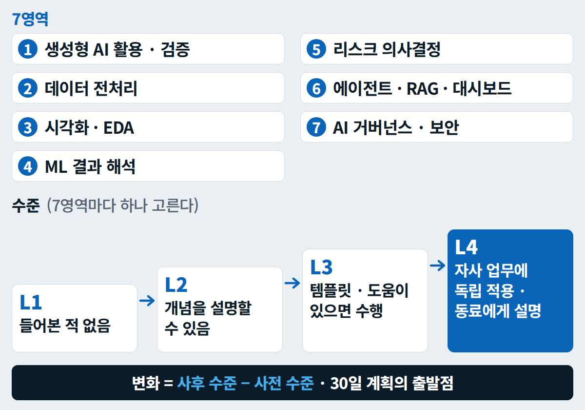

6일차 · 제출 · 팀 15:50 · 개인 17:50 

# 제출 — 팀은 릴리스 링크 하나, 개인은 비공개 폼

**팀**은 솔루션 킷을 팀 저장소(비공개, 강사가 협업자)의 릴리스 `v1.0` 링크 하나로 냅니다. **개인** 도입 기획서 · 나만의 KPI · ROI는 회사 이야기가 들어가므로 **비공개 폼으로만** 내고, 저장소에는 올리지 않습니다. 폼 주소는 수업 중 화면(QR)과 오픈채팅 공지로 안내합니다 — 아래 표의 폼 이름이 링크로 보이면 거기서 열어도 됩니다.

## 한눈에 — 마감 {#overview}

| 마감 | 누가 | 무엇 | 어디로 |
|---|---|---|---|
| **5일차(10/20) 21:00** | 개인 | 기획서 초안 `plan_draft__T{조}-{번호}.docx`(1–6장) | 개인 제출 비공개 폼 |
| **6일차 15:50** | 팀 | 솔루션 킷 `tradefin-kit-T{조}` 릴리스 `v1.0` 링크 | 팀 제출 폼 |
| **6일차 17:05** | 개인 | 사후 진단 · 동료 투표 | 사후 진단 폼 · 동료 피드백 · 투표 폼 — 주소는 수업 중 화면(QR) · 오픈채팅 공지, 안 열리면 [종이 양식](judging.md#files) |
| **6일차 17:50** | 개인 | 최종 기획서 `d6_plan__T{조}-{번호}.docx`(11장) · 나만의 KPI · ROI `d6_roi__T{조}-{번호}.xlsx` | 개인 제출 비공개 폼 |
| 수료 후 7일 안 | 개인(선택) | 피드백 반영본 다시 내기 | 같은 비공개 폼 |

**파일 이름**: `{산출물}__T{조}-{번호}` — 예: 2조 7번 → `d6_plan__T2-07.docx` · `d6_roi__T2-07.xlsx`(밑줄 두 개, 대문자 T, 번호 두 자리). 팀 zip은 `d6_team_solution__T2.zip`.

## 팀 제출 — 15:50 `v1.0` 릴리스 링크 {#team}

1. **15:40 코드 프리즈 전에** README 5항목(목적 · 구성 · 실행 방법 · 데이터 원천과 가상 여부 · 담당자)과 [보안 점검](kit.md#security) 3검색(실제 키 · 실명 · 실제 이메일 → 0건)을 마치고, 릴리스 노트(P6-3 초안 → 사람이 고침)를 `release/v1.0` PR로 병합합니다.
2. **15:40 코드 프리즈** — 이후로는 기능을 더하지 않습니다. README · 오타는 `v1.0`을 만들기 전에만 고칩니다.
3. 저장소 관리자: 프리즈 뒤 `gh release create v1.0 …` 또는 **Releases** → **Draft a new release** → 태그 `v1.0` → **Publish release** → [릴리스 만들기](kit.md#release).
4. 다른 역할 1명이 `v1.0`을 새 폴더에서 다시 돌려 '차이 0줄'을 확인합니다 → [재현 테스트](lab-b.md#b6-repro).
5. **15:50까지** 릴리스 주소(`…/releases/tag/v1.0`)를 팀 제출 폼에 붙이고 제출합니다. 팀당 한 번이면 됩니다.
6. GitHub가 막히면 `d6_team_solution__T{조}.zip`(README 포함, 폴더 구조 그대로)을 USB로 강사에게 건네고, 강사가 대신 올립니다(팀 제출 폼은 파일을 받지 않습니다).

- `v1.0`을 낸 뒤 고친 것은 `v1.1`로 새 릴리스를 만듭니다 — 태그는 옮기지 않습니다. 심사는 `v1.0` 기준입니다.
- 15:45에 발표 순서를 추첨합니다 → [7분 데모](kit.md#demo).

## 개인 제출 — 비공개 폼 {#personal}

| 순서 | 언제 | 무엇 |
|---|---|---|
| 기획서 초안 | **5일차 21:00** | `plan_draft__T{조}-{번호}.docx` — 1–6장(요약 · 현황 · 문제 정의와 목표 KPI · 솔루션 구조 · 데이터 · 모델 · 규칙) |
| 1차 서면 피드백 | 6일차 09:00 | 자리마다 봉투(인쇄본) — 첫 장에 내 1:1 코칭 시각 → [피드백 양식](#feedback) |
| 1:1 코칭(10분) | 13:20–14:00 · 14:15–14:55 · 15:10–15:30 중 내 시각 | "개선 3개 중 1개를 같이 고치기". 자리를 비우는 동안 내 역할은 역할 이슈에 적어 둔 **코칭 대행자**가 맡습니다 |
| 팀 서면 심사평 | 17:10 | 팀별 서면 심사표 → [심사 기준](judging.md#awards) |
| 최종 기획서 | **17:50** | `d6_plan__T{조}-{번호}.docx` — 11장 완성본 |
| 나만의 KPI · ROI | **17:50** | `d6_roi__T{조}-{번호}.xlsx` — KPI 3개 이내(기준선 · 목표 · 측정 방법 · 주기) + ROI(보수안부터) |
| 다시 내기(선택) | 수료 후 7일 안 | 피드백 반영본 — 강사가 한 줄 서면 확인을 보냅니다 |

- 기획서 양식은 `ax_proposal_template.md`(11장)입니다. 7–11장 초안과 **.docx** 파일은 프롬프트 [S8](../prompts/day6.md#s8)이 한 번에 만들어 줍니다 — 서식을 손으로 옮기지 않습니다. 파일 만들기가 안 되는 AI라면 Markdown으로 받아 Google Docs에서 **파일 → 다운로드 → Microsoft Word(.docx)**.
- 자사 실명 · 담당자 연락처 · 실데이터는 넣지 않습니다. 제출 전에 [익명화 체크리스트](../setup.md#byod)의 '마지막 확인'을 봅니다.
- 폼에서 **제출** 뒤 '응답이 기록되었습니다' 화면까지 확인합니다.

## 개인 기획서 11장 — 6일의 결과가 모이는 곳 {#proposal}

| 장 | 제목 | 작성 가이드 | 쌓아 온 곳 |
|---|---|---|---|
| 1 | 요약(1쪽) | 문제 1줄 · 해법 1줄 · 기대효과(숫자 2개) · 요청 사항(예산 · 인력 · 승인) | 전체 |
| 2 | 현황(AS-IS) | 매출채권 규모 · DSO · 연체율 · 결제방식 구성 · 수작업 검토시간(숫자는 익명화) | 1일차 현안 정의서 · [AX 캔버스](../ax-project.md#canvas) |
| 3 | 문제 정의와 목표 KPI | KPI마다 기준선 · 목표 · 측정 방법 · 주기, 효과를 AI와 분리하는 방법(도입 전후 · 대조군) | 1일차 AX 캔버스 · 6일차 KPI |
| 4 | 솔루션 구조 | 파이프라인: 전처리 → 예측 → 등급 → 한도 → 경보 → 독촉 초안 → 사람 승인 → 로그, 도구별 대안(Plan B) | 2–5일차 · 5일차 규정 챗봇 평가표 · 상황판 요구사항 |
| 5 | 데이터 | 원천(ERP · 엑셀 · 신용조사 등) · 품질 이슈 · 가명처리 규칙 · 보관 위치 · 갱신 주기 | 2일차 자사 데이터 사전 · 정제 규칙 |
| 6 | 모델 · 규칙 | 등급 기준 · 임계값과 비용 비율 · 한도 공식 · 경보 임계값 · **사람 개입 지점** | 3일차 비용비 · 임계값 · 4일차 정책 실험 카드 · 자사 파라미터 |
| 7 | 운영 SOP | 위기 유형별 SOP 요약과 발동 조건 | 6일차 SOP |
| 8 | 리스크 · 규제 · 데이터 거버넌스 | 아래 체크리스트마다 '해당 / 비해당 / 확인 필요' + 근거, 위험(환각 · 모델 오류 · 입력 조작 · 벤더 종료 · 인력 의존)과 완화책 | 5 · 6일차 |
| 9 | 비용 · ROI | 도구비 시나리오 비교 · BCR · ROI · 회수기간 — 보수안 먼저 | 6일차 ROI |
| 10 | 로드맵 | PoC 4주 → 파일럿 → 확산, 단계마다 중단 기준 | 6일차 이론(PoC · 파일럿 · 확산) |
| 11 | 30일 실행계획 | 현업 복귀 30일 안에 할 일 3개 — 각각 구현 의도 3줄(언제 · 어디서 · 무엇으로) + 담당 · 기한 · 완료 기준 | 6일차 총정리 |
| 부록 | 용어 · 근거 자료 · 가정 목록 | | |

- 5일차 21:00 초안은 1–6장, 6일차에 7–11장을 채워 마감합니다. A4 8–12쪽이면 충분합니다.

### 8장 체크리스트 — 항목마다 '해당 / 비해당 / 확인 필요'와 근거 {#ch8-checklist}

| 항목 | 확인할 것 |
|---|---|
| 개인정보 | 바이어 담당자 이름 · 이메일은 개인정보다. 해외 AI 서비스에 넣을 때의 국외 이전 요건 |
| 가명처리 | 익명화 규칙(ID 치환 · 삭제 · 스케일 · 날짜 이동 · 권역화)과 대응표 보관 위치 |
| 신용정보 · 추심 | 채권 추심을 외부에 맡길 때 허가 요건 — 무허가 대행에 맡기지 않는다 |
| 독촉 문구 | 야간 반복 연락 · 허위 법적 절차 표시 금지를 설계 기준으로(5일차 가드레일) |
| AI 관련 법 | 우리 사용이 고영향 판단 · 생성형 결과물 고지 대상인지 — 해석이 필요하면 '확인 필요(사내 법무)' |
| 금융권 원칙(참고) | 사람 최종 승인 · 로그 보관을 사내에도 적용하는가 |
| 해외 규제 | 거래국 · 바이어 쪽 규제의 해당 여부 |
| 저작권 · 데이터 수집 | 약관 · 규칙 원문 재배포 금지, 수집 체크리스트(2일차) |
| 모델 리스크 | 검증 · 재학습 주기, 성능 모니터링, 변경 이력 |
| 감사 추적 | 감사로그 필드와 보관 기간(5일차 승인 기록) |
| 도구 수명 | 벤더 종료 · 요금 변경 대비, 데이터 내보내기 경로 |
| 사내 규정 | 회사 AI 사용 규정 · 보안 규정, 승인 부서 |

## 1차 서면 피드백과 1:1 코칭 {#feedback}

5일차 21:00에 낸 초안(1–6장)에 두 강사가 밤사이 1인 1쪽 서면 피드백을 씁니다. 6일차 09:00에 봉투로 받습니다.

| 칸 | 내용 |
|---|---|
| 총평 | 2줄 |
| 강점 3 | 항목마다 근거 쪽수 |
| 개선 3 | 무엇을 · 왜 · 어떻게 |
| KPI 타당성 | 기준선이 있는가 · 측정할 수 있는가 · 효과를 AI 도입과 분리할 수 있는가 |
| 리스크 | 개인정보 · 환각 · 규정(K-SURE 기한 · 면책) · 사람 승인 지점 |
| 다음 30일 액션 | 1–3개(담당 · 기한) |

**개인 기획서 루브릭(각 1–4점)** — 서면 피드백과 최종본 확인에 같은 기준을 씁니다.

| 기준 | 1 | 2 | 3 | 4 |
|---|---|---|---|---|
| 문제 정의 | 막연함 | 문제는 있으나 숫자 없음 | 숫자 기준선 있음 | 기준선 + 원인 가설 + 범위 |
| 데이터 준비도 | 원천 불명 | 원천만 적음 | 품질 · 가명처리 계획 | 샘플로 검증 완료 |
| 솔루션 적합성 | 도구 나열 | 파이프라인 일부 | 전 단계 + 사람 승인 | 전 단계 + 대안(Plan B) |
| KPI · ROI 타당성 | 과장 · 근거 없음 | 산식만 | 보수 시나리오 포함 | 보수 · 기준 · 낙관 + 신뢰도 보정 |
| 거버넌스 · 리스크 | 없음 | 일부 | 체크리스트 대부분 | 체크리스트 + 책임자 · 주기 |
| 실행 가능성 | 계획 없음 | 로드맵만 | 30일 계획 | 30일 계획 + 승인 경로 |

- **1:1 코칭(10분)**은 개선 3개 가운데 1개를 강사와 같이 고치는 시간입니다. 고칠 장을 미리 열어 두고 갑니다.
- 팀 해커톤 심사([심사 기준](judging.md))와 개인 기획서 루브릭은 따로입니다. 개인 기획서는 순위를 매기지 않습니다.

## 사후 진단 — 16:55 {#post-assessment}

사전 설문과 **같은 문항**으로 6일 뒤 내 수준을 다시 잽니다(10분, QR). 줄 세우는 시험이 아니라 30일 계획의 출발점입니다.

| 수준 | 뜻 |
|---|---|
| L1 | 들어본 적 없음 |
| L2 | 개념을 설명할 수 있음 |
| L3 | 템플릿 · 도움이 있으면 수행 |
| L4 | 자사 업무에 독립적으로 적용하고 동료에게 설명 |

- **7영역**: ① 생성형 AI 활용 · 검증 ② 데이터 전처리 ③ 시각화 · EDA ④ ML 결과 해석 ⑤ 리스크 의사결정 ⑥ 에이전트 · RAG · 대시보드 ⑦ AI 거버넌스 · 보안.
- **추가 4문항**: 가장 먼저 현업에 적용할 것 · 가장 어려웠던 실습과 이유 · 업무 관련성(1–5) · 30일 실행계획 3개(기획서 11장과 같게).
- 같은 시간에 [동료 투표](judging.md#peer)도 냅니다 — 둘 다 **17:05 마감**. 폼: 사후 진단 폼 — 안 열리면 종이 양식 `post_assessment.md`.

<figure markdown="span">
  { width="520" loading=lazy }
  <figcaption>사후 진단 — 7영역마다 L1–L4 중 하나를 고르고, 변화는 사후 수준 − 사전 수준입니다</figcaption>
</figure>

## 양식 파일 {#files}

--8<-- "docs/_snippets/day6/files_kit_cards.md"
