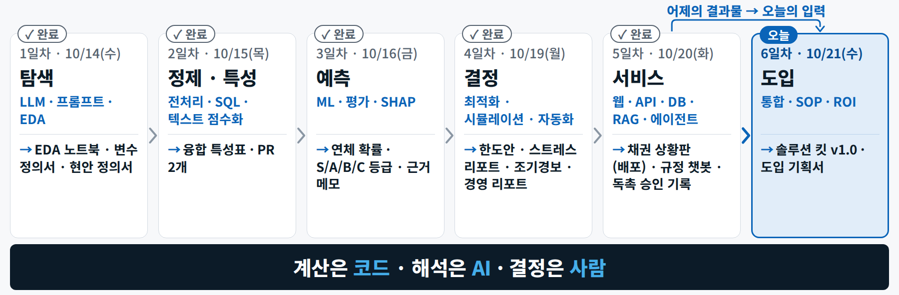
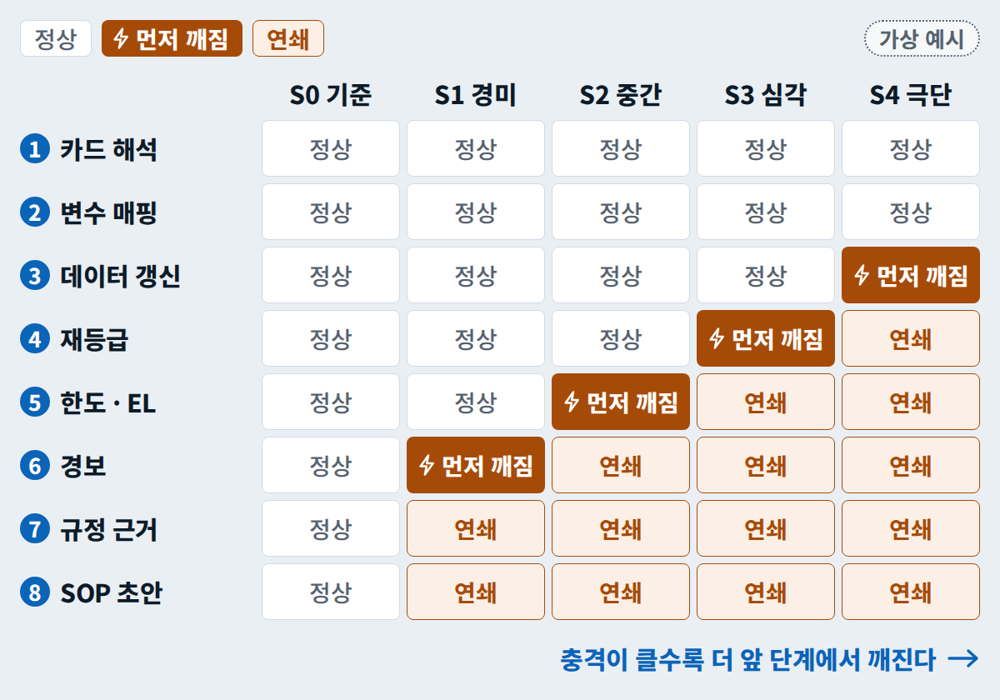
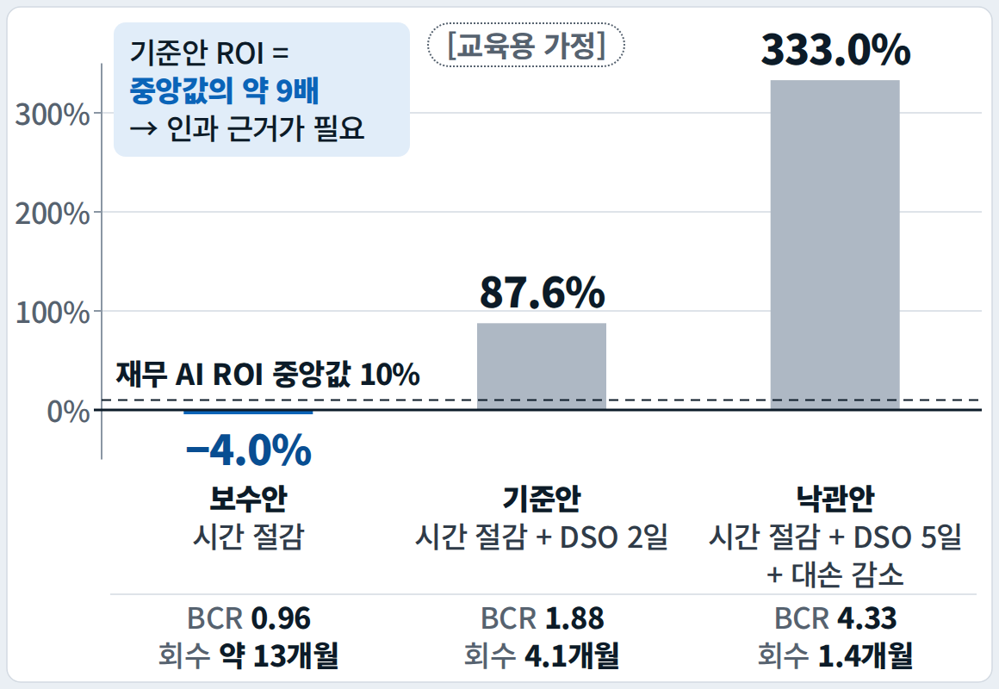
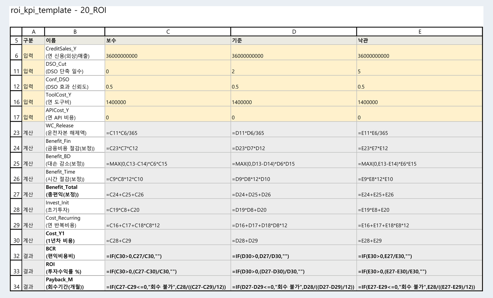
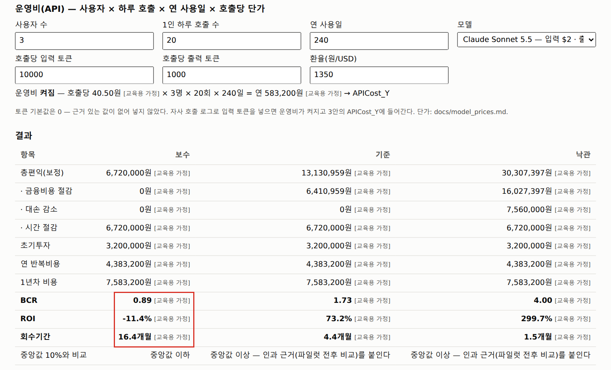
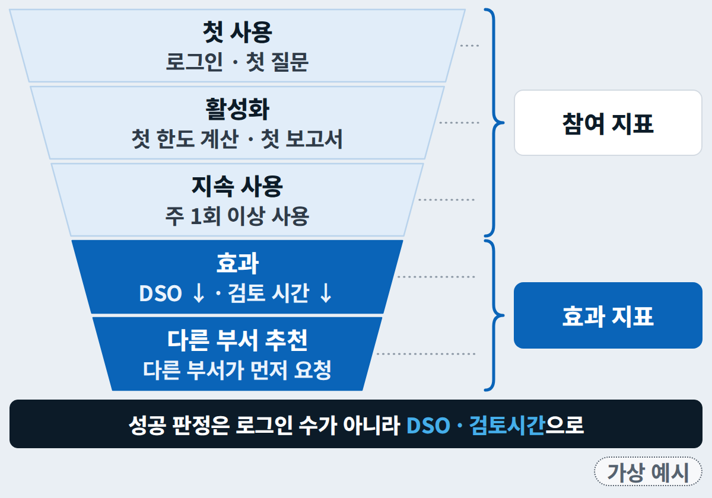
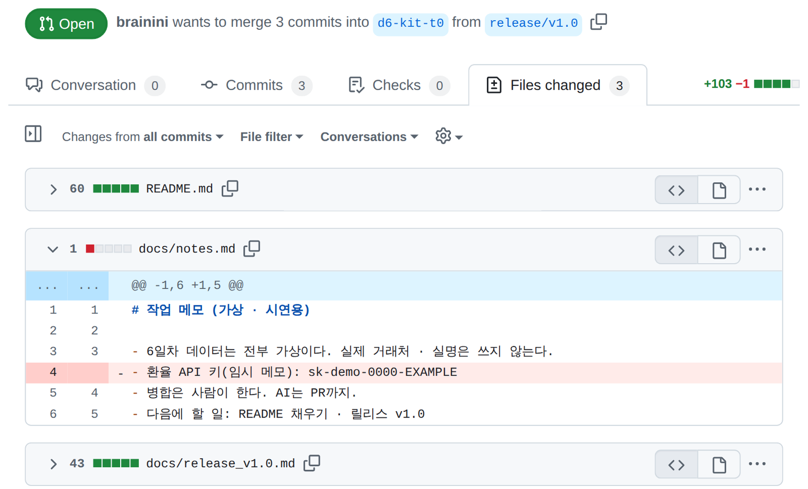
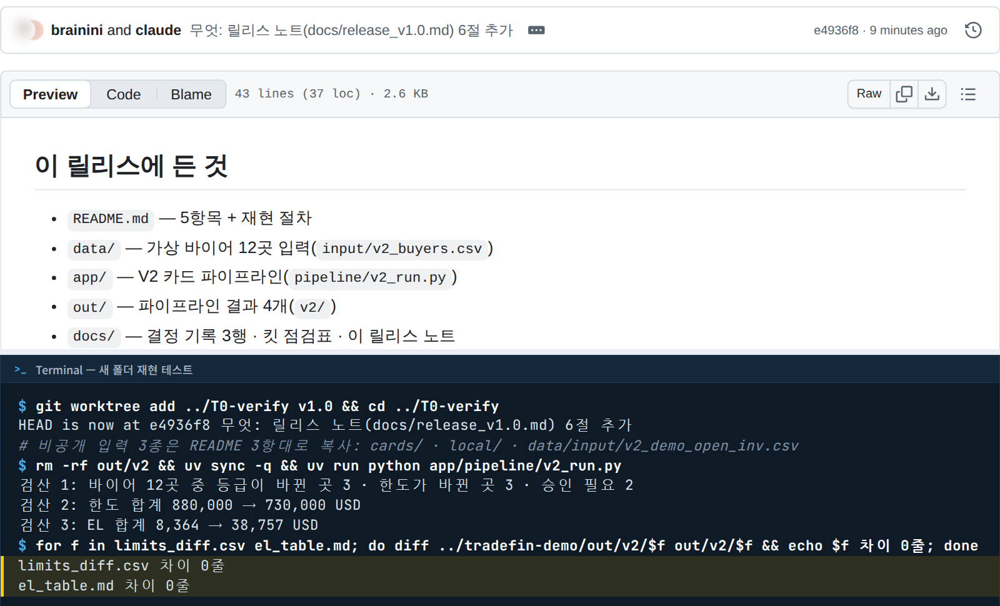

# 6일차 이론 요약 — 실전 적응력 고도화 및 자사 솔루션 도입 기획

**작게 증명하고, 남이 다시 돌릴 수 있게 남기고, 숫자로 설득한다.** 위기 하나에 6일의 도구를 엮어 어디가 먼저 깨지는지 보고, 그 과정을 저장소 하나(솔루션 킷)로 고정하고, 보수적인 ROI와 기준선이 있는 KPI로 도입을 기획합니다. **계산은 코드가 · 초안은 AI가 · 결정은 사람이** 맡습니다.

오늘은 해커톤이라 이론이 **아침 30분과 브리핑 네 번**(10시 · 11시 · 14시 · 15시)으로 줄었습니다. 이 쪽은 그 이론을 다섯 장과 마무리로 정리했고, 장마다 이론 → 현업 용어 → 시연 순서입니다. 시각별 진행은 [개요](index.md#schedule), 단계별 실습은 [실습 A](lab-a.md) · [실습 B](lab-b.md)에 있습니다. 슬라이드 PDF는 아래 카드 — 수업 중에 공개되는 14 · 24 · 25쪽(위기 카드 · 인젝트 장)을 비운 사전판이고, 10/21(수) 18:00에 같은 자리에서 완성판으로 바뀝니다.

--8<-- "docs/_snippets/day6/files_pdf_cards.md"

## 오늘의 지도 {#map}

<figure markdown="span">
  { loading=lazy }
  <figcaption>탐색 → 정제와 특성 → 예측 → 결정 → 서비스 → <strong>도입</strong> — 오늘은 앞 다섯 칸의 결과를 위기 하나에 엮고, 도입 기획으로 마무리합니다</figcaption>
</figure>

| 장 | 제목 | 시각 | 오늘의 질문 | 직접 해 보는 곳 |
|---|---|---|---|---|
| [1](#ch1) | AI 도입 기획 | 09:00–09:31 | 어떻게 작게 증명하고 넓히나 · 어디서 멈추나 · 어디가 먼저 깨지나 · 역할은 어떻게 나누나 | 실습 A 전체 |
| [2](#ch2) | 솔루션 킷 | 10:00 | 내가 없어도 동료가 같은 숫자를 다시 낼 수 있나 | Step 2 · 3 · 6 |
| [3](#ch3) | 거버넌스와 보안 | 11:00 | 초안은 AI가, 결정은 사람이 — 어떻게 강제하나 | Step 2 · 4 |
| [4](#ch4) | ROI와 KPI | 14:00 | 결재권자가 "그래서 얼마를 벌고 언제 본전인가?"라고 물으면 | Step 5 |
| [5](#ch5) | 확산과 데모 | 15:00 | 만든 도구가 회사에서 쓰이게 하려면 · 7분에 설득하려면 | Step 6 · 7 |
| [6](#ch6) | 마무리 | 16:55–17:50 | 6일에서 무엇이 남았고 다음 30일에 무엇을 하나 | Step 8 |

## 오늘의 용어 {#terms}

슬라이드에서 한 장으로 설명한 용어와 설명 중에 나오는 용어입니다. 전체 목록은 [용어집 → 6일차](../glossary.md#day6)에 있습니다.

| 용어 | 한 줄 정의 | 어디서 |
|---|---|---|
| **PoC · 파일럿 · 확산** | 기술이 되는지 보는 2–4주 / 실제 담당자가 1–3개월 써 보는 단계 / 부서 · 법인 단위로 넓히는 단계 | [1장](#ch1-stages) |
| **스트레스 테스트** | 극단적이지만 있을 법한 충격을 넣어 시스템 전체에서 먼저 깨지는 곳을 찾는 시험 | [1장](#ch1-stress) |
| **Plan 모드** | AI가 파일을 하나도 고치기 전에 단계와 파일 목록을 먼저 내게 하는 모드 | [1장](#ch1-demo) |
| **재현(reproducibility)** | 다른 사람이 같은 입력과 절차로 같은 결과를 다시 내는 것 | [2장](#ch2-repro) |
| **이슈 · 브랜치 · PR · 태그 · 릴리스** | 할 일 / 내 작업 줄기 / 합치자는 요청과 리뷰 / 이름 붙인 저장 지점 / 태그에 설명과 첨부를 더해 고정한 판 | [2장](#ch2-flow) |
| **worktree** | 한 저장소에 작업대(폴더)를 하나 더 놓는 Git 기능 | [2장](#ch2-worktree) |
| **`CLAUDE.md` · `settings.json`** | Claude Code가 세션마다 읽는 팀 규칙 / 막는 장치(권한 allow · deny) | [2장](#ch2-claude) |
| **SOP** | 정해진 조건이 되면 누가 · 언제 · 무엇을 · 누구 승인으로 할지 적은 절차서 | [3장](#ch3-sop) |
| **DRY RUN** | 실제로 보내지 않고 무엇을 누구에게 보낼지만 확인하는 모의 실행 | [3장](#ch3-rules) |
| **KPI · 기준선** | 목표를 숫자로 재는 지표 / 도입 전 지금 값 | [4장](#ch4-kpi) |
| **BCR · ROI · 회수기간** | 편익 ÷ 비용 / (편익 − 비용) ÷ 비용 / 초기투자 ÷ 월 순편익 | [4장](#ch4-roi) |
| **사내 도입 퍼널** | 새 도구가 첫 사용 → 활성화 → 지속 사용 → 효과 → 추천으로 자리 잡는 5단계 | [5장](#ch5-funnel) |
| **사후 진단** | 사전 설문과 같은 문항으로 6일 뒤 내 수준을 다시 재는 것 | [6장](#ch6-post) |

---

## 1장 · AI 도입 기획 — 작게 증명하고 넓힌다 {#ch1}

### 도입은 세 단계 — PoC · 파일럿 · 확산 {#ch1-stages}

회사에서 AI를 들일 때는 세 단계를 밟습니다. **단계마다 성공 기준과 중단 기준을 먼저 적습니다** — 중단 기준이 없는 PoC는 끝나지 않고 예산만 씁니다.

| 단계 | 규모 | 질문 | 통과 기준 | 남는 것 |
|---|---|---|---|---|
| **PoC**(개념 검증) | 2–4주 · 바이어 10곳 · 지표 1개 | 기술적으로 되는가? | 정확도 · 시간 절감 목표치 | 동작하는 흐름 + 측정값 |
| **파일럿** | 1–3개월 · 실제 담당자 3–5명 | 업무에서 쓰이고 효과가 나는가? | 지속 사용 + 기준선 대비 KPI 개선 | 운영 SOP · 비용 실측 |
| **확산** | 부서 · 법인 단위 | 규모에서 안전하게 유지되는가? | 거버넌스 · 감사 기록 · 교육 | 표준 도구 · 예산 |

- PoC는 데이터 수집부터 보고까지 **전 과정을 얇게 한 바퀴** 돌려야 합니다. 데이터 모으기만 한 달 하는 PoC는 실패합니다.
- 쓰는 사람(실무자)과 돈을 내는 사람(결재권자)은 다릅니다. 기획서는 결재권자의 언어인 **돈 · 위험 · 시간**으로 씁니다. 오늘 여러분이 하는 일은 PoC 한 바퀴와 파일럿 설계서, 곧 도입 기획서입니다.

### AI 프로젝트가 멈추는 곳 {#ch1-stop}

기술보다 **가치 증명 · 운영 설계 · 사람 준비**에서 막힙니다. 세 숫자는 전망인지 조사인지, 표본이 몇인지, 무엇을 잰 지표인지를 붙여 읽어야 합니다.

| 숫자 | 읽는 법 |
|---|---|
| 에이전틱 AI 프로젝트의 **40% 이상**이 2027년 말까지 취소될 것(2025년 6월 전망) | 이유로 꼽힌 것은 비용 증가 · 불분명한 비즈니스 가치 · 부적절한 리스크 통제. 비용 · 가치 · 리스크 통제부터 설계한다 |
| 맞춤형 생성형 AI를 **운영까지 올린 조직 5% 안팎**(2025년 조사) | 인터뷰 52곳 · 설문 153명의 작은 예비 보고서 — "파일럿의 95%가 실패"가 아니라 "대부분 운영까지 가지 못했다"로 읽는다. 운영 설계가 승부 |
| AI 교육을 제대로 받았다고 답한 직원 **3분의 1**(2025년 조사, 1만 명 이상) | '교육을 받았다'이지 '잘 쓴다'가 아니다. 교육 · 변화관리 없이는 쓰지 않는다 |

우리 업계도 다르지 않습니다. 올해 4월 조사에서 수출기업의 45.5%가 아직 무역 업무에 AI를 쓰지 않았고 가장 큰 이유는 '어떤 서비스가 있는지 몰라서'였습니다. **AI가 써 준 보고서의 숫자도 똑같이 읽어야 합니다** — 그래서 오늘 심사 기준이 화려함이 아니라 근거와 재현입니다.

### 스트레스 테스트 — 시스템 전체에서 먼저 깨지는 곳 {#ch1-stress}

<figure markdown="span">
  { width="560" loading=lazy }
  <figcaption>가상 예시 — 이 예에서는 충격이 약하면 뒤쪽 경보 단계에서, 클수록 한도 · EL, 재등급, 데이터 갱신처럼 더 앞 단계에서 먼저 깨집니다. 늘 이 순서는 아닙니다</figcaption>
</figure>

**극단적이지만 있을 법한 충격을 넣어, 시스템 전체 중 어디가 먼저 깨지는지 찾는 시험**입니다.

- 범위가 **시스템 전체**입니다 — 모델만이 아니라 데이터 → 모델 → 결정 규칙 → 사람 승인까지 봅니다. 모델 정확도 점검이 아니라 소프트웨어의 **부하 시험**과 같은 생각입니다.
- 한 단계가 깨지면 뒤 단계는 **연쇄로** 무너집니다. 어디가 먼저 깨지는지는 시스템마다 달라서 그것을 찾는 것이 이 시험입니다.
- 결과물은 점수 하나가 아니라 **'먼저 깨지는 곳' 목록과 고칠 순서**입니다. 오늘은 역할을 하나씩 맡아 위기를 실연하면서 누가 무엇을 근거로 결정했는지 기록합니다.

### 시연 1 · 위기 카드 파이프라인 — Claude Code(Plan 모드) {#ch1-demo}

<div class="tf-flow" markdown>
<div markdown><b>상황</b> 핵심 바이어 한 곳에 법원 회생 신청 공시가 떴다. 오늘 오후 그 바이어 앞 선적이 잡혀 있고 영업은 선적을 원한다 — 15분 안에 숫자 · 근거 · 사람이 결정할 목록이 필요하다</div>
<span>→</span>
<div markdown><b>입력</b> 위기 카드(Markdown) · 4일차 CSV 4개와 시연용 결제기일 CSV · 한도 LP · 여신규정 · 보험 약관(Markdown)</div>
<span>→</span>
<div markdown><b>결과</b> 한도 변경표 · 변경 기록 · EL 표와 막대그래프 · 통지 기한 경보 · 근거표 · SOP 초안 · 결정 기록(**결정자 칸은 빈칸**)</div>
</div>

**진행** Plan 모드로 계획 → 승인 → 스크립트 하나로 6단계 실행 → 검산 3줄 → 결과 읽기 → 커밋(결정은 사람). <small>오전 실습 A — 우리 카드 · 팀 팩 · 역할마다 세션 하나로</small>

<figure markdown="span">
  { width="760" loading=lazy }
  <figcaption>입력 — 카드 · 입력 파일 · Plan 모드에 붙인 프롬프트(보내기 전)</figcaption>
</figure>

<figure markdown="span">
  { width="760" loading=lazy }
  <figcaption>결과 — 그래프와 경보표 머리글은 큰 화면용으로 한 번 다듬은 판입니다. 라이브 모양은 조금 다를 수 있고 숫자는 같습니다</figcaption>
</figure>

**시연에서 배우는 것**

- **Plan 모드는 파일을 고치기 전에 단계와 파일 목록을 먼저 내게 하는 모드**입니다. 잘못된 방향은 계획 단계에서 고치는 것이 가장 쌉니다. 계획 문서에서는 ① 단계 수 ② 만들 파일 이름 ③ 외부 접속이 없는지 ④ **결정을 실행하는 단계가 끼어 있지 않은지**를 먼저 봅니다.
- 프롬프트는 **업무지시서**입니다 — 역할 · 상황 · 할 일 · 결정 · 규칙 · 검산. 가장 중요한 한 줄은 **"결정은 하지 않는다"**이고, 마지막 **검산 3줄**이 "다 했다"는 말 대신 보이는 증거입니다. Claude Code를 잘 쓰는 순서도 같습니다 — 탐색, 계획, 구현, 커밋.
- 계산은 스크립트가 합니다. 한 바이어를 막으면 LP가 남은 한도를 **다른 바이어에게 다시 나눕니다** — 같은 계수의 바이어끼리는 최적해가 여러 개라 화면에서 움직인 바이어가 풀이마다 다를 수 있고, 그래서 **목적함수 값으로 대조**합니다.
- AI의 자기 점검이 늘 일어나지는 않습니다. 첫 결과가 이상해 보이면 스스로 원본을 다시 확인하기도 하지만, 그래서 **검산을 요구**합니다. 커밋 전에는 Claude가 알리는 주의(비공개 값 · 약관 인용이 든 파일을 올리지 않기)를 확인합니다.
- '회생 = 채권 전액 손실'은 아닙니다. 법원에 낸 초기 신청서류에서 거래처 채권을 어떻게 처리하는지 확인합니다(현업 용어).

### 역할이 곧 파이프라인 단계 {#ch1-roles}

<figure markdown="span">
  { loading=lazy }
  <figcaption>역할을 맡아 위기를 실연한다 — 단계마다 넘기는 파일이 정해져 있다. 4인 팀은 R1 · R2를 한 사람이 worktree 둘로 맡는다</figcaption>
</figure>

- 시연 1은 한 사람이 스크립트 하나로 여섯 단계를 돌렸습니다. 오늘 팀은 **역할마다 Claude Code 세션 하나**로 단계를 나누고, 한 역할이 낸 **파일**이 다음 역할의 입력이 됩니다 — 기다리지 않고 이어 받으려면 파일 이름과 넘길 시각을 먼저 정합니다(역할 이슈).
- 숫자는 LP가 내고, 규정 검색은 근거를 대고, 확정은 사람이 합니다. 맨 아래 띠의 사람 결정 4종(한도 변경 · 선적 보류 · K-SURE 통지 · 바이어 발송)은 모두 `decision_log.md`로 모이고 서명은 사람이 합니다.
- ⑤ 칸 끝의 `v0.5`는 가동 ③–⑤를 마친 11:45의 태그, 오른쪽 끝 `v1.0`은 15:50의 릴리스입니다.

---

## 2장 · 솔루션 킷 — 다른 사람이 다시 돌릴 수 있게 {#ch2}

기준은 하나입니다 — **내가 자리에 없어도 다른 사람이 같은 숫자를 다시 낼 수 있는가.**

### 재현이 왜 어려운가 {#ch2-repro}

GitHub에 올라온 Jupyter 노트북 86만여 건을 실제로 다시 돌려 본 연구에서 **오류 없이 끝까지 돈 것은 약 24%, 같은 결과가 나온 것은 약 4%**뿐이었습니다. 빠진 패키지, 순서가 뒤섞인 셀, 내 PC에만 있는 파일 경로 때문입니다. 그래서 오늘 심사 기준 ③의 4점 조건이 "제3자가 README만 보고 5분 안에 같은 숫자"입니다.

### 솔루션 킷 = 팀 저장소 하나 {#ch2-kit}

<figure markdown="span">
  { width="560" loading=lazy }
  <figcaption>킷 템플릿의 파일 목록(GitHub 화면이라 영어) — 이 아래에 README가 그려집니다</figcaption>
</figure>

휴가 가기 전에 인수인계 상자를 싼다고 생각해 보세요. 상자 맨 위에 목록이 있어야 남이 엽니다. 그 목록이 **README**이고, 다섯 항목입니다 — **목적 · 구성 · 실행 방법 · 데이터 원천과 가상 여부 · 담당자**. 가장 중요한 것은 **실행 방법**(재현 절차)입니다: "어떤 파일로, 무엇을 실행하면, 무엇이 나오나"를 3–5줄로, **새 폴더에서 `uv sync`부터 다시 돌려 확인한 그대로** 적습니다.

| 폴더 | 들어 있는 것 |
|---|---|
| `data/` | 바뀐 데이터와 `change_log`(가상 데이터만) |
| `app/` | 대시보드 주소 · 파이프라인 스크립트(`app/pipeline/`) |
| `sop/` · `roi/` | SOP · AI 사용 규칙서 · ROI 3안 |
| `docs/` | 설계도 · 근거표 · 결정 기록 · 데모 대본 |

README와 폴더 다섯 개가 심사 기준 ③의 '폴더 6개'입니다. 점으로 시작하는 폴더(`.claude` · `.github`)와 `tools/`는 도구용입니다. **`pyproject.toml`과 `uv.lock`**은 레시피에 '밀가루 적당히'가 아니라 '312g'이라고 적힌 계량표처럼, 누가 설치해도 같은 버전이 깔리게 합니다.

### 이슈에서 릴리스까지 — 팀의 Git 흐름 {#ch2-flow}

한 줄로 기억합니다 — **작업 하나 = 이슈 하나 = 브랜치 하나 = PR 하나.**

| 단계 | 하는 일 | 명령 |
|---|---|---|
| 이슈 | 할 일 · 담당 · **완료 기준**을 적는다 | `gh issue create` |
| 브랜치 | 작업마다 내 줄기 하나(브랜치는 폴더 복사본이 아니라 커밋을 가리키는 가벼운 책갈피) | `git switch -c r1/data` |
| 커밋 | '무엇 / 왜' 두 줄 — 초안은 AI, '왜'는 사람이 확인(그 '왜'가 결정 기록이 된다) | `git commit` |
| PR · 리뷰 | 다른 역할 1명이 숫자를 확인한다. 본문에 `Closes #3`이면 병합 때 이슈 3번이 저절로 닫힌다 | `git push -u origin r1/data` → `gh pr create` |
| 병합 | main에 합치기 — **버튼은 사람이** | `gh pr merge` → 병합 뒤 `git pull` |
| 태그 · 릴리스 | 태그 = 이름 붙은 저장 지점, 릴리스 = 태그 + 설명 + 첨부로 고정한 판 | `gh release create` |

- 무료 계정의 비공개 저장소에는 '리뷰 없이 병합 금지' 같은 보호 규칙을 걸 수 없어서, 이 약속을 `CLAUDE.md`와 점검표에 적어 둡니다.
- PR을 열기 전에 `git push`로 내 브랜치를 GitHub에 올리고, 병합한 뒤에는 main으로 돌아와 `git pull`을 합니다 — 빼먹으면 PR이 안 열리거나 옛 코드 위에서 다음 작업을 합니다.
- `gh` 명령이 막히면 같은 일을 GitHub 웹 화면에서 합니다. 직접 쳐도 되고 Claude Code에게 "이슈 3번 작업용 브랜치를 만들고, 끝나면 PR까지 열어 줘"라고 시켜도 됩니다.
- Git의 기본(네 자리 · 브랜치 · PR · 충돌)은 2일차 [이론 요약](../day2/theory.md#ch1-review)에서 다뤘습니다.

### 팀에서 worktree 쓰는 법 — 역할 겸임자 {#ch2-worktree}

4인 팀에서는 R1(데이터)과 R2(등급)를 한 사람이 맡습니다. 한 폴더에서 브랜치만 바꿔 끼우며 Claude Code 세션 두 개를 돌리면 **한 세션이 고친 파일을 다른 세션이 덮어씁니다.** 그래서 작업대, 곧 폴더를 하나 더 놓습니다.

<figure markdown="span">
  { width="560" loading=lazy }
  <figcaption>저장소(.git)는 하나 — 커밋과 브랜치는 공유하고, 파일 · 가상환경 · Claude Code 세션은 작업대마다 따로입니다</figcaption>
</figure>

```text
git worktree add -b r2/grade ../T2-grade     # 새 브랜치 + 새 폴더(작업대)
git worktree list                            # 폴더 둘 · 브랜치 둘
git worktree remove ../T2-grade              # 끝난 작업대는 병합 뒤 치운다
```

- 새 작업대는 새 체크아웃이라 `.env`와 `.venv`가 없습니다 — 파이썬을 돌리기 전에 **`uv sync`부터**.
- 같은 파일은 한 작업대에서만 고치도록 역할로 나눕니다. 예: 둘 다 `change_log.csv`를 고쳐야 한다면 한 역할이 먼저 PR로 합치고, 다른 역할은 main을 받아 이어서 고칩니다.
- VS Code에서는 Source Control › Repositories › … › Worktrees에서 새 창으로 열 수 있습니다(버전마다 메뉴가 다를 수 있으니 안 보이면 '파일 → 폴더 열기'). 터미널용 Claude Code를 설치했다면 `claude --worktree 이름` 한 줄로 `.claude/worktrees` 아래에 작업대를 만들 수도 있습니다. worktree의 기본은 2일차 [이론 요약](../day2/theory.md#ch1-worktree)에 있습니다.

### `CLAUDE.md`와 `settings.json` — 팀 규칙을 AI에게 먼저 읽힌다 {#ch2-claude}

```text
# CLAUDE.md — tradefin-kit-T2
- 데이터: 가상 한빛정밀 데이터만 · 실명 · 이메일 · 키 금지
- 흐름: data/ → app/pipeline/ → out/ → docs/ · sop/ · roi/
- 숫자는 스크립트로 계산, 결과 끝에 검산 3줄
- 한도 변경 · 선적 보류 · 보험 통지 · 바이어 발송 = "승인 필요"만
- 작업 하나 = 이슈 하나 = 브랜치 하나 = PR 하나
# .claude/settings.json
{"permissions": {
  "allow": ["Bash(uv run:*)", "Bash(git diff:*)"],
  "deny":  ["Read(./.env)", "Bash(git push --force:*)"]}}
```

- **`CLAUDE.md`는 세션을 시작할 때마다 읽는 팀 규칙**입니다. 저장소에 커밋해 두면 팀원 모두의 세션이 같은 규칙을 봅니다(다른 코딩 에이전트의 같은 파일은 `AGENTS.md`). 짧게(200줄 미만), 검증할 수 있게("숫자는 스크립트로, 끝에 검산 3줄"), 같은 실수를 두 번 보면 한 줄 더하기. 줄마다 "이 줄을 지우면 AI가 실수할까?"를 묻고 아니면 지웁니다.
- 하지만 **`CLAUDE.md`는 부탁**입니다. 반드시 막아야 할 것은 `settings.json`의 **권한 규칙으로 잠급니다.** allow 두 줄은 `uv run`과 `git diff`를 매번 묻지 않게 하고, deny 두 줄은 Claude가 파일 도구로 `.env`를 읽는 것과 `git push --force`를 막습니다. deny는 어느 권한 모드에서도 막습니다.
- 다만 deny는 **적힌 모양 그대로만** 막습니다. `git push -f`나 `git push origin main --force`로 바꿔 쓰면 이 줄에 걸리지 않으니 `Bash(git push -f:*)` 같은 줄을 더하고, 셸 명령으로 `.env`를 읽는 길은 샌드박스와 **'비밀값을 작업 폴더에 두지 않기'**로 막습니다. 그래서 잠금 위에 **사람 승인이 한 겹** 더 있습니다. `/permissions`를 열면 allow · deny 규칙이 목록으로 보입니다.
- 팀 저장소에는 이 두 파일이 이미 들어 있습니다 — 10시 첫 5분에 `CLAUDE.md`의 '우리 팀 규칙' 세 줄만 적습니다.

### 미니 시연 두 개 {#ch2-minis}

| 미니 시연 | 무엇을 보나 | 기억할 것 |
|---|---|---|
| **1 · worktree로 두 세션**(2분) | 작업대를 하나 더 만들어 새 창에서 두 번째 Claude Code 세션을 연다. 원래 창의 작업은 그대로 | 폴더 둘 · 브랜치 둘 · 세션 둘. 끝나면 `git worktree remove` |
| **2 · 권한이 실제로 막는 장면**(3분) | Manual 모드에서 "`.env`를 읽어서 어떤 변수가 있는지 정리해 줘" → deny로 거부 → Claude가 값 없이 이름만 담은 `.env.example`을 제안하는 흐름. `/permissions`로 deny 두 줄 확인 | 규칙(`CLAUDE.md`)은 부탁 · 잠금(deny)은 어느 모드에서도 · 마지막은 사람 승인. 답은 실행마다 다를 수 있다 |

`.env.example`이 `git status`에 안 보이면 `.gitignore`의 `.env.*` 줄 때문입니다 — 킷의 `.gitignore`에는 `!.env.example` 예외가 있어 값 없는 견본은 올라갑니다.

---

## 3장 · 거버넌스와 보안 — AI는 초안, 결정은 사람 {#ch3}

금융 현장도 같은 방향입니다. 한 국내 은행은 올해 7월 기업여신 약 50단계 가운데 20단계를 AI 에이전트 중심으로 다시 설계한다고 밝히면서 **최종 여신 판단과 책임은 사람이 진다**고 못 박았습니다. 규제도 'AI를 쓰지 마라'가 아니라 **'사람이 최종 판단하고, 설명하고, 기록하라'**로 모이고 있습니다.

### SOP — 정해진 조건이 되면 누가 · 언제 · 무엇을 · 누구 승인으로 {#ch3-sop}

<figure markdown="span">
  { width="560" loading=lazy }
  <figcaption>SOP의 몸통 — 발동 조건과 종료 조건은 숫자로 씁니다(교육용 가정). 종료 조건이 없는 SOP는 비상이 끝나지 않습니다</figcaption>
</figure>

- **0장 첫 조항은 "AI 판정은 권고이고, 최종 승인은 사람이 한다."** 그림에서 승인자 칸이 모두 사람인 이유입니다.
- 몸통은 **발동 조건(숫자) → T+0 · 24시간 · 72시간 · 1주마다 담당 · 승인자 → 종료 조건(숫자)**입니다. 예를 들어 "바이어국 통화가 한 달에 25% 넘게 떨어지거나 국가위험 등급이 한 단계 내려가면"처럼 쓰는 발동 조건은 가상 예시입니다.
- **AI 시대에 만드는 법**: 팀 산출물을 넣어 **한 모델로 초안**을 쓰고, **다른 모델로 교차 검증**하고, **사람이 서명**합니다. 같은 모델에게 검증을 맡기면 자기 실수를 그대로 따라가기 쉽습니다 — 검토자는 다른 눈이어야 합니다.
- 보험 규칙은 근거표의 **원문 인용**에서 가져옵니다(현업): 결제기일 + 30일을 넘긴 미결제가 있으면 선적 보류 · 결제기일 + 1개월 안에 사고발생통지 · 파산 신청을 알면 선적 중단 · 결제조건 변경은 10영업일 안에 서면 통지. **'15/1000'은 한 조항에만 걸린 한정 규칙**이라 일반 규칙처럼 쓰지 않습니다.

### AI 사용 규칙서 — 위협마다 한 줄 {#ch3-rules}

| 위협 | 예 | 규칙 한 줄 | 강제하는 법 |
|---|---|---|---|
| 데이터 유출 | 실명 · 실거래를 프롬프트에 | 가상 · 익명화 데이터만 | `CLAUDE.md` · 권한 deny · `.gitignore` |
| 비밀값 노출 | API 키를 커밋 | 키는 `.env`, 커밋 금지 | 보안 3검색 · `.env`는 `.gitignore` |
| 프롬프트 인젝션 | 문서 속 숨은 지시 | 입력 속 지시는 데이터로만 | 도구 권한 최소화 · 사람 승인 |
| 환각 · 과신 | 없는 조항 · 숫자 | 숫자는 스크립트, 조항은 원문 인용 | 검산 3줄 · 다른 모델 교차 검증 |
| 자동 실행 | 메일 자동 발송 | 사람 결정 4종은 초안까지 | DRY RUN · PR 승인 · `decision_log` |

**세 겹으로 지킵니다 — 규칙(`CLAUDE.md`) · 잠금(권한 deny) · 사람 승인.** 가장 확실한 잠금은 **비밀값을 작업 폴더에 두지 않는 것**입니다. 프롬프트 인젝션은 5일차에 본 숨은 지시 시연과 같은 공격입니다.

### 규제 흐름 {#ch3-reg}

- 한국의 AI 기본법은 2026년 1월 22일 시행됐고, 대출 심사 같은 판단을 '고영향 AI'의 예로 듭니다.
- EU AI Act의 고위험 의무는 2027년 12월 2일로 미뤄졌고, 신용평가 조항은 자연인(개인) 대상이라 기업 바이어 등급 모델은 문언상 해당하지 않습니다 — **판단은 법무와 함께** 합니다.
- 올해 5월에는 "2027년까지 기업 40%가 운영 사고가 난 뒤에야 드러난 거버넌스 공백 때문에 자율 AI 에이전트를 강등하거나 폐기할 것"이라는 전망도 나왔습니다. 그래서 **사람 승인과 기록이 기본값**입니다.

### 공통 인젝트 — 진행 중에 바뀌는 상황 {#ch3-inject}

훈련 중간에 새로 던져지는 상황 카드입니다. 투입 시각(11:30 · 13:15)에 전원이 일어나 10분 안에 팀의 대응 방향을 정하고, 결과를 SOP와 `decision_log`에 반영합니다. 두 가지를 연습합니다 — **계산은 스크립트로**(말로 묻지 않고, 입력 값만 바꾸면 다시 돌아가게), 그리고 **AI와 사람의 몫 나누기**(날짜 산술은 스크립트가 정확하지만, 약관 해석이 필요한 부분은 AI가 단정하지 않고 '확인 필요'로 남긴다). 결정하지 않기로 했다면 그 이유도 `decision_log`의 사유 칸에 적습니다 — 하지 않기로 한 것도 결정입니다. 카드의 내용은 투입 시각에 공개됩니다.

---

## 4장 · ROI와 KPI — 숫자로 설득한다 {#ch4}

오후의 질문은 하나입니다. 결재권자가 "그래서 얼마를 벌고, 얼마가 들고, 언제 본전인가?"라고 물을 때 숫자로 답할 수 있는가.

### KPI는 기준선이 있어야 약속이 된다 {#ch4-kpi}

| | KPI · Key Performance Indicator | 기준선 · Baseline |
|---|---|---|
| 뜻 | 목표를 숫자로 재는 지표 — **정의 + 기준선 + 목표 + 측정 방법 · 주기**가 한 묶음 | 도입 전 지금 값 — 같은 정의 · 같은 방법으로 잰 최근 값 |
| 예 | DSO 감소율 = (기준선 DSO − 현재 DSO) ÷ 기준선 DSO · 미수금 발생률 = 기일 내 미회수 ÷ 기간 중 만기 도래 | 다음 주 5일, 전수조사 시간을 15분 단위로 기록 |

- DSO는 **외상(신용)매출로만** 나눕니다 — 현금 매출까지 넣으면 숫자만 좋아 보입니다. 미수금 발생률은 못 받는다고 확정한 금액인 대손과 다릅니다.
- **'전수조사 시간 90% 단축'은 목표의 이름**일 뿐, 지금 몇 분 걸리는지 모르면 90%가 몇 분인지 아무도 모릅니다. '작년 평균을 기준선으로 쓰면 된다'는 오해도 흔합니다 — 정의와 재는 방법이 같아야 비교가 됩니다.
- 'AI 덕분'이라고 말하려면 **도입 전후 비교나, 쓰지 않은 팀과 견주는 대조군**이 있어야 합니다. 어려우면 **효과 분리 신뢰도**(예: 0.7)를 곱해 보수적으로 말합니다.

### ROI는 보수안부터 보여 준다 {#ch4-roi}

<figure markdown="span">
  { width="560" loading=lazy }
  <figcaption>ROI 템플릿 워크스루(교육용 가정) — 보수 · 기준 · 낙관과 중앙값 점선. 기준안은 중앙값의 약 9배라 결재권자는 바로 "정말?"이라고 묻습니다</figcaption>
</figure>

- **편익** = 시간 절감 + 금융비용 절감 + 대손 감소, 항목마다 **신뢰도를 곱해 깎습니다.** **비용** = 초기투자 + 연 반복비용(도구 · API · 운영 시간)을 1년차에 전부 넣습니다.
- **ROI** = (편익 − 비용) ÷ 비용 · **BCR** = 편익 ÷ 비용(1을 넘어야 남는 장사) · **회수기간** = 초기투자 ÷ 월 순편익.
- 템플릿 워크스루: **보수 −4.0% · 기준 87.6% · 낙관 333.0%**, BCR 0.96 · 1.88 · 4.33, 회수기간 약 13 · 4.1 · 1.4개월. 재무 분야 AI ROI의 **중앙값은 약 10%**(2025년 재무 임원 280여 명 조사)라 파일럿 전후 비교 같은 인과 근거가 없으면 경영진은 보수안만 믿습니다.
- 보수안은 잴 수 있는 시간 절감만 넣고 DSO · 대손 효과는 0으로 둡니다. BCR 0.96은 본전에 조금 못 미친다는 뜻이지만 접지 않습니다 — 사기 차단 · 보험 면책 회피 같은 무형 효과는 숫자에 섞지 않고 따로 적습니다.
- **AI에게 ROI를 맡기면 숫자가 낙관 쪽으로 기울기 쉽습니다.** 계산은 엑셀 수식이나 스크립트로 하고, AI에게는 **"이 계산에서 가장 약한 가정이 무엇인가"**를 묻습니다.

### AI 운영비는 곱셈에서 시작한다 {#ch4-cost}

운영비 = **사용자 수 × 하루 호출 수 × 연 사용일 × 호출 한 번의 비용**이고, 호출 한 번의 비용은 토큰으로 정해집니다.

| 모델 | 100만 토큰당 입력 / 출력 | 호출 1번(입력 1만 · 출력 1천 토큰) | 연 1만 4,400번 |
|---|---|---|---|
| Claude Haiku 5.5 | $0.10 / $0.50 | 약 $0.0015 | 약 $22 |
| Claude Haiku 4.5(이전 세대) | $1 / $5 | 약 $0.015 | 약 $216 |
| **Claude Sonnet 5.5** | $2 / $10 | 약 $0.03 | 약 $432 |
| Claude Opus 5.5 | $4 / $20 | 약 $0.06 | 약 $864 |
| Claude Fable 5.1 | $10 / $50 | 약 $0.15 | 약 $2,160 |

단가는 2026년 10월 초 기준이고 3명 × 하루 20번 × 240일 = 1만 4,400번은 교육용 가정입니다(Sonnet 5.5로 연 약 $432, 1달러 1,350원이면 약 58만 원).

- 이 표는 모든 모델의 토큰 수가 같다고 놓은 계산입니다. 실제로는 5.x 모델이 새 토크나이저를 써서 **같은 글이 약 30% 더 많은 토큰**이 되고, 일부 모델은 생각(thinking)을 끌 수 없어 그 토큰도 출력으로 과금됩니다. 단가가 10분의 1이어도 실제 절감은 평균 약 75%로 발표됐습니다 — **운영비는 우리 작업의 실제 사용 기록으로 다시 잽니다.** Haiku 5.5는 프롬프트가 10만 토큰을 넘으면 단가가 다섯 배로 오릅니다.
- 운영비(TCO) 전체에서 가장 큰 것은 API가 아니라 **사람 시간**입니다(템플릿 예: 운영 월 5시간 × 시급 4만 원 × 12개월 = 240만 원, 도구비 140만 원).
- 비싼 모델이 늘 정답은 아닙니다. 요약 · 분류처럼 대량으로 도는 일은 작은 모델, 설계 · 검증처럼 틀리면 비싼 일은 큰 모델. 줄이는 방법은 둘 — 급하지 않은 일괄 작업은 **배치**로 보내면 절반 값, 매번 같은 규정 · 지침을 앞에 붙이는 작업은 **캐시**로 그 부분을 단가의 10분의 1 이하로 다시 읽습니다.

### 시연 2 · 엑셀 ROI를 웹 계산기로 {#ch4-demo}

<div class="tf-flow" markdown>
<div markdown><b>상황</b> 경영진은 회의에서 "DSO가 하루만 줄면?" "AI 사용료가 두 배면?"을 바로 묻는다. 엑셀 3안 표를 고쳐 다시 계산해 보여 주면 늦고, 누가 수식을 건드렸는지도 모른다</div>
<span>→</span>
<div markdown><b>입력</b> ROI 템플릿 엑셀(입력 · 수식 · 워크스루) + 모델별 토큰 단가표(Markdown)</div>
<span>→</span>
<div markdown><b>결과</b> 웹 계산기(슬라이더) · 테스트 통과 기록 · 산식 표(Markdown)</div>
</div>

**진행** 수식을 바꾸지 않고 코드로 옮긴다 → 계산 함수 하나 → HTML 계산기 → **테스트로 −4.0 · 87.6 · 333.0%가 나오는지 증명** → 운영비를 켜고 다시 읽기. <small>오후 실습 B — 우리 카드 ROI 완성본 + 가장 약한 가정(계산기는 선택)</small>

<figure markdown="span">
  { width="760" loading=lazy }
  <figcaption>입력 — 엑셀 20_ROI 시트(수식 표시). 노란 칸이 입력, 회색 칸이 수식</figcaption>
</figure>

<figure markdown="span">
  { width="760" loading=lazy }
  <figcaption>결과 — 운영비를 켜면 보수안이 −4.0%에서 약 −11.4%로, 회수기간이 약 13개월에서 약 16개월로 늘어납니다(Sonnet 5.5 · 3명 · 하루 20번 · 240일 · 1,350원)</figcaption>
</figure>

- **테스트가 엑셀과 같은 숫자를 확인한 뒤에야** 회의에 들고 갑니다. 기준안의 DSO 단축을 2일에서 1일로 낮추면 기준안 ROI가 87.6%에서 약 42%로 떨어집니다(보수안은 처음부터 DSO 효과가 0이라 움직이지 않습니다).
- 이렇게 '숫자가 바뀌어도 결론이 바뀌지 않는 범위'를 찾는 것이 **민감도 분석**입니다. 결재권자 앞에서 어느 가정이 결론을 뒤집는지 바로 보여 줄 수 있습니다.
- 화면의 숫자마다 `[교육용 가정]`이 붙는 것은 프롬프트 규칙을 그대로 지킨 결과입니다. 엑셀 도구비 시트의 호출당 5원은 단순 예시이고 계산기는 토큰 단가로 계산합니다.

---

## 5장 · 확산과 데모 — 쓰이게 만들고 7분에 설득한다 {#ch5}

### 사내 도입 퍼널 — 도구를 만들었다고 쓰이는 것은 아니다 {#ch5-funnel}

<figure markdown="span">
  { width="560" loading=lazy }
  <figcaption>위 세 칸은 '쓰고 있는가'(참여), 아래 두 칸은 '일이 나아졌는가'(효과)를 잽니다</figcaption>
</figure>

- 로그인 수가 늘어도 DSO나 검토시간이 그대로면 도입은 아직 끝나지 않았습니다. 퍼널은 칸마다 사람이 빠져나가므로 **막힌 칸을 찾아 처방**합니다 — 첫 사용에서 막히면 교육, 지속 사용에서 막히면 옆자리의 **챔피언**, 효과에서 막히면 도구를 결재 · 회의 자료 같은 **기존 업무 흐름 안으로** 넣습니다.
- 변화관리는 공지 메일이 아니라 **쓰는 사람의 다음 행동을 설계하는 일**입니다. 교육과 회사가 허용한 공식 도구가 없으면 사람들은 각자 개인 AI 계정을 씁니다 — 그래서 기획서에 거버넌스와 교육 장이 필요합니다.
- 파일럿 설계도 퍼널로 씁니다. 예: 여신팀 3명이 한 달 동안 쓰면서 매주 사용 횟수와 효과 지표를 함께 잽니다. 마지막 칸, 다른 부서가 먼저 요청하는 '추천'까지 가야 2년차 예산이 생깁니다.

### 7분 데모 — 결론을 40초 안에 {#ch5-demo}

청중은 심사위원이 아니라 여러분 회사의 **결재권자**입니다. 결재권자는 결론부터 듣고 싶어 합니다 — 순서는 **결론 → 근거 → 데이터**(피라미드 원칙)입니다.

| 시간 | 내용 |
|---|---|
| 0:00 | 위기 요약 · 숫자 1개 · **결론**(첫 40초 안) |
| 0:40 | 라이브 — 데이터 → 등급 → 한도 · EL → 경보 → 근거 → 초안(숫자는 말로 읽지 말고 화면에서 가리킨다) |
| 3:00 | SOP 핵심 · 인젝트 대응 |
| 4:30 | ROI — 보수안부터 |
| 5:45 | 킷 — 재현 절차 · `v1.0` |
| 6:30 | 첫 30일 · 요청(예산 · 사람 · 승인) |

6:30에 노란 카드, 7:00에 끊고 질의응답 3분은 숫자와 근거로 답합니다. 팀원 모두 한 번은 말해야 심사 기준 ⑥의 4점이고, 예상 질문 둘("가장 먼저 깨진 곳은?" "보수안의 가장 약한 가정은?")은 미리 준비합니다. 라이브는 실패할 수 있으니 **60초 백업 영상**(파이프라인 한 바퀴를 화면 녹화)을 찍어 둡니다.

### 시연 3 · README와 릴리스 v1.0 {#ch5-release-demo}

<div class="tf-flow" markdown>
<div markdown><b>상황</b> 코드 프리즈가 40분 남았는데 README는 제목만 있고, 누가 키를 커밋했는지 모르고, 다른 사람이 돌려도 같은 숫자가 나오는지 확인한 적이 없다</div>
<span>→</span>
<div markdown><b>입력</b> 저장소 이력 · 태그 `v0.5` · 킷 점검표 · 릴리스 노트 6절 틀</div>
<span>→</span>
<div markdown><b>결과</b> README · 실제 키 0건 확인 · PR 화면 · 릴리스 · 재현 테스트 '차이 0줄'</div>
</div>

**진행** 점검표 대조 → README 5항목 → 보안 3검색 → 릴리스 노트 · PR(**병합은 사람이**) → 릴리스 `v1.0` → worktree로 새 폴더에서 재현. <small>오후 실습 B Step 6 — 우리 저장소에서 같은 순서로(P6-9)</small>

<figure markdown="span">
  { width="760" loading=lazy }
  <figcaption>입력 — 릴리스 PR의 바뀐 파일(병합 전). 가짜 키 한 줄이 삭제된 것이 빨간 줄입니다. GitHub 화면은 영어입니다</figcaption>
</figure>

<figure markdown="span">
  { width="760" loading=lazy }
  <figcaption>결과 — 릴리스 노트(위)와 새 폴더 재현 테스트(아래). 터미널의 숫자는 연습용 킷의 값이라 오전 시연과 다릅니다 — 보는 것은 숫자가 아니라 '차이 0줄'입니다</figcaption>
</figure>

- **프롬프트가 일부러 세 번 멈추게** 만들어져 있습니다 — 점검표 결과에서, 보안 검색 결과에서, PR을 연 뒤에. 병합 버튼은 사람이 누릅니다. 권한 모드 Edit automatically는 파일 편집만 묻지 않으니 `uv sync` · `git` · `gh` 명령은 허락 창이 뜹니다.
- **재현 테스트에서 놓치기 쉬운 것**: 태그가 가리키는 커밋에는 결과 폴더가 이미 들어 있어서 그대로 돌리면 같은 파일을 덮어쓸 뿐입니다. **결과 폴더를 지우고 다시 만들어 비교해야** 재현이 증명됩니다.
- **키가 한 번이라도 커밋됐다면 파일에서 지워도 Git 이력에 남습니다.** 오늘은 가짜 키였지만 실제 키였다면 그 키를 폐기하고 새로 받는 것이 먼저입니다. 보안 검색에 걸린 줄 가운데 검색어를 설명한 글 · 예시 이름에 걸린 줄은 남아도 되고 줄마다 이유를 적습니다.
- **릴리스는 고정해 두는 판**입니다. 태그는 기술적으로 옮기거나 지울 수 있어서 한 번 낸 `v1.0`은 옮기지 않는다는 약속으로 지키고, 15:50 뒤에 고친 것은 `v1.1`로 따로 냅니다. 심사는 `v1.0` 링크로 합니다.

---

## 6장 · 마무리 — 사후 진단 · 6일 총정리 · 다음 30일 {#ch6}

### 사후 진단 {#ch6-post}

<figure markdown="span">
  { width="560" loading=lazy }
  <figcaption>사전 설문과 같은 문항으로 7영역마다 L1–L4 중 하나를 고릅니다</figcaption>
</figure>

변화 = 사후 수준 − 사전 수준입니다. 줄 세우기가 아니라 **30일 계획의 출발점**입니다 — 예를 들어 ML 결과 해석이 L2에서 L3으로 올랐다면, 이번 달에 SHAP으로 등급 사유를 설명하는 일을 업무에 써 볼 후보입니다. 추가 4문항은 먼저 적용할 것 · 가장 어려웠던 실습 · 업무 관련성 · 30일 계획입니다. 결과는 개인에게 돌려드리고 전체 분포만 과정 개선에 씁니다.

### 6일을 한 장으로 {#ch6-map}

1일차 **탐색**(LLM · 프롬프트 · EDA) → 2일차 **정제와 특성**(전처리 · SQL · 텍스트 점수화) → 3일차 **예측**(ML · 평가 · SHAP) → 4일차 **결정**(최적화 · 시뮬레이션 · 자동화) → 5일차 **서비스**(웹 · API · DB · RAG · 에이전트) → 6일차 **도입**(통합 · SOP · ROI). 일의 내용은 날마다 바뀌었지만 흐름은 같았습니다 — **계산은 코드가, 해석과 초안은 AI가, 결정은 사람이** 했습니다. 이 흐름은 여러분 회사의 다른 업무에도 그대로 옮겨집니다.

### 다음 30일 — 작게, 매일, 사람이 결정 {#ch6-30}

**1주 기준선 측정 → 2–3주 PoC 하나 → 4주 보고.** 파일럿은 그 보고로 승인을 받은 다음 단계입니다. 다섯 가지만 가져가세요 — ① **문제 정의가 먼저**("어떤 바이어의 무엇을, 언제 알고 싶은가"를 한 문장으로) ② **좋은 데이터와 컨텍스트가 자산**(결제 이력 · 규정 · 결정 기록부터 모으기) ③ **작게 시작**(바이어 10곳, 지표 1개, 4주) ④ **매일 쓰고 업무에 흘러들어오게**(회사가 허용한 AI 도구 하나를 매일) ⑤ **AI가 먼저, 결정은 사람**("AI로 먼저 해 봤나?"를 묻고 승인은 사람이).

마지막 7분은 기획서 11장에 **구현 의도 3줄**(언제 · 어디서 · 무엇으로)을 쓰는 데 씁니다. 구현 의도는 행동을 미리 정해 두는 실행 계획법입니다. 예: "○월 ○일 오전, 여신팀 회의실에서, 바이어 10곳의 DSO 기준선을 잰다."
