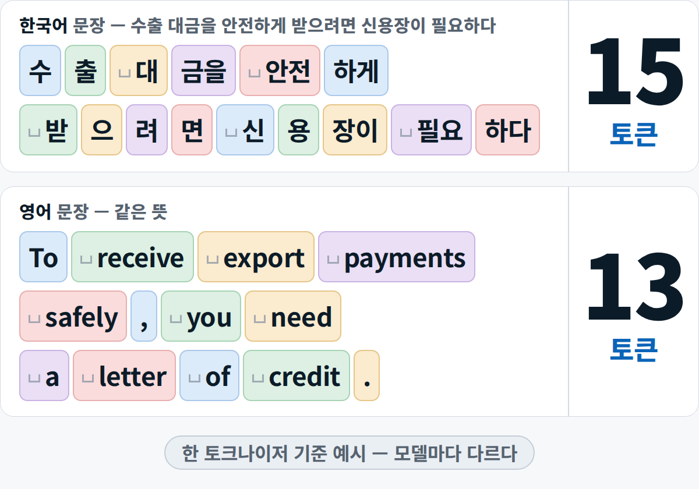
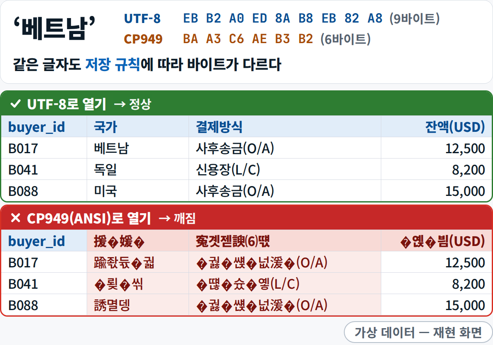

기초 F1 · 1일차 · 데이터 위생 · 토큰 · 인코딩

# F1 · 내 데이터는 어디로 가나

AI 대화창에 올린 파일은 **내 PC를 떠나 AI 회사의 서버로 갑니다.** 그래서 무엇을 올리는지, 어떤 설정으로 올리는지, 어떤 모양(파일 형식·인코딩)으로 올리는지를 먼저 챙깁니다.

<small>[이론 요약](../day1/theory.md)을 보충하는 짧은 해설</small>

## 1. 비유 — 은행 창구와 본점 전산실 {#analogy}

AI 대화창은 **은행 창구**와 같습니다. 창구에 서류를 내면 서류는 창구에 머물지 않고 **본점 전산실**로 갑니다.
AI도 마찬가지입니다. 브라우저의 대화창(창구)은 받아 주기만 하고, 답은 AI 회사의 서버(전산실)에서 만들어집니다.

- **창구에 낸 서류 = 회사 밖으로 나간 서류.** 그래서 거래처에 이메일을 보낼 때와 같은 기준으로 올립니다.
- **전산실이 처리하는 양에는 단위와 한도가 있습니다.** AI에서는 **토큰**입니다. 길게 붙여 넣을수록 요금과 한도가 빨리 찹니다.
- **서류 양식이 다르면 전산실이 잘못 읽습니다.** 파일에서는 **형식(CSV·XLSX)과 인코딩(UTF-8)** 입니다. 한글이 깨지거나 숫자가 글자로 읽히는 문제는 대부분 여기서 생깁니다.

## 2. 그림 {#figure}

<figure markdown="span">
  { loading=lazy }
  <figcaption>AI 서비스의 데이터 제어 메뉴 — '모델 개선(학습)'은 끄고 시작합니다(ChatGPT는 설정 › 데이터 제어, Claude는 설정 › 개인정보)</figcaption>
</figure>

<figure markdown="span">
  { width="640" loading=lazy }
  <figcaption>토큰 — 같은 뜻이어도 언어와 모델에 따라 조각 수가 다릅니다(한 토크나이저 기준 예시)</figcaption>
</figure>

<figure markdown="span">
  { width="560" loading=lazy }
  <figcaption>인코딩 — 한글이 깨지는 것은 파일이 망가져서가 아니라 저장한 규칙과 읽는 규칙이 달라서입니다</figcaption>
</figure>

## 3. 용어 {#terms}

| 용어 | 한 줄 정의 |
|---|---|
| **클라이언트 · 서버** | 요청하는 쪽(브라우저·앱)과, 요청을 받아 처리하고 답을 돌려주는 컴퓨터 — 5일차 [웹과 API](../day5/theory.md#ch1-web)에서 자세히 봅니다 |
| **클라우드 / 온프레미스 / 망분리** | 외부 데이터센터를 빌려 쓰기 / 회사 건물 안의 서버 / 업무망과 인터넷망을 나눈 보안 구조 |
| **토큰 · 컨텍스트 창** | AI가 글을 읽고 쓰는 조각 단위(요금·한도의 단위) · AI가 한 번에 붙잡고 볼 수 있는 토큰의 양(작업 책상의 넓이) → [용어집 1일차](../glossary.md#day1) |
| **CSV · 인코딩(UTF-8)** | 값을 쉼표로 구분해 글자만 담은 표 파일 · 글자를 숫자로 저장하는 규칙(UTF-8이어야 한글이 어디서나 깨지지 않는다) |

알아 둘 것

- **망분리된 회사**에서는 업무 PC에서 AI 사이트가 아예 열리지 않을 수 있습니다. 우회하지 말고 개인 노트북이나 짝의 화면으로 실습합니다.
- **같은 뜻이어도 언어와 표현에 따라 토큰 수가 다릅니다.** 긴 보고서를 통째로 넣는 일이 왜 비싼지 감이 옵니다.
- **XLSX는 시트·서식·수식이 있는 엑셀 파일, CSV는 글자만 있는 표**입니다. AI 도구마다 잘 받는 형식이 달라서 과정 파일은 두 형식을 함께 줍니다.
- **숫자처럼 보이는 글자**를 조심합니다. `"1,234 "`(쉼표·끝 공백), `"30일"`, `"N/A"`처럼 글자로 저장된 숫자는 합계·정렬·피벗을 틀리게 만듭니다. 1일차에 직접 찾아봅니다.

## 4. 오늘 실습 어디서 만나나 {#practice}

| 어디서 | 무엇을 |
|---|---|
| 이론 [00 시작하며](../day1/theory.md#ch00) | 데이터 위생 다섯 가지 — 가상 데이터와 공개 공시만 · 실데이터는 익명화본도 올리지 않기 · 학습 설정 끄기 |
| 이론 [토큰](../day1/theory.md#term-token) · [컨텍스트 창](../day1/theory.md#term-context) · [인코딩](../day1/theory.md#term-encoding) | 요금과 한도의 단위, 한 번에 보는 양, 한글이 깨지는 이유 |
| 실습 **[A-1 · 01 설치 점검](../day1/lab-a.md#a1-check)**(13:00–13:20) | 점검표: 터미널 · 확장 3종 · Claude Code 로그인 · 학습 설정 끄기 · 깨진 CSV 다시 열기(`d1_encoding_test.csv`를 UTF-8로) |
| 실습 **[B-1 · 01 바이어 데이터 진단](../day1/lab-b.md#b1-diagnose)**(15:00–15:12) | 고치기 전에 진단부터: 텍스트 vs 숫자 불일치, 빈칸 같은 품질 문제 찾기(프롬프트 B1) |

- 학습 설정 끄는 법은 [사전 준비 3번](../setup.md#ai-training), CSV가 깨질 때는 [FAQ](../faq.md#q-csv), 올리면 안 되는 것은 [데이터 위생 5원칙](../setup.md#hygiene)에 있습니다.

## 5. 익명 실패 사례 {#case}

[현장 사례 · 익명] **"명령 승인 ≠ 비밀 공유 동의"**

한 개발팀이 AI 코딩 도구에게 원격 서버의 문제 진단을 맡겼습니다. AI가 제안한 명령을 사람이 '승인'했는데,
그 명령이 **환경변수 전체를 화면에 출력**하는 바람에 서버의 비밀 키가 AI 대화 기록에 그대로 남았습니다.
사람이 승인한 것은 진단 명령이었지, 비밀을 넘기는 일이 아니었습니다.

그 뒤 팀은 수칙 세 줄을 문서로 정했습니다.

1. 환경변수·설정 파일을 통째로 출력하지 않는다.
2. 명령을 승인하는 것은 비밀 공유에 동의하는 것이 아니다.
3. 비밀이 노출되면 즉시 알리고 교체한다.

**교훈** — 대화창은 외부 채널입니다. 내가 붙여 넣은 것뿐 아니라 **AI가 대신 읽고 출력한 것**도 회사 밖으로 나갑니다.

## 6. 완료 체크리스트 {#checklist}

- [ ] AI 대화창에 올린 파일이 어디로 가는지(클라이언트 → AI 회사 서버) 내 말로 설명할 수 있다
- [ ] 쓰는 AI 서비스의 '모델 개선(학습)' 설정을 껐고, 민감한 내용은 임시(시크릿) 채팅으로 한다
- [ ] 같은 뜻의 한국어·영어 문장의 토큰 수가 다를 수 있다는 것을 설명할 수 있다
- [ ] 과정 CSV를 UTF-8로 열었다 — 깨졌다면 '텍스트/CSV에서 가져오기'로 스스로 고쳤다
- [ ] 숫자처럼 보이는 글자(예: `"30일"`, `"1,234 "`)를 찾아낼 수 있다

## 다음으로 {#next}

2일차 [F2 · 웹·API, 그리고 커밋 이력](f2.md)에서는 '요청과 응답'을 웹 전체로 넓히고, 데이터를 모으기 전에 확인할 것과 커밋 이력을 살펴봅니다.
