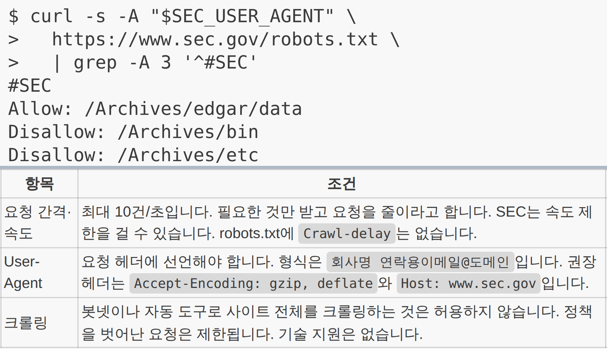
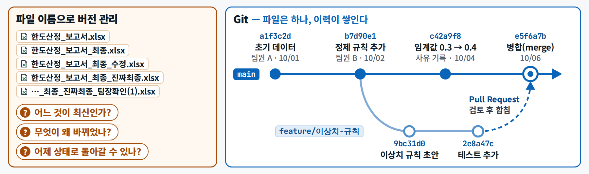

기초 F2 · 2일차 · 이론 1·2장 Git · GitHub와 5장 '텍스트를 지표로'의 수집 원칙

# F2 · 웹·API, 그리고 커밋 이력

웹은 **요청과 응답**입니다. 데이터는 정문(API)으로 먼저 받고, 화면을 긁어 올 때(스크래핑)는 규칙을 지킵니다. 그리고 규칙 · 프롬프트 · 결과를 **GitHub에 커밋**해 '언제, 무엇을, 왜 바꿨나'를 남깁니다.

<small>[이론 요약](../day2/theory.md)을 보충하는 짧은 해설</small>

## 1. 비유 — 주문서와 납품, 그리고 세이브 포인트 {#analogy}

**웹 = 주문서와 납품.** 브라우저가 주소로 **요청**(주문서)을 보내면, 서버가 내용과 함께 **상태 코드**(납품 결과)를 돌려줍니다.

| 상태 코드 | 납품 비유 | 뜻 |
|---|---|---|
| 200 | 정상 납품 | 요청 성공 |
| 403 | 출입 금지 | 접근 권한 없음(막힌 사이트, 로그인 필요) |
| 404 | 그런 물건 없음 | 주소가 없음 |
| 429 | 주문이 너무 잦음 | 짧은 시간에 요청이 너무 많음 — 멈추고, 천천히, 횟수를 줄인다 |

**API = 거래처 전용 납품 창구, 스크래핑 = 진열대를 보고 옮겨 적기.** 창구(API)가 있으면 창구를 먼저 씁니다.
진열대를 옮겨 적을 때는 가게의 규칙(robots.txt · 이용약관)과 저작권을 지키고, 너무 자주 가지 않습니다.

**버전관리 = 게임 세이브 포인트.** `보고서_최종_진짜최종_수정2.xlsx`처럼 파일 이름으로 버전을 나누는 대신,
한 파일의 **저장 시점(커밋)** 마다 '무엇을, 왜' 바꿨는지 적어 두고, 언제든 그 시점으로 돌아가 볼 수 있게 합니다.

## 2. 그림 {#figure}

<figure markdown="span">
  { width="720" loading=lazy }
  <figcaption>공식 창구의 이용 조건을 읽는 예 — 허용 경로 · 금지 경로 · 요청 간격 · 정체 밝히기</figcaption>
</figure>

<figure markdown="span">
  { loading=lazy }
  <figcaption>파일 이름 버전 관리 vs Git 이력 — 파일은 하나, 이력이 쌓입니다</figcaption>
</figure>

## 3. 용어 {#terms}

| 용어 | 한 줄 정의 |
|---|---|
| **웹 스크래핑 vs API** | 사람용 웹 화면에서 내용을 긁어 오기 vs 기계끼리 데이터를 주고받도록 만든 공식 창구 |
| **robots.txt · 이용약관 · 저작권** | 사이트가 자동 수집 프로그램에 허용·금지 경로를 알리는 파일 · 수집·저장·재배포가 허용되는지 정한 규칙 · 글에 대한 권리 |
| **HTTP 요청·응답** | 요청하면 서버가 상태 코드와 함께 답한다(200 성공 · 403 금지 · 404 없음 · 429 너무 많음) — 5일차 [웹과 API](../day5/theory.md#ch1-http)에서 자세히 |
| **버전관리 · Git · 커밋** | 변경 이력을 저장·비교·되돌릴 수 있게 관리하기 · 대표 도구 · '무엇을, 왜'를 붙여 저장한 변경 한 묶음 → [용어집 1일차](../glossary.md#day1) |
| **저장소 · GitHub · diff** | 파일과 변경 이력을 함께 담은 프로젝트 폴더 · 저장소를 웹에 올려 협업하는 서비스 · 두 버전 사이의 바뀐 줄 비교 |

알아 둘 것

- **자료를 모으기 전 확인 순서**: ① API · 오픈데이터가 있나 → ② `사이트주소/robots.txt` → ③ 이용약관(자동 수집·재배포·AI 학습 금지 여부)과 저작권(기사 원문은 재배포하지 않고 **제목 · 날짜 · URL · 점수만** 기록) → ④ 우회하지 않기(User-Agent로 정체를 밝히고, 429를 받으면 멈추고 간격을 둔다). robots.txt에 막혀 있지 않다고 해서 약관·저작권 문제가 사라지지는 않습니다.
- **무엇을 커밋하나**: 결과 파일보다 **규칙 · 프롬프트 · 데이터 사전 · 결정 기록**이 먼저입니다. 결과는 규칙과 프롬프트만 있으면 다시 만들 수 있지만, '왜 그렇게 정했나'는 적어 두지 않으면 사라집니다.
- **커밋 메시지는 두 줄**: 첫 줄 `2일차: 결측 대체를 평균에서 중위수로 바꿈`, 한 줄 비우고, `왜: 매출 규모가 한쪽으로 치우쳐 평균이 대표값이 아님`. 빈 줄이 있어야 `git log --oneline`에 첫 줄만 보입니다.

## 4. 오늘 실습 어디서 만나나 {#practice}

| 어디서 | 무엇을 |
|---|---|
| 이론 [1장 Git · GitHub로 함께 일하기](../day2/theory.md#ch1) | 브랜치 · PR · 리뷰 · worktree — 커밋 이력을 나누고 합치는 법 |
| 이론 [모으기 전에 — 가져와도 되는가](../day2/theory.md#ch5-collect) | API 먼저 → robots.txt → 약관 · 저작권 → 우회 금지 |
| 실습 B **[02 수집 점검](../day2/lab-b.md#b-collect)**(15:10–15:20) | `수집점검.md` 다섯 칸을 채우고 결론 하나(API 사용 / 수동 열람만 / 수집 불가) — 점검만 하고 기사를 수집하지 않습니다 |
| **[8교시 합치기](../day2/lab-b.md#period8)**(17:00–17:20) | PR 리뷰 · 병합 · worktree 정리 · 커밋 그래프 확인 |

### 웹 화면만으로 커밋하기 — 채팅 경로 {#first-commit}

VS Code를 못 쓰는 PC에서는 GitHub 웹 화면만으로 같은 일을 할 수 있습니다. 화면의 버튼 이름은 GitHub가 바꿀 수 있습니다. 다르면 강사 시연 화면을 따라 합니다.

1. 과정 저장소 [`brainini/tradefin-ai-2026`](https://github.com/brainini/tradefin-ai-2026)에서 초록색 **Use this template** → **Create a new repository**를 누릅니다.
2. Owner는 내 계정, Repository name은 `tradefin-my-T{조}-{번호}`(예: `tradefin-my-T2-07`), **Public**을 고르고 **Create repository**를 누릅니다. 이름에 실명·회사명은 넣지 않습니다.
3. 내 저장소에서 `workbench` → `day1` → `outputs` 폴더로 들어가 **Add file** → **Upload files**를 누르고 결과 파일(예: `d1_signals_halden.md`)을 끌어다 놓습니다.
4. 아래 커밋 메시지 칸에 두 줄(`1일차: 위험 신호 표 추가` / `왜: …`)을 쓰고 **Commit changes**를 누릅니다.
5. 같은 폴더의 다른 파일을 열고 연필 아이콘(**Edit this file**)으로 **한 줄을 고친 뒤** 다시 커밋합니다 — 두 번째 커밋입니다.
6. 파일 화면의 **History**(시계 아이콘)를 눌러 커밋 목록을 보고, 두 번째 커밋을 눌러 **diff**(빨강 = 지운 줄, 초록 = 더한 줄)를 확인합니다.
7. 커밋 목록에서 첫 번째 커밋 오른쪽의 `<>`(**Browse repository at this point**)를 눌러 **이전 버전**을 열어 봅니다.
8. 저장소 주소를 복사해 제출 폼에 붙입니다.

- 폴더 구조와 일차별로 넣을 파일은 저장소의 `workbench/README.md`에 있습니다.
- 올리기 전에 [저장소 · 앱 규칙](../setup.md#repo-hygiene)을 한 번 봅니다. 웹 업로드는 `.gitignore`가 막아 주지 않습니다.

## 5. 익명 실패 사례 {#case}

[현장 사례 · 익명] **"파일 이름 백업과 'no message' 커밋"**

여러 프로젝트에서 같은 모습이 나왔습니다. 첫 커밋만 해 두고 그 뒤로는 한 번도 커밋하지 않은 저장소,
파일 이름 끝에 `_bk`나 날짜를 붙여 쌓아 둔 백업, 메시지가 'no message'이거나 바꾼 내용과 상관없는 커밋.
셋 다 같은 문제를 남깁니다 — **언제, 무엇을, 왜 바꿨는지 아무도 되짚을 수 없습니다.** '보고서_최종_진짜최종.xlsx'와 같은 문제입니다.

**교훈** — 커밋 메시지는 다음 사람과 **다음 AI**를 위한 기록입니다. 작게, 자주, '무엇'과 '왜'를 적어 커밋합니다.

## 6. 완료 체크리스트 {#checklist}

- [ ] 상태 코드 200 · 403 · 404 · 429의 뜻을 말할 수 있다
- [ ] 자료를 모으기 전 확인 순서(API → robots.txt → 약관 · 저작권 → 우회 금지)를 안다
- [ ] 개인 저장소 `tradefin-my-T{조}-{번호}`가 있고, 커밋이 2개 이상이며 메시지에 '왜'가 있다
- [ ] History에서 diff를 보고, 이전 버전을 열어 봤다
- [ ] 저장소에 실데이터 · 회사 자료 · 키가 없다

## 다음으로 {#next}

3일차 [F3 · 같은 입력이면 같은 결과](f3.md)에서는 같은 입력이면 같은 결과가 나오게 코드 · 데이터 · 환경 · 시드를 고정하고 기록합니다.
