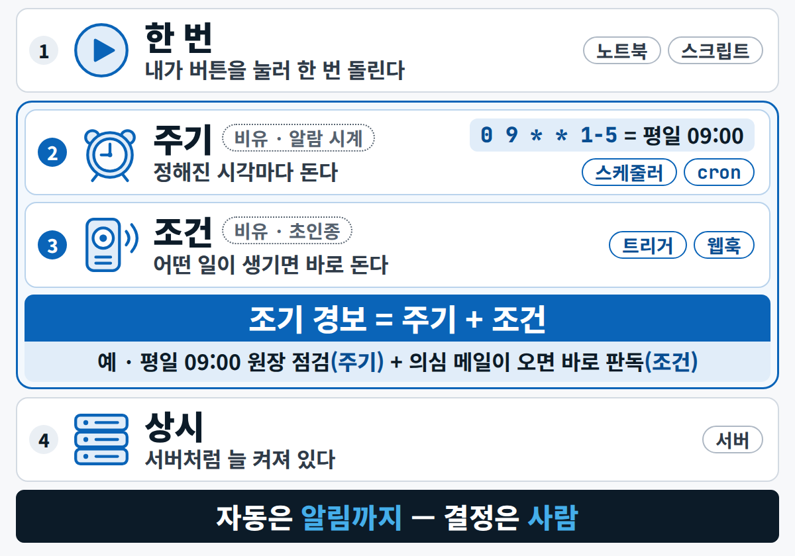
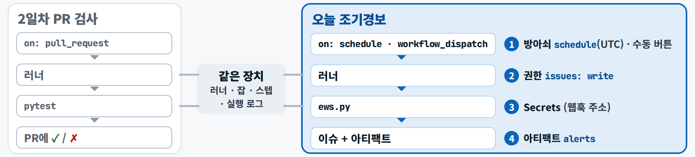

<div class="tf-hero tf-hero--sm" markdown>
<span class="tf-eyebrow">기초 F4 · 4일차 · 3교시 자동화 장(약 10분) + 실습 B ② · 8교시 예약 실행 확인</span>

# F4 · 프로그램은 언제 도는가, 고장은 어떻게 고치나

조기 경보는 누가 버튼을 눌러야 도는 프로그램이 아니라, **정해진 시각에 돌며 조건을 보는 프로그램**입니다. 그리고 고장은 **넣은 것 · 기대한 결과 · 실제 결과 · 재현 절차** 네 가지를 적으면 절반은 고친 것입니다.

</div>

## 1. 비유 — 일하는 방식 네 가지, 그리고 병원 진료 {#analogy}

| 프로그램이 도는 방식 | 업무 비유 | 예 |
|---|---|---|
| **한 번 실행** | 필요할 때 계산기를 두드림 | 엑셀 계산, 노트북 '모두 실행', Actions의 수동 `Run workflow` 버튼 |
| **주기 실행**(스케줄 · cron) | 매주 월요일 9시 정기 보고 | "평일 09:00에 연체 목록을 새로 만든다" |
| **조건 실행**(트리거 · 웹훅) | 연기가 나면 울리는 화재경보기 | "의심 메일이 들어오면 바로 판독한다" |
| **상시 실행**(서버) | 24시간 문을 연 편의점 | 대시보드 앱, 챗봇 |

→ 조기 경보 = **주기 실행 + 조건**. 매일 정해진 시각에 돌면서, 기준치를 넘은 바이어만 알립니다.

**디버깅 = 병원 진료.** "아파요"만으로는 의사가 고칠 수 없습니다. 무엇을 먹었고(**넣은 것**), 평소에는 어땠고(**기대한 결과**), 지금은 어떤지(**실제 결과**), 언제 그런지(**재현 절차**)를 말해야 합니다. AI에게 오류를 물을 때도 똑같습니다.

## 2. 그림 {#figure}

<figure markdown="span">
  { width="520" loading=lazy }
  <figcaption>방아쇠는 데이터가 바뀌는 주기에 맞춥니다 — 원장은 하루 한 번이라 1분마다 감시하는 상시 방식은 과합니다</figcaption>
</figure>

<figure markdown="span">
  { loading=lazy }
  <figcaption>2일차 시연 1에서 본 PR 자동 검사와 같은 장치입니다 — 달라지는 것은 방아쇠 · 권한 · 비밀값 · 결과물</figcaption>
</figure>

## 3. 용어 {#terms}

| 용어 | 한 줄 정의 |
|---|---|
| **트리거 · cron** | 프로그램을 언제 돌릴지 정하는 방아쇠(한 번 · 주기 · 조건 · 상시) / 분 · 시 · 일 · 월 · 요일 다섯 칸으로 적는 시각 — GitHub Actions의 cron은 **UTC** |
| **멱등성 · 로그** | 여러 번 실행해도 한 번과 같은 성질 / 언제 · 무엇을 · 어떤 결과로 했는지의 기록 |
| **브랜치 · 이슈 · PR** | 원본을 건드리지 않고 실험하는 사본 갈래 / 버그 · 할 일을 적고 담당 · 상태를 추적하는 게시물 / 갈래를 합치자는 요청 |

알아 둘 것

- **UTC로 적습니다.** 평일 09:00 KST는 `0 0 * * 1-5`. 9시 전 시각은 전날이 되어 요일 칸도 하루 당깁니다. 예약 실행은 붐비는 시각(특히 정각)에 늦게 시작하거나 건너뛸 수 있어 **17분처럼 정각을 비켜** 씁니다.
- **스케줄과 수동 버튼은 기본 브랜치(main)의 워크플로 파일만** 돕니다. 'Run workflow 버튼이 안 보여요'는 거의 다 이 이유입니다.
- **러너는 빈 컴퓨터**라 커밋된 파일만 봅니다. `.gitignore`로 빠진 원본 데이터는 러너에 없으니 작업 사본을 커밋합니다.
- **로그 = 언제 · 무엇을 · 결과.** 경보가 오지 않았을 때 '안 돌았는지, 돌았는데 0건인지'를 로그로 가립니다. 한 줄에 JSON 하나(jsonl)로 남기면 사람도 코드도 읽습니다.
- **오류 메시지는 마지막 줄부터** 읽습니다. 오류의 종류와 한 줄 설명이 대개 맨 아래에 있습니다.
- **고치기 전에 기대값부터** 적습니다. 예: 시나리오가 심할수록 기대손실이 커져야 한다(S0 < S1 < … < S4), 같은 기준일로 두 번 돌리면 결과 파일이 같아야 한다. 이 성질이 깨지면 어딘가 틀린 것입니다.
- **AI가 고친 곳은 diff로 확인**합니다. "다 고쳤어요"라는 말보다 바뀐 줄이 정확합니다.
- **자동은 알림까지, 결정은 사람이.** 자동 이슈의 모든 문장은 '권고(사람 승인 전)'이고, 병합 버튼은 내가 직접 누릅니다.

## 4. 오늘 실습 어디서 만나나 {#practice}

| 때 | 어디서 | 무엇을 |
|---|---|---|
| 실습 A ③ | 테스트 실패 · 버그 카드 | 실패한 테스트를 **고장 보고 4요소**로 정리해 AI에게 주고(프롬프트 A3), 속성 테스트가 못 잡는 오류를 찾아 봅니다 |
| 실습 B ② | Actions의 `Run workflow` | 워크플로 파일 4곳(방아쇠 · 권한 · 판 번호 · 러너)을 읽고, 실행 로그를 스텝별로 펼쳐 보고, 한 번 더 돌려 **이슈가 1건 그대로**인지 봅니다 |
| 실습 B 막힐 때 | 로그 읽기 | `can't open file` · `403` · 버튼이 안 보임 — 오류 메시지의 마지막 줄부터 |
| 실습 B 더 하기 | 예약 줄 | cron을 UTC로 쓰고, 수업 뒤 **Disable workflow**로 끕니다 |
| 8교시 | 아침에 건 예약 실행 확인 | 이벤트를 `schedule`로 거르고 이슈 맨 아래 댓글(이벤트 · 실행 번호 · 시각)을 읽습니다 |

**오늘 실습** → [4일차 실습 B · ② 자동 실행](../day4/lab-b.md#b-auto) · [막힐 때](../day4/lab-b.md#troubleshooting) · [8교시](../day4/lab-b.md#period8) · [고장 보고 프롬프트 A3](../prompts/day4.md#a3)

이슈 본문은 이 네 칸이면 충분합니다.

```markdown
### 넣은 것
(파일 · 명령 · 설정값 · 기준일)

### 기대한 결과
(무엇이 나와야 했나 — 테스트나 대조표의 값)

### 실제 결과
(무엇이 나왔나 — 숫자, 화면 캡처, 오류 메시지 마지막 줄)

### 재현 절차
1.
2.
3.
```

## 5. 현장 이야기 — "조용한 실패" {#case}

<span class="chip chip--field">[현장 사례 · 익명]</span> AI가 루브릭으로 점수를 매기는 한 평가 시스템은, 검증이 실패하거나 AI의 답을 읽어 내지 못하면 **보통 점수를 주고 통과**시키도록 짜여 있었습니다. 실패한 건도 결과표에서는 평범한 점수처럼 보였고, 무엇이 실패했는지 겉으로 드러나지 않았습니다.

**교훈** — 실패는 결과 속에 숨기지 말고 드러냅니다. 실패는 '실패'로 표시하고 로그에 남기며, 기대값과 대조해 찾아냅니다. 자동화에서는 **'안 돌았다'와 '돌았는데 0건'을 구분할 수 있어야** 합니다.

## 6. 완료 체크리스트 {#checklist}

<div class="tf-checklist" data-title="완료 체크리스트" markdown>

- [ ] 프로그램이 도는 네 방식을 예와 함께 말하고, 조기 경보가 '주기 실행 + 조건'임을 설명할 수 있다
- [ ] 평일 09:00 KST를 UTC cron으로 쓸 수 있다(`0 0 * * 1-5`)
- [ ] 오류 메시지를 마지막 줄부터 읽었다
- [ ] 같은 기준일로 두 번 돌려도 이슈가 1건인 것을 확인했다(멱등)
- [ ] 4요소(넣은 것 · 기대한 결과 · 실제 결과 · 재현 절차)로 고장 하나를 적었다
- [ ] 워크플로의 권한 줄과 cron 줄을 내 눈으로 읽고 승인했다

</div>

## 다음으로 {#next}

5일차 [F5 · 내 PC의 앱을 모두의 앱으로](f5.md)에서는 상시 실행 프로그램(서버)을 직접 띄우고 배포합니다.
