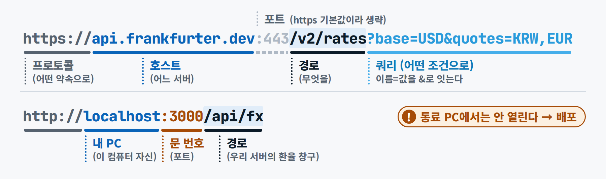
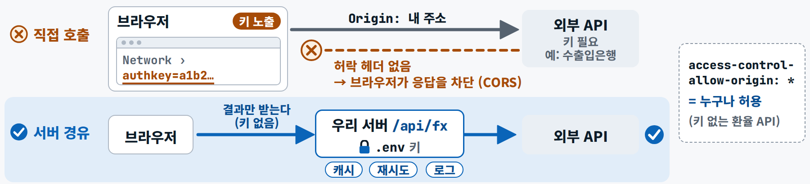

<div class="tf-hero tf-hero--sm" markdown>
<span class="tf-eyebrow">기초 F5 · 5일차 · 1교시 웹과 API · 2교시 배포 장 + 실습 B6 배포 · 8교시 팀 저장소</span>

# F5 · 내 PC의 앱을 모두의 앱으로

`streamlit run`으로 띄운 앱은 **내 PC에서만** 열립니다. 모두가 쓰려면 클라우드 서버에서 계속 돌도록 **배포**하고, 키 같은 **비밀값은 저장소가 아니라 Secrets 칸**에 둡니다. 함께 고칠 때는 **브랜치 → PR → 리뷰 → 병합**으로 합칩니다.

</div>

## 1. 비유 — 거실 가게와 상가 점포 {#analogy}

- **`streamlit run app.py` = 내 집 거실에 가게를 연 것.** 주소 `localhost:8501`은 "우리 집(localhost)의 8501호 문(포트)"입니다. 집 안 사람만 들어올 수 있고, 창(터미널)을 닫으면 가게도 닫힙니다. 이 주소를 메신저로 보내면 동료 PC의 8501호 문을 두드리게 되어 아무것도 열리지 않습니다.
- **배포 = 상가에 점포를 얻어 늘 열어 두는 것.** Streamlit Community Cloud가 GitHub 저장소의 코드를 가져가 계속 돌려 줍니다. 대신 **누구나 주소를 알 수 있는 공개**라서, 올리는 것은 가상 데이터뿐입니다.
- **비밀값(API 키) = 금고 비밀번호.** 장부(저장소)에 적지 않고 금고(Secrets 칸)에만 둡니다. 오늘 앱은 금고를 **비워 둬도** 모의 모드로 끝까지 돕니다.
- **브랜치 · PR · 리뷰 = 사본 → 수정 제안서 → 결재.** 갈래(브랜치)에서 고치고, 수정 제안서(PR)를 올리고, 결재(리뷰)를 받아 원본(main)에 반영(병합)합니다. 배포는 main을 읽으니 **병합이 곧 배포 버튼**입니다.
- **요구사항 카드 = 일을 맡길 때의 인수 기준.** AI에게 기능을 시키기 전에 "~일 때(Given) ~하면(When) ~된다(Then)"를 적어 두면, 그 세 줄이 AI의 일감이고 내 확인 기준입니다.

## 2. 그림 {#figure}

<figure markdown="span">
  { loading=lazy }
  <figcaption>localhost = 이 컴퓨터 자신 · 포트 = 문 번호(Next.js 3000 · Streamlit 8501) — 그래서 내 PC의 앱은 나만 열 수 있습니다</figcaption>
</figure>

<figure markdown="span">
  { loading=lazy }
  <figcaption>키가 있는 API는 브라우저가 아니라 서버에서 부릅니다 — 키는 서버의 환경변수 · Secrets에만 있습니다</figcaption>
</figure>

## 3. 용어 {#terms}

| 용어 | 한 줄 정의 |
|---|---|
| **서버 프로세스 · localhost · 포트 → 배포** | 요청을 기다리며 계속 실행 중인 프로그램 · 내 컴퓨터와 그 안의 문 번호 · 클라우드 서버에 올려 누구나 주소로 쓰게 하기 |
| **API 키 · 환경변수 · Secrets** | 유료 AI 서비스를 쓰는 비밀 열쇠 · 비밀값을 코드 · 저장소 밖에 따로 두고 앱이 읽게 하는 설정값 · 배포 화면의 비밀값 칸 |
| **브랜치 · PR · 리뷰 · 병합** | 한 일에 하나씩 가르는 작업 갈래 · 내 변경을 합쳐 달라는 제안 · 합치기 전에 다른 사람이 검토하기 · main에 반영하기 |
| **요구사항 카드 · 인수 기준(Given/When/Then)** | 만들기 전에 목적 · 입력 · 출력 · 완료 조건을 "~일 때 ~하면 ~된다"로 적은 한 쪽 문서 |

알아 둘 것

- **Community Cloud**: 12시간 동안 아무도 접속하지 않으면 잠들고(깨우기 버튼 → 1–2분), 비공개 앱은 계정당 1개라 수업 앱은 **공개 저장소 + 합성 데이터**로 만듭니다. 앱이 쓰는 데이터(`d5_start.csv` 등)는 `.gitignore`가 막고 있으므로 배포 전에 `git add -f`로 이름을 적어 더합니다.
- **저장소에는 값 없는 견본만**: `secrets.toml.example`은 커밋하고, 진짜 `secrets.toml` · `.env`는 `.gitignore`로 막습니다. GitHub 웹 화면의 파일 올리기는 `.gitignore`를 보지 않으니 직접 확인합니다.
- **배포한 앱의 파일은 휘발성**: 앱이 다시 시작되면 사라집니다. 오래 남겨야 하는 기록은 서버형 DB가 필요합니다(내일 해커톤의 선택지).
- **요구사항 먼저**: AI에게 기능을 시키기 전에 세 줄을 씁니다. <span class="chip chip--virtual">[가상 예시]</span>

    ```text
    Given 환율 API가 응답하지 않을 때
    When ⓪ 통합 상황판을 열면
    Then 같은 타일이 저장된 환율로 보이고 '저장된 환율 사용' 경고가 함께 보인다
    ```

## 4. 오늘 실습 어디서 만나나 {#practice}

| 때 | 어디서 | 무엇을 |
|---|---|---|
| 실습 B2 | 요구사항 카드 | `spec_fx_tile.md`를 읽고 Then 한 줄을 내 말로 더합니다 |
| 실습 B5 | 커밋 · PR · 병합 | 배포용 데이터는 `git add -f`로 함께 올리고, **병합 버튼은 내가 직접** 누릅니다 |
| 실습 B6 | share.streamlit.io | 내 저장소 · `main` · `app/streamlit_app.py` → Python 3.13 → Secrets는 비움 → Deploy |
| 실습 B8 | 점검 | 올라간 파일 목록(`git ls-files`)에 `secrets.toml`이 없고 견본(`.example`)만 있는지 · 배포 로그(Manage app) 열어 보기 |
| 8교시 | 팀 저장소 | 조장: 킷 템플릿으로 `tradefin-kit-T{조}`(비공개)를 만들고 팀원 초대 · 팀원: README 팀원 표에 한 줄을 더하는 PR → 서로 리뷰 → 병합 |

**오늘 실습** → [5일차 실습 B · B5 커밋·PR·병합](../day5/lab-b.md#b5) · [B6 배포](../day5/lab-b.md#b6) · [8교시 팀 저장소](../day5/lab-b.md#period8) · [배포 오류 프롬프트 P5-B3](../prompts/day5.md#p5-b3)

## 5. 현장 이야기 — "비밀값이 저장소로" {#case}

<span class="chip chip--field">[현장 사례 · 익명]</span> 여러 프로젝트에서 같은 실수가 반복됐습니다. 설정 파일에 AI 서비스 키를 그대로 적어 둔 채 저장소가 그 파일을 추적하게 두거나, `.env` 파일을 커밋한 채 원격 저장소에 올린 경우입니다. 한 번 올라간 키는 파일을 지워도 커밋 이력에 남습니다.

**교훈** — 키는 처음부터 Secrets · 환경변수에 두고, 저장소에는 값 없는 견본만 둡니다. 노출되면 지우는 것보다 **즉시 폐기하고 재발급**하는 것이 먼저입니다. 그리고 브라우저 쪽 코드(`NEXT_PUBLIC_…` 같은 이름)에 넣은 값은 누구나 개발자 도구로 볼 수 있습니다.

## 6. 완료 체크리스트 {#checklist}

<div class="tf-checklist" data-title="완료 체크리스트" markdown>

- [ ] `localhost:8501`이 무엇이고, 왜 터미널을 닫으면 앱이 꺼지는지 설명할 수 있다
- [ ] 내 앱 주소가 다른 사람의 노트북 · 휴대폰에서도 열린다
- [ ] 저장소에 키가 없다(Secrets 칸에만 두었거나, 비워 두었다)
- [ ] 기능 1개를 요구사항 카드(Given/When/Then)부터 쓰고 추가했다
- [ ] PR을 올리고 **병합은 내가 직접** 눌렀다
- [ ] 팀 저장소에 PR 1건을 열고, 다른 팀원의 PR 1건을 리뷰했다
- [ ] 독촉 메일은 초안 · 승인 기록까지만 만들었다 — 실제 발송 0건

</div>

## 다음으로 {#next}

6일차 [F6 · 솔루션 킷 = 저장소 하나](f6.md)에서는 오늘 만든 팀 저장소에 6일의 결과를 담아 `v1.0`으로 릴리스합니다.
