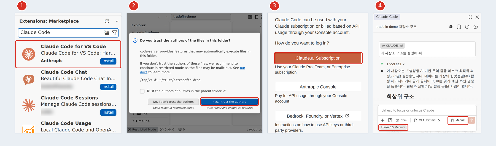
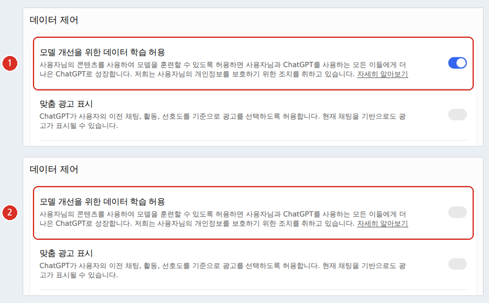

<div class="tf-hero" markdown>
<span class="tf-eyebrow">시작하기 · 개강(10/14) 전에 집에서 한 번, 당일 08:40에 강의장에서 한 번 더</span>

# 사전 준비

<p class="tf-now" data-tf-now></p>

이 과정의 실습은 **VS Code + Claude Code + Git · GitHub**, 한 작업실에서 합니다. 설치하는 프로그램은 모두 무료이고, **Claude Code를 쓰려면 유료 Claude 계정**이 필요합니다. 파이썬은 따로 설치하지 않습니다(uv가 맞는 버전을 받아 옵니다). 순서대로 따라 하면 30–40분쯤 걸립니다.

<div class="tf-meta" markdown>
<span class="tf-chip">30–40분</span>
<span class="tf-chip">Windows · macOS</span>
<span class="tf-chip">유료 Claude 계정 필요</span>
<span class="tf-chip">막히면 Codespaces</span>
</div>

<div class="tf-buttons" markdown>
[설치 시작](#dev-env){ .md-button .md-button--primary }
[계정 만들기](#accounts){ .md-button }
[데이터 위생](#hygiene){ .md-button }
[막힐 때](#stuck){ .md-button }
</div>
</div>

<div class="tf-checklist" data-title="개강 전 체크리스트 — 누르면 이 브라우저에 저장됩니다" markdown>

- [ ] **Claude 계정**이 있고 Claude Code를 쓸 수 있는 요금제다(Pro 이상 · 과정 제공 Team 좌석 · Console 중 하나) <span class="tf-chip tf-chip--must">필수</span> → [1. 계정](#accounts)
- [ ] **GitHub 계정**을 만들고 이메일 인증까지 끝냈다 <span class="tf-chip tf-chip--must">필수</span> — 1일차 오후에 전원이 내 저장소를 만듭니다 → [1. 계정](#accounts) · [5. GitHub](#github)
- [ ] **VS Code**를 설치했다 <span class="tf-chip tf-chip--must">필수</span> → [0-1](#vscode)
- [ ] **Git**을 설치하고 이름 · 이메일을 설정했다 <span class="tf-chip tf-chip--must">필수</span> — Windows는 Git for Windows → [0-2](#git)
- [ ] **uv**를 설치했다 <span class="tf-chip tf-chip--must">필수</span> → [0-3](#uv)
- [ ] VS Code에 **Claude Code 확장**을 설치하고 로그인했다 <span class="tf-chip tf-chip--must">필수</span> → [0-4](#claude-code)
- [ ] 연습으로 과정 저장소를 받아 `uv sync`를 한 번 해 봤다 <span class="tf-chip">권장</span> — 교실 Wi-Fi가 붐비지 않게 → [0-5](#clone)
- [ ] 쓰는 AI 서비스(Claude · ChatGPT)의 "학습에 사용" 설정을 껐다 → [3. 학습 설정](#ai-training)
- [ ] 접속 테스트 사이트가 모두 열린다 → [2. 접속 테스트](#connection-test)
- [ ] 회사 노트북에서 막히는 것이 없는지 확인했다(막히면 [Codespaces](#codespaces)) → [7. 회사 노트북](#company-laptop)
- [ ] 데이터 위생 5원칙과 저장소 · 앱 규칙을 읽었다 → [8. 데이터 위생](#hygiene)
- [ ] (선택) ChatGPT 계정 · 엑셀(또는 웹용 Excel)로 `.xlsx` 열기 → [1. 계정](#accounts) · [4. 엑셀](#excel)

</div>

Streamlit Community Cloud는 **미리 가입하지 않아도 됩니다** — GitHub 계정으로 로그인만 하면 되고 5일차에 함께 합니다([언제 가입하나](#account-timeline)).

## 0. 수업 환경 — VS Code · Git · uv · Claude Code {#dev-env}

1일차 오후부터 모든 실습을 이 환경에서 합니다. 아래 단계 카드를 순서대로 따라 하고, 끝난 단계는 **이 단계 완료**를 눌러 두세요(오른쪽 · 휴대폰은 아래 진행 카드에 표시됩니다). 계정(Claude 유료 · GitHub)은 [1. 계정 만들기](#accounts)에서 먼저 준비합니다. 회사 노트북에서 설치가 막히면 그 자리에서 멈추고 [막힐 때](#stuck)를 보세요 — 브라우저만 되면 [Codespaces](#codespaces)로 같은 작업실을 쓸 수 있습니다.

### 0-1. VS Code {#vscode .step data-tool="VS Code"}

VS Code는 파일 · 편집기 · 터미널 · Git · AI(Claude Code)가 한 창에 모인 무료 편집기입니다. 이 과정은 이 창을 '작업실'로 씁니다.

=== "Windows"

    1. [code.visualstudio.com/download](https://code.visualstudio.com/download)에서 **User Installer (64-bit)**를 받아 실행합니다. 관리자 권한이 필요 없습니다.
    2. 설치 마법사의 "PATH에 추가"는 켜 둔 채 기본값으로 끝까지 진행합니다.
    3. 터미널을 새로 열어 `code --version`을 입력해 버전이 나오는지 봅니다.

=== "macOS"

    1. 같은 페이지에서 macOS용 파일을 받아 **Applications** 폴더로 옮깁니다.
    2. VS Code를 열고 ++cmd+shift+p++ → `Shell Command: Install 'code' command in PATH`를 실행합니다.
    3. 터미널을 새로 열어 `code --version`으로 확인합니다.

    이 사이트의 단축키는 Windows 기준입니다. macOS에서는 **Ctrl → Cmd**, **Alt → Option**으로 누릅니다 — Ctrl 그대로인 것까지 [FAQ](faq.md#q-mac-keys)에 표로 있습니다.

이미 설치돼 있다면 **수업 전날 업데이트**합니다. 오래된 VS Code에서는 Claude Code 확장의 아이콘이 보이지 않을 수 있습니다.

!!! ok "확인"

    - [ ] 새 터미널에서 `code --version`이 버전 번호를 보여 준다

### 0-2. Git {#git .step data-tool="Git"}

Git은 파일이 바뀐 이력을 기록하는 도구입니다. GitHub은 그 이력을 온라인에 올려 두는 서비스입니다.

=== "Windows"

    [Git for Windows](https://git-scm.com/install/windows)를 받아 기본값으로 끝까지 설치합니다. 명령 창이 막혀 있지 않다면 한 줄로도 됩니다.

    ```powershell
    winget install --id Git.Git -e --source winget
    ```

    Claude Code가 명령을 실행할 때 Git Bash를 쓰므로, Windows에서는 Git for Windows를 꼭 설치합니다.

=== "macOS"

    터미널에서 `git --version`을 입력합니다. 버전이 나오면 설치된 것이고, 없으면 `xcode-select --install`로 설치합니다.

설치한 뒤 **이름과 이메일을 한 번** 정해 둡니다. 이 값은 로그인이 아니라 커밋에 찍히는 작성자 표시입니다.

```bash
git config --global user.name "내 별명"
git config --global user.email "숫자ID+아이디@users.noreply.github.com"
git config --global init.defaultBranch main
git --version
```

!!! warning "공개 저장소에는 커밋한 사람의 이름과 이메일이 그대로 보입니다"

    실명과 회사 이메일 대신 **GitHub 아이디(또는 별명)**와 GitHub이 만들어 주는 **noreply 주소**를 권합니다. GitHub → **Settings → Emails**에서 "Keep my email addresses private"를 켜면 `숫자ID+아이디@users.noreply.github.com` 모양의 주소가 보입니다. 화면의 주소를 **그대로 복사**해 위 `user.email`에 넣습니다.

(선택) 2일차에 터미널에서 PR · 이슈를 다루고 싶다면 GitHub CLI도 설치합니다 — Windows `winget install --id GitHub.cli --source winget`, macOS `brew install gh` 뒤 `gh auth login`. 없어도 GitHub 웹 화면으로 같은 일을 할 수 있습니다.

!!! ok "확인"

    - [ ] `git --version`이 버전을 보여 준다
    - [ ] `git config --global user.email`이 noreply 주소(또는 공개해도 되는 주소)다

### 0-3. uv {#uv .step data-tool="터미널"}

uv는 파이썬 설치 · 가상환경(`.venv`) · 패키지 설치 · 잠금 파일(`uv.lock`)을 한 번에 다루는 도구입니다. 과정의 모든 코드는 `uv run`으로 실행합니다.

=== "Windows"

    **PowerShell**을 열어(시작 메뉴에서 "PowerShell", 64비트) 한 줄을 실행합니다.

    ```powershell
    powershell -ExecutionPolicy ByPass -c "irm https://astral.sh/uv/install.ps1 | iex"
    ```

=== "macOS"

    ```bash
    curl -LsSf https://astral.sh/uv/install.sh | sh
    ```

설치가 끝나면 터미널과 VS Code를 **완전히 닫았다가 새로 열고** 확인합니다.

```bash
uv --version
```

!!! ok "확인"

    - [ ] 새로 연 터미널에서 `uv --version`이 버전을 보여 준다

### 0-4. Claude Code 확장 설치와 로그인 {#claude-code .step data-tool="VS Code · Claude Code"}

Claude Code는 내 폴더의 파일을 읽고, 고치고, 실행하고, 커밋까지 하는 코딩 에이전트입니다. 이 과정에서는 VS Code 확장으로 씁니다. **확장 안에 Claude Code가 들어 있어서 따로 설치할 것이 없습니다.**

1. VS Code에서 ++ctrl+shift+x++ (macOS ++cmd+shift+x++)로 확장 화면을 엽니다.
2. `Claude Code`를 검색해 게시자가 **Anthropic**인 **Claude Code for VS Code**(`anthropic.claude-code`)를 **Install**합니다. 같은 방법으로 `Python`(`ms-python.python`)과 `Jupyter`(`ms-toolsai.jupyter`)도 설치합니다.
3. 폴더를 하나 열고 파일을 하나 엽니다. 편집기 오른쪽 위의 **Spark 아이콘**(또는 아래 상태 표시줄의 "Claude Code")을 누르면 Claude Code 패널이 열립니다.
4. **Sign in**을 누르면 브라우저가 열립니다. Claude 계정으로 로그인해 승인하고 VS Code로 돌아옵니다. 로그인 뒤 "Learn Claude Code" 안내가 나오면 성공입니다.

<figure markdown="span">
  { width="680" loading=lazy }
  <figcaption>게시자가 Anthropic인지 확인하고 설치 → 패널의 Sign in으로 로그인합니다</figcaption>
</figure>

!!! warning "Claude Code는 유료 계정이 있어야 합니다"

    **무료(Free) 요금제로는 쓸 수 없습니다.** 아래 셋 중 하나가 필요합니다.

    - Claude **Pro 이상** 개인 구독
    - 과정에서 나눠 주는 **Team 좌석**(있다면 개강 전에 강사가 따로 안내합니다)
    - **Console(API)** 계정

    어느 쪽도 어렵다면 채팅(claude.ai · ChatGPT)과 GitHub 웹 화면으로 같은 실습을 하는 길이 있습니다 → [막힐 때](#stuck).

- **폴더를 열 때 "이 폴더의 작성자를 신뢰하시겠습니까?"**가 나오면 **Yes, I trust the authors**를 누릅니다. 신뢰하지 않으면(제한 모드) Claude Code 확장이 동작하지 않습니다.
- 환경변수 `ANTHROPIC_API_KEY`가 **설정돼 있지 않아야** 합니다. 설정돼 있으면 구독 대신 API 요금이 청구됩니다. 터미널에서 Windows(PowerShell)는 `echo $env:ANTHROPIC_API_KEY`, macOS는 `echo $ANTHROPIC_API_KEY`를 입력해 아무것도 나오지 않으면 됩니다.
- Claude 설정에서 "학습에 사용"을 끄는 방법은 [3. AI 학습 설정 끄기](#ai-training)에 있습니다.

!!! ok "확인"

    - [ ] Claude Code 패널에서 로그인했고 "Learn Claude Code" 안내가 보였다
    - [ ] `ANTHROPIC_API_KEY`를 출력하면 아무것도 나오지 않는다

### 0-5. 내 저장소 만들기 · clone · uv sync {#clone .step data-tool="GitHub · 터미널"}

**연습 — 개강 전에 해 두면 좋은 것 (권장).** 1일차 교실 Wi-Fi에서 20명이 패키지를 한꺼번에 받으면 느립니다. 집에서 과정 저장소를 임시로 받아 `uv sync`를 한 번 해 두면, 내려받은 패키지가 내 컴퓨터에 보관되어 1일차의 `uv sync`는 몇 초면 끝납니다.

```bash
git clone https://github.com/brainini/tradefin-ai-2026.git tradefin-warmup
cd tradefin-warmup
uv sync
uv run python scripts/hello.py
```

마지막 줄이 `환경 준비 완료 — Python 3.13.x · pandas 3.0.x`처럼 나오면 성공입니다. `tradefin-warmup` 폴더는 연습용이라 확인한 뒤 폴더째 지워도 됩니다. 처음에는 패키지를 1GB 안팎 내려받습니다(디스크 여유 3GB 이상 권장).

!!! tip "저장소 폴더는 OneDrive 밖에 둡니다"

    바탕화면 · 문서 폴더가 OneDrive로 동기화되고 있으면 `.venv`의 파일 수천 개가 동기화되며 느려지거나 오류가 납니다. `C:\work`처럼 동기화되지 않는 폴더에서 작업합니다.

**1일차 오후 — 내 저장소 (실습 A-1에서 함께 합니다).** 조 · 번호는 1일차 아침에 안내합니다.

1. GitHub에 로그인해 [`brainini/tradefin-ai-2026`](https://github.com/brainini/tradefin-ai-2026)을 열고 **Use this template → Create a new repository**를 누릅니다.
2. Owner는 내 계정, 이름은 `tradefin-my-T{조}-{번호}`(예: `tradefin-my-T2-07`), 공개 범위는 **Public**으로 **Create repository**를 누릅니다. 회사명 · 실명은 이름에 넣지 않습니다.
3. VS Code에서 ++ctrl+shift+p++ (macOS ++cmd+shift+p++) → `Git: Clone` → 내 저장소 주소(**Code → HTTPS**에서 복사)를 붙여 넣고, 저장할 폴더를 고릅니다. 처음 push할 때는 GitHub 로그인 창이 뜨며, 브라우저에서 승인하면 됩니다.
4. "복제한 저장소를 여시겠습니까?"에서 **Open**을 누르고, 작성자 신뢰를 묻는 창에서 **Yes, I trust the authors**를 누릅니다.
5. 터미널(++ctrl+grave-accent++)에서 한 번만 실행합니다.

    ```bash
    uv sync
    uv run python scripts/hello.py
    ```

    `.venv`가 만들어지고 `uv.lock`에 적힌 버전 그대로 설치됩니다. 3일차 Prophet은 `uv sync --group forecast`, 5일차 대시보드는 `uv sync --group dash`로 그날 아침에 더 받습니다.

6. 오른쪽 아래에 "이 저장소에서 권장하는 확장을 설치하시겠습니까?"가 나오면 **Install**을 누릅니다(Claude Code · Python · Jupyter).

!!! ok "확인"

    - [ ] `uv run python scripts/hello.py`가 `환경 준비 완료 — Python 3.13.x · pandas 3.0.x`를 보여 준다

### 0-6. VS Code에서 열기 — 노트북 · 권한 모드 {#open-in-vscode .step data-tool="VS Code · Claude Code"}

- **노트북(.ipynb)**을 열면 오른쪽 위 **Select Kernel → Python Environments → `.venv`**를 고릅니다. 이 저장소의 설정(`.vscode/settings.json`)이 `.venv`를 기본 파이썬으로 지정해 두었습니다. 목록에 없으면 `uv sync`를 한 뒤 ++ctrl+shift+p++ → `Developer: Reload Window`를 실행합니다.
- 터미널에서는 `python` 대신 항상 **`uv run python ...`**으로 실행합니다. 그러면 PowerShell 스크립트 실행 오류 없이 같은 환경이 쓰입니다.
- **Claude Code의 권한 모드**를 확인합니다. 패널의 입력창 아래에 현재 모드가 표시됩니다. 최신 Claude Code는 처음에 **Auto**로 시작하기도 하므로, **1일차 실습 전에 Manual**로 맞춥니다(큰 작업의 첫 프롬프트는 Plan으로 계획부터 받습니다). 모드 표시를 눌러 바꿀 수 있고, 새 대화를 열 때마다 처음에 한 번 확인하는 것이 좋습니다(Codespaces는 Plan으로 시작하도록 설정돼 있습니다).

| 모드(VS Code 표시) | AI가 묻지 않고 하는 일 | 언제 쓰나 |
|---|---|---|
| **Manual** | 읽기만 합니다. 파일 수정 · 명령 실행은 매번 승인을 받습니다 | 1일차 기본 · 중요한 파일 |
| **Plan** | 읽고 계획만 세웁니다. 승인하기 전에는 파일을 바꾸지 못합니다 | 여러 단계 작업의 시작 |
| Edit automatically | 파일 수정은 묻지 않고 합니다 | 익숙해진 반복 작업(2일차부터) |
| Auto | 별도 검토 모델이 사람 대신 판단합니다 | 강사 시연으로만 보여 드립니다 |

- 처음에는 Plan으로 계획을 읽고, 고칠 곳이 있으면 Manual에서 바뀌는 내용(diff)을 읽은 뒤 **승인**합니다. 승인하기 전에 읽는 습관이 이 과정의 안전장치입니다.
- (선택) 어느 저장소를 열든 같은 모드로 시작하게 하려면 VS Code의 **Settings**(왼쪽 아래 톱니바퀴)에서 `Claude Code: Initial Permission Mode`를 검색해 목록의 `plan`(또는 `manual`)을 고릅니다. 이 설정에는 Auto가 없습니다.
- 연결이 잘 됐는지 보려면 패널에 `이 프로젝트가 무엇을 하는지 설명해 줘`를 보내 봅니다. 폴더의 `CLAUDE.md`를 읽고 한국어로 답하면 됩니다.

!!! ok "확인"

    - [ ] 입력창 아래 모드 표시가 **Manual**이다
    - [ ] `이 프로젝트가 무엇을 하는지 설명해 줘`에 한국어로 답한다

### 0-7. 첫 커밋 {#first-commit .step data-tool="VS Code · GitHub"}

1일차 실습 A-1에서 `CLAUDE.md`에 내 규칙을 더한 뒤 첫 커밋을 합니다. 순서는 이렇습니다.

1. 왼쪽 **소스 제어** 아이콘(++ctrl+shift+g++)을 누르면 바뀐 파일이 보입니다. 파일을 누르면 바뀐 줄(diff)이 나란히 보입니다.
2. 커밋할 파일 옆의 **+**(Stage Changes)를 누릅니다.
3. 메시지 칸에 씁니다 — 첫 줄 `1일차: 무엇을 했다`, **한 줄 비우고**, `왜: 이유`. 빈 줄이 있어야 `git log --oneline`에 첫 줄만 보입니다. **Commit**을 누릅니다.
4. **Sync Changes**(또는 **Publish Branch**)를 눌러 GitHub에 올립니다(push). 처음에는 GitHub 로그인 창이 뜹니다.
5. github.com에서 내 저장소를 열어 커밋이 보이는지 확인합니다.

Claude Code에게 시킬 수도 있습니다: `바뀐 내용을 요약해 커밋하고 push 해 줘`. 승인 창이 뜨면 명령과 바뀐 내용을 읽고 승인합니다. 커밋 전에 새 파일의 이름과 내용을 한 번 보는 것은 같습니다 → [저장소 · 앱 규칙](#repo-hygiene).

!!! ok "확인"

    - [ ] github.com의 내 저장소에서 방금 한 커밋이 보인다

### 0-8. 매일 아침: 그날 파일 받기 {#daily-files}

내 저장소는 템플릿으로 만든 **새 저장소**라서 과정 저장소와 이력이 이어져 있지 않습니다. 그래서 `git pull`로는 새 파일이 오지 않습니다. 매일 아침 터미널에서 실행합니다.

```bash
uv run python tools/get_day_files.py 1    # 1~6 중 오늘 일차
```

- 그날 파일을 **같은 경로**(예: `data/checkpoints/d2_start.xlsx`)로 내려받고, 실습에서 고쳐 쓸 데이터 파일(`data/`의 표 · JSON — 5일차는 요구사항 카드 · 톤 표)은 `workbench/day2/data/`처럼 **작업 사본**도 만듭니다. 원본은 고치지 않고 사본에서 작업합니다. 프롬프트 · 양식 · 완성본 · 비교 기준은 사본 없이 원본 자리에서 읽습니다.
- 이미 있는 파일은 덮어쓰지 않습니다. 같은 명령을 다시 실행하면 새로 열린 파일만 더 받습니다. 목록만 보려면 뒤에 `--list`를 붙입니다.
- **[열기 전]** 은 정한 시각에 여는 파일입니다 — 전날 결과가 든 다음 날 시작 파일, 완성본, 비교 기준(정답), 실습 시각에 맞춰 여는 파일이 그렇습니다. 여는 시각과 이유는 줄 끝 괄호에 나옵니다. 그 시각이 지난 뒤 같은 명령을 다시 실행하면 받습니다(꼭 필요하면 `--now` — 비교 기준은 먼저 내 결과를 만든 뒤에). 시각은 [과정 소개 → 자료는 언제 열리나](course.md#release)에 있습니다.
- 6일차 위기 카드처럼 **정한 시각에 자동으로 올라오는 파일**은 출력 끝의 **자동 공개 시각** 목록에 나옵니다. 그 시각이 지난 뒤 다시 실행하세요. 시각이 지났는데 아직 올라오지 않았으면 맨 끝 줄에 그렇게 알려 줍니다 — 1–2분 뒤 다시 실행합니다.
- 인터넷이 막혀 있으면 과정 사이트 각 일차 쪽의 **파일 받기** 카드에서 직접 내려받습니다.

### 0-9. 설치가 막힌 PC라면 — GitHub Codespaces {#codespaces}

Codespaces는 GitHub이 빌려주는 클라우드 컴퓨터에서 브라우저로 VS Code를 쓰는 서비스입니다. 이 저장소에는 설정(`.devcontainer`)이 들어 있어서 Python 3.13 · uv · 확장 3종이 알아서 준비되고 `uv sync`까지 끝난 작업실이 열립니다.

1. 내 저장소(`tradefin-my-T{조}-{번호}`)를 열고 초록색 **Code** 버튼 → **Codespaces** 탭 → **Create codespace on main**을 누릅니다.
2. 처음 만들 때는 몇 분 걸립니다. 브라우저에 VS Code가 열리고 터미널에서 `uv sync`가 끝나면 준비된 것입니다.
3. Claude Code 패널에서 **Sign in** — 로그인 뒤 VS Code로 돌아오지 못하면 브라우저에 표시된 코드를 패널에 붙여 넣습니다. 권한 모드 확인은 [0-6](#open-in-vscode)과 같습니다.
4. 쓰지 않을 때는 왼쪽 아래 **Codespaces** 표시 → **Stop Current Codespace**로 멈춥니다.

개인 무료 계정은 한 달에 코어 시간 120시간(2코어 머신이면 약 60시간)을 쓸 수 있습니다. 비상용으로만 쓰고, 일을 마치면 멈춥니다. 저장소 만들기부터 막혔다면 github.com에서 템플릿으로 저장소를 만든 뒤 바로 Codespaces를 열면 됩니다.

### 0-10. 자주 막히는 곳과 대체 경로 {#stuck}

| 증상 | 이렇게 |
|---|---|
| `uv`(또는 `git`, `code`)를 찾을 수 없다 · "인식되지 않습니다" | 터미널과 VS Code를 완전히 닫았다가 새로 엽니다. 그래도 안 되면 설치를 다시 합니다 |
| Claude Code 아이콘(Spark)이 안 보인다 | 파일을 하나 엽니다 → VS Code를 업데이트합니다 → ++ctrl+shift+p++ → `Developer: Reload Window` → 폴더 신뢰(제한 모드가 아닌지) |
| 로그인 창이 안 뜨거나 로그인 뒤 돌아오지 않는다 | 브라우저 팝업을 허용하고 다시 누릅니다. 돌아오지 않으면 브라우저에 표시된 코드를 패널에 붙여 넣습니다 |
| 구독 중인데 API 요금이 청구된다 | 환경변수 `ANTHROPIC_API_KEY`를 지우고 패널에서 `/logout` → `/login` |
| `uv sync`가 실패한다(네트워크 · 보안 프로그램) | 회사 망이 pypi.org · github.com을 막는 경우가 많습니다. 개인 노트북이나 Codespaces로 |
| 노트북 커널 목록에 `.venv`가 없다 | `uv sync`를 먼저 한 뒤 Reload Window. 그래도 안 되면 노트북 대신 스크립트(`.py`)로 같은 일을 합니다 |
| push가 거부된다 · 로그인을 묻는다 | VS Code 왼쪽 아래 계정 아이콘에서 GitHub에 로그인합니다. `GH007 ... private email`이면 `git config --global user.email`을 noreply 주소로 바꾸고 다시 커밋합니다 |
| Claude Code 계정이 없다 | claude.ai(또는 ChatGPT)에 파일을 올려 같은 질문을 하고, 결과를 GitHub 웹 화면(**Add file → Upload files**)으로 올립니다. 강사 화면을 함께 보며 진행합니다 |
| GitHub 로그인이 안 된다 | 결과 파일을 USB나 메신저로 강사에게 전달하고, 다음 날 아침 시작 파일로 합류합니다 |

## 1. 계정 만들기 {#accounts}

가능하면 **집에서 미리** 만들어 오세요. 강의장에서 여럿이 한꺼번에 가입하면 추가 인증을 요구할 수 있습니다.

| 계정 | 필요 | 만드는 곳 | 주의 |
|---|---|---|---|
| Claude | **필수** | [claude.ai](https://claude.ai) | 가입할 때 휴대폰 **문자(SMS) 인증**이 필요합니다. 인터넷 전화 · 가상번호 · 유선전화 번호는 안 되고, 한 번호로 최대 3개 계정까지 만들 수 있습니다. **Claude Code는 무료 요금제로 쓸 수 없습니다** — Pro 이상 개인 구독, 과정 제공 Team 좌석(안내가 있을 때), 또는 Console(API) 계정이 필요합니다 → [0-4](#claude-code) |
| GitHub | **필수** | [github.com](https://github.com/signup) | **1일차 오후에 전원이** 이 과정 저장소로 내 저장소를 만들고 첫 커밋을 합니다. 5일차에는 같은 계정으로 Streamlit 앱을 배포하고, 6일차에는 팀 저장소를 만듭니다. 가입 → **이메일 인증**까지 집에서 끝내 오세요. 사용자 이름(아이디)은 공개되므로 회사명은 넣지 않기를 권합니다 → [5. GitHub](#github) |
| ChatGPT | 선택(권장) | [chatgpt.com](https://chatgpt.com) | 같은 결과를 다른 AI로 교차 확인할 때 씁니다(**ChatGPT 또는 Claude 웹** 중 하나면 됩니다). 무료 계정은 파일 업로드가 **하루 3개**라 실습량에 부족할 수 있어 Claude를 먼저 쓰고, ChatGPT는 강사 공용 프로젝트(초대 링크는 당일 안내) 또는 유료 개인 계정이 있을 때 씁니다 |
| Google | 선택 | [accounts.google.com](https://accounts.google.com/signup) | 제출 폼(Google Forms)을 열고 기획서를 Google Docs로 쓸 때만 필요합니다(Word로 써도 됩니다). **개인 계정**을 권합니다 — 회사 계정은 외부 폼 · 문서 공유가 막혀 있는 경우가 있습니다 |
| Streamlit Community Cloud | **필수**(5일차) | [share.streamlit.io](https://share.streamlit.io) | 따로 가입하지 않고 **GitHub 계정으로 로그인**(Continue with GitHub)하면 됩니다. 5일차 실습 B6에서 함께 합니다 → [6. 도구(5일차)](#day5-tools) |

### 언제 가입하나 — 날짜별 계정 달력 {#account-timeline}

| 언제 | 무엇 | 왜 그때 |
|---|---|---|
| **개강 전(집에서)** | Claude(유료) · **GitHub(이메일 인증까지)** · (선택) ChatGPT | 강의장에서 여럿이 한꺼번에 가입하면 추가 인증을 요구할 수 있습니다 |
| 5일차 실습 B6(16:10) | Streamlit Community Cloud | GitHub로 로그인만 하면 됩니다(미리 해 두어도 됩니다) |

!!! tip "모델은 이름보다 계층과 일의 종류로 고릅니다"

    모델 이름과 메뉴 위치는 자주 바뀝니다(개강일 10/14에도 ChatGPT에서 모델 하나가 퇴역합니다). 실습 안내는 이름보다 **계층**(최상위 · 주력 · 경량)과 **일의 종류**(빠른 답 · 생각한 뒤 답)로 적습니다. 화면에 보이는 이름이 안내와 달라도 같은 계층에서 일에 맞게 고르면 됩니다.

## 2. 접속 테스트 {#connection-test}

회사 망에서는 막혀 있는 경우가 많습니다. 아래 주소를 **실습할 노트북**에서 하나씩 열어 보세요.

| 주소 | 무엇에 쓰나 | 이렇게 확인 | 막히면 |
|---|---|---|---|
| code.visualstudio.com · marketplace.visualstudio.com | VS Code 설치 · 확장(Claude Code · Python · Jupyter) 설치 | 다운로드 쪽이 열리는지 | 개인 노트북 또는 [Codespaces](#codespaces) |
| astral.sh · pypi.org · files.pythonhosted.org | uv 설치 · `uv sync`(패키지 받기) | 브라우저로 세 주소가 열리는지 | [Codespaces](#codespaces) |
| github.com · raw.githubusercontent.com | 내 저장소 만들기 · clone · push · 그날 파일 받기 | 로그인 → 오른쪽 위 내 아이콘이 보이는지 | 짝과 한 화면으로, [Codespaces](#codespaces) |
| claude.ai | Claude 채팅 · Claude Code 로그인 | 로그인 → 새 채팅 → 입력창의 클립(＋) 아이콘이 보이는지 | 짝의 화면으로 |
| chatgpt.com | (선택) ChatGPT | 로그인 → 새 채팅 | Claude로 |
| [brainini.github.io/tradefin-ai-2026](https://brainini.github.io/tradefin-ai-2026/) | 이 사이트 · 파일 받기 | 1일차 → 파일 받기 → 파일이 내려받아지는지 | 강사가 USB · 오픈채팅으로 배포 |
| docs.google.com (Google Forms) | 내 저장소 주소 제출 | 제출 폼 링크가 열리는지 | 오픈채팅으로 저장소 주소 전달 |
| www.sec.gov · data.sec.gov | (선택) 1일차 공시 원문 확인 | 브라우저로 www.sec.gov가 열리는지 | 보고서 발췌(`reports/`)와 비율표 `real_buyers_ratios.csv`로 진행 |
| share.streamlit.io | 5일차 대시보드 배포 | 첫 화면이 열리는지 | 강사 앱 주소로 진행 |
| api.frankfurter.dev | 5일차 실시간 환율 | 브라우저로 주소가 열리고 JSON이 보이는지 | 괜찮습니다 — 저장된 환율 파일(`fx_krw_daily.csv`)로 진행합니다 |

## 3. AI 학습 설정 끄기 {#ai-training}

무료 · 개인 요금제에서는 대화 내용이 AI 학습이나 사람 검토에 쓰일 수 있습니다. 실습 데이터는 가상이지만, **설정부터 확인하는 습관**을 먼저 들입니다. (메뉴 이름은 2026-10 기준이며 화면 언어 · 버전에 따라 조금 다를 수 있습니다.)

=== "ChatGPT"

    1. chatgpt.com 왼쪽 아래 **내 이름(프로필 아이콘)**을 누릅니다(화면 버전에 따라 오른쪽 위에 있을 수 있습니다).
    2. **설정** → **데이터 제어**를 엽니다.
    3. **모델 개선을 위한 데이터 학습 허용**(계정 화면에 따라 '모든 사람을 위한 모델 개선', Improve the model for everyone)을 끕니다.
    4. 민감한 내용을 다룰 때는 **임시 채팅**(Temporary chat)을 씁니다. 임시 상태인 동안은 학습에 쓰이지 않습니다.

    !!! warning "👍/👎 피드백 버튼은 누르지 않기"

        학습 설정을 꺼도 답변에 👍/👎 피드백을 보내면 그 대화 전체가 학습에 쓰일 수 있습니다.

=== "Claude"

    1. claude.ai 왼쪽 아래 **내 이름(프로필)** → **설정**(Settings)을 엽니다.
    2. **개인정보 보호**(Privacy) 화면으로 갑니다.
    3. **Claude 개선에 도움 주기**(Help improve Claude)를 끕니다. 허용하면 대화가 학습에 쓰이고 보관 기간이 5년으로 늘어납니다(허용하지 않으면 30일).
    4. 민감한 내용을 다룰 때는 **시크릿 채팅**(Incognito chat)을 씁니다. 무료에서도 됩니다.

    Claude Code도 같은 계정의 이 설정을 따릅니다.

<figure markdown="span">
  { width="680" loading=lazy }
  <figcaption>데이터 제어 메뉴 — '모델 개선(학습)'은 끄고 시작합니다</figcaption>
</figure>

회사가 정한 다른 AI 서비스를 쓰게 되면 같은 방식으로 '대화를 학습에 쓰기' · '활동 기록' 설정부터 찾아 끄고 시작합니다.

!!! danger "무료 API는 앱과 다릅니다"

    개발자용 **무료 API**에 넣은 내용은 제품 개선에 쓰이고 사람이 검토할 수 있는 서비스가 많습니다. 실데이터는 넣지 않습니다(데이터 위생 2원칙).

## 4. 엑셀 {#excel}

엑셀(또는 **웹용 Excel** — 무료 Microsoft 계정으로 office.com에서 실행)로 `.xlsx` 파일을 열 수 있으면 충분합니다. 실습의 엑셀 단계는 피벗 · 수식을 손으로 만드는 일이 아니라, 과정이 주는 **완성본 엑셀을 열어 AI 결과와 견주는 일**입니다.

- 내려받은 파일을 열 때 노란 띠(제한된 보기)가 뜨면 **편집 사용**을 누릅니다. 과정 엑셀 파일에는 매크로가 없습니다.
- 내 엑셀 버전 보는 곳: **파일** → **계정** → **Excel 정보**. 완성본의 수식(XLOOKUP 등)은 Microsoft 365 · Excel 2021 이후 · 웹용 Excel에서 그대로 계산됩니다. 그보다 오래된 판에서는 저장된 값으로 보입니다.
- Google Sheets도 열리지만 메뉴와 수식 표기가 안내와 달라 권하지 않습니다.
- CSV 파일이 깨져 보이면 [FAQ의 CSV 한글 깨짐](faq.md#q-csv)을 보세요. 과정 CSV는 UTF-8(BOM 포함)이라 보통 바로 열립니다.

## 5. GitHub 계정과 내 저장소 {#github}

1일차 오후(실습 A-1)에 **전원이** 이 과정 저장소로 내 저장소를 만들고 첫 커밋을 합니다. 만드는 순서는 [0-5](#clone), 커밋하는 순서는 [0-7](#first-commit)에 있습니다. 여기서는 미리 확인할 것만 적습니다.

<div class="tf-checklist" data-title="GitHub 미리 확인" markdown>

- [ ] github.com에 로그인된다(비밀번호 · 이메일 인증 완료)
- [ ] 2단계 인증(2FA) 설정 안내가 나오면 그대로 따라 설정했다(휴대폰 인증 앱 또는 패스키)
- [ ] 사용자 이름(아이디)에 회사명 · 실명이 들어 있지 않다 — 아이디는 공개되고 커밋에도 보입니다
- [ ] 회사 노트북에서 github.com이 열린다 — 막히면 개인 노트북이나 짝의 화면, 또는 [Codespaces](#codespaces)로 합니다(회사 규정을 어기며 우회하지 않습니다)

</div>

- 저장소 이름은 `tradefin-my-T{조}-{번호}`(예: `tradefin-my-T2-07`)입니다. 조 · 번호는 1일차 아침에 안내합니다.
- 저장소는 **공개(Public)가 기본**이라 **가상 데이터만** 올립니다. 비공개로 하고 싶다면 비공개로 만들고 강사 계정을 협업자로 추가합니다(**Settings → Collaborators**). 어느 쪽이든 자사 자료는 올리지 않습니다 → [저장소 · 앱 규칙](#repo-hygiene).
- 웹 화면만으로도 파일을 올리고 고칠 수 있습니다 → [기초 F2](foundations/f2.md#first-commit).

## 6. 도구(5일차) — Claude Code · Git/GitHub · Streamlit · uv {#day5-tools}

5일차에 새로 가입할 곳은 없습니다 — **Claude · ChatGPT · GitHub 계정**(이미 있음)과 VS Code의 **Claude Code**로 합니다. 요금제별 사용 한도는 자주 바뀌니 개강 전에 계정 화면에서 한 번 확인하세요.

| 도구 | 가입 | 알아 둘 것 |
|---|---|---|
| **Claude Code**(VS Code 확장) | 1일차에 로그인 | 큰 작업의 첫 프롬프트는 Plan, 승인 창은 `2 Yes, and manually approve edits`. 입력창 아래 모드 표시를 매번 확인 |
| **Claude · ChatGPT 프로젝트** | 이미 있는 계정 | 실습 A 기준선 — 규정 PDF + 지침 칸. 골든셋 파일은 올리지 않음 |
| **uv · pytest** | 1일차에 설치 | `uv sync --group dash`(streamlit)로 5일차 패키지를 받고 `uv run pytest app/tests -q`로 검사 |
| **Streamlit Community Cloud** | GitHub로 로그인(Continue with GitHub) | **내 개인 저장소의 `main`**을 배포합니다. 12시간 접속이 없으면 잠들고(깨우기 버튼 → 1–2분), 비공개 앱은 계정당 1개라 **공개 저장소 + 합성 데이터**로 만듭니다 → [배포 순서](course.md#streamlit) |
| **앱의 AI 키(선택)** | 가입 없음 — 강사가 안내할 때만 | 실습은 키 없이(모의 모드). 키는 Streamlit Secrets 칸에만 → [키 규칙](course.md#llm-key) |

## 7. 회사 노트북 점검 {#company-laptop}

| 확인할 것 | 막히면 |
|---|---|
| AI 사이트(claude.ai · chatgpt.com) 접속 | 개인 노트북을 가져오거나, 옆 사람과 한 화면으로 페어 실습 |
| VS Code · Git · uv 설치(관리자 권한 없이 설치되는 파일을 씁니다) · 확장 마켓플레이스 접속 | [Codespaces](#codespaces) — 브라우저만 되면 같은 작업실이 열립니다 |
| `uv sync`가 패키지를 받는지(pypi.org · github.com이 막히지 않았는지) | [Codespaces](#codespaces) 또는 개인 노트북 |
| 매크로 · 외부 파일 차단(엑셀 '제한된 보기' 노란 띠) | 내려받은 파일을 연 뒤 **편집 사용**을 누릅니다(과정 파일에는 매크로가 없습니다) |
| 회사 규정상 외부 AI에 회사 자료 업로드 금지 | 실습은 가상 데이터만 씁니다. 내 프로젝트는 **구조만 옮기기** — 컬럼 이름 · 행 수만 같은 가상 데이터로 연습합니다 |
| github.com · share.streamlit.io 차단 | 개인 노트북 또는 짝의 화면으로 진행하고, 결과 파일은 강사 체크포인트로 합류합니다 |

## 8. 데이터 위생 5원칙 — 'AI 대화창은 외부 채널이다' {#hygiene}

AI 대화창에 무언가를 붙여넣는 순간 그 데이터는 회사 밖으로 나간 것입니다. 외부로 이메일을 보내는 것과 같습니다.

<div class="tf-rules" markdown>

1. **실습은 가상 데이터와 공개 공시만** — (가상) 한빛정밀(주) · Halden은 교육용 가상 회사이고, 공시는 공개 자료입니다.
2. **회사 실데이터 · 개인정보는 올리지 않는다 — 익명화본도** — 담당자 이름 · 이메일 · 계좌는 개인정보입니다. 무료 AI · 무료 API(입력을 사람이 검토하거나 제품 개선에 쓰는 서비스)에는 더더욱 안 됩니다.
3. **AI 서비스의 '모델 개선(학습)' 설정은 끄고 시작한다** — 방법은 [3. AI 학습 설정 끄기](#ai-training). 민감한 내용은 임시(시크릿) 채팅으로.
4. **내 저장소는 공개 — 키 · 비밀번호 · 회사 자료는 커밋하지 않는다** — 비밀번호 · 키 · 계좌는 대화창에도 붙여넣지 않습니다.
5. **AI 결과는 검증 전까지 초안** — 인용은 원문에서, 숫자는 계산 근거와 코드로 직접 다시 확인한 뒤 씁니다.

</div>

법 해석이 필요한 판단(개인정보 국외 이전, 계약상 비밀유지 등)은 회사 법무 · 보안 담당에게 확인하세요.

!!! warning "회사 보안 규정이 우선입니다"

    회사에 보안 규정이 있다면 그것이 이 다섯 원칙보다 먼저입니다.

### 저장소 · 앱 · 폼에 올릴 때 — 1일차 오후부터 {#repo-hygiene}

1일차 오후부터는 결과를 **GitHub 저장소와 공개 앱**에 올립니다. 대화창보다 더 넓게 공개되는 곳이 있습니다.

<div class="tf-stack" markdown>

| 어디에 | 올려도 되는 것 | 올리면 안 되는 것 |
|---|---|---|
| 개인 저장소 `tradefin-my-…` (공개가 기본) | 과정의 가상(합성) 데이터, 내가 쓴 규칙 · 프롬프트 · 데이터 사전 · 결과 파일 | 회사 실데이터(**익명화본 포함**) · 회사 문서 · API 키 · 비밀번호 · `secrets.toml` · `.env` · 이름 · 이메일 · 계좌 |
| 팀 저장소 `tradefin-kit-T{조}` (비공개 · 팀원과 강사는 협업자) | 가상 한빛정밀 데이터로 만든 솔루션 킷 | 위와 같음 + 개인 도입 기획서 · ROI 시트 |
| Streamlit 공개 앱 | 합성 데이터 | 실데이터 |
| 제출 폼(비공개) | 개인 도입 기획서 · ROI 시트 · 사후 진단 | 익명화하지 않은 자사 자료 · 담당자 연락처 |

</div>

- **이름 규칙**: 저장소 · 파일 · 커밋 메시지에 실명 · 회사명 · 고객사명을 쓰지 않습니다(예: `tradefin-my-T2-07`). 커밋 작성자 이름과 이메일도 공개되므로 GitHub 아이디와 noreply 주소를 씁니다([0-2](#git)).
- **`.gitignore`는 웹 업로드를 막지 못합니다.** 템플릿에 `secrets.toml` · `.env` · `private/` 폴더를 막는 설정이 들어 있지만, GitHub 웹 화면의 **Upload files**는 고르는 대로 다 올립니다. 올리기 전에 파일 이름과 내용을 한 번 더 봅니다.
- **Claude Code가 만든 파일도 같습니다.** 커밋하기 전에 소스 제어 화면에서 새 파일의 이름과 내용을 한 번 봅니다. 파일을 지우거나 덮어쓰는 명령은 승인하기 전에 읽습니다.
- **한 번 커밋한 내용은 지워도 이력(History)에 남습니다.** 실수로 올렸다면 파일만 지우고 끝내지 말고 바로 강사에게 알립니다. 키였다면 키부터 교체합니다.
- **키는 Secrets 칸에만**: API 키는 Streamlit Secrets 칸에만 넣습니다. 노출되면 즉시 알리고 교체합니다.
- **메일은 DRY RUN**: 실습의 독촉 · 통지 메일은 초안과 승인 기록까지만 만들고 실제로 보내지 않습니다.

### 내 업무 숫자를 쓰고 싶다면 — 익명화 체크리스트 {#byod}

과정 중 AI 도구(ChatGPT · Claude · Claude Code)와 공개 저장소에는 회사 실데이터를 올리지 않습니다 — 익명화본도. 내 업무의 숫자는 아래 두 곳에서만, 체크리스트를 **모두** 통과한 값으로 씁니다.

1. 내 PC의 `private/` 폴더에서 엑셀 · 내 PC의 스크립트로 직접 계산해 보는 사본(커밋 금지).
2. 6일차 개인 도입 기획서 · KPI · ROI의 자사 숫자(비공개 폼으로만 제출).

과정이 끝난 뒤 회사가 허용한 AI 도구로 내 업무에 적용할 때도 같은 기준을 씁니다.

| 원본 칸 | 이렇게 바꾼다 |
|---|---|
| 바이어명 · 담당자명 · 이메일 · 전화 | 지우고 `BUYER_001` 같은 코드로 바꾼다. 코드 ↔ 실제 이름 대응표는 내 PC에만 두고 올리지 않는다 |
| 국가 | 그 나라 바이어가 3곳 미만이면 권역(예: 동남아)으로 올린다 |
| 금액 | 파일마다 비밀 배수(0.5~2.0 사이 아무 수)를 곱하거나 구간(예: 1만~5만 달러)으로 바꾼다 |
| 날짜 | 바이어별로 같은 날수(0~90일)만큼 옮긴다 — 연체일 · 결제기간 같은 '간격'은 그대로 유지된다 |
| 인보이스 · L/C · B/L 번호 | 1, 2, 3 … 순번으로 새로 매긴다 |
| 메모 · 메일 본문 같은 자유 서술 | 지우거나 분류 코드로 바꾼다(예: 분쟁 사유 = 품질/수량/서류/가격) |
| 은행 · 계좌 정보 | 완전히 지운다 |

<div class="tf-checklist" data-title="마지막 확인 4가지" markdown>

- [ ] 파일 안에서 회사 이름 · 이메일 도메인을 검색(++ctrl+f++)해 0건이다
- [ ] 한 행만 보고 어느 회사인지 알 수 없다(국가 + 업종 + 금액 조합으로도)
- [ ] 회사 보안 규정 · NDA(비밀유지계약)에 어긋나지 않는다
- [ ] 쓰려는 AI 서비스의 학습 설정을 껐다

</div>

!!! danger "이런 곳에는 실데이터를 올리지 않습니다"

    - 무료 소비자 AI에 **원본** 업로드 — 프롬프트 · 대화를 사람 검토자가 볼 수 있는 서비스
    - 입력이 제품 개선에 쓰이거나 사람이 검토할 수 있는 무료 API
    - Tableau Public · Flourish처럼 결과가 **공개 게시**되는 도구
    - K-SURE · D&B 신용조사 보고서 **원문**(재배포 · AI 입력 조건을 확인하지 못했습니다)

!!! failure "실수로 실데이터를 올렸다면"

    1. 그 대화를 바로 삭제합니다.
    2. 강사 · 도우미에게 알립니다(비난하지 않습니다. 기록만 합니다).
    3. 가상 데이터로 바꿔 계속합니다.
